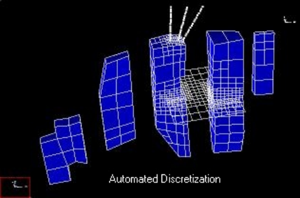
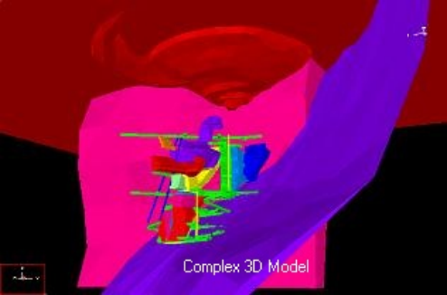
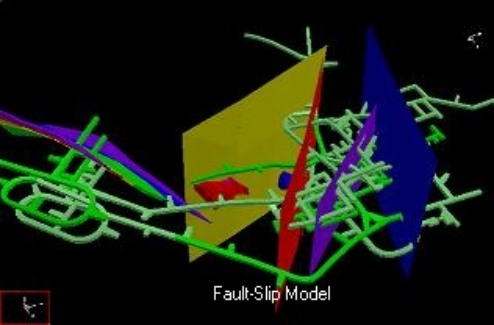
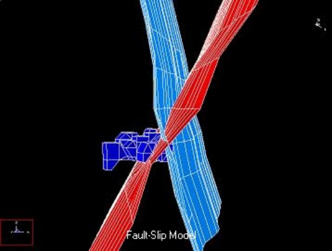
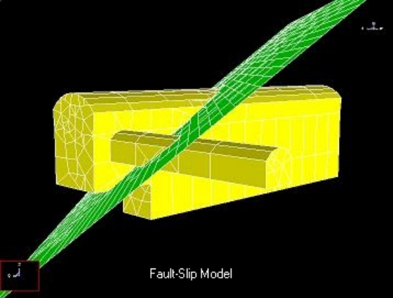

**Map3D Fault-Slip** - 弹性岩体与完全塑性断层滑移应力分析。

该模块用于对三维模型进行应力分析，适用于土木、地质和采矿项目。

包含三维 CAD 建模器（Map3D Modeller）、结果查看器（Map3D Results Viewer）和 GIS 可视化数据库。

应力分析采用 BEM（边界元法），具有多项特性：

- 超大问题规模。Map3D 可对含有数千个开挖体的模型（超过一百万个自由度）进行应力分析。这样可以详细表示几何形状，无需简化大型模型（过度简化是建模误差的主要来源）。可轻松模拟全矿范围的模型。

- 完整的三维复杂开挖形状。可轻松分析竣工详细模型和复杂的三维形状。由于应力分析基于边界元法（BEM），只需指定开挖体（及其他特征）的表面，无需定义（划分单元）相邻开挖体之间的矿柱。任意形状都可轻松组合成一个待分析的大型模型。

- 具有不同模量的多个弹性区（刚性岩脉或软矿石）。Map3D 完全支持引入不同的材料区，便于考虑刚性或软弱岩石类型。

- 具有不同采前应力状态的区域。

- 带屈服矿柱的板状开采。这种近似通常适用于大型窄脉矿山。

- 以弹-黏-塑性方式滑移和膨胀（包括蠕变）的离散非平面断层面。这些特征采用位移不连续法实现。程序采用弹-黏-塑性流动法则，以适应多种不同类型的行为。可轻松进行采矿和地震模拟的断层滑移分析。

- 可模拟裂纹和裂隙，包括能量释放率和应力强度计算。裂隙扩展可模拟为一系列离散步骤。

- 考虑充填体放置或裂纹扩展等影响需要多个采矿步。Map3D 目前支持 40 步。可在任意阶段将各种材料替换到开挖体或裂隙中。

- 自动布尔相交功能允许开挖体、断层和裂隙相互交叉和重叠。没有这一功能，对于复杂模型，几乎无法对相交特征进行建模。Map3D 可轻松处理这些情况。

- 自动离散。模型可根据需要手动离散，也可交由程序内置的自动化例程完成。这些例程确保仅在需要之处加密单元，在优化分析时间的同时始终保持高精度。

Map3D Fault-Slip 提供免费演示版。除只允许运行小规模问题外，所有功能均可使用。该版本非常适合用于教学建模、可视化和三维 CAD 的基础知识。

Map3Di 集成地震活动性
