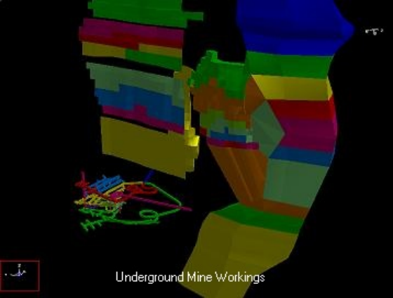
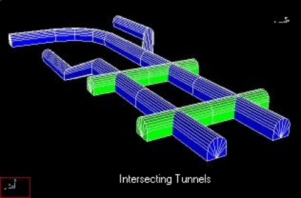
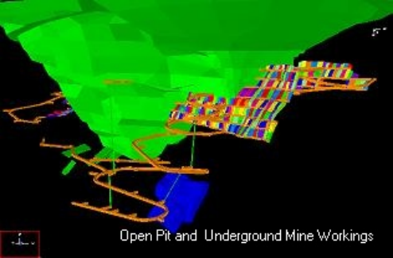
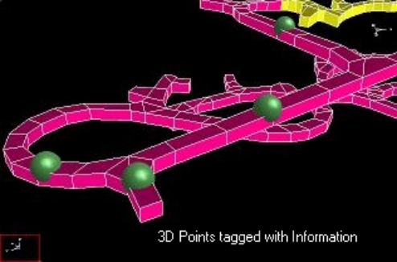
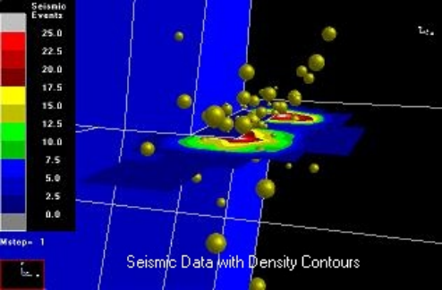

**Map3D Modeller** - 三维 CAD 和 GIS 可视化数据库。

该模块用于构建和可视化三维模型，适用于土木、地质和采矿项目。

易于使用的三维 CAD（基于 OpenGL）系统支持徒手绘制、数字化或对象拾取，用于构建和编辑 5 种基本实体类型：

- 三维块体。这些实体用于构建采场、矿体、岩脉和巷道。最简便的方法是定义一系列横截面或水平

平面图（每个可具有不同的形状和不同数量的点）。Map3D 可根据需要轻松简化这些轮廓，然后在各轮廓环之间插值，形成复杂的三维形状。

- 二维特征。这些实体用于构建断层、板状采矿、地表地形和裂隙。这些特征无需是平面。完全支持弯曲和错断的裂隙和断层。

- 网格平面。可定义横截面，用于绘制等值线或对模型进行切片。

- · 网格线。这些对于表示钻孔和地层支护的位置特别有用。可轻松识别仪器的位置和方向。

- 构造线。巷道中心线等简单测量数据最适合用构造线表示。这样可轻松与其他 CAD 软件包导入/导出（完整支持 dxf 和 pnt），也是显示线数据的快捷方式。

- 光源着色模型。支持 OpenGL 光源着色，以增强模型表现力。

包含全套编辑功能，包括复制、移动、拉伸、展平、缩放、旋转等，便于对上述实体进行图形化操作。

GIS 可视化数据库可用于存储、分析和显示任何所需信息的数据库，包括地震数据以及品位、岩体质量等地质信息。

三维点可标记以下一系列内容：

- 数值（例如颜色、震级、方向、时间等），

- 关键字（用于过滤），

- 文本信息，

- 文件名（例如图形文件、文档、电子表格、图纸等）。

这些项目的显示可通过多种方式过滤。每个点的位置可显示为彩色着色球体，其大小和颜色可根据各种参数组合缩放。可根据用户定义的密度函数，在平面上绘制点震级密度的等值线。等值线平面可由用户定义，也可通过自动线性回归拟合。

Map3D Results Viewer
