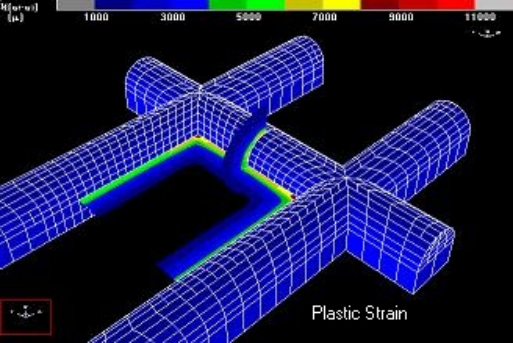
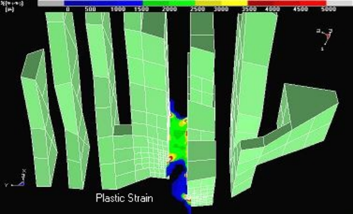
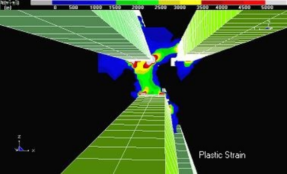
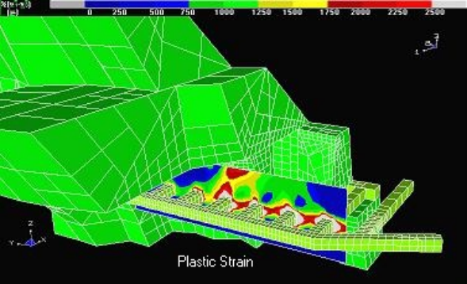

**Map3D Non-Linear** - 非线性岩体响应。

包含 Map3D Fault-Slip 的全部功能，并增加了三维岩体在荷载超过岩石强度时发生屈服、并通过非线性变形耗散多余应力的能力。该功能适用于模拟厚矿层、超应力矿柱、拱座、充填体和蠕变响应。该公式在边界单元表面上求解非线性问题，并在这些边界之间插值这些效应。这是非弹性建模的一阶近似，其优势在于问题规模大、执行速度非常快。

Map3D Visco-Plastic
