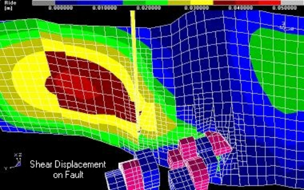
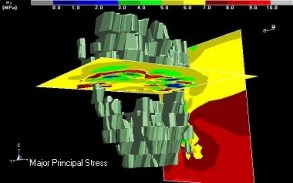
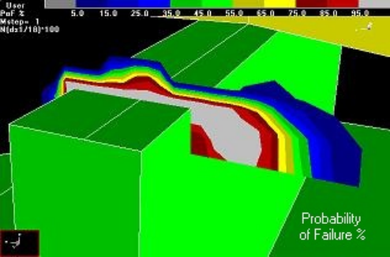
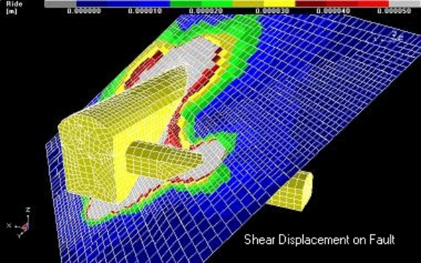
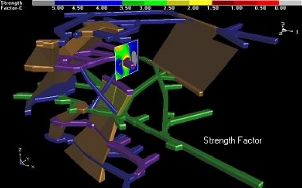

**Map3D Results Viewer** - 应力分析结果的查看与分析。

包含 GIS 可视化数据库，但不包含 CAD 系统。

- 查看由 Map3D 应力分析程序生成的应力分析结果

- 在切割平面上、沿线以及在特定点处显示等值线

- 用户定义的等值线函数

- 直接导出到 Excel 以绘制 x-y 图

- 显示三维轨迹

- 在用户定义的平面和线上显示所有应力、应变、位移和强度参数，包括主分量和合成值

- 以 dxf 和 pnt 格式导出，以便与其他 CAD 和显示系统兼容

- 破坏概率等值线

- 安全系数等值线

- 光源着色模型

- 地形等值线

**Map3D Fault-Slip**
