**Map3D Visco-Plastic** - 三维弹-黏-塑性岩体响应（仍在开发中，目前尚未商业发布）。

包含 Map3D Fault-Slip 的全部功能，并增加了三维岩体表现为弹-黏-塑性的能力。该模型完整求解非关联增量塑性方程，并增加了三维岩体在荷载超过岩石强度时发生屈服、并通过非线性变形耗散多余应力的能力。这种模拟能力可提供模拟地层支护与充填体相互作用研究所需的大位移。该功能适用于模拟厚矿层、超应力矿柱、拱座、充填体和蠕变响应。该公式在岩体中指定的区域内求解非线性问题。

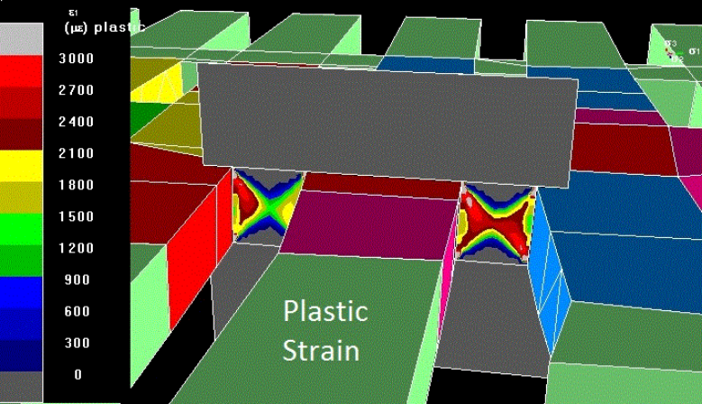

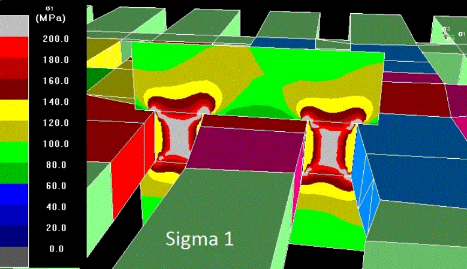

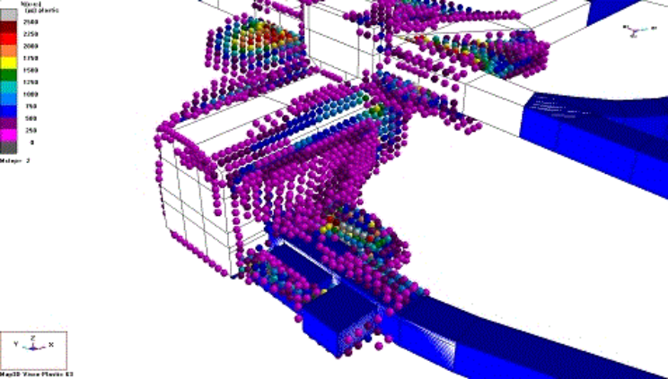

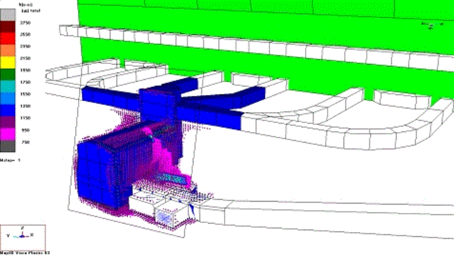

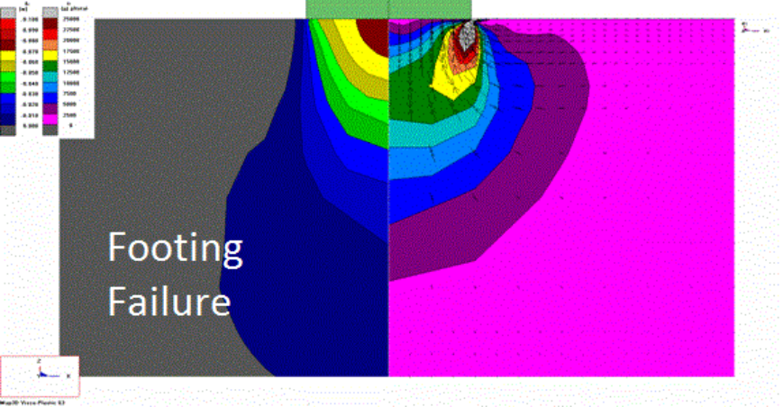

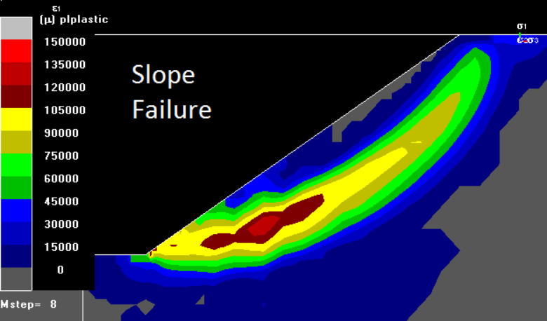

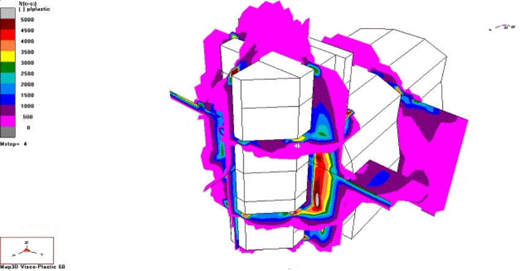

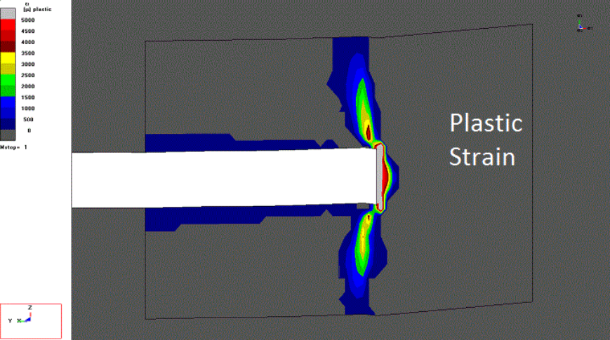

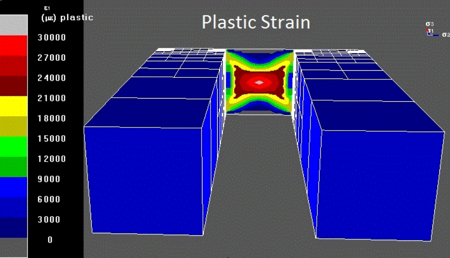

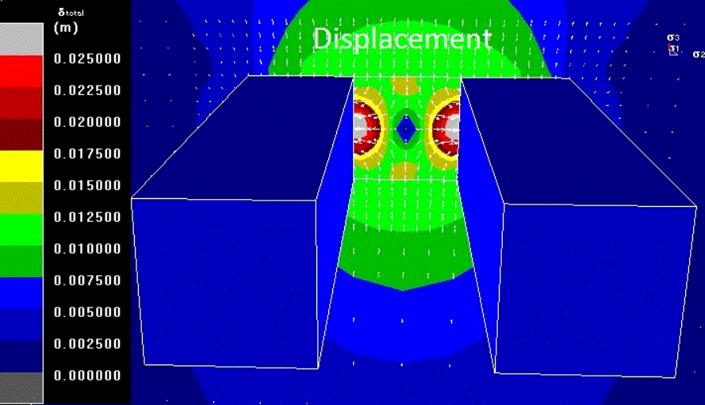

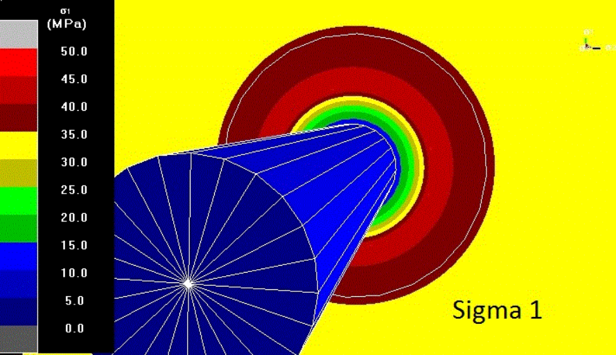

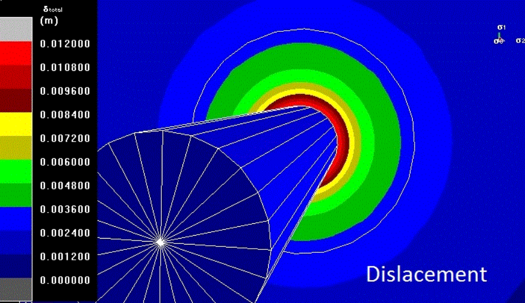

Map3D 概述
