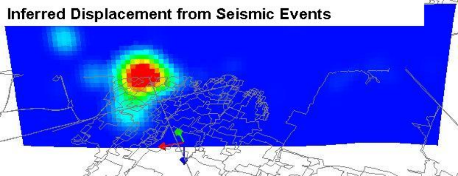
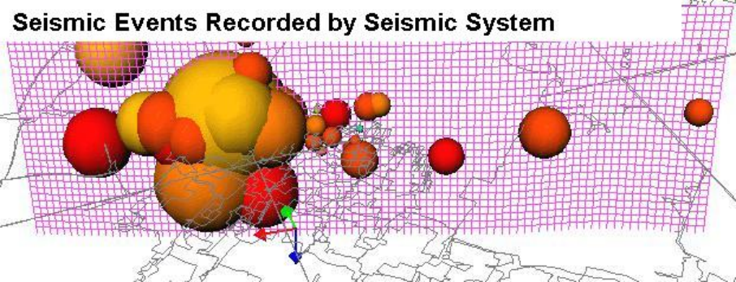
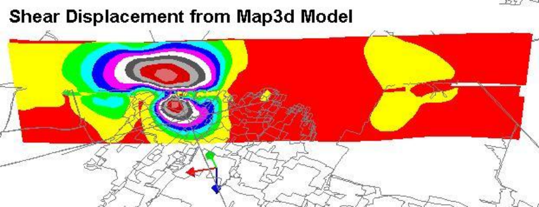

**Map3Di Integrated Seismicity** - 将外部场荷载效应叠加到应力分析中。

包含 Map3D Fault-Slip 的全部功能，并增加了场荷载效应。场荷载效应可从任何热加热、流体压力、非线性行为以及地震活动性所指示的变形数据库中导入。这些效应可用于表征二维和三维地质特征、适应岩性变化，并将地震荷载效应纳入应力分析。

数值模拟可预测岩体在采矿开挖推进过程中的响应。断层或岩性变化等地质特征的影响虽然可以轻松纳入模型，但这些特征的位置、方向和行为

属性往往并不确定。这可能导致建模结果可靠性较低，因而对矿山运营人员的用处有限。Map3Di 允许将外部场荷载效应叠加到 Map3D 模型中。场荷载可来自热加热、流体压力、非线性行为等。此外，这些荷载还可通过多种形式的现场监测确定，例如流体压力（如井水位下降、水坝、水力压裂）、加热（如自然升温、核废料储存）以及变形（如用伸长计监测）。

现场荷载信息的另一个重要来源是地震活动。根据定义，地震活动的出现表明岩体正在屈服于荷载，并以某种方式发生变形。地震活动可能表明断层面上发生剪切，也可能表明存在三维材料非线性，这可能由软弱的岩性特征引起。Map3Di 允许您将地震活动所指示的变形叠加到 Map3D 矿山模型上。例如，如果地震活动显示某处发生剪切，则可在模型中强制施加该剪切，从而重新分布应力以适应这一效应。

Map3Di 的理念是将某些已知的场荷载与常规建模特征（采前应力、模型几何、岩脉、断层等）一并叠加，从而对整个岩体中的应力、应变和位移给出综合预测。通过 Map3Di 边界元法将数值模拟与地震监测相结合，可将地震活动所指示的变形叠加到数值模型中。这样可有效地表征地质特征，并考虑这些特征对岩体响应的影响。

场荷载信息可归结为指定：滑移面某一段上的滑移量和膨胀量，和/或三维区域的变形。但这些信息从何而来：

- 假设您测量了整个矿山的温度分布，并希望将该场荷载应用到 Map3Di 模型。做法是将整个岩体细分为小的三维区域，然后指定每个区域的温度。随后需要计算每个区域的“自由热膨胀”。接着只需告知 Map3Di 使用该场荷载。Map3Di 会进行必要的计算，以确定集成场荷载的应力贡献。

- 假设您向裂隙中注入了重质浆液，待其凝固后钻孔，以确定在裂隙中造成的膨胀量，并希望将该场荷载应用到 Map3Di 模型。做法是将裂隙细分为小的平面区域，然后指定每个区域的膨胀量。接着只需告知 Map3Di 使用该场荷载。Map3Di 会进行必要的计算，以确定集成场荷载的应力贡献。

- 假设您根据地震活动判断岩体的某些部分正在变形，而其他部分没有。做法是将整个岩体细分为小的三维区域，然后计算每个区域的变形。接着只需告知 Map3Di 使用该场荷载。Map3Di 会进行必要的计算，以确定集成场荷载的应力贡献。

请注意，Map3Di 模型可包含所有常规特征，包括开挖体、刚性岩脉、断层等。场荷载与所有这些其他特征的效应将叠加在一起，最终对整个岩体中的应力、应变和位移给出综合预测。

Map3Di 如何帮助我们克服太沙基（Terzaghi）观察法设计在应用中的不足？采用这种方法有许多潜在好处：

- 首先需要认识到，我们打算应用根据现场数据（地震活动、温度、流体压力或变形）测得的已知场荷载条件。这本身可视为校准或微调，而不是进行预测。我们实际上是在向模型中添加信息。

- 地震监测提供的信息极为丰富。地震监测可提供关于岩体响应的信息量和空间分布，这是以合理成本无法通过其他方式获得的。Map3Di 提供了直接利用这些信息进行模型校准的机制。由于地震活动具有实时性，每个采矿增量都可以走完采矿/监测/重新设计的循环。因此，无需花费数年进行目视观察来建立岩体响应历史，而有可能更快地校准模型。

- 也许最重要的是，它使实时适应不断变化的岩体条件成为可能。这样可以识别并适应岩性或节理等快速变化的局部条件。条件变化时，可更新模型校准。这有可能显著提高预测的可靠性。

- 最后，例如通过纳入地震活动所指示的某些断层滑移，实际上已经表征了该断层滑移的影响，并将其效应纳入了模型。例如，如果地震活动显示某处发生剪切，则可在模型中强制施加该剪切，从而重新分布应力以适应这一确切效应。

Map3D Thermal-Fluid Flow
