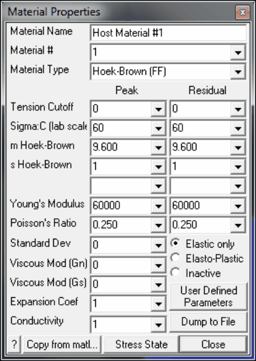
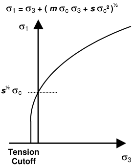

Hoek-Brown 材料只能在 Map3D Fault-Slip 的弹性分析中用作破坏准则。

Material Name - 指定材料的描述性名称。

Material # - 指定材料编号。

- 材料 #1 保留给基岩（宿主）材料。

- 其他材料编号用于定义替代材料区，例如矿石、断层泥、充填体等。

Material Type - 指定材料类型（Mohr-Coulomb、Hoek-Brown、Drucker-Prager、Fault-Gouge、Hyperbolic-Backfill、Quadratic-Backfill、Equilibrated-Gouge、Yielding-Pillar 或 none）。

- Hoek-Brown - 将破坏包络线定义为一条曲线。

- 对于 3D FF 块体，Hoek-Brown 准则用主应力定义强度，如下所示：

**3D FF 块体中的 Hoek-Brown**

- Tension cutoff 和 sc 以应力单位（MPa 或 psi）指定。

- 仅使用峰值。

Young's Modulus 和 Poisson's Ratio - 以应力单位（MPa 或 psi）指定杨氏模量（岩体尺度的变形模量）。

- 仅使用峰值。

Standard Deviation - 以应力单位（MPa 或 psi）指定标准差。

- 该参数描述强度参数的不确定性。

- 该参数仅用于绘制剪切破坏概率 Plot > Strength Factors > Rockmass Probability N-distribution。

Viscous Modulus（ _Gn_ 和 _Gs_ ）- Hoek-Brown 材料不使用这些参数。

Expansion Coefficient 和 Conductivity 仅用于 Map3D Thermal-Fluid Flow。Map3D Thermal- Fluid Flow 可同时求解与应力分析耦合的稳态热/流体流动。

Elastic only - 勾选后，该材料仅发生弹性响应，即不使用强度参数。

- 可用于定义具有不同弹性属性和/或初始应力状态的区域，例如刚性岩脉、软矿石区、充填体或支护单元。

Elasto-Plastic - 勾选后，该材料发生弹-黏-塑性响应，即强度参数用作流动法则。

- 可用于定义同时具有不同弹性属性和强度参数的区域。

- 请注意，在 Map3D Fault-Slip 中，仅允许 DD 单元（即断层泥）发生非线性响应。

- 在 Map3D Non-Linear 中，三维岩体也可发生塑性屈服。

- 目前不支持 Hoek-Brown 材料的屈服。

Inactive - 勾选后，该材料不用于应力分析，因此不会影响预测的应力、应变或位移。

- 可用于定义具有不同强度参数的区域，用于生成强度因子等值线。

User Defined - 允许指定用于绘制等值线的用户定义参数。

- 每个材料编号定义不同的参数。

      - Plot > Stress > User

   - 这些参数与以下功能配合使用

- 可用于定义具有不同强度参数的区域，用于生成强度因子等值线。

Dump to File - 可将所有材料属性数据转储到文件中，以便在记事本或 Excel 中查看。

Copy from material - 可将材料属性从一个材料编号复制到另一个。所有属性（包括应力状态）均被复制。

Stress State - 指定该材料的初始（远场）应力状态。

- 大多数材料插入到具有相同（远场）应力状态的块体中。

- 支柱或充填体等材料放置时的初始应力接近于零。

相关主题：

3D FF 块体中的 Mohr_Coulomb

3D FF 块体中的 Drucker-Prager
