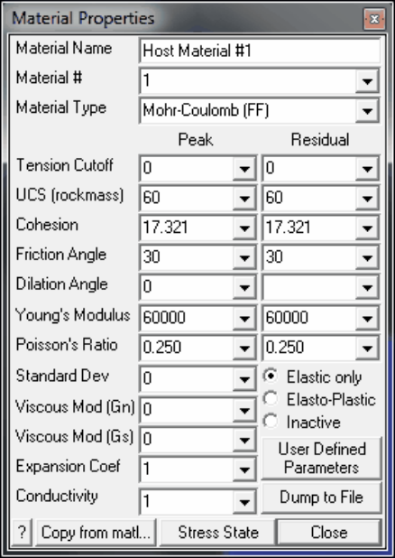
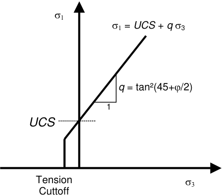
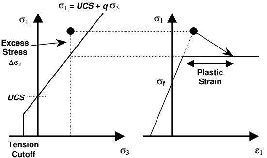
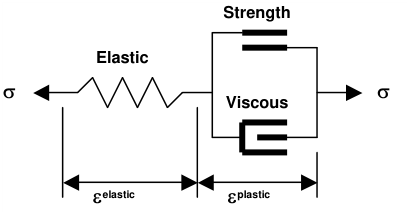

Mohr-Coulomb 材料可用于在 Map3D NonLinear 中描述 3D FF 块体的非线性响应。它也可在 Map3D Fault-Slip 的弹性分析中用作破坏准则。

Material Name - 指定材料的描述性名称。

Material # - 指定材料编号。

- 材料 #1 保留给基岩（宿主）材料。

- 其他材料编号用于定义替代材料区，例如矿石、断层泥、充填体、软化材料等。

Material Type - 指定材料类型（Mohr-Coulomb、Hoek-Brown、Drucker-Prager、Fault-Gouge、Equilibrated-Gouge、Yielding-Pillar、Hyperbolic-Backfill、Quadratic-Backfill、Softened-Material 或 none）。

- Mohr-Coulomb - 将破坏包络线定义为一条直线。

- 对于 3D FF 块体，Mohr-Coulomb 准则用主应力定义强度，如下所示：

#### 3D FF 块体中的 Mohr-Coulomb

- Tension cutoff 和 _UCS_ - 以应力单位（MPa 或 psi）指定。

- 摩擦角和剪胀角以度为单位指定。

- 黏聚力与 _UCS_ 和摩擦角的关系为 _UCS_ =2 _Coh_ tan(45+j/2)。如果指定了黏聚力，则 _UCS_ 由该关系式确定。

- 破坏之前使用这些参数的峰值。屈服之后使用残余值，以产生应变软化响应。

- 弹性分析中忽略残余值。

Young's Modulus 和 Poisson's Ratio - 以应力单位（MPa 或 psi）指定杨氏模量（岩体尺度的变形模量）。

- 破坏之前使用这些参数的峰值。

- 屈服之后使用残余值。弹性分析中忽略残余值。

Standard Deviation - 以应力单位（MPa 或 psi）指定标准差。

- 该参数描述强度参数的不确定性。

- 该参数仅用于绘制剪切破坏概率 Plot > Strength Factors > Rockmass Probability N-distribution。

Viscous Modulus（ _Gn_ 和 _Gs_ ）- 这些参数仅用于非线性分析（Map3D Non-Linear 中的 3D FF 块体和 Map3D Fault-Slip 中的 DD 平面）。对于 3D FF 块体，仅使用 _Gs_ 。

- 黏性模量描述蠕变响应，其中蠕变阻力由蠕变系数 _C_ 乘以塑性应变率确定。请注意，用户必须同时选择蠕变系数 _C_ 和时间步长 D _t_ ，然后将二者之商指定为黏性模量 _G_ 。

- 以应力单位（MPa 或 psi）指定黏性模量。

Expansion Coefficient 和 Conductivity 仅用于 Map3D Thermal-Fluid Flow。

- Map3D Thermal-Fluid Flow 可同时求解与应力分析耦合的稳态热/流体流动。

Elastic only - 勾选后，该材料仅发生弹性响应，即不使用强度参数。

- 可用于定义具有不同弹性属性和/或初始应力状态的区域，例如刚性岩脉、软矿石区、充填体或支护单元。

Elasto-Plastic - 勾选后，该材料发生弹-黏-塑性响应，即强度参数用作流动法则。

- 可用于定义同时具有不同弹性属性和强度参数的区域。

- 请注意，在 Map3D Fault-Slip 中，仅允许 DD 单元（即断层泥）发生非线性响应。

- 在 Map3D Non-Linear 中，三维岩体也可发生塑性屈服。

Inactive - 勾选后，该材料不用于应力分析，因此不会影响预测的应力、应变或位移。

- 可用于定义具有不同强度参数的区域，用于生成强度因子等值线。

User Defined - 允许指定用于绘制等值线的用户定义参数。

- 每个材料编号定义不同的参数。

   - Plot > Stress > User

- 这些参数与以下功能配合使用

- 可用于定义具有不同强度参数的区域，用于生成强度因子等值线。

Dump to File - 可将所有材料属性数据转储到文件中，以便在记事本或 Excel 中查看。

Copy from material - 可将材料属性从一个材料编号复制到另一个。所有属性（包括应力状态）均被复制。

Stress State - 指定该材料的初始（远场）应力状态。

- 大多数材料插入到具有相同（远场）应力状态的块体中。

- 支柱或充填体等材料放置时的初始应力接近于零。

在弹性分析中，通常将主应力与 Mohr-Coulomb 或 Hoek-Brown 强度准则结合使用，以估算因应力过大而造成的损伤程度。可以预期，弹性分析中的多余应力越大，通常对应于非线性分析中的塑性应变越大。由于这些参数均不具有方向敏感性，该准则可代表均质岩体的稳定性。

#### 3D FF 块体中的 Mohr-Coulomb

应力过大可以用多种形式表示，包括：

Plot > Strength Factors > dS1 - Excess Stress

Plot > Strength Factors > dTmax - Excess Stress

Plot > Strength Factor > SF-A - Strength/Stress Plot > Strength Factor > SF-B - Strength/Stress

Plot > Strength Factors > SF-C - Strength/Stress

相比之下，在非线性分析中，除非使用了某种蠕变，否则应力永远不会超过强度（在后一种情况下，黏性蠕变可使应力状态超出破坏准则，表明缺乏静力平衡）。因此，对于非线性分析，通常直接将模型预测的塑性应变或塑性应变率作为损伤指标。

在 3D FF 块体中，弹性应变由应力确定：

sxx   = sxxf  + [ (1-n) exxelastic + n ( eyyelastic + ezzelastic ) ] _E_ / [ (1+n) (1-2n) ] syy  = syyf + [ (1-n) eyyelastic + n ( ezzelastic + exxelastic  ) ] _E_ / [ (1+n) (1-2n) ] szz   = szzf  + [ (1-n) ezzelastic  + n ( exxelastic + eyyelastic ) ] _E_ / [ (1+n) (1-2n) ] txy  = txyf +  exyelastic _E_ / (1+n) tyz  = tyzf  +  eyzelastic _E_ / (1+n) txz  = txzf  +  exzelastic _E_ / (1+n)

其中 _E_ 和 n 分别表示杨氏模量（岩体尺度的变形模量）和泊松比，sf 和 tf 表示初始（采前）应力状态

在 Map3D Non-Linear 中，如果应力超过强度，可通过限制应力来确定塑性应变

其中

s1 - s1° - _C_ De1plastic /D _t_ = _UCS_ + _q_ ( s3 - s3° - _C_ De3plastic /D _t_ ) s1°  = [ (1-n) e1plastic + n ( e2plastic + e3plastic ) ] _E_ / [ (1+n) (1-2n) ] s2°  = [ (1-n) e2plastic + n ( e3plastic + e1plastic ) ] _E_ / [ (1+n) (1-2n) ] s3°  = [ (1-n) e3plastic + n ( e1plastic + e2plastic ) ] _E_ / [ (1+n) (1-2n) ]

累积塑性应变 eplastic 确定为所有蠕变步的塑性蠕变增量 Deplastic 之和。

如果应力低于拉伸截断值，可通过限制应力来确定塑性应变

s3 - s3° - _C_ De3plastic /D _t_ = _To_

塑性体积应变还可包含剪胀分量

evolume = ( e1plastic + e2plastic + e3plastic ) = tan( _dilation angle_ ) e1plastic

总应变等于弹性部分与塑性部分之和。

蠕变响应采用线性（Bingham）蠕变模型模拟。

在每个蠕变步，所有屈服单元（应力超过强度的单元）上的应力状态计算为强度加上蠕变阻力

s = _Strength_ + _C_ Deplastic /D _t_

_C_ = _G_ D _t_

其中蠕变阻力由蠕变系数 _C_ 乘以塑性应变率确定。请注意，用户必须同时选择蠕变系数 _C_ 和时间步长 D _t_ ，然后将二者之商指定为黏性模量 _G_ 。蠕变阻力既可仅用作抑制非线性变形的技术，也可用于真实的时间相关蠕变模拟

#### Analysis > Options > Creep

应变可以用多种形式表示，包括：

Plot > Strain > Value > Elastic

Plot > Strain > Value > Plastic Plot > Strain > Value > Total

Plot > Strain > E1 - Major principal strain Plot > Strain > E2 - Intermediate principal strain

Plot > Strain > E3 - Minor principal strain

Plot > Strain > Emax - Maximum shear strain

Plot > Strain > Evolume - Volumetric shear strain

相关主题：

3D FF 块体中的 Hoek-Brown

3D FF 块体中的 Drucker-Prager
