软化材料可用于模拟地层屈服及由此产生的应力重分布效应。尽管塑性建模无疑是实现这一目的的最佳方法，但材料软化同样可用于模拟地层屈服、应力重分布以及对周边区域可能产生的影响。这种方法的优点是，工程师可以快速、轻松地研究非线性行为。

软化背后的理论在 **Elastic softening to simulate plastic yielding.pdf** 中有详细说明。以下为简要概述。

在数值建模中，弹性岩体的卸压是通过允许塑性应变来实现的。这些应变用于耗散弹性响应所显示的多余应力。下图所示为另一种引发塑性变形的方法：逐步降低应力-应变模量的大小。可以看到，虽然从技术上讲这会降低弹性应力-应变响应的刚度，但这可解释为等同于塑性应变增量（Dep ）。

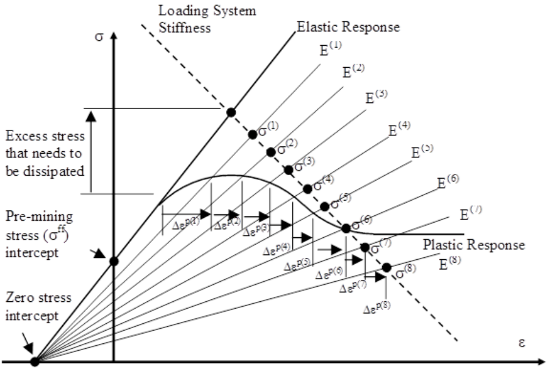

岩石破坏通常被理解为剪切破坏的结果，可通过降低剪切模量来模拟；而体积变化则与剪胀或压实相关，具体取决于应力条件和岩石本身的性质。降低剪切模量可用于减小应力差（s1-s3），降低体积模量可用于控制体积应变

（evolume=e1+e2+e3）。这样可以独立控制剪切破坏过程和剪胀响应。无论软化是自动完成还是手动完成，显然都必须注意使卸压量符合实际，以确保受影响矿柱的最终应力状态满足经过良好标定的强度准则。

未软化的体积模量 **_B_** 和剪切模量 **_G_** 可根据杨氏模量 **_E_** 和泊松比按下式确定：

**_B = E/3/(1-2_** n **_) G = E/2/(1+_** n **_)_**

软化后的体积模量 **_Bs_** 和软化后的剪切模量 **_Gs_** 由下表中的体积软化参数 **_b_** 和剪切软化参数 **_g_** 确定，即

**_Bs = B×b Gs = G×g_**

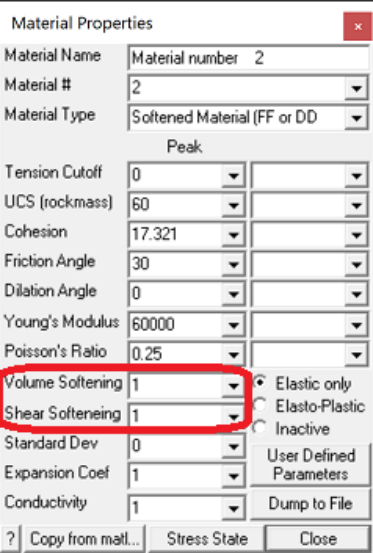

例如，**_g=1_** 的剪切软化表示不软化，而 **_g=0.5_** 的剪切软化表示剪切模量降低 50%...

为了说明软化过程的简便性，下面给出一个侧壁屈服的超应力巷道示例。请注意，该示例的目的不是复现塑性建模的结果，也不应期望能够做到这一点。不过，它将演示侧壁软化、卸压、应力转移和屈服。这里希望说明，通过软化：

- 应力可以耗散到周围的拱座，

- 可以产生与塑性相关的更大应变和位移。

#### 塑性模型结果

考虑一条半径为 1 m 的圆形巷道，采前均匀应力为 30 MPa。全程采用 MohrCoulomb 破坏准则，UCS 为 11.9 MPa，摩擦角为 30°，杨氏模量为 6780 MPa，泊松比为 0.21。该模型使用 Map3D Visco-Plastic 进行了分析。采用弹性/理想塑性行为，剪胀率设为零。下图左侧显示最大主应力，右侧显示位移。

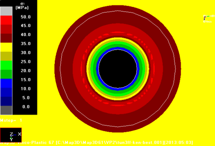

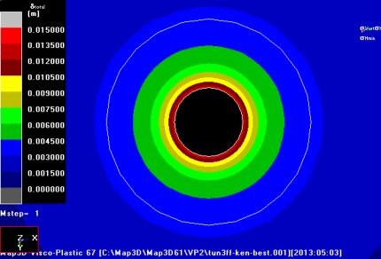

这些 Map3D Visco-Plastic 模型结果与塑性应力和位移的闭合解析解非常吻合。作为参考，图中还给出了弹性解析解。

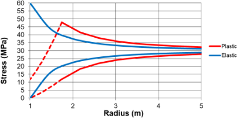

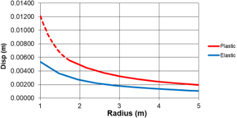

#### 软化模型结果

为了用软化来模拟上述情形，对巷道侧壁周围的一个区域进行了软化，如下图所示，其中巷道为蓝色，软化区为紫色。该软化区选取的大小与上面确定的塑性区相同（半径 1.74 m）。

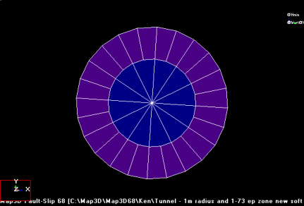

这里希望说明，塑性闭合可以用简单的软化模型来模拟。

此处，弹性剪切模量按系数 **_g=0.2_** 软化，而体积模量保持不变。下图左侧显示最大主应力，右侧显示位移。

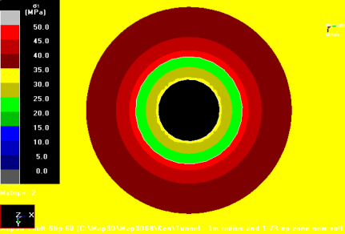

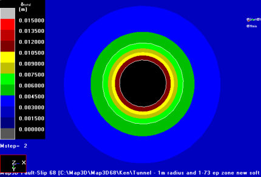

软化结果与塑性的最小主应力和位移均吻合得很好。请注意，虽然屈服区内软化后的最大主应力实际值与塑性结果在细节上并不吻合，但平均而言量级大致正确。此外，应力已相当准确地重分布到弹性“拱座”，所显示的应力集中程度几乎与预期完全一致。

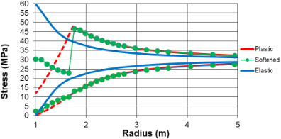

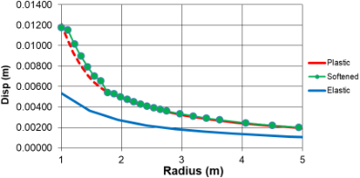

虽然软化的结果与塑性分析结果并不完全吻合，但显然已经模拟了侧壁材料的屈服，并使弹性结果更接近塑性模型的结果。看来材料软化可用于模拟地层屈服、应力重分布以及对周边区域可能产生的影响。与塑性建模相比，这种方法的优点是工程师可以快速、轻松地研究非线性行为。与简单的弹性模型相比，软化模型所需的分析时间几乎没有增加。

更详细的说明和示例见 **Elastic softening to simulate plastic yielding.pdf** 。
