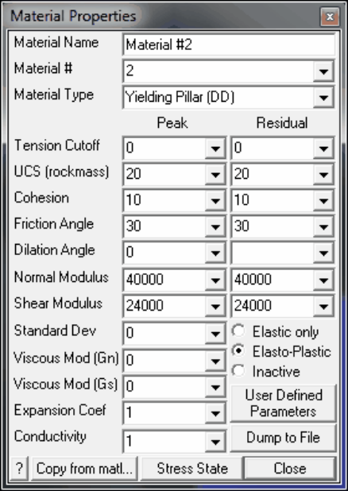
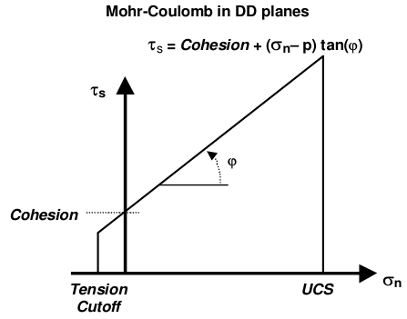
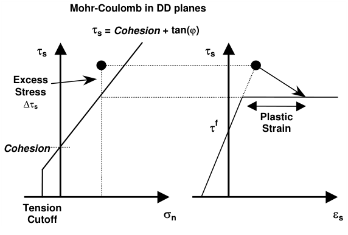
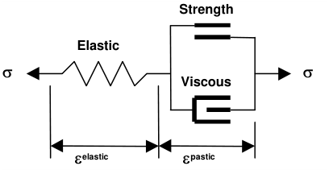

Yielding-Pillar 材料可用于在 Map3D FaultSlip 和 Map3D Non-Linear 中描述 DD 平面的非线性响应。

Material Name - 指定材料的描述性名称。

Material # - 指定材料编号。

- 材料 #1 保留给基岩（宿主）材料。

- 其他材料编号用于定义替代材料区，例如矿石、断层泥、充填体等。

Material Type - 指定材料类型（Mohr-Coulomb、Hoek-Brown、Drucker-Prager、Fault-Gouge、Hyperbolic-Backfill、Quadratic-Backfill、Equilibrated-Gouge、Yielding-Pillar 或 none）。

- Mohr-Coulomb - 将破坏包络线定义为一条直线。

- 对于 DD 平面，Mohr-Coulomb 准则用面内剪应力和正应力定义强度，如下所示：

- Tension Cutoff、Cohesion 和 _UCS_ 以应力单位（MPa 或 psi）指定。

- 摩擦角和剪胀角以度为单位指定。

- 黏聚力和摩擦角定义剪切响应。

- 拉伸截断和 _UCS_ 定义垂直于剪切面方向的响应。此处 _UCS_ 用于模拟屈服矿柱。

- 破坏之前使用这些参数的峰值。

- 屈服之后使用残余值，以产生应变软化响应。弹性分析中忽略残余值。

- 如果在 Stress State 中指定了流体压力，则使用有效正应力（sn-p）（此处 p 为流体压力）。

Young's Modulus 和 Poisson's Ratio 以应力单位（MPa 或 psi）指定杨氏模量（岩体尺度的变形模量）。

- 在 DD 平面中，作用于单元表面的剪应力和正应力通过剪切模量和法向模量，与剪切位移（滑移量）和法向位移（闭合量）的弹性部分相关联

Shear Modulus = _E_ / [ 2 (1+n) ]

Normal Modulus = _E_ / [ 3 (1-2n) ]

- 破坏之前使用这些参数的峰值。

- 屈服之后使用残余值。

- 弹性分析中忽略残余值。

Standard Deviation - 以应力单位（MPa 或 psi）指定标准差。

- 该参数描述强度参数的不确定性。

- 该参数仅用于绘制剪切破坏概率 Plot > Strength Factors > InPlane Probability N-distribution。

Viscous Modulus（ _Gn_ 和 _Gs_ ）- 这些参数仅用于非线性分析（Map3D Non-Linear 中的 3D FF 块体和 Map3D Fault-Slip 中的 DD 平面）。

- 黏性模量描述蠕变响应，其中蠕变阻力由蠕变系数 _C_ 乘以塑性应变率确定。请注意，用户必须同时选择蠕变系数 _C_ 和时间步长 D _t_ ，然后将二者之商指定为黏性模量 G。

- 以应力单位（MPa 或 psi）指定黏性模量。

Expansion Coefficient 和 Conductivity 仅用于 Map3D Thermal-Fluid Flow。

- Map3D Thermal-Fluid Flow 可同时求解与应力分析耦合的稳态热/流体流动。

Elastic only - 勾选后，该材料仅发生弹性响应，即不使用强度参数。

- 可用于定义具有不同弹性属性和/或初始应力状态的区域，例如刚性岩脉、软矿石区、充填体或支护单元。

Elasto-Plastic - 勾选后，该材料发生弹-黏-塑性响应，即强度参数用作流动法则。

- 可用于定义同时具有不同弹性属性和强度参数的区域。

- 请注意，在 Map3D Fault-Slip 中，仅允许 DD 单元（即断层泥）发生非线性响应。

- 在 Map3D Non-Linear 中，三维岩体也可发生塑性屈服。

Inactive - 勾选后，该材料不用于应力分析，因此不会影响预测的应力、应变或位移。

- 可用于定义具有不同强度参数的区域，用于生成强度因子等值线。

User Defined - 允许指定用于绘制等值线的用户定义参数。

   - 每个材料编号定义不同的参数。

   - 这些参数与 Plot > Stress > User 配合使用

- 可用于定义具有不同强度参数的区域，用于生成强度因子等值线。

Dump to File - 可将所有材料属性数据转储到文件中，以便在记事本或 Excel 中查看。

Copy from material 可将材料属性从一个材料编号复制到另一个。所有属性（包括应力状态）均被复制。

Stress State - 指定该材料的初始（远场）应力状态。

- 大多数材料插入到具有相同（远场）应力状态的块体中。

- 支柱或充填体等材料放置时的初始应力接近于零。

在弹性分析中，通常将弱面（断层、节理组或层理面）上的剪应力和正应力与 Mohr-Coulomb 强度准则结合使用，以估算因应力过大而造成的损伤程度。可以预期，弹性分析中的多余应力越大，通常对应于非线性分析中的塑性应变（滑移）越大。由于这些参数具有方向依赖性，该准则可代表各向异性岩体的稳定性。

应力过大可以用多种形式表示，包括：

Plot > Strength Factors > dTip In-Plane excess shear stress

Plot > Strength Factors > dTub Ubiquitous-plane excess shear stress

Plot > Strength Factors > SF-ip Strength/Stress

Plot > Strength Factors > SF-ub Strength/Stress

相比之下，在非线性分析中，除非使用了某种蠕变，否则应力永远不会超过强度（在后一种情况下，黏性蠕变可使应力状态超出破坏准则，表明缺乏静力平衡）。因此，对于非线性分析，通常直接将模型预测的塑性应变或塑性应变率作为损伤指标。

在 DD 平面中，弹性应变由应力确定：

ts = tf + _Shear Modulus_ eselastic

- sn = sf + _Normal Modulus_ enelastic

其中 _Shear Modulus_ 和 _Normal Modulus_ 分别表示断层泥材料在剪切方向和法向的弹性模量，tf 和 sf 表示剪切方向和法向的初始应力状态，并且

eselastic =  dselastic / _Thickness_

enelastic =  dnelastic / _Thickness_

其中 dselastic 和 dnelastic 分别表示剪切位移（滑移量）和法向位移（闭合量）的弹性分量，_Thickness_ 表示 DD 平面厚度（即断层泥、矿层宽度、采幅或矿柱高度）。DD 平面厚度通过以下功能设置

#### CAD > Build > DDLoop

并可通过以下功能修改

#### CAD > Edit > Entity Properties

在 DD 单元中，如果剪应力超过强度，可通过限制应力来确定塑性应变

ts - ts° - _C_ Desplastic /D _t_ = _Cohesion_ + tan(j) ( sn - sn° - _C_ Denplastic /D _t_ )

其中

ts° = _Shear Modulus_ esplastic

sn° = _Normal Modulus_ enplastic

累积塑性应变 eplastic 确定为所有蠕变步的塑性蠕变增量 Deplastic 之和。

如果正应力低于拉伸截断值，可通过限制应力来确定塑性应变

sn - sn° - _C_ Denplastic /D _t_ = _To_

如果正应力超过 _UCS_ ，可通过限制应力来确定塑性应变

sn - sn° - _C_ Denplastic /D _t_ = _UCS_

在剪切破坏的情况下，塑性法向应变还可包含剪胀分量

- enplastic = tan( _dilation angle_ ) esplastic

总应变等于弹性部分与塑性部分之和。

蠕变响应采用线性（Bingham）蠕变模型模拟。

在每个蠕变步，所有屈服单元（应力超过强度的单元）上的应力状态计算为强度加上蠕变阻力

_Strength_ + _C_ Denplastic /D _t_

_C_ = _G_ D _t_

其中蠕变阻力由蠕变系数 _C_ 乘以塑性应变率确定。请注意，用户必须同时选择蠕变系数 _C_ 和时间步长 D _t_ ，然后将二者之商指定为黏性模量 _G_ 。蠕变阻力既可仅用作抑制非线性变形的技术，也可用于真实的时间相关蠕变模拟

#### Analysis > Options > Creep

应变、剪切位移（滑移量）和法向位移（闭合量）可以用多种形式表示，包括：

Plot > Surface > Value > Elastic

Plot > Surface > Value > Plastic

Plot > Surface > Value > Total

**552 Map3D User's Manual - Version 72** Plot > Strain > E1 - Major principal strain Plot > Surface > Es Shear Strain Plot > Surface > En Normal Strain Plot > Surface > ds Shear Displacement (Ride) Plot > Surface > dn Normal Displacement (Closure)

另外值得关注的是塑性蠕变增量 Deplastic，即黏性单元对剪切阻力的贡献

Dts   = _C_ Desplastic /D _t_ Plot > Surface > dEs Incremental Shear Strain Plot > Surface > dTs Excess Shear Stress 相关主题：DD 平面中的 Fault-Gouge、DD 平面中的 Backfill-Hyperbolic
