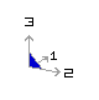
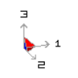

远场主应力状态的方向由显示窗口右上角的应力方向图标指示。

在上图所示的视图中，s1 轴大部分指向屏幕内并略微偏右，s2 轴大部分指向右侧并略微指向屏幕外，s3 轴笔直向上。请注意，图标的背面以蓝色着色。

在上图所示的视图中，s1 轴大部分指向右侧并略微指向屏幕内，s2 轴大部分指向屏幕外并略微偏右，s3 轴笔直向上。请注意，图标的内侧以红色着色。

请注意，各轴的长度按主应力分量的大小缩放。

采前主应力分量通过“CAD > Properties > Material Properties > Stress State”指定。
