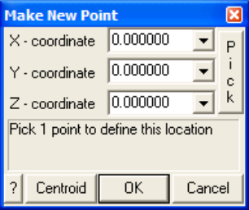

创建新的可视化点。有关 Map3D 中可用可视化功能的说明，请参阅可视化。

可视化点可显示为光源着色的球体，其直径和/或颜色随震级变化，也可在平面上绘制等值线以显示密度等。

每个点可标记以下一系列内容：

- 数值（例如颜色、震级、方向等）

- 文本信息

- 文件名（例如图形文件、文档、电子表格等）

左键单击某个点时，其位置、震级和文本信息显示在状态栏中。

右键单击某个点将激活 Visual Database。该功能可用于显示有用的地质信息数据库，例如品位、岩体质量等。

激活该功能后，系统将提示用户提供新可视化点的坐标。

请注意，如果已有可视化文件处于活动状态，则该新点将添加到该文件中。如果没有活动的可视化文件，系统将提示用户打开一个文件，该新点将添加到该文件中。

X、Y 和 Z 坐标 - 指定可视化点的坐标。

Pick - 激活光标十字线，允许从模型中交互式选择坐标。

为便于从模型中直观地选择点，所有捕捉功能均可使用。

#### CAD > Snap

选定后，可视化点的坐标显示在对话框中。

Centroid - 激活光标，用户可从模型中选择一个实体。坐标将在所选实体的中心处计算。

OK - 完成坐标编辑，并创建和显示可视化点。

创建可视化点后，用户即可右键单击该点，添加文本信息和/或文件名。

- 用左键拾取事件时，文本信息和文件名显示在屏幕底部的状态栏中。

- 也可用右键拾取事件对其进行编辑。

- 如果文件名已与某个应用程序关联，用右键拾取还可以显示该文件（有关如何“将文件与程序关联”，请参阅 Windows 文档）。
