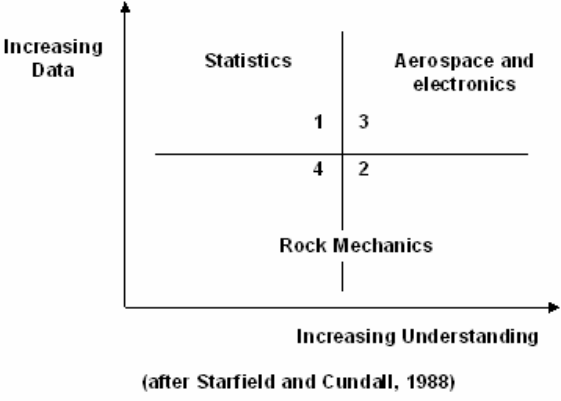
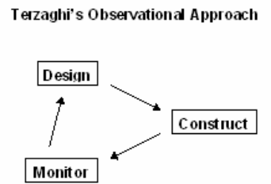
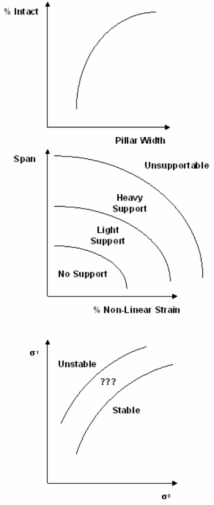
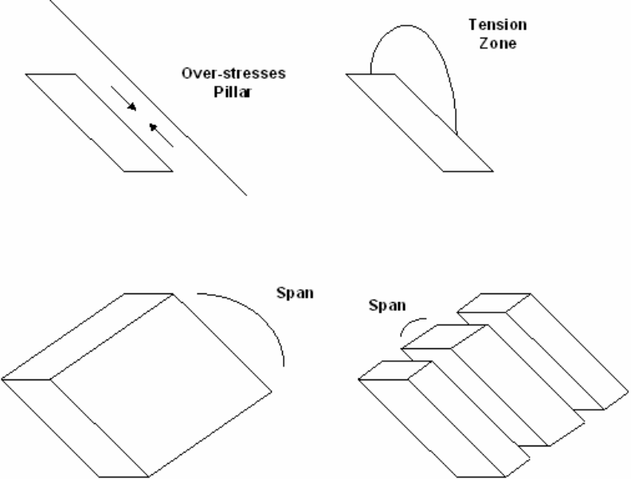
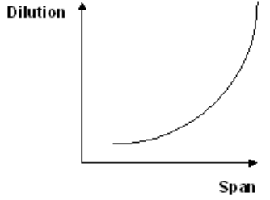
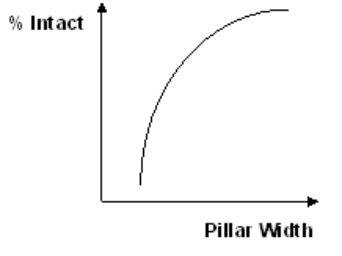
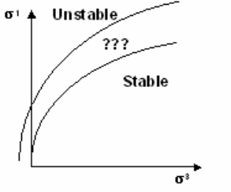
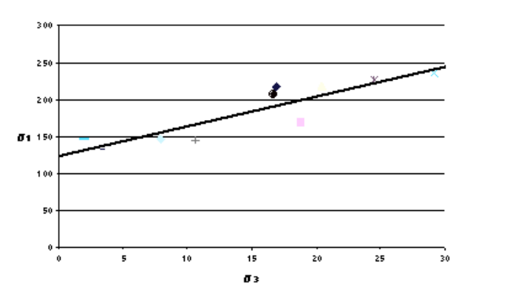

数值模拟的目标很简单：（准确、可靠地）预测岩体对开采的响应。我们指定荷载条件和几何形状（可以包括岩墙、断层、层理等），要求满足平衡和连续性条件，假定适用弹性和/或非线性本构，然后求解这些方程，得到整个岩体中的应力、应变、位移等。

通过分析应力分析结果，我们可以识别出例如超应力或屈服的部位，确定哪些部位需要支护以及采用何种支护类型合适等。

最终目标是了解会出现哪些问题，以及这些问题发生的时间和位置。这样就可以比较不同的矿山布局和开采顺序，并制定问题发生时的应对策略，避免意外的生产中断。还可以为支护要求、具体矿柱宽度、允许采场高度等确定明确的设计数值。简而言之，它提供了一种帮助您设计矿山的工具。数值模拟本身相当简单，但解释结果则困难得多。用于岩体预测的数值模拟并非一门精确的科学，总会存在未预料到或未被理解的岩体特征。

Starfield 和 Cundall (1988) 的以下论述给出了其中的几点原因。

_岩石力学模型属于"数据受限问题"：人们很少能充分了解岩体的特征和行为，从而对其进行明确无歧义的模拟。因此，岩石力学中的模型不能按照常规方式（例如电气工程或航空航天工程中的方式）使用，而需要为岩石力学建模采用一种独特而恰当的方法论。_

问题往往是不适定的，这给结果解释带来困难，并让人始终怀疑所模拟的问题是否正确。模型的设计应由模型需要回答的问题来驱动，而不是由所模拟系统的细节来驱动。这有助于简化和控制模型。

模型是对现实的简化，而不是对现实的模仿。它是一种需要针对特定任务设计或选择的思维工具。根本问题在于分辨率。人们总是担心对问题过度简化。

期望有朝一日拥有足够的数据、以常规方式（例如电气工程或航空航天工程中的方式）模拟岩体是徒劳的。随着纳入的细节越来越多，人们会逐渐失去对模型的思维把控，模型反而变得更低效而非更有效。

#### 将数值模拟应用于矿山设计的常规方法是什么？

在大多数其他工程学科（电气工程或航空航天工程）中，数值模拟通常基于实验室测得的材料性质来预测响应。如果材料、几何形状和荷载条件都已充分掌握，这种方法通常效果良好。

相比之下，将数值模拟应用于矿山设计的常规方法基于"Terzaghi 观测设计法"。

在初期（即开采之前），您可以进行参数研究。您可以比较不同的设计方案，识别影响稳定性的重要因素。您可能会发现某些方向比其他方向更有利，或某些开采顺序是更好的选择。您还可以大致估算提高产量与增加维护和支护需求之间的成本效益。

了解可能出现的问题类型和特别易受影响的部位无疑是有用的信息，因为这能帮助您制定问题一旦发生时的应对策略。但是，如果您想利用模拟为支护要求、具体矿柱宽度、允许采场高度和实际成本确定明确的设计数值，就必须对预测的准确性有信心。

例如，如果您完全不知道某个模型预测的可靠程度，那么根据该预测规定矿柱宽度为 1.2 m 就毫无意义。除非您同样确信预测是可靠的，否则绝不会仅凭模拟结果显示某个眉线安全，就允许人员从其下方通过。

要评估风险并以此为基础进行成本效益决策，从根本上必须了解预测的可靠性。

这一论断值得花点时间思考。我想不出任何例子能说明可靠性未知的预测有任何价值。您可以承认预测的可靠性较低、误差可能达到 ±100%；或者您也可能有证据表明预测的可靠性很高、误差小于 ±10%。任何决策者都需要了解这一点，才能将其纳入成本效益考量。

请思考以下两个问题：

如果有确凿证据表明模型预测的可靠性为 99%（误差 ±1%），您为什么不使用它？

如果有确凿证据表明模型预测的可靠性仅为 1%（误差 ±99%），您又为什么要使用它？

问题的关键其实就是可靠性！我们必须知道预测的可靠程度，否则就一无所获 (Wiles 2006 and Wiles 2007)。

那么，如何获得可靠的设计呢？解决办法就是所有工程师都在使用的、久经验证的设计方法。用于确定可靠性的程序称为"Terzaghi 观测设计法" (Terzaghi and Peck, 1967)：

- 确定某种初始矿山布局——参数研究。

- 开始开采。

- 监测岩体响应——通常为目视观察。

- 根据观测到的行为重新设计——模型校准。

这一过程即构成模型校准。无论是否使用数值模拟，这基本上都是我们所有人设计矿山的方法。

_基于最不利假设进行设计必然是不经济的，但没有其他任何方法能在施工前向设计者保证，由土体支承的结构不会出现意外缺陷。然而，如果项目允许在施工期间修改设计，那么基于最可能的情况而非最不利的情况进行设计，就可以节省大量费用。现有信息的空白通过施工期间的设计来填补，并根据发现的情况修改设计。这种设计基础可称为观测法。_

_要在土方工程中采用观测法，必须满足两个条件。首先，必须在施工前通过地基勘察结果揭示软弱带的存在及其总体特征。其次，必须采取专门措施，在施工期间、在仍来得及根据发现修改设计之前，获取有关这些软弱带不利特征的定量信息。直到土与水相互作用的力学机制被清楚认识、并开发出适当的观测手段之后，这些条件才得以满足。根据项目性质，实施观测法所需的数据通过测量孔隙水压力和测压水位、荷载和应力、水平位移、竖向位移和角位移以及渗流量来获得。_

尽管这段文字年代较早，但其思想是合理的。将这些思想应用于利用数值模拟预测岩体响应，可得出以下建议：

1) 开始之前，务必清楚自己为什么要建立模型，以及要回答哪些问题。预设可能的模拟结果以及据此将做出的决策。如果在建模之前无法做出这些决策，那么建模之后很可能也无法做出。以下是一些具体做法示例：

   - 矿柱宽度将按照矿柱横截面最多 50% 屈服的标准来选择。

   - 必须在预测稀释率达到 10% 之前完成充填。

   - 当非线性变形超过 1% 应变时，需要对地层进行修复处理。

   - 当弹性超应力超过强度的 1.6 倍时，将出现长期地层失稳。

- 2) 在项目中尽早使用模型，以同时获得数据和认识。模型往往能帮助您理解正在发生的情况。

3) 寻找控制问题的力学机制。尝试识别重要的机制、变形模式和可能的破坏模式。利用模型进行"数值试验"，以澄清对现场情况的相互矛盾的看法。以下是一些控制机制的示例：

- 采场与上盘断层之间形成的上盘矿柱发生压缩屈服，是造成稀释的原因。

- 上盘缺乏围压，是造成稀释的原因。

- 跨度过大，是造成稀释的原因。

4) 使用能够体现重要机制的最简单模型（二维、三维、弹性、塑性、断层、水、热、动力等）。实施该模型并验证其是否符合您的预期；如果不符合，则找出薄弱环节（在模型中或在您的预期中）并加以调整。

- 虽然二维分析可能适用于开采初期回采率很低以及开采后期回采率很高的情况，但通常需要进行三维分析。

- 软弱断层上的滑移可能主导应力重分布，因此需要进行断层滑移模拟。

- 矿柱屈服可能导致显著的应力重分布，因此需要进行非线性分析。

5) 在从简单模型中获得尽可能多的认识之后，您可以运行更复杂、更详细的模型，以提高精度，并研究简单模型中被忽略的地质和岩体响应方面的问题。

6) 从结果中总结出可用于设计的简单趋势。评估这些趋势对模型中各假定参数的敏感性。统计方法有助于确定预测的可靠性。可以给出的一些有用趋势包括：

- 稀释体积与跨度的关系。

- 矿柱完整百分比与矿柱宽度的关系。

· 地层稳定性与预测应力状态的关系。

7) 随着开挖推进监测岩体响应。验证观测到的响应与预测结果是否足够吻合。随着新信息的获得和对力学机制认识的深入，必要时重新建模。这种方法的效果如何？

这种方法的价值在于，随着开采的推进，您会了解模型的可靠程度（或不可靠程度）。请注意，传统上岩体响应主要通过目视观察，并常常辅以少量分散布置的仪器。通过观察岩体响应，随着时间推移，您将切实看到模型何时有效、何时无效。您会了解哪些特征需要纳入模型（例如断层面、岩性、荷载条件等）。您不仅学会如何使用模型预测岩体响应，还会对预测结果建立信心，并能识别出模型预测值得怀疑的情况。

简而言之，您会了解自己的预测有多可靠（或多不可靠）。

一旦确定了可靠性，您就可以对设计进行精细调整。经过良好校准的模型可以让您预见未来：预测岩体将如何响应。

如果应用得当，这一程序极具价值。您可以有把握地缩减矿柱、修改设计，只在必要的地方留矿。您可以避免意外的生产中断，可以放心地进行开采。

为了加深对这一概念的理解，我们来看一个实际例子：在数年的开采中发生了多次剧烈的矿柱破坏。针对每次破坏，都运行了数值模型，以确定破坏发生时间和位置处的应力状态。如果将所有这些应力预测值绘制在 s1 与 s3 坐标轴上，可得到下图：

该图表明，每次破坏发生时的应力状态与线性强度准则之间存在很强的相关性。这些数据的相关系数为 0.90。换一种说法：如果计算每个矿柱的应力状态与最佳拟合直线之间的差值，再取这些误差的平均值，就会发现 s1 预测的平均误差约为 17 MPa。由此得出的变异系数仅为 ±9%。

显然，就这个具体例子而言，这种方法可以非常有效：数值模拟预测的应力状态是矿柱破坏时间和位置的非常可靠的预测指标。当然，应力状态远低于最佳拟合直线（超过 17 MPa）的矿柱预计不会发生破坏。同样，远高于最佳拟合直线（超过 17 MPa）的矿柱预计应在之前的某个开采步骤中就已经破坏。

值得一问的是，这是否真的是 Terzaghi 观测设计法的应用？事实上确实如此。在这项研究进行的数年间，矿山生产人员尝试了许多不同的布局调整。他们所做的调整是以井下观察到的响应类型为指导的。起初他们发现，虽然无法避免矿柱破坏，但可以在很大程度上控制破坏在开采顺序中发生的时机。最终他们发现，通过实施地层预处理，可以在最适合他们的时间诱发矿柱破坏。

将数值模拟融入矿山设计流程

#### 这种方法有哪些不足？

这种方法存在几个重要的不足。首先，需要多次经历"开采/监测/重新设计"循环，才能了解模型预测的可靠程度。这需要时间、人力和持续的投入（大量的下井工作）。监测岩体响应并非易事，可能需要数年时间才能有把握地确定可靠性。只有您自己才能判断这些投入是否值得，即是否值得坚持下去。

此外还存在一些不太明显的局限。可能存在无法为建模充分表征的地质构造。例如，各种断层的位置、形状、延伸范围和状态等细节往往了解得不够充分，无法准确地纳入数值模型。忽略这些构造可能使模型结果失效。通过正确应用 Terzaghi 观测设计法，您可能会确定模型预测不可靠，从而面临一种无法预测的局面（至少就您现有的模型而言无法预测）。"地质输入决定地质输出"。

最后，如果开采前应力、岩性或节理等局部条件在不同位置之间变化很快，那么要以足够的分辨率进行监测、从而识别这些变化特征的影响，可能并不现实。已有一些建模实例考虑了这些变化的条件，所得应力分析的预测结果与观测到的变形吻合得非常好。至少在这些情况下，这表明结果的离散性源于局部条件的变化，而非模型误差。

这类变化通常不会被考虑在内，并表现为预测结果的较大离散，从而降低预测的可靠性。

虽然 Terzaghi 观测设计法本身是合理的，但它可能只是证明了您实际上缺乏可靠性。

显然，我们希望找到解决这些问题的办法：

- 我们希望缩短校准循环。

- 我们还希望能够充分表征地质构造，以便将其纳入数值模拟。

- 最后，我们希望减少离散性，建立高可靠性的模型。

我们将如何改进这些不足？一个很有前景的研究方向是将数值模拟与地震监测相结合：Map3Di。
