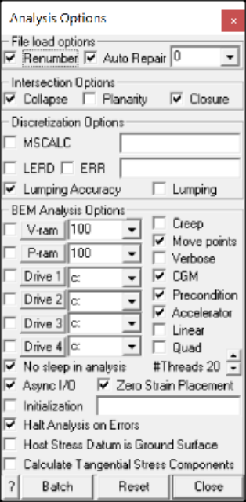

设置控制程序各项操作的选项。

#### File Load Options:

Analysis > Options > Renumber 重新编号表面，使体积为正（在文件加载期间）。Analysis > Options > Auto Repair 尝试通过填补间隙、删除重复项等方式修复模型（在文件加载期间）。

#### Intersection Options:

Analysis > Options > Collapse 合并相邻表面（在相交分析期间）。

Analysis > Options > Planarity 将非平面四边形细分为三角形（在相交分析期间）。

Analysis > Options > Closure 进行闭合与重叠检查，并解决布尔相交（在相交分析期间）。

#### Discretization Options:

Analysis > Options > MSCALC 在用户定义的点上计算结果（在 Map3D BEM 分析期间）。

Analysis > Options > LERD 计算能量释放率和加载系统刚度（在 Map3D BEM 分析期间）。

Analysis > Options > ERR 计算能量释放率和加载系统刚度（在 Map3D BEM 分析期间）。

Analysis > Options > Lumping Accuracy

Analysis > Options > Lumping 预先计算系数矩阵的大小（在离散化分析期间）。

#### Map3D BEM Analysis Options:

Analysis > Options > V-ram 将部分系数矩阵存储在虚拟内存中（在 Map3D BEM 分析期间）。

Analysis > Options > P-ram 将部分系数矩阵存储在物理内存中（在 Map3D BEM 分析期间）。Analysis > Options > Drive 1 指定系数矩阵的主暂存驱动器（在 Map3D BEM 分析期间）。

Analysis > Options > Drive 2 指定系数矩阵的第二暂存驱动器（在 Map3D BEM 分析期间）。

Analysis > Options > Drive 3 指定系数矩阵的第三暂存驱动器（在 Map3D BEM 分析期间）。

Analysis > Options > Drive 4 指定系数矩阵的第四暂存驱动器（在 Map3D BEM 分析期间）。

Analysis > Options > Creep 进行弹-粘-塑性蠕变分析。

Analysis > Options > Move Points 移动非常靠近边界表面的场点（在 Map3D BEM 分析期间）。

Analysis > Options > Verbose 将所有解向量和场点结果写入日志文件（在 Map3D BEM 分析期间）。

Analysis > Options > CGM 使用共轭梯度求解器（在 Map3D BEM 分析期间）。

Analysis > Options > Precondition 对矩阵进行预处理（在 Map3D BEM 分析期间）。Analysis > Options > Accelerate 使用矩阵加速器（在 Map3D BEM 分析期间）。Analysis > Options > Linear 使用高阶边界单元（在 Map3D BEM 分析期间）。

Analysis > Options > Quad 使用高阶边界单元（在 Map3D BEM 分析期间）。

Analysis > Options > Threads = 8  表示当前活动的线程数。

Analysis > Options > Nosleep in analysis 使用 Windows 异步 I/O 例程（在 Map3D BEM 分析期间）。

Analysis > Options > Async I/O 使用 Windows 异步 I/O 例程（在 Map3D BEM 分析期间）。

Analysis > Options > Zero Strain Placement 使用 CAD > Edit > Entity Properties 为块体指定新材料时，这些材料将按 CAD > Properties > Material Properties 中指定的应力状态进行初始化。

Analysis > Options > Initialization 初始化模型，使分析从上一次分析结束的位置继续。

Analysis > Options > Halt on Errors 初始化模型，使分析从上一次分析结束的位置继续。

Analysis > Options > Host Stress Datum is Ground Surface 将基准面视为地表，使基准面以上的任何表面都被赋予零应力状态。

Analysis > Options > Calculate Tangential Stress Components 在弹性分析中，除非有要求，否则不计算切向应力。这是因为求解过程不需要它们，且会增加分析时间。在塑性分析中，默认会计算这些值。

#### Miscellaneous Options:

Analysis > Options > Batch 设置分析批处理队列。

Analysis > Options > Reset
