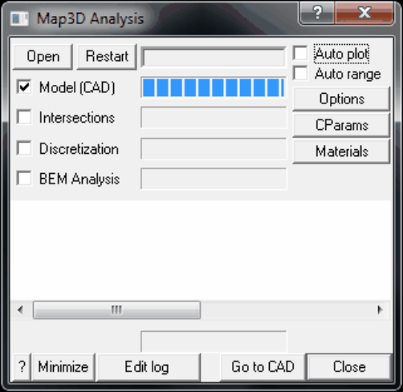

打开 Map3D Analysis 对话框，该对话框控制所有应力分析功能。

Analysis > Open 从文件加载模型。

Analysis > Restart 重新启动因中止、断电或操作系统崩溃而中断的分析。

Analysis > Model (CAD) 从文件加载模型。

Analysis > Intersections 进行接触与相交分析。

Analysis > Discretization 块体与网格离散化。

Analysis > BEM Analysis Map3D 边界元（BEM）分析。

Analysis > Auto Plot 在 Map3D BEM 分析进行过程中自动绘制所选的表面分量。

Analysis > Auto Range 在 Map3D BEM 分析进行过程中自动调整等值线范围。

Analysis > Options 设置控制程序各项操作的选项。

Analysis > Cparams 在分析过程中修改分析控制参数。

Analysis > Materials 在分析过程中修改材料属性。

Analysis > Minimize 在分析过程中最小化图形显示。

Analysis > Edit log 编辑日志文件。日志文件记录了写入消息窗口的所有消息。

Analysis > Go to CAD 进入模型构建与编辑阶段。

Analysis > Close 关闭对话框。

Analysis > Spawn Results 启动另一个 Map3D 实例并加载第一个开采步骤的结果。这便于在后续步骤仍在分析时查看已完成步骤的结果。

Analysis > Suspend 暂停当前正在运行的分析。

Analysis > Resume 恢复已暂停的分析。
