## 5.5.1.1 块体

构建完全三维的 FF（Fictitious Force）型块体。这些块体用于 3D 采空区、替代材料区（矿体或岩脉）以及充填区。块体表面将在程序的后续阶段进一步细分为边界单元。在 Map3D Non-Linear 中，这些区域可以屈服并表现出非线性行为。

多个块体可以组合成复杂的 3D 形状。FFLoop 功能（ CAD > Build > FF Loop）可用于从底面平面或剖面拉伸出一系列 3D FF 块体，也可用于在多个底面平面或剖面之间进行插值。

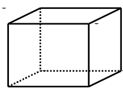

启动该功能时，系统会提示您选择前 4 个角点，用于定义 6 面块体的一个面（例如底面）。输入完毕后，系统会提示您再输入 4 个角点（角点 5、6、7 和 8），用于定义块体的相对面（例如顶面）。

角点可以按顺时针或逆时针方向排序，前提是底面和顶面以相同的顺序输入，且顶面角点 5、6、7 和 8 正好位于底面角点 1、2、3 和 4 的正上方。

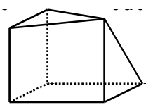

任何角点都可以重复使用，以定义 3 面体形状和楔形体。

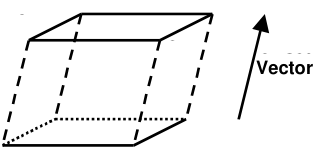

定义底面（角点 1、2、3 和 4）后，其余角点（5、6、7 和 8）可以通过偏移或拉伸生成

#### CAD > Build > Offset Remaining

角点的坐标可以通过键盘输入

#### CAD > Build > Enter Point

通过徒手绘制选取、从其他实体（其他块体或构造线）拾取，或进行数字化

#### CAD > Digitizer Setup > Activate

有多种绘图工具可帮助您在模型上直观地选取点

#### CAD > Snap

可以使用以下功能取消选择角点

#### CAD > Build > Undo Point

可以使用以下功能重新选择角点

#### CAD > Build > Redo Point

当输入第 8 个角点或用户选择以下功能时，块体即视为完成

块体构建完成后，系统会提示您输入块体属性。这样可以指定各种参数，包括块体颜色和开采顺序。

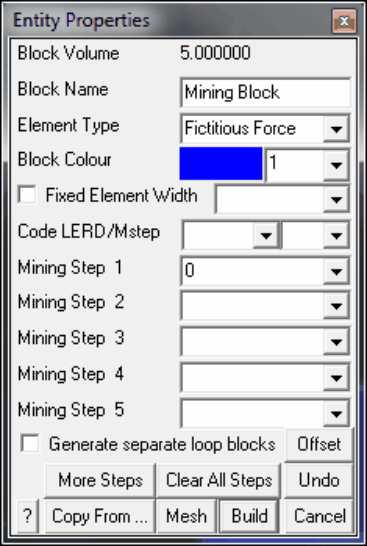

Block Volume - 显示块体的体积。

Block Name - 指定块体的描述性名称。

Element Type - 指定块体所使用的边界单元类型。

- Fictitious Force - FF 单元应用于三维要素，如采空区、替代材料区、充填采场等。

- Displacement Discontinuity - DD 单元应用于板状开采空区、裂隙和断层面。

- 非活动单元可用于显示仅供可视化而包含、不用于实际应力分析的要素。

Block Colour - 指定用于显示块体的颜色编号。

指定分配给每个按钮的颜色编号。共有 10 种颜色可供显示。它们依次编号为

1 到 10、11 到 20、21 到 30 等，

因此编号

1、11、21 ……，2、22、32 ……，3、23、33 ……等显示相同的颜色。

Fixed Element Width - 指定用户定义的单元宽度。

该参数可用于对选定实体强制采用均匀离散化。指定此值时务必格外小心，因为较小的值很容易导致问题规模过大。

一般情况下不应使用此选项（取消选中），离散化应交由 _AL_ 和 _AG_ 参数处理。后者仅在需要分析结果的位置集中布置单元，从而优化单元使用并最小化问题规模。更多讨论请参阅

#### CAD > Properties Control Parameters

在相交分析期间，该参数也可用于避免生成边长大于此值的表面。边长超过此尺寸的任何表面都不会被合并（collapse）

#### Analysis > Options > Collapse

在离散化过程中，边长超过此尺寸的任何表面都将被细分，以防止出现边长大于此值的表面。

有关此参数的使用示例，请参阅 Tabular Mining Example

Matl_Code LERD/MStep - 指定用于 LERD/LSS 计算时代入块体的材料代码。

第一个框用于填写材料代码。

第二个框用于指定进行计算的开采步骤编号。如果此框留空，则对所有步骤进行 LERD 计算。

#### Analysis > Options > LERD/LSS。

- Mining Step n - 指定在开采步骤 n 中用于该块体的材料代码。在上例中，块体在步骤 1 中不存在，在步骤 2 中插入材料 #2（矿石），在步骤 3 中被开挖（材料代码 0 表示开挖），最后在步骤 4 中插入材料 #5（充填体）。使用正的材料编号时，材料以指定的初始应力状态置入块体，然后按您为该材料编号设置的弹/塑性属性发生变形。使用负的材料编号时，材料以指定的初始应力状态置入块体，但无论发生何种变形，应力状态都保持在这些数值，从而提供应力边界条件。

More Steps - 允许指定更多开采步骤。

Clear All Steps - 清除所有开采步骤（1-100）。

Undo - 取消选择最后输入的点，并返回块体构建流程

#### CAD > Build > Undo Point

Copy From… - 允许您选择另一个块体，从中复制实体属性。

Mesh - 构建块体，并按指定的块体网格间距将表面细分为更小的部分。

Build - 完成块体构建并将块体录入模型数据库。

完成此操作后，您还有最后一次机会撤销此操作，并通过选择以下功能将该块体从模型数据库中移除

#### CAD > Build > Undo Build

Cancel 中止块体构建。

请注意，可以创建体积为零的块体，例如指定长度为零的偏移矢量。这使用户可以根据需要构建单个 FF 表面。虽然这是允许的，但不建议这样做，因为它可能导致体积不闭合。

只需更改单元类型，即可随时将 FF 块体合并为 DD 平面

#### CAD > Edit > Entity Properties

在这种情况下，块体的底面（由角点 1、2、3 和 4 定义的面）将成为 DD 平面，块体的其余各面将被丢弃。

Notes:

应使用不同的颜色编号来表示块体的逻辑分组（例如不同的水平、剖面或逻辑开采单元，如开拓、采场等）。这些颜色可由用户定义

#### Tools > Custom Colours

具有相同颜色编号的所有块体将被 Map3D 自动合并为单一的复杂形状。

由于很容易开启和关闭特定块体颜色编号的显示

#### View > Hide Block Colours

这为处理复杂的模型数据提供了一种高效的方法。

有关模型构建方面的讨论，请参阅：

#### Model Building and Editing

有关模型构建教程，请参阅：

#### Model Building Tutorials

按空格键会自动激活上一次使用的构建功能。

## 5.5.1.2 FF Loop

构建完全三维的 FF（Fictitious Force）型块体。这些块体用于 3D 采空区、替代材料区（矿体或岩脉）以及充填区。块体表面将在程序的后续阶段进一步细分为边界单元。在 Map3D Non-Linear 中，这些区域可以屈服并表现出非线性行为。

有关此功能的一些示例，可在 Model Building Tutorials 中找到。请特别参阅

- Video demo of FFLoop model building with multiple loops

- Video demo of FFLoop model simplification using slicing

- FFLoop Drift Example

- FFLoop Stope Example

- Bulk Mining Example

#### FFLoops

启动该功能时，系统会提示您选择角点，用于定义一系列平面图或剖面的周界。遍历每个回路的方向无关紧要。可以同时定义任意数量的回路。每个回路上的点数不必相同。每个回路的起点和终点（例如第一个回路上的点 1 和 11，第二个回路上的点 12 和 22）必须位于同一位置，以定义一系列闭合回路。

#### Snap > Trace

可以逐个选择单个点，也可以使用 CAD > Snap > Trace CLoop 捕捉功能选择沿某条构造线段的所有点。

#### Snap > Win

可以逐个选择单个点，也可以使用 CAD > Snap > Window 捕捉功能选择沿多条构造线的所有点。

#### Close

满足以下两个条件之一时，FFLoop 功能即视为完成：

- 用户第三次选择回路的最后一个点（即点 #22）

- CAD > Build > FFLoop

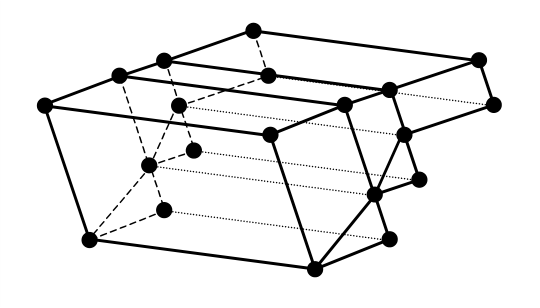

随后，回路将被细分为一系列 3 边或 4 边的 FF 单元。这些表面将在程序的后续阶段进一步细分为边界单元。执行该细分的程序会查找彼此靠近的角点，因此用户应注意定义回路，使连接关系简单明确。在上例中，建议选取或生成点 4 和点 5。

#### Guide Lines

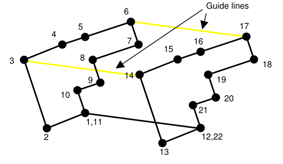

对于较复杂的形状，可以定义导线（以黄色显示），强制沿这些线细分各面。导线只需定义为构造线即可。示例请参阅 [https://www.map3d.com/ffloop.htm](https://www.map3d.com/ffloop.htm)。导线不得相交或交叉。

#### Extrusion using Offset

输入第一个闭合回路后，可以使用 CAD > Build > Offset Remaining 偏移其余各点来生成这些点

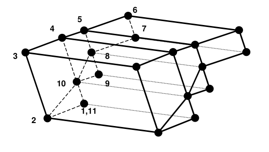

#### Miscellaneous

角点的坐标可以通过键盘输入

#### CAD > Build > Enter Point

通过徒手绘制选取、从其他实体（其他块体或构造线）拾取，或进行数字化

#### CAD > Digitizer Setup > Activate

有多种绘图工具可帮助您在模型上直观地选取点

#### CAD > Snap

可以使用以下功能取消选择角点

#### CAD > Build > Undo Point

可以使用以下功能重新选择角点

#### CAD > Build > Redo Point

块体构建完成后，系统会提示您输入块体属性。这样可以指定各种参数，包括块体颜色和开采顺序。

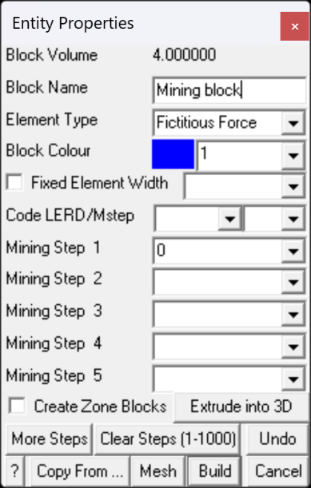

Block Volume - 显示块体的体积。

Block Name - 指定块体的描述性名称。

Element Type - 指定块体所使用的边界单元类型。

- Fictitious Force - FF 单元应用于三维要素，如采空区、替代材料区、充填采场等。

- Displacement Discontinuity - DD 单元应用于板状开采空区、裂隙和断层面。

- 非活动单元可用于显示仅供可视化而包含、不用于实际应力分析的要素。

Block Colour - 指定用于显示块体的颜色编号。

指定分配给每个按钮的颜色编号。共有 10 种颜色可供显示。它们依次编号为

1 到 10、11 到 20、21 到 30 等，

因此编号

1、11、21 ……，2、22、32 ……，3、23、33 ……等显示相同的颜色。

Fixed Element Width - 指定用户定义的单元宽度。

该参数可用于对选定实体强制采用均匀离散化。指定此值时务必格外小心，因为较小的值很容易导致问题规模过大。

一般情况下不应使用此选项（取消选中），离散化应交由 _AL_ 和 _AG_ 参数处理。后者仅在需要分析结果的位置集中布置单元，从而优化单元使用并最小化问题规模。更多讨论请参阅

#### CAD > Properties Control Parameters

在相交分析期间，该参数也可用于避免生成边长大于此值的表面。边长超过此尺寸的任何表面都不会被合并（collapse）

#### Analysis > Options > Collapse

在离散化过程中，边长超过此尺寸的任何表面都将被细分，以防止出现边长大于此值的表面。

有关此参数的使用示例，请参阅 Tabular Mining Example

Matl_Code LERD/MStep - 指定用于 LERD/LSS 计算时代入块体的材料代码。

第一个框用于填写材料代码。

第二个框用于指定进行计算的开采步骤编号。如果此框留空，则对所有步骤进行 LERD 计算。

#### Analysis > Options > LERD/LSS。

- Mining Step n - 指定在开采步骤 n 中用于该块体的材料代码。在上例中，块体在步骤 1 中不存在，在步骤 2 中插入材料 #2（矿石），在步骤 3 中被开挖（材料代码 0 表示开挖），最后在步骤 4 中插入材料 #5（充填体）。使用正的材料编号时，材料以指定的初始应力状态置入块体，然后按您为该材料编号设置的弹/塑性属性发生变形。使用负的材料编号时，材料以指定的初始应力状态置入块体，但无论发生何种变形，应力状态都保持在这些数值，从而提供应力边界条件。

Create Zone Blocks - 如果要构建多回路块体，可以指定是否在各块体之间创建界面，使每个块体都可作为独立的开采单元处理。这些子区段将各自被指定不同的颜色编号，以便在使用 Hide Block Colours 查看时方便隐藏/显示。如果不指定此选项，则将创建一个大的单一块体。

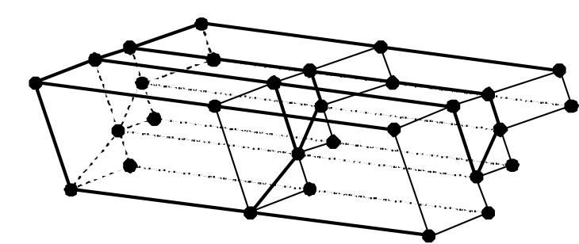

Extrude into 3D - 允许您偏移平面回路，将块体拉伸为 3D 形状。此操作也可以使用 Extrude/Offset Remaining 完成。

More Steps - 允许指定更多开采步骤。

Clear All Steps - 清除所有开采步骤（1-1000）。

Undo - 取消选择最后输入的点，并返回块体构建流程

#### CAD > Build > Undo Point

Copy From… - 允许您选择另一个块体，从中复制实体属性。

Mesh - 构建块体，并按指定的块体网格间距将表面细分为更小的部分。

Build - 完成块体构建并将块体录入模型数据库。

完成此操作后，您还有最后一次机会撤销此操作，并通过选择以下功能将该块体从模型数据库中移除

#### CAD > Build > Undo Build

Cancel 中止块体构建。

请注意，可以创建体积为零的块体，例如指定长度为零的偏移矢量。这使用户可以根据需要构建单个 FF 表面。虽然这是允许的，但不建议这样做，因为它可能导致体积不闭合。

只需更改单元类型，即可随时将 FF 块体合并为 DD 平面

#### CAD > Edit > Entity Properties

在这种情况下，块体的底面（由角点 1、2、3 和 4 定义的面）将成为 DD 平面，块体的其余各面将被丢弃。

Notes:

应使用不同的颜色编号来表示块体的逻辑分组（例如不同的水平、剖面或逻辑开采单元，如开拓、采场等）。这些颜色可由用户定义

#### Tools > Custom Colours

具有相同颜色编号的所有块体将被 Map3D 自动合并为单一的复杂形状。

由于很容易开启和关闭特定块体颜色编号的显示

#### View > Hide Block Colours

这为处理复杂的模型数据提供了一种高效的方法。

有关模型构建方面的讨论，请参阅：

#### Model Building and Editing

有关模型构建教程，请参阅：

#### Model Building Tutorials

按空格键会自动激活上一次使用的构建功能。

## 5.5.1.3 DD Loop

构建 DD（Displacement Discontinuity）型块体。这些块体用于板状开采、薄矿层或断层面。在 Map3D 的所有版本中，这些区域都可以屈服并表现出非线性行为。多个 DD 可以组合成复杂的错位和起伏形状。

有关此功能的一些示例，可在 Model Building Tutorials 中找到。请特别参阅

- Video demo of DDLoop model building with sub-parallel lines

- Video demo of DDLoop model building with interior loops

- DDLoop Pillar Example

- Tabular Mining Example

#### DDLoop

启动该功能时，系统会提示您选择一系列回路，用于定义所需区域的周界。遍历每个回路的方向无关紧要。每个回路的起点和终点（例如点 1 和 11，或 12 和 22）必须位于同一位置，以定义闭合回路。

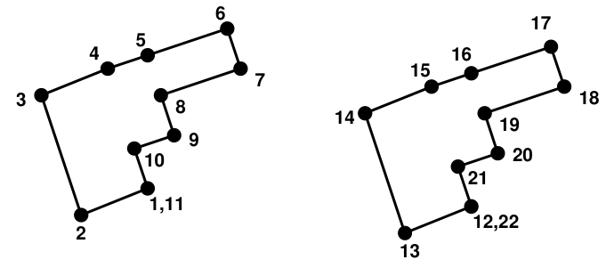

#### Snap > Trace

可以逐个选择单个点，也可以使用 CAD > Snap > Trace CLoop 捕捉功能选择沿某条构造线段的所有点。

#### Snap > Win

可以逐个选择单个点，也可以使用 CAD > Snap > Window 捕捉功能选择沿多条构造线的所有点。

#### Close

满足以下两个条件之一时，DDLoop 功能即视为完成：

- 用户第三次选择回路的最后一个点（即点 #12,22）

- CAD > Build > DDLoop

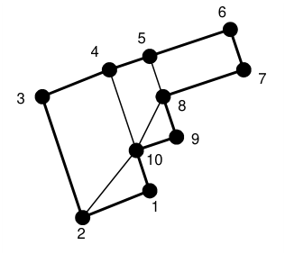

随后，回路将被细分为一系列 3 边或 4 边的 DD 单元。这些表面将在程序的后续阶段进一步细分为边界单元。执行该细分的程序会查找彼此靠近的角点，因此用户应注意定义回路，使连接关系简单明确。在上例中，建议选取或生成点 4 和点 5。

Mesh 构建功能（见下文）可用于构建块体，并按指定的块体网格间距将表面细分为更小的部分。该功能会根据需要生成内部点，以保持单元形状良好。

#### Guide Lines

通过定义导线（以黄色显示），可以同时追踪多个内部区域。

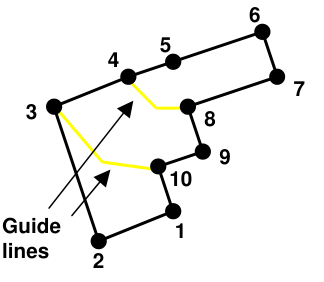

导线只需定义为构造线即可。示例请参阅 [https://www.map3d.com/t.htm](https://www.map3d.com/t.htm)。导线必须从边到边穿过周界回路。可以定义多条相互相交的导线，从而定义多个区域。

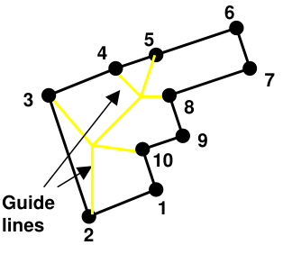

#### Interior Zones

可以通过追踪其外缘来定义多个内部区域（例如矿柱），如下所示。遍历内部区域的方向无关紧要。通过这种方式可以定义任意数量的内部区域。

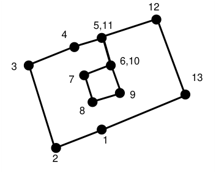

或者，也可以方便地通过追踪外周界（ CAD > Snap > Trace CLoop）并使用导线定义所需的内部形状来构建这些内部区域。

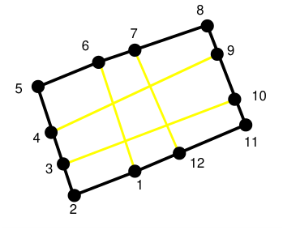

Create Zone Blocks - 如果要构建多回路 DD 平面，可以指定是否在各子区段之间创建界面，使每个子区段都可作为独立的一组 DDPlane 处理。这些子区段将各自被指定不同的颜色编号，以便在使用 Hide Block Colours 查看时方便隐藏/显示。如果不指定此选项，则将创建一个大的单一 DDPlane 组。

#### Extrusion using Offset

输入至少两个点后，可以使用 CAD > Build > Offset Remaining 偏移其余各点来生成这些点

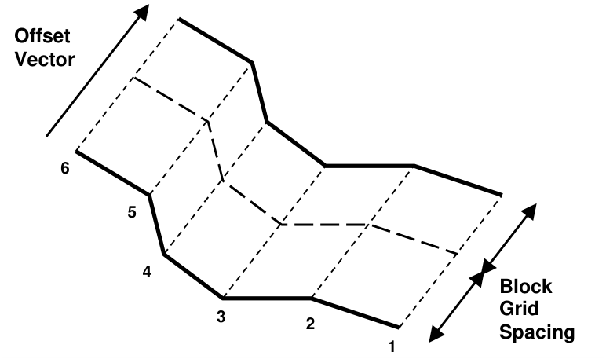

另请注意，只需将单元类型从 DD 更改为 FF，即可将 DD 单元拉伸为 FF 区域。

#### Miscellaneous

角点的坐标可以通过键盘输入

#### CAD > Build > Enter Point

通过徒手绘制选取、从其他实体（其他块体或构造线）拾取，或进行数字化

#### CAD > Digitizer Setup > Activate

有多种绘图工具可帮助您在模型上直观地选取点

#### CAD > Snap

可以使用以下功能取消选择角点

#### CAD > Build > Undo Point

可以使用以下功能重新选择角点

#### CAD > Build > Redo Point

块体构建完成后，系统会提示您输入块体属性。这样可以指定各种参数，包括块体颜色和开采顺序。

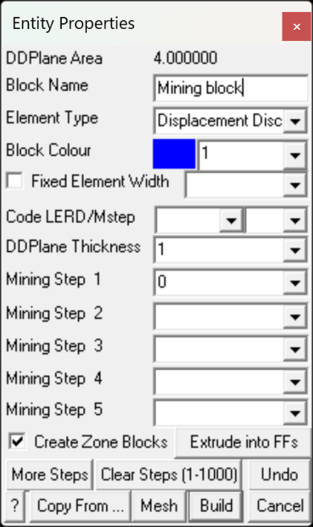

DDPlane Area - 显示 DDLoop 中包含的所有 DDPlane 的总面积。

Block Name - 指定块体的描述性名称。

Element Type - 指定块体所使用的边界单元类型。

- Displacement Discontinuity - DD 型单元应用于板状开采空区、裂隙和断层面。

- Fictitious Force - FF 型单元应用于三维要素，如采空区、替代材料区、充填采场等。

- 非活动单元可用于显示仅供可视化而包含、不用于实际应力分析的要素。

Block Colour - 指定用于显示块体的颜色编号。

指定分配给每个按钮的颜色编号。共有 10 种颜色可供显示。它们依次编号为

1 到 10、11 到 20、21 到 30 等，

因此编号

1、11、21 ……，2、22、32 ……，3、23、33 ……等显示相同的颜色。

Fixed Element Width - 指定用户定义的单元宽度。

该参数可用于对选定实体强制采用均匀离散化。指定此值时务必格外小心，因为较小的值很容易导致问题规模过大。

一般情况下不应使用此选项（取消选中），离散化应交由 _AL_ 和 _AG_ 参数处理。后者仅在需要分析结果的位置集中布置单元，从而优化单元使用并最小化问题规模。更多讨论请参阅

#### CAD > Properties Control Parameters

在相交分析期间，该参数也可用于避免生成边长大于此值的表面。边长超过此尺寸的任何表面都不会被合并（collapse）

#### Analysis > Options > Collapse

在离散化过程中，边长超过此尺寸的任何表面都将被细分，以防止出现边长大于此值的表面。

有关此参数的使用示例，请参阅 Tabular Mining Example

Matl_Code LERD/MStep - 指定用于 LERD/LSS 计算时代入块体的材料代码。

第一个框用于填写材料代码。

第二个框用于指定进行计算的开采步骤编号。如果此框留空，则对所有步骤进行 LERD 计算。

#### Analysis > Options > LERD/LSS。

#### Analysis > Options > LERD/LSS

DDPlane Thickness - 指定插入 DD 单元中的材料厚度（即断层泥、矿层宽度、采幅或矿柱高度）。

该要素被充填时，其法向位移（闭合量）将被限制在此厚度内。此外，法向位移（闭合量）和剪切位移（ride）都要除以该厚度，以确定充填材料中发生的应变

Fault-Gouge in DD planes

Backfill-Hyperbolic in DD planes Equilibrated-Gouge in DD planes

Mohr-Coulomb in DD planes

该参数应使用与指定坐标位置相同的单位（例如米或英尺）。

- Mining Step n - 指定在开采步骤 n 中用于该块体的材料代码。在上例中，块体在步骤 1 中不存在，在步骤 2 中插入材料 #2（矿石），在步骤 3 中被开挖（材料代码 0 表示开挖），最后在步骤 4 中插入材料 #5（充填体）。使用正的材料编号时，材料以指定的初始应力状态置入块体，然后按您为该材料编号设置的弹/塑性属性发生变形。使用负的材料编号时，材料以指定的初始应力状态置入块体，但无论发生何种变形，应力状态都保持在这些数值，从而提供应力边界条件。

Extrude into FFs - 允许您将 DD 平面拉伸为 FF 块体。系统将提示您输入拉伸矢量

More Steps - 允许指定更多开采步骤。

Clear All Steps - 清除所有开采步骤（1-1000）。

Undo - 取消选择最后输入的点，并返回块体构建流程

#### CAD > Build > Undo Point

Copy From… - 允许您选择另一个块体，从中复制实体属性。

Mesh - 构建块体，并按指定的块体网格间距将表面细分为更小的部分。该功能会根据需要生成内部点，以保持单元形状良好。

Build - 完成块体构建并将块体录入模型数据库。

完成此操作后，您还有最后一次机会撤销此操作，并通过选择以下功能将该块体从模型数据库中移除

#### CAD > Build > Undo Build

Cancel 中止块体构建。

请注意，可以创建体积为零的块体，例如指定长度为零的偏移矢量。这使用户可以根据需要构建单个 FF 表面。虽然这是允许的，但不建议这样做，因为它可能导致体积不闭合。

只需更改单元类型，即可随时将 DD 块体拉伸为 3D FF 块体

#### CAD > Edit > Entity Properties

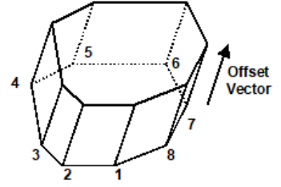

在这种情况下，角点 1 到 8 定义块体的底面。顶面和侧面在拉伸过程中自动生成。

请注意，可以创建体积为零的块体，例如指定长度为零的偏移矢量。这使用户可以根据需要构建单个 FF 表面。虽然这是允许的，但不建议这样做，因为它可能导致体积不闭合。

Notes:

应使用不同的颜色编号来表示块体的逻辑分组（例如不同的水平、剖面或逻辑开采单元，如开拓、采场等）。这些颜色可由用户定义

#### Tools > Custom Colours

具有相同颜色编号的所有块体将被 Map3D 自动合并为单一的复杂形状。

由于很容易开启和关闭特定块体颜色编号的显示

#### View > Hide Block Colours

这为处理复杂的模型数据提供了一种高效的方法。

有关模型构建方面的讨论，请参阅：

#### Model Building and Editing

有关模型构建教程，请参阅：

#### Model Building Tutorials

按空格键会自动激活上一次使用的构建功能。

## 5.5.1.4 Tunnel

构建巷道（FF - Fictitious Force 型块体）。用于沿巷道路径拉伸横截面来构建 3D 巷道。巷道表面将在程序的后续阶段进一步细分为边界单元。

#### Tunnel

巷道构建分三个阶段进行：

- 1) 选择巷道轮廓；

- 2) 选择巷道参考点；

- 3) 选择巷道路径/布置。

**Stage 1 - Tunnel Profile**

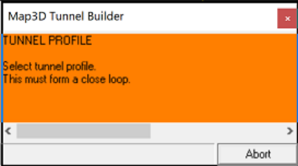

启动该功能时，系统会提示您选择巷道轮廓：

- 它必须构成闭合回路

- 它可以按任意所需方向构建（x-y、y-z、x-z 或任何用户定义方向）`o` 请注意，如果轮廓在 x-y 平面内构建，则将 y 方向作为向上 `o` 否则，如果轮廓在 y-z 或 x-z 平面内构建，则将 z 方向作为向上

- 选择时请记住，该巷道轮廓将沿远离您视点的方向拉伸（如下方红色箭头所示）

- 可以按照类似选择构造线的方式，以一系列点来选择它 CAD > Build > Construction Lines

- 或者，可以使用例如 CAD > Snap > Trace CLoop 选择以构造线预先定义好的形状

- 在轮廓选择期间可以使用所有捕捉和构建功能，包括 CAD > Build > Offset Remaining

这里巷道轮廓以绿色显示。红色箭头表示在阶段 3 - 巷道路径/布置中巷道的拉伸方向。

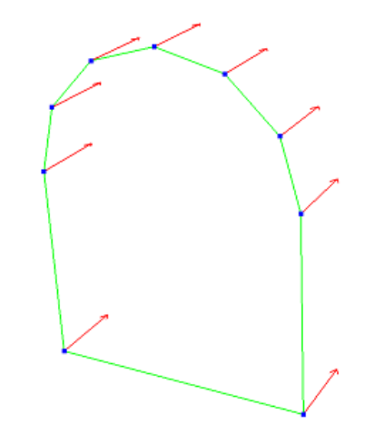

当回路闭合时，Map3D 会检测到完整的巷道轮廓。随后将引导您进入阶段 2 - 巷道参考点。

**Stage 2 - Tunnel Reference Point**

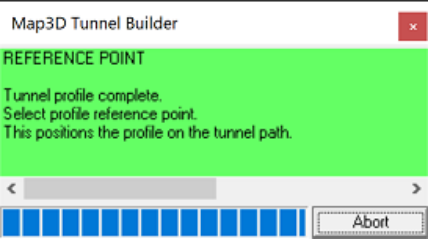

巷道参考点表示巷道轮廓上用于将轮廓定位到巷道路径/布置上的位置。

下图中选取了右下角作为参考点。

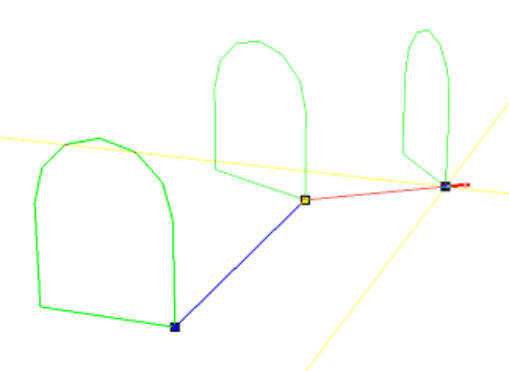

选择参考点后，将引导您进入阶段 3 - 巷道路径/布置。

请注意，如果选错了参考点，只需使用 CAD > Build > Undo Build 或按 Esc 键撤销选择即可。

**Stage 3 - Tunnel Path/Layout**

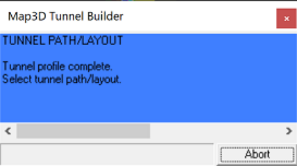

现在可以选择巷道路径/布置：

- 上面选取的轮廓将沿路径/布置拉伸

- 可以按照类似选择构造线的方式选择路径/布置 CAD > Build > Construction Lines

- 或者，可以沿一组预先定义的构造线选择路径/布置

- 闭合巷道回路是可以接受的

- 倾斜的巷道路径是可以接受的

- 在轮廓选择期间可以使用所有捕捉和构建功能，包括 CAD > Build > Offset Remaining

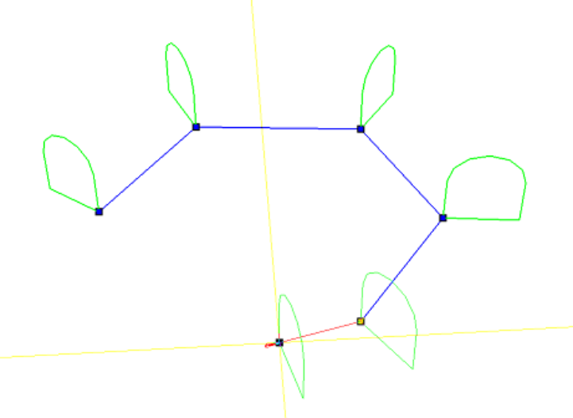

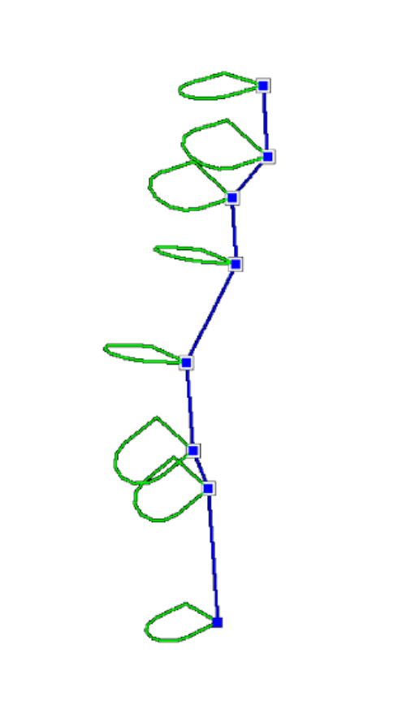

上图左侧，路径的前两个点选在水平面内（倾角或俯角小于 45°），因此巷道被拉伸为水平巷道，断面按图示竖直放置。右侧，路径的前两个点选在竖直面内（倾角或俯角大于 45°），因此巷道被拉伸为竖井，断面按图示近于水平放置。

满足以下两个条件之一时，巷道路径/布置即视为完成：

- 用户第二次选择最后一个点

- CAD > Build > Tunnel

完成后，巷道将按下图所示构建。

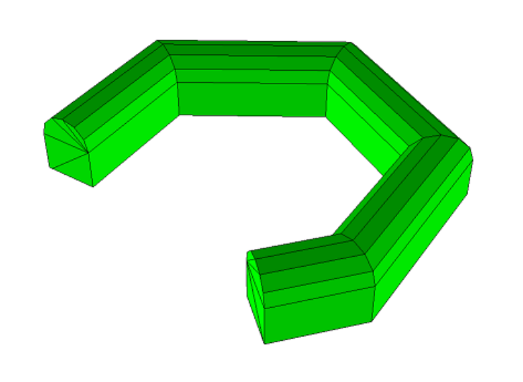

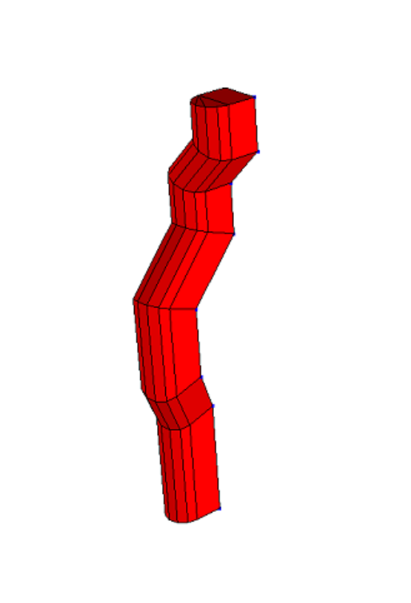

#### Miscellaneous

角点的坐标可以通过键盘输入

#### CAD > Build > Enter Point

通过徒手绘制选取、从其他实体（其他块体或构造线）拾取，或进行数字化

#### CAD > Digitizer Setup > Activate

有多种绘图工具可帮助您在模型上直观地选取点

#### CAD > Snap

可以使用以下功能取消选择角点

#### CAD > Build > Undo Point

可以使用以下功能重新选择角点

#### CAD > Build > Redo Point

块体构建完成后，系统会提示您输入块体属性。这样可以指定各种参数，包括块体颜色和开采顺序。

Block Volume - 显示块体的体积。

Block Name - 指定块体的描述性名称。

Element Type - 指定块体所使用的边界单元类型。

- Fictitious Force - FF 单元应用于三维要素，如采空区、替代材料区、充填采场等。

- 非活动单元可用于显示仅供可视化而包含、不用于实际应力分析的要素。

Block Colour - 指定用于显示块体的颜色编号。

指定分配给每个按钮的颜色编号。共有 10 种颜色可供显示。它们依次编号为

1 到 10、11 到 20、21 到 30 等，

因此编号

1、11、21 ……，2、22、32 ……，3、23、33 ……等显示相同的颜色。

Fixed Element Width - 指定用户定义的单元宽度。

该参数可用于对选定实体强制采用均匀离散化。指定此值时务必格外小心，因为较小的值很容易导致问题规模过大。

一般情况下不应使用此选项（取消选中），离散化应交由 _AL_ 和 _AG_ 参数处理。后者仅在需要分析结果的位置集中布置单元，从而优化单元使用并最小化问题规模。更多讨论请参阅

#### CAD > Properties Control Parameters

在相交分析期间，该参数也可用于避免生成边长大于此值的表面。边长超过此尺寸的任何表面都不会被合并（collapse）

#### Analysis > Options > Collapse

在离散化过程中，边长超过此尺寸的任何表面都将被细分，以防止出现边长大于此值的表面。

有关此参数的使用示例，请参阅 Tabular Mining Example

Matl_Code LERD/MStep - 指定用于 LERD/LSS 计算时代入块体的材料代码。

第一个框用于填写材料代码。

第二个框用于指定进行计算的开采步骤编号。如果此框留空，则对所有步骤进行 LERD 计算。

#### Analysis > Options > LERD/LSS。

- Mining Step n - 指定在开采步骤 n 中用于该块体的材料代码。在上例中，块体在步骤 1 中不存在，在步骤 2 中插入材料 #2（矿石），在步骤 3 中被开挖（材料代码 0 表示开挖），最后在步骤 4 中插入材料 #5（充填体）。使用正的材料编号时，材料以指定的初始应力状态置入块体，然后按您为该材料编号设置的弹/塑性属性发生变形。使用负的材料编号时，材料以指定的初始应力状态置入块体，但无论发生何种变形，应力状态都保持在这些数值，从而提供应力边界条件。

Generate Separate Loop Blocks - 您可以指定是否在各块体之间创建界面，使每个块体都可作为独立的开采单元处理（如下所示）。如果不指定此选项，则将创建一个大的单一块体。

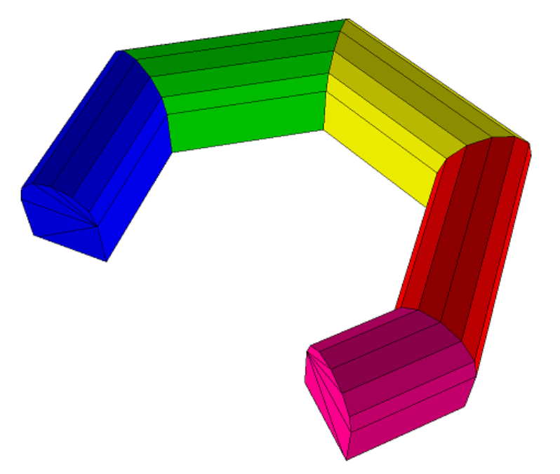

More Steps - 允许指定更多开采步骤。

Clear All Steps - 清除所有开采步骤（1-100）。

Undo - 取消选择最后输入的点，并返回巷道构建流程

#### CAD > Build > Undo Point

Copy From… - 允许您选择另一个块体，从中复制实体属性。

Mesh - 构建块体，并按指定的块体网格间距将表面细分为更小的部分。

Build - 完成块体构建并将块体录入模型数据库。

完成此操作后，您还有最后一次机会撤销此操作，并通过选择以下功能将该块体从模型数据库中移除

#### CAD > Build > Undo Build

Cancel 中止块体构建。

Notes:

应使用不同的颜色编号来表示块体的逻辑分组（例如不同的水平、剖面或逻辑开采单元，如开拓、采场等）。这些颜色可由用户定义

#### Tools > Custom Colours

具有相同颜色编号的所有块体将被 Map3D 自动合并为单一的复杂形状。

由于很容易开启和关闭特定块体颜色编号的显示

#### View > Hide Block Colours

这为处理复杂的模型数据提供了一种高效的方法。

有关模型构建方面的讨论，请参阅：

#### Model Building and Editing

有关模型构建教程，请参阅：

#### Model Building Tutorials

按空格键会自动激活上一次使用的构建功能。

## 5.5.1.5 Grid Plane

构建网格平面。分析结果（应力、应变和位移）在这些网格平面上计算。每个网格平面将在程序的后续阶段进一步细分。

此功能使用与 CAD > Build > DDLoop 相同的构建功能

请注意，线网格可以使用以下功能创建

CAD > Build > Grid Line。

启动该功能时，系统会提示您选择一个由角点构成的闭合回路，用于定义网格平面的周界。当最后选取的角点与第一个角点相同，或用户选择构建 GPlane 工具栏按钮时，网格平面即视为完成

CAD > Build > Grid Plane

**Snap > Trace**

可以逐个选择单个点，也可以使用 CAD > Snap > Trace CLoop 捕捉功能选择沿某条构造线段的所有点。

#### Snap > Win

可以逐个选择单个点，也可以使用 CAD > Snap > Window 捕捉功能选择沿多条构造线的所有点。

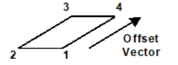

输入至少两个点后，其余各点可以通过偏移生成

#### CAD > Build > Offset Remaining

角点的坐标可以通过键盘输入

#### CAD > Build > Enter Point

通过徒手绘制选取、从其他实体（其他块体或构造线）拾取，或进行数字化

#### CAD > Digitizer Setup > Activate

有多种绘图工具可帮助您在模型上直观地选取点

#### CAD > Snap

可以使用以下功能取消选择角点

#### CAD > Build > Undo Point

可以使用以下功能重新选择角点

#### CAD > Build > Redo Point

网格平面构建完成后，系统会提示您输入属性。这样可以为网格平面指定名称。

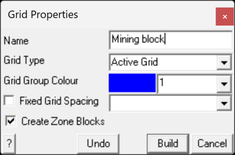

Name - 指定网格的描述性名称。

Grid Type - 指定网格是活动（用于应力分析）还是非活动（不用于应力分析）。

Fixed Grid Spacing - 指定用户定义的网格间距。

该参数可用于对选定网格强制采用均匀离散化。指定此值时务必格外小心，因为较小的值很容易导致问题规模过大。

一般情况下不应使用此选项（取消选中），离散化应交由 _AG_ 参数处理。后者仅在需要分析结果的位置集中布置单元，从而优化单元使用并最小化问题规模。

#### CAD > Properties Control Parameters

Create Zone Blocks - 如果要构建多回路网格平面，可以指定是否在各子区段之间创建界面，使每个子区段都可作为独立的一组 GPlane 处理。这些子区段将各自被指定不同的颜色编号，以便在使用 Hide Grid Colours 查看时方便隐藏/显示。如果不指定此选项，则将创建一个大的单一 GPlane 组。

Undo - 取消选择最后输入的点，并返回网格构建流程

#### CAD > Build > Undo Point

Build - 完成网格构建并将其录入模型数据库。

完成此操作后，您还有最后一次机会撤销此操作，并通过选择以下功能将该网格从模型数据库中移除

#### CAD > Build > Undo Build

Cancel - 中止网格构建。

有关场点网格平面的使用示例，请参阅：

#### Model Building Tutorials

按空格键会自动激活上一次使用的构建功能。

## 5.5.1.6 Grid Line

构建网格线。分析结果（应力、应变和位移）在这些网格线上计算。每条网格线将在程序的后续阶段进一步细分。

#### CAD > Build > Construction Lines

此功能使用与以下功能相同的构建功能

#### CAD > Build > Grid Plane。

请注意，网格平面可以使用以下功能创建

**2**

**1**

启动该功能时，系统会提示您选择多个角点，用于定义沿网格线的点。

当最后一个角点被选择两次，或用户选择以下功能时，网格线即视为完成

CAD > Build > Grid Line

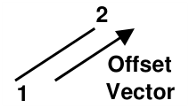

输入第一个点后，其余的点可以通过偏移生成

#### CAD > Build > Offset Remaining

角点的坐标可以通过键盘输入

#### CAD > Build > Enter Point

通过徒手绘制选取、从其他实体（其他块体或构造线）拾取，或进行数字化

#### CAD > Digitizer Setup > Activate

有多种绘图工具可帮助您在模型上直观地选取点

#### CAD > Snap

可以使用以下功能取消选择角点

#### CAD > Build > Undo Point

可以使用以下功能重新选择角点

#### CAD > Build > Redo Point

网格平面构建完成后，系统会提示您输入属性。这样可以为网格线指定名称。

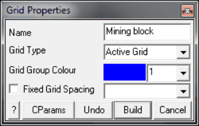

Name - 指定网格的描述性名称。

Grid Type - 指定网格是活动（用于应力分析）还是非活动（不用于应力分析）。

Fixed Grid Spacing - 指定用户定义的网格间距。

该参数可用于对选定网格强制采用均匀离散化。指定此值时务必格外小心，因为较小的值很容易导致问题规模过大。

一般情况下不应使用此选项（取消选中），离散化应交由 _AG_ 参数处理。后者仅在需要分析结果的位置集中布置单元，从而优化单元使用并最小化问题规模。

#### CAD > Properties Control Parameters

Undo - 取消选择最后输入的点，并返回网格构建流程

#### CAD > Build > Undo Point

Build - 完成网格构建并将其录入模型数据库。

完成此操作后，您还有最后一次机会撤销此操作，并通过选择以下功能将该网格从模型数据库中移除

#### CAD > Build > Undo Build

Cancel - 中止网格构建。

有关场点网格平面的使用示例，请参阅：

#### Model Building Tutorials

按空格键会自动激活上一次使用的构建功能。

## 5.5.1.7 Construction Lines

构建构造线。它们用于表示开采轮廓，并作为构建模型的辅助。构造线通常从图纸数字化得到，或从其他 CAD 软件包导入。

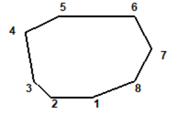

启动该功能时，系统会提示您选择一系列角点，用于定义所需区域的周界。当重复第 1 个角点，或用户选择以下功能时，构造线即视为完成

CAD > Build > Construction Lines

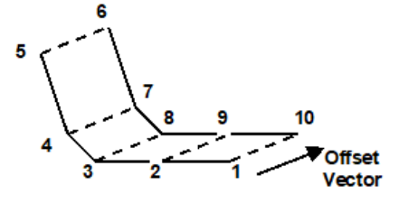

输入至少两个点后，其余各点可以通过偏移生成

#### CAD > Build > Offset Remaining

角点的坐标可以通过键盘输入

#### CAD > Build > Enter Point

通过徒手绘制选取、从其他实体（其他块体或构造线）拾取，或进行数字化

#### CAD > Digitizer Setup > Activate

有多种绘图工具可帮助您在模型上直观地选取点

#### CAD > Snap

可以使用以下功能取消选择角点

#### CAD > Build > Undo Point

可以使用以下功能重新选择角点

#### CAD > Build > Redo Point

块体构建完成后，系统会提示您输入属性。这样可以指定构造线的颜色。

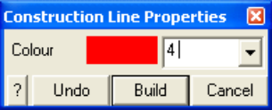

Colour - 指定用于显示构造线的颜色编号。共有 10 种颜色可供显示。它们依次编号为

1 到 10、11 到 20、21 到 30 等，

因此编号

1、11、21 ……，2、22、32 ……，3、23、33 ……等显示相同的颜色。

Undo - 取消选择最后输入的点，并返回构造线构建流程。

#### CAD > Build > Undo Point

Build - 完成网格构建并将其录入模型数据库。

完成此操作后，您还有最后一次机会撤销此操作，并通过选择以下功能将该网格从模型数据库中移除

#### CAD > Build > Undo Build

Cancel - 中止线的构建。

Notes

应使用不同的颜色编号来表示构造线的逻辑分组（例如不同的水平、剖面或逻辑开采单元，如开拓、采场等）。这些颜色可由用户定义

#### Tools > Custom Colours

由于很容易开启和关闭特定构造线颜色编号的显示

#### View > Hide Block Colours

这为处理复杂的构造线数据提供了一种高效的方法。

有关在模型构建中使用构造线的示例，请参阅：

#### Model Building Tutorials

按空格键会自动激活上一次使用的构建功能。

## 5.5.1.8 Enter Point

在构建以下实体期间，可以通过键盘输入角点的坐标：

#### CAD > Build > Block

CAD > Build > FF Loop

CAD > Build > DD Loop

CAD > Build > Tunnel

CAD > Build > Grid Plane

#### CAD > Build > Grid Line

#### CAD > Build > Construction Lines

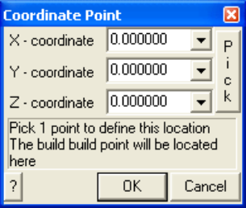

X, Y and Z – coordinate 指定点的坐标。

Pick - 激活光标十字线，以便从模型中交互式选取点。

为便于在模型上直观地选取点，所有捕捉功能均可使用。

#### CAD > Snap

选取后，点的坐标会显示在对话框中。

## 5.5.1.9 Extrude/Offset Remaining

拉伸部分构建的实体，以便在构建以下实体期间帮助生成其余各点：

#### CAD > Build > Block

CAD > Build > FF Loop

CAD > Build > DD Loop

CAD > Build > Tunnel

CAD > Build > Grid Plane

CAD > Build > Grid Line

#### CAD > Build > Construction Lines

X, Y and Z – offset 指定偏移矢量的各分量。所有选定实体都将移动该量。

Pick - 激活光标十字线，以便从模型中交互式选取偏移矢量。这需要选取两个点来定义该矢量。

Length, Plunge and Direction - 指定偏移矢量的各分量。所有选定实体都将移动该量。

Norm - 激活光标，以便交互式选择一个表面，使偏移矢量垂直于该表面。这需要选取两个点来定义该矢量。选取后，偏移矢量的各分量会显示在对话框中。

为便于在模型上直观地选取点，所有捕捉功能均可使用。

#### CAD > Snap

选取后，偏移矢量的各分量会显示在对话框中。

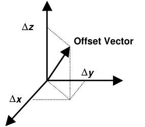

例如，如果您已构建了 3D 块体的底面（点 1、2、3 和 4），并希望在底面上方一米高程处生成其余各点（5、6、7 和 8），只需将偏移矢量输入为 (0,0,1)。

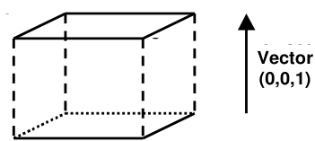

请注意，可以创建体积为零的块体，例如指定长度为零的偏移矢量。这使用户可以根据需要构建单个 FF 表面。虽然这是允许的，但不建议这样做，因为它可能导致体积不闭合。

## 5.5.1.10 Undo Point

在块体构建期间，点按顺序选取。这样可以在构建以下实体期间取消选择点：

CAD > Build > Block

CAD > Build > FF Loop

CAD > Build > DD Loop

CAD > Build > Tunnel

CAD > Build > Grid Plane

CAD > Build > Grid Line

CAD > Build > Construction Lines

任何被取消选择的点都可以使用以下功能重新选择

#### CAD > Build > Redo Point

块体构建完成后，可以通过选择以下功能撤销并将该块体从模型数据库中移除（支持 10 级撤销/重做）

#### CAD > Build > Undo Build

然后可以重做块体构建。这使您可以重复任何试验性的网格划分操作。

CAD > Build > Undo Redo

## 5.5.1.11 Redo Point

在块体构建期间，点按顺序选取。这样可以在构建以下实体期间重新选择任何已被取消选择的点：

CAD > Build > Block

CAD > Build > FF Loop

CAD > Build > DD Loop

CAD > Build > Tunnel

CAD > Build > Grid Plane

CAD > Build > Grid Line

CAD > Build > Construction Lines

可以使用以下功能取消选择点

#### CAD > Build > Undo Point

块体构建完成后，可以通过选择以下功能撤销并将该块体从模型数据库中移除（支持 10 级撤销/重做）

#### CAD > Build > Undo Build

然后可以重做块体构建。这使您可以重复任何试验性的网格划分操作。

CAD > Build > Undo Redo

## 5.5.1.12 Undo Build

在块体构建期间，点按顺序选取。这样可以在构建以下实体期间取消选择点：

CAD > Build > Block

CAD > Build > FF Loop

CAD > Build > DD Loop

CAD > Build > Tunnel

CAD > Build > Grid Plane

CAD > Build > Grid Line

CAD > Build > Construction Lines

任何被取消选择的点都可以使用以下功能重新选择

#### CAD > Build > Redo Point

块体构建完成后，可以通过选择以下功能撤销并将该块体从模型数据库中移除（支持 10 级撤销/重做）

#### CAD > Build > Undo Build

然后可以重做块体构建。这使您可以重复任何试验性的网格划分操作。

CAD > Build > Undo Redo

## 5.5.1.13 Redo Build

在块体构建期间，点按顺序选取。这样可以在构建以下实体期间重新选择任何已被取消选择的点：

CAD > Build > Block

CAD > Build > FF Loop

CAD > Build > DD Loop

CAD > Build > Tunnel

CAD > Build > Grid Plane

CAD > Build > Grid Line

CAD > Build > Construction Lines

可以使用以下功能取消选择点

CAD > Build > Undo Point

块体构建完成后，可以通过选择以下功能撤销并将该块体从模型数据库中移除（支持 10 级撤销/重做）

#### CAD > Build > Undo Build

然后可以重做块体构建。这使您可以重复任何试验性的网格划分操作。

CAD > Build > Undo Redo
