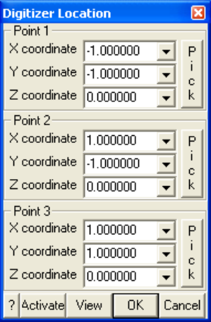

设置数字化仪。

通过在待数字化图纸上指定 3 个点，可以唯一确定数字化平面的比例、位置和方向。

操作步骤如下：

1. 在图纸上选择 3 个点，

2. 输入每个点的坐标，

3. 然后用数字化仪游标拾取这些点。

4. Pick 用于激活数字化仪游标，以便选择各个点。

CAD > Digitizer > Activate 用于切换数字化仪的启用状态，以便从图纸上选取点。可使用 Tools > CAD Toolbar > Configure 将此按钮放置在 CAD 工具栏上。

View —— 调整视图位置，以便看到与模型叠加显示的数字化平面。

任何可以设置为以绝对模式控制光标移动（即数字化仪移动与光标位置一一对应）的数字化仪都受支持。大多数新型数字化仪都随附提供此支持的驱动程序。另一种选择是使用以下支持大多数数字化仪的软件：

Virtual Tablet Interface Digitizer Technology Company 16541 Redmond Way, Suite 195C Redmond, Washington USA 98052 Tel: 206 868 3246 Fax: 206 885 7704
