## 5.5.4.1 实体属性

编辑块体类型、颜色、开采顺序等。

可以点击按钮，或直接在任意实体上单击右键来启动此功能。启动此功能后，系统会首先提示您建立要编辑的实体列表

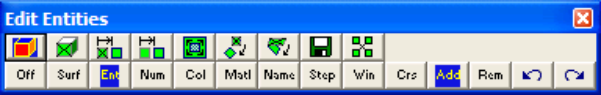

- 如果勾选了 Tools > Shift-key Selection，则必须按住 Shift 键才能进行多项选择。

- 默认情况下，选中的实体会被添加到列表中；但如果按住 Ctrl 键，选中的实体将从列表中移除。

- 按住 Shift 键或 Ctrl 键时，可以拖出交叉窗口。

- 此工具栏的使用方法详见 Build A List of Entities for Editing

- 按空格键会自动激活上一次使用的编辑功能。

- 单击右键时按住 Alt 键，会自动重复上一次使用的编辑功能。

选择所需实体后，可以点击任意编辑按钮：

CAD > Edit > Entity Properties Edit block type, colour, mining sequence, CAD > Edit > Erase Entities Erase selected entities, CAD > Edit > Move Entities Move selected entities, CAD > Edit > Copy Entities Copy selected entities, CAD > Edit > Scale Entities Scale selected entities, CAD > Edit > Rotate Azimuth Rotate the azimuth of selected entities, CAD > Edit > Rotate Dip Rotate the dip of selected entities,

CAD > Edit > Dump to File Dump selected entities to a file,

CAD > Edit > Group Group selected entities into a single block,

- 双击任意顶点以执行高亮显示的功能，

- 单击右键查看选项列表。

如果对话框中的任何字段显示为 "Variable"，则是因为您选择的某些块体在该字段上具有不同的属性。如果希望保持这些属性不变（即每个块体各不相同），请将该字段保留为 "Variable"。如果希望为所有选定块体更改该字段的值，请输入所需的值。

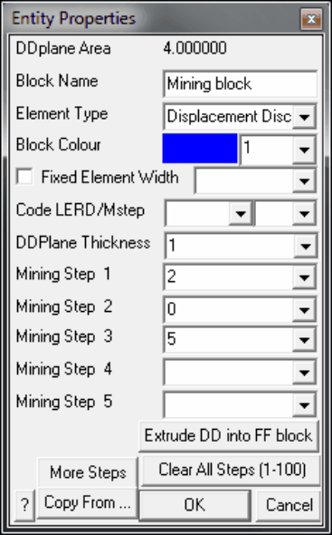

Block Volume - 如果您选择的全部是 FF 块体，将显示这些块体的总体积。如果您选择的全部是 FF 块体，将显示这些块体的总体积。

DDPlane Area - 如果您选择的全部是 DD 块体，则显示 DDLoop 中包含的所有 DDPlane 的总面积。

Block Name - 指定块体的描述性名称。

Element Type - 指定块体所使用的边界单元类型。

- Displacement Discontinuity - DD 型单元应用于板状开采空区、裂隙和断层面。

- Fictitious Force - FF 型单元应用于三维要素，如采空区、替代材料区、充填采场等。

- 非活动单元可用于显示仅供可视化而包含、不用于实际应力分析的要素。

- 请注意，DD 型单元可以转换为 GPlane。

Block Colour - 指定用于显示块体的颜色编号。

- 指定分配给每个按钮的颜色编号。共有 10 种颜色可供显示。它们依次编号为

- 1 到 10，

11 到 20，

21 到 30 等，

- 因此编号 1、11、21 ……显示相同的颜色，

- 2, 22, 32...,

- 3, 23, 33..., etc.

Fixed Element Width - 指定用户定义的单元宽度。

- 该参数可用于对选定实体强制采用均匀离散化。指定此值时务必格外小心，因为较小的值很容易导致问题规模过大。

- 一般情况下不应使用此选项（取消选中），离散化应交由 _AL_ 和 _AG_ 参数处理。后者仅在需要分析结果的位置集中布置单元，从而优化单元使用并最小化问题规模。更多讨论请参阅

CAD > Properties Control Parameters

- 在相交分析期间，该参数也可用于避免生成边长大于此值的表面。边长超过此尺寸的任何表面都不会被合并（collapse）

#### Analysis > Options > Collapse

- 在离散化过程中，边长超过此尺寸的任何表面都将被细分，以防止出现边长大于此值的表面。

- 有关此参数的使用示例，请参阅 Tabular Mining Example

Matl_Code LERD/MStep - 指定用于 LERD/LSS 计算时代入块体的材料代码。

第一个框用于填写材料代码。

第二个框用于指定进行计算的开采步骤编号。如果此框留空，则对所有步骤进行 LERD 计算。

#### Analysis > Options > LERD/LSS.

DDPlane Thickness - 指定插入 DD 单元中的材料厚度（即断层泥、矿层宽度、采幅或矿柱高度）。

- 该要素被充填时，其法向位移（闭合量）将被限制在此厚度内。此外，法向位移（闭合量）和剪切位移（ride）都要除以该厚度，以确定充填材料中发生的应变

Mohr-Coulomb in DD planes

Fault-Gouge in DD planes Backfill-Hyperbolic in DD planes

- 该参数应使用与指定坐标位置相同的单位（例如米或英尺）。

Mining Step n - 指定在开采步骤 n 中用于该块体的材料代码。

- 在上例中，块体在步骤 1 中不存在，在步骤 2 中插入材料 #2（矿石），在步骤 3 中被开挖（材料代码 0 表示开挖），最后在步骤 4 中插入材料 #5（充填体）。

- 使用正的材料编号时，材料以指定的初始应力状态置入块体，然后按您为该材料编号设置的弹/塑性属性发生变形。

- 使用负的材料编号时，材料以指定的初始应力状态置入块体，但无论发生何种变形，应力状态都保持在这些数值，从而提供应力边界条件。

Extrude DD into FF blocks - 允许您将 DD 平面拉伸为 FF 块体。系统将提示您输入拉伸矢量

More Steps - 允许指定更多开采步骤。

Clear All Steps - 清除所有开采步骤（1-100）。

Copy From… - 允许您选择另一个块体，从中复制实体属性。

OK - 完成块体编辑并修改已更改的所有属性。

Cancel - 中止块体编辑。

完成任何编辑操作后，您有一次机会通过选择以下功能撤销所做的修改

#### Undo

您也可以通过选择以下功能恢复相同的选择集，并再次修改同一组实体

#### Redo

只需将单元类型从 Displacement Discontinuity 更改为 Fictitious Force，即可将 DD 块体拉伸为 3D FF 块体。

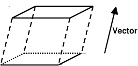

在这种情况下，角点 1 到 4 定义块体的底面。顶面和侧面在拉伸过程中自动生成。将单元类型从 Fictitious Force 更改为 Displacement Discontinuity，可将 FF 块体合并为 DD 平面。在这种情况下，块体的底面（由角点 1、2、3 和 4 定义的面）将成为 DD 平面，块体的其余各面将被丢弃。

请注意，可以创建体积为零的块体，例如指定长度为零的偏移矢量。这使用户可以根据需要构建单个 FF 表面。虽然这是允许的，但不建议这样做，因为它可能导致体积不闭合。

注意

应使用不同的颜色编号来表示块体的逻辑分组（例如不同的水平、剖面或逻辑开采单元，如开拓、采场等）。这些颜色可由用户定义

#### Tools > Custom Colours

具有相同颜色编号的所有块体将被 Map3D 自动合并为单一的复杂形状。

由于很容易开启和关闭特定块体颜色编号的显示

#### View > Hide Block Colours

这为处理复杂的模型数据提供了一种高效的方法。

可以使用以下功能调整双击时间

#### Tools > Double Click Time

有关模型构建方面的讨论，请参阅：

#### Model Building and Editing

有关模型构建教程，请参阅：

Model Building Tutorials

## 5.5.4.2 删除实体

删除选定的实体。

可以点击按钮，或直接在任意实体上单击右键来启动此功能。启动此功能后，系统会首先提示您建立要编辑的实体列表

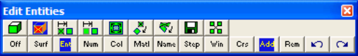

- 如果勾选了 Tools > Shift-key Selection，则必须按住 Shift 键才能进行多项选择。

- 默认情况下，选中的实体会被添加到列表中；但如果按住 Ctrl 键，选中的实体将从列表中移除。

- 按住 Shift 键或 Ctrl 键时，可以拖出交叉窗口。

- 此工具栏的使用方法详见 Build A List of Entities for Editing

- 按空格键会自动激活上一次使用的编辑功能。

- 单击右键时按住 Alt 键，会自动重复上一次使用的编辑功能。

选择所需实体后，可以点击任意编辑按钮：

CAD > Edit > Entity Properties Edit block type, colour, mining sequence, CAD > Edit > Erase Entities Erase selected entities, CAD > Edit > Move Entities Move selected entities, CAD > Edit > Copy Entities Copy selected entities,

CAD > Edit > Scale Entities Scale selected entities,

CAD > Edit > Rotate Azimuth Rotate the azimuth of selected entities, CAD > Edit > Rotate Dip Rotate the dip of selected entities, CAD > Edit > Dump to File Dump selected entities to a file,

CAD > Edit > Group Group selected entities into a single block,

- 双击任意顶点以执行高亮显示的功能，

- 单击右键查看选项列表。

完成任何编辑操作后，您有一次机会通过选择以下功能撤销所做的修改

#### Undo

您也可以通过选择以下功能恢复相同的选择集，并再次修改同一组实体

#### Redo

可以使用以下功能调整双击时间

Tools > Double Click Time

## 5.5.4.3 移动实体

移动选定的实体。

可以点击按钮，或直接在任意实体上单击右键来启动此功能。启动此功能后，系统会首先提示您建立要编辑的实体列表

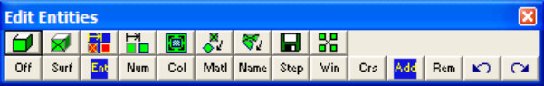

- 如果勾选了 Tools > Shift-key Selection，则必须按住 Shift 键才能进行多项选择。

- 默认情况下，选中的实体会被添加到列表中；但如果按住 Ctrl 键，选中的实体将从列表中移除。

- 按住 Shift 键或 Ctrl 键时，可以拖出交叉窗口。

- 此工具栏的使用方法详见 Build A List of Entities for Editing

- 按空格键会自动激活上一次使用的编辑功能。

- 单击右键时按住 Alt 键，会自动重复上一次使用的编辑功能。

选择所需实体后，可以点击任意编辑按钮：

CAD > Edit > Entity Properties Edit block type, colour, mining sequence, CAD > Edit > Erase Entities Erase selected entities, CAD > Edit > Move Entities Move selected entities, CAD > Edit > Copy Entities Copy selected entities,

CAD > Edit > Scale Entities Scale selected entities, CAD > Edit > Rotate Azimuth Rotate the azimuth of selected entities, CAD > Edit > Rotate Dip Rotate the dip of selected entities, CAD > Edit > Dump to File Dump selected entities to a file, CAD > Edit > Group Group selected entities into a single block,

- 双击任意顶点以执行高亮显示的功能，

- 单击右键查看选项列表。

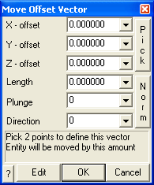

X, Y and Z – offset 指定偏移矢量的各分量。所有选定实体都将移动该量。

Pick - 激活光标十字线，以便从模型中交互式选取偏移矢量。这需要选取两个点来定义该矢量。

Length, Plunge and Direction - 指定偏移矢量的各分量。所有选定实体都将移动该量。

Norm - 激活光标，以便交互式选择一个表面，使偏移矢量垂直于该表面。

为便于在模型上直观地选取点，所有捕捉功能均可使用。

#### CAD > Snap

选取后，偏移矢量的各分量会显示在对话框中。

Edit - 完成编辑并调用对选定块体的实体属性的编辑。

OK - 完成偏移矢量的编辑并移动选定的块体。

Cancel - 中止实体的移动。

完成任何编辑操作后，您有一次机会通过选择以下功能撤销所做的修改

#### Undo

您也可以通过选择以下功能恢复相同的选择集，并再次修改同一组实体

#### Redo

可以使用以下功能调整双击时间

Tools > Double Click Time

## 5.5.4.4 复制实体

复制选定的实体。

可以点击按钮，或直接在任意实体上单击右键来启动此功能。启动此功能后，系统会首先提示您建立要编辑的实体列表

- 如果勾选了 Tools > Shift-key Selection，则必须按住 Shift 键才能进行多项选择。

- 默认情况下，选中的实体会被添加到列表中；但如果按住 Ctrl 键，选中的实体将从列表中移除。

- 按住 Shift 键或 Ctrl 键时，可以拖出交叉窗口。

- 此工具栏的使用方法详见 Build A List of Entities for Editing

- 按空格键会自动激活上一次使用的编辑功能。

- 单击右键时按住 Alt 键，会自动重复上一次使用的编辑功能。

选择所需实体后，可以点击任意编辑按钮：

CAD > Edit > Entity Properties Edit block type, colour, mining sequence, CAD > Edit > Erase Entities Erase selected entities, CAD > Edit > Move Entities Move selected entities, CAD > Edit > Copy Entities Copy selected entities, CAD > Edit > Scale Entities Scale selected entities, CAD > Edit > Rotate Azimuth Rotate the azimuth of selected entities, CAD > Edit > Rotate Dip Rotate the dip of selected entities, CAD > Edit > Dump to File Dump selected entities to a file, CAD > Edit > Group Group selected entities into a single block,

- 双击任意顶点以执行高亮显示的功能，

- 单击右键查看选项列表。

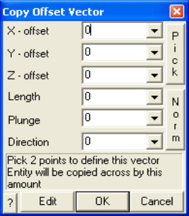

X, Y and Z – offset 指定偏移矢量的各分量。所有选定实体都将被复制到该偏移所指定的位置。

Pick - 激活光标十字线，以便从模型中交互式选取偏移矢量。这需要选取两个点来定义该矢量。

Length, Plunge and Direction - 指定偏移矢量的各分量。所有选定实体都将被复制到该偏移所指定的位置。

Norm - 激活光标，以便交互式选择一个表面，使偏移矢量垂直于该表面。

为便于在模型上直观地选取点，所有捕捉功能均可使用。

#### CAD > Snap

选取后，偏移矢量的各分量会显示在对话框中。

Edit - 完成编辑并调用对选定块体的实体属性的编辑。

OK - 完成偏移矢量的编辑并移动选定的块体。

Cancel - 中止实体的移动。

完成任何编辑操作后，您有一次机会通过选择以下功能撤销所做的修改

#### Undo

您也可以通过选择以下功能恢复相同的选择集，并再次修改同一组实体

#### Redo

可以使用以下功能调整双击时间

Tools > Double Click Time

## 5.5.4.5 缩放实体

缩放选定的实体。

可以点击按钮，或直接在任意实体上单击右键来启动此功能。启动此功能后，系统会首先提示您建立要编辑的实体列表

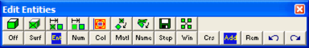

- 如果勾选了 Tools > Shift-key Selection，则必须按住 Shift 键才能进行多项选择。

- 默认情况下，选中的实体会被添加到列表中；但如果按住 Ctrl 键，选中的实体将从列表中移除。

- 按住 Shift 键或 Ctrl 键时，可以拖出交叉窗口。

- 此工具栏的使用方法详见 Build A List of Entities for Editing

- 按空格键会自动激活上一次使用的编辑功能。

- 单击右键时按住 Alt 键，会自动重复上一次使用的编辑功能。

选择所需实体后，可以点击任意编辑按钮：

CAD > Edit > Entity Properties Edit block type, colour, mining sequence, CAD > Edit > Erase Entities Erase selected entities, CAD > Edit > Move Entities Move selected entities, CAD > Edit > Copy Entities Copy selected entities, CAD > Edit > Scale Entities Scale selected entities,

CAD > Edit > Rotate Azimuth Rotate the azimuth of selected entities, CAD > Edit > Rotate Dip Rotate the dip of selected entities, CAD > Edit > Dump to File Dump selected entities to a file, CAD > Edit > Group Group selected entities into a single block,

- 双击任意顶点以执行高亮显示的功能，

- 单击右键查看选项列表。

X, Y and Z – coordinates 指定缩放中心的坐标。缩放期间，该点保持不动。所有其他点都将移动以实现所需的缩放。

Pick - 激活光标十字线，以便从模型中交互式选取旋转中心。

为便于在模型上直观地选取点，所有捕捉功能均可使用。

CAD > Snap

选取后，缩放中心的各分量会显示在对话框中。

Centroid - 计算所有选定实体的中心。

OK - 完成坐标编辑，并提示您输入缩放系数。

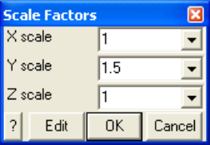

X, Y and Z - scale 指定实体的缩放量。下图中，块体在 y 方向上放大了 1.5 倍。

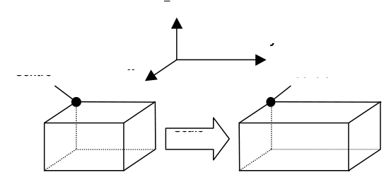

Edit - 完成编辑并调用对选定块体的实体属性的编辑。

OK - 完成缩放系数的编辑并缩放选定的实体。

Cancel - 中止实体的缩放。

完成任何编辑操作后，您有一次机会通过选择以下功能撤销所做的修改

#### Undo

您也可以通过选择以下功能恢复相同的选择集，并再次修改同一组实体

Redo

可以使用以下功能调整双击时间

Tools > Double Click Time

## 5.5.4.6 旋转方位角

旋转选定实体的方位角。

可以点击按钮，或直接在任意实体上单击右键来启动此功能。启动此功能后，系统会首先提示您建立要编辑的实体列表

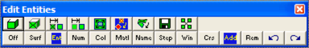

- 如果勾选了 Tools > Shift-key Selection，则必须按住 Shift 键才能进行多项选择。

- 默认情况下，选中的实体会被添加到列表中；但如果按住 Ctrl 键，选中的实体将从列表中移除。

- 按住 Shift 键或 Ctrl 键时，可以拖出交叉窗口。

- 此工具栏的使用方法详见 Build A List of Entities for Editing

- 按空格键会自动激活上一次使用的编辑功能。

- 单击右键时按住 Alt 键，会自动重复上一次使用的编辑功能。

选择所需实体后，可以点击任意编辑按钮：

CAD > Edit > Entity Properties Edit block type, colour, mining sequence, CAD > Edit > Erase Entities Erase selected entities, CAD > Edit > Move Entities Move selected entities, CAD > Edit > Copy Entities Copy selected entities, CAD > Edit > Scale Entities Scale selected entities, CAD > Edit > Rotate Azimuth Rotate the azimuth of selected entities, CAD > Edit > Rotate Dip Rotate the dip of selected entities, CAD > Edit > Dump to File Dump selected entities to a file, CAD > Edit > Group Group selected entities into a single block,

- 双击任意顶点以执行高亮显示的功能，

- 单击右键查看选项列表。

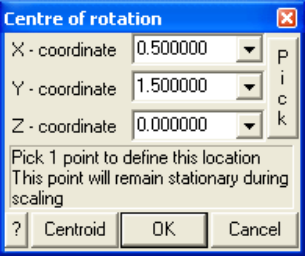

X, Y and Z – coordinates 指定旋转中心的坐标。

Pick - 激活光标十字线，以便从模型中交互式选取旋转中心。

为便于在模型上直观地选取点，所有捕捉功能均可使用。

#### CAD > Snap

选取后，缩放中心的各分量会显示在对话框中。

Centroid - 计算所有选定实体的中心。

OK - 完成坐标编辑，并提示您输入缩放系数。

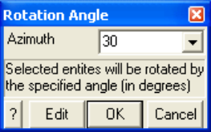

- Azimuth - 指定希望选定实体旋转的角度（度）。· 旋转在 X-Y 平面内进行，因此所有竖直线保持竖直。

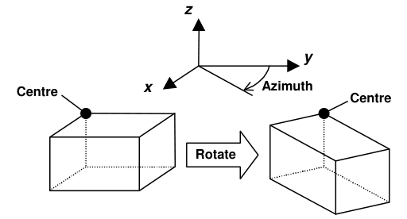

Edit - 完成编辑并调用对选定块体的实体属性的编辑。

OK - 完成方位角的编辑并旋转选定的实体。

Cancel - 中止实体的旋转。

完成任何编辑操作后，您有一次机会通过选择以下功能撤销所做的修改

Undo

您也可以通过选择以下功能恢复相同的选择集，并再次修改同一组实体

Redo

可以使用以下功能调整双击时间

Tools > Double Click Time

## 5.5.4.7 旋转倾角

旋转选定实体的倾角。

可以点击按钮，或直接在任意实体上单击右键来启动此功能。启动此功能后，系统会首先提示您建立要编辑的实体列表

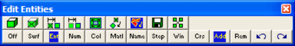

- 如果勾选了 Tools > Shift-key Selection，则必须按住 Shift 键才能进行多项选择。

- 默认情况下，选中的实体会被添加到列表中；但如果按住 Ctrl 键，选中的实体将从列表中移除。

- 按住 Shift 键或 Ctrl 键时，可以拖出交叉窗口。

- 此工具栏的使用方法详见 Build A List of Entities for Editing

- 按空格键会自动激活上一次使用的编辑功能。

- 单击右键时按住 Alt 键，会自动重复上一次使用的编辑功能。

选择所需实体后，可以点击任意编辑按钮：

CAD > Edit > Entity Properties Edit block type, colour, mining sequence, CAD > Edit > Erase Entities Erase selected entities, CAD > Edit > Move Entities Move selected entities, CAD > Edit > Copy Entities Copy selected entities, CAD > Edit > Scale Entities Scale selected entities, CAD > Edit > Rotate Azimuth Rotate the azimuth of selected entities, CAD > Edit > Rotate Dip Rotate the dip of selected entities,

CAD > Edit > Slice Entities Slice selected entities,

CAD > Edit > Dump to File Dump selected entities to a file, CAD > Edit > Group Group selected entities into a single block,

- 双击任意顶点以执行高亮显示的功能，

- 单击右键查看选项列表。

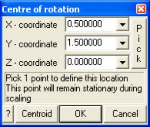

X, Y and Z – coordinates 指定旋转中心的坐标。

Pick - 激活光标十字线，以便从模型中交互式选取旋转中心。

为便于在模型上直观地选取点，所有捕捉功能均可使用。

#### CAD > Snap

选取后，缩放中心的各分量会显示在对话框中。

Centroid - 计算所有选定实体的中心。

OK - 完成坐标编辑，并提示您输入缩放系数。

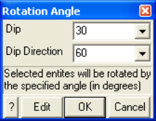

Dip - 指定希望选定实体旋转的角度（度）。

Dip Direction - 指定发生倾斜的方位角（度）。倾向与倾斜面的走向成 90°。

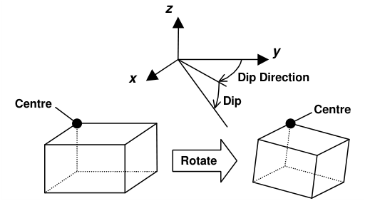

Edit - 完成编辑并调用对选定块体的实体属性的编辑。

OK - 完成倾角和倾向的编辑并旋转选定的实体。

Cancel - 中止实体的旋转。

完成任何编辑操作后，您有一次机会通过选择以下功能撤销所做的修改

#### Undo

您也可以通过选择以下功能恢复相同的选择集，并再次修改同一组实体

#### Redo

可以使用以下功能调整双击时间

#### Tools > Double Click Time

## 5.5.4.8 切割实体

切割实体。

所有实体都可以被切割，包括 FF 块体、DD 平面、网格平面、网格线和构造线。

Video Demo of Model_Simplification_Using_Slicing

可以点击按钮，或直接在任意实体上单击右键来启动此功能。启动此功能后，系统会首先提示您建立要编辑的实体列表

- 如果勾选了 Tools > Shift-key Selection，则必须按住 Shift 键才能进行多项选择。

- 默认情况下，选中的实体会被添加到列表中；但如果按住 Ctrl 键，选中的实体将从列表中移除。

- 按住 Shift 键或 Ctrl 键时，可以拖出交叉窗口。

- 此工具栏的使用方法详见 Build A List of Entities for Editing

- 按空格键会自动激活上一次使用的编辑功能。

- 单击右键时按住 Alt 键，会自动重复上一次使用的编辑功能。

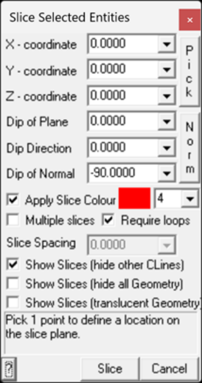

X, Y and Z – coordinate 指定切割平面上的一点。

Pick - 激活光标十字线，以便交互式选取该点。

Dip of Plane, Dip Direction and Normal - 指定切割平面的方向。

Norm - 激活光标，以便交互式选择一个表面，使切割平面与之平行。平面的倾角和倾向将被设置为垂直于所选表面。

Apply Slice Colour - 选中时，指定分配给切割期间创建的 CLine 的颜色编号；否则将使用被切割对象的颜色。

Multiple Slices - 指定按指定的切片间距创建多个切片。

Require Loops - 切片可以是单条线，也可以选择形成闭合回路。

Slice Spacing - 指定可选的多切片间距。

Show Slices (hide other CLines) - 将自动隐藏所有已有的 CLine，并显示新创建的 CLine 切片。

Slice Spacing (hide all Geometry) - 将自动隐藏所有已有的几何体，并显示新创建的 CLine 切片。

Slice Spacing (translucent Geometry) - 将自动把所有已有的几何体设为半透明，并显示新创建的 CLine 切片。

- 有多个 "View > Hide" 选项可用于控制各类实体的显示，包括：

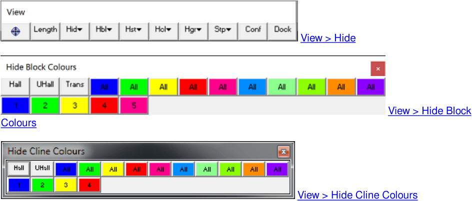

为便于在模型上直观地选取点，所有捕捉功能均可使用。

#### CAD > Snap

选取后，偏移矢量的各分量会显示在对话框中。

Slice - 对选定的块体执行切割操作。

Cancel - 中止实体的切割。

完成任何编辑操作后，您有一次机会通过选择以下功能撤销所做的修改

Undo

您也可以通过选择以下功能恢复相同的选择集，并再次修改同一组实体

Redo

可以使用以下功能调整双击时间

Tools > Double Click Time

## 5.5.4.9 转储到文件

将选定的实体转储到文件。

可以点击按钮，或直接在任意实体上单击右键来启动此功能。启动此功能后，系统会首先提示您建立要转储的实体列表

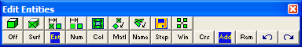

- 如果勾选了 Tools > Shift-key Selection，则必须按住 Shift 键才能进行多项选择。

- 默认情况下，选中的实体会被添加到列表中；但如果按住 Ctrl 键，选中的实体将从列表中移除。

- 按住 Shift 键或 Ctrl 键时，可以拖出交叉窗口。

- 此工具栏的使用方法详见 Build A List of Entities for Editing

- 按空格键会自动激活上一次使用的编辑功能。

- 单击右键时按住 Alt 键，会自动重复上一次使用的编辑功能。

选择所需实体后，可以点击任意编辑按钮：

CAD > Edit > Entity Properties Edit block type, colour, mining sequence, CAD > Edit > Erase Entities Erase selected entities, CAD > Edit > Move Entities Move selected entities, CAD > Edit > Copy Entities Copy selected entities, CAD > Edit > Scale Entities Scale selected entities, CAD > Edit > Rotate Azimuth Rotate the azimuth of selected entities, CAD > Edit > Rotate Dip Rotate the dip of selected entities, CAD > Edit > Dump to File Dump selected entities to a file,

CAD > Edit > Group Group selected entities into a single block,

- 双击任意顶点以执行高亮显示的功能，

- 单击右键查看选项列表。

可以使用以下功能调整双击时间

Tools > Double Click Time

## 5.5.4.10 组合实体

将选定的实体组合为单个块体。这是一个高级选项，仅应由有经验的用户使用。

有时可能需要删除或构建单个表面，然后将它们组合成一个块体。此功能将实体组合起来，由单个表面形成无缝闭合的块体。请注意，使用此操作时，用户必须确保被组合的表面形成无缝闭合的表面包络，且没有内部表面。存在内部表面可能导致错误。

组合功能的实现是为了让高级用户可以删除少数表面单元并重新构建。它还可用于连接从 CAD 软件包带入的表面。请注意，用户必须确保没有内部表面，并且所组合的表面确实形成了无缝闭合的表面包络。

可以点击按钮，或直接在任意实体上单击右键来启动此功能。启动此功能后，系统会首先提示您建立要组合的实体列表

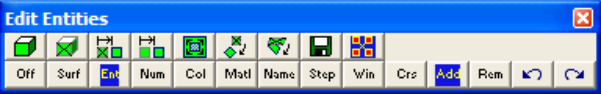

- 如果勾选了 Tools > Shift-key Selection，则必须按住 Shift 键才能进行多项选择。

- 默认情况下，选中的实体会被添加到列表中；但如果按住 Ctrl 键，选中的实体将从列表中移除。

- 按住 Shift 键或 Ctrl 键时，可以拖出交叉窗口。

- 此工具栏的使用方法详见 Build A List of Entities for Editing

- 按空格键会自动激活上一次使用的编辑功能。

- 单击右键时按住 Alt 键，会自动重复上一次使用的编辑功能。

选择所需实体后，可以点击任意编辑按钮：

CAD > Edit > Entity Properties Edit block type, colour, mining sequence, CAD > Edit > Erase Entities Erase selected entities, CAD > Edit > Move Entities Move selected entities, CAD > Edit > Copy Entities Copy selected entities, CAD > Edit > Scale Entities Scale selected entities, CAD > Edit > Rotate Azimuth Rotate the azimuth of selected entities, CAD > Edit > Rotate Dip Rotate the dip of selected entities,

CAD > Edit > Dump to File Dump selected entities to a file,

CAD > Edit > Group Group selected entities into a single block,

- 双击任意顶点以执行高亮显示的功能，

- 单击右键查看选项列表。

如果对话框中的任何字段显示为 "Variable"，则是因为您选择的某些表面在该字段上具有不同的属性。要将选定的实体组合为单个块体，所有表面在所有字段中必须具有相同的设置。请使用 CAD > Edit > Entity Properties 来完成此操作。

完成任何编辑操作后，您有一次机会通过选择以下功能撤销所做的修改

#### Undo

您也可以通过选择以下功能恢复相同的选择集，并再次修改同一组实体

#### Redo

可以使用以下功能调整双击时间

#### Tools > Double Click Time

## 5.5.4.11 拉伸顶点

对选定顶点添加偏移。

可以点击按钮，或直接在任意顶点上单击右键来启动此功能。启动此功能后，系统会首先提示您建立要拉伸的顶点列表

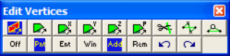

- 如果勾选了 Tools > Shift-key Selection，则必须按住 Shift 键才能进行多项选择。

- 默认情况下，选中的实体会被添加到列表中；但如果按住 Ctrl 键，选中的实体将从列表中移除。

- 按住 Shift 键或 Ctrl 键时，可以拖出交叉窗口。

- 此工具栏的使用方法详见 Build A List of Vertices for Editing

- 按空格键会自动激活上一次使用的编辑功能。

- 单击右键时按住 Alt 键，会自动重复上一次使用的编辑功能。

选择所需实体后，可以点击任意编辑按钮：

CAD > Edit > Stretch Vertices CAD > Edit > Move Vertices to Point CAD > Edit > Move Vertices to X CAD > Edit > Move Vertices to Y CAD > Edit > Move Vertices to Z CAD > Edit > Move Vertices to Plane CAD > Edit > Subdivide Construction Lines CAD > Edit > Smooth Construction Lines CAD > Edit > Remove Construction Vertex

- 双击任意顶点以执行高亮显示的功能，

- 单击右键查看选项列表。

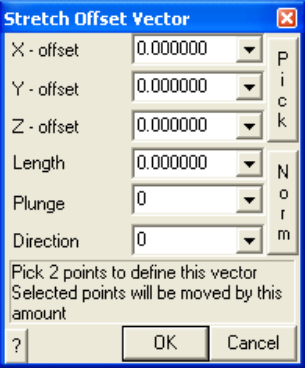

X, Y and Z – offset 指定拉伸矢量的各分量。

- 所有选定顶点都将移动到该偏移所指定的位置。

- 这需要选取两个点来定义该矢量。

- 选取后，偏移矢量的各分量会显示在对话框中。

Pick 激活光标十字线，以便从模型中交互式选取偏移矢量。这需要选取两个点来定义该矢量。

Length, Plunge and Direction - 指定偏移矢量的各分量。所有选定顶点都将移动该量。

Norm - 激活光标，以便交互式选择一个表面，使偏移矢量垂直于该表面。

为便于在模型上直观地选取点，所有捕捉功能均可使用。

#### CAD > Snap

选取后，偏移矢量的各分量会显示在对话框中。

OK - 完成偏移矢量的编辑并拉伸选定的顶点。

Cancel - 中止顶点的拉伸。

完成任何编辑操作后，您有一次机会通过选择以下功能撤销所做的修改

#### Undo

您也可以通过选择以下功能恢复相同的选择集，并再次修改同一组实体

#### Redo

可以使用以下功能调整双击时间

#### Tools > Double Click Time

## 5.5.4.12 将顶点移动到点

将选定的顶点移动到某个点。

可以点击按钮，或直接在任意顶点上单击右键来启动此功能。启动此功能后，系统会首先提示您建立要移动的顶点列表。

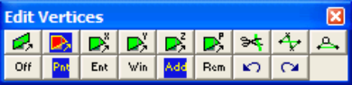

- 如果勾选了 Tools > Shift-key Selection，则必须按住 Shift 键才能进行多项选择。

- 默认情况下，选中的实体会被添加到列表中；但如果按住 Ctrl 键，选中的实体将从列表中移除。

- 按住 Shift 键或 Ctrl 键时，可以拖出交叉窗口。

- 此工具栏的使用方法详见 Build A List of Vertices for Editing

- 按空格键会自动激活上一次使用的编辑功能。

- 单击右键时按住 Alt 键，会自动重复上一次使用的编辑功能。

选择所需实体后，可以点击任意编辑按钮：

CAD > Edit > Stretch Vertices CAD > Edit > Move Vertices to Point CAD > Edit > Move Vertices to X CAD > Edit > Move Vertices to Y CAD > Edit > Move Vertices to Z CAD > Edit > Move Vertices to Plane CAD > Edit > Subdivide Construction Lines CAD > Edit > Smooth Construction Lines CAD > Edit > Remove Construction Vertex

- 双击任意顶点以执行高亮显示的功能，

- 单击右键查看选项列表。

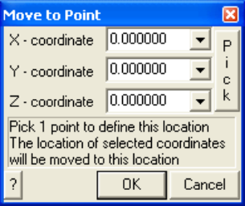

X, Y and Z – coordinate 指定点的坐标。所有选定顶点都将移动到该点。

Pick - 激活光标十字线，以便从模型中交互式选取该点。

为便于在模型上直观地选取点，所有捕捉功能均可使用。

#### CAD > Snap

选取后，偏移矢量的各分量会显示在对话框中。

OK - 完成偏移矢量的编辑并拉伸选定的顶点。

Cancel - 中止顶点的拉伸。

完成任何编辑操作后，您有一次机会通过选择以下功能撤销所做的修改

#### Undo

您也可以通过选择以下功能恢复相同的选择集，并再次修改同一组实体

Redo

可以使用以下功能调整双击时间

#### Tools > Double Click Time

## 5.5.4.13 将顶点移动到 X

移动选定顶点的 X 坐标。

可以点击按钮，或直接在任意顶点上单击右键来启动此功能。启动此功能后，系统会首先提示您建立要移动的顶点列表。

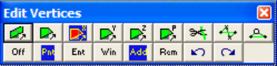

- 如果勾选了 Tools > Shift-key Selection，则必须按住 Shift 键才能进行多项选择。

- 默认情况下，选中的实体会被添加到列表中；但如果按住 Ctrl 键，选中的实体将从列表中移除。

- 按住 Shift 键或 Ctrl 键时，可以拖出交叉窗口。

- 此工具栏的使用方法详见 Build A List of Vertices for Editing

- 按空格键会自动激活上一次使用的编辑功能。

- 单击右键时按住 Alt 键，会自动重复上一次使用的编辑功能。

选择所需实体后，可以点击任意编辑按钮：

CAD > Edit > Stretch Vertices CAD > Edit > Move Vertices to Point CAD > Edit > Move Vertices to X CAD > Edit > Move Vertices to Y CAD > Edit > Move Vertices to Z

CAD > Edit > Move Vertices to Plane

CAD > Edit > Subdivide Construction Lines CAD > Edit > Smooth Construction Lines

CAD > Edit > Remove Construction Vertex

- 双击任意顶点以执行高亮显示的功能，

- 单击右键查看选项列表。

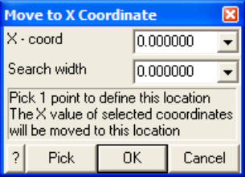

X – coordinate 指定点的 X 坐标。所有选定顶点（即列表中的顶点）的 X 坐标都将移动到该值。

Search width 与指定的 x 坐标值相距在搜索宽度以内的所有坐标都将被移动，即使它们不在列表中。

Pick 激活光标十字线，以便从模型中交互式选取该点。为便于在模型上直观地选取点，所有捕捉功能均可使用

为便于在模型上直观地选取点，所有捕捉功能均可使用。

#### CAD > Snap

选取后，偏移矢量的各分量会显示在对话框中。

OK - 完成偏移矢量的编辑并拉伸选定的顶点。

Cancel - 中止顶点的拉伸。

完成任何编辑操作后，您有一次机会通过选择以下功能撤销所做的修改

#### Undo

您也可以通过选择以下功能恢复相同的选择集，并再次修改同一组实体

#### Redo

可以使用以下功能调整双击时间

#### Tools > Double Click Time

## 5.5.4.14 将顶点移动到 Y

移动选定顶点的 Y 坐标。

可以点击按钮，或直接在任意顶点上单击右键来启动此功能。启动此功能后，系统会首先提示您建立要移动的顶点列表。

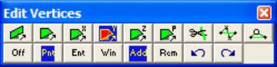

- 如果勾选了 Tools > Shift-key Selection，则必须按住 Shift 键才能进行多项选择。

- 默认情况下，选中的实体会被添加到列表中；但如果按住 Ctrl 键，选中的实体将从列表中移除。

- 按住 Shift 键或 Ctrl 键时，可以拖出交叉窗口。

- 此工具栏的使用方法详见 Build A List of Vertices for Editing

- 按空格键会自动激活上一次使用的编辑功能。

- 单击右键时按住 Alt 键，会自动重复上一次使用的编辑功能。

选择所需实体后，可以点击任意编辑按钮：

CAD > Edit > Stretch Vertices CAD > Edit > Move Vertices to Point CAD > Edit > Move Vertices to X CAD > Edit > Move Vertices to Y CAD > Edit > Move Vertices to Z CAD > Edit > Move Vertices to Plane CAD > Edit > Subdivide Construction Lines CAD > Edit > Smooth Construction Lines CAD > Edit > Remove Construction Vertex

- 双击任意顶点以执行高亮显示的功能，

- 单击右键查看选项列表。

Y – coordinate 指定点的 Y 坐标。所有选定顶点（即列表中的顶点）的 Y 坐标都将移动到该值。

Search width 与指定的 y 坐标值相距在搜索宽度以内的所有坐标都将被移动，即使它们不在列表中。

Pick 激活光标十字线，以便从模型中交互式选取该点。为便于在模型上直观地选取点，所有捕捉功能均可使用

为便于在模型上直观地选取点，所有捕捉功能均可使用。

#### CAD > Snap

选取后，偏移矢量的各分量会显示在对话框中。

OK - 完成偏移矢量的编辑并拉伸选定的顶点。

Cancel - 中止顶点的拉伸。

完成任何编辑操作后，您有一次机会通过选择以下功能撤销所做的修改

#### Undo

您也可以通过选择以下功能恢复相同的选择集，并再次修改同一组实体

Redo

可以使用以下功能调整双击时间

Tools > Double Click Time

## 5.5.4.15 将顶点移动到 Z

移动选定顶点的 Z 坐标。

可以点击按钮，或直接在任意顶点上单击右键来启动此功能。启动此功能后，系统会首先提示您建立要移动的顶点列表。

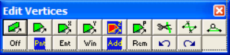

- 如果勾选了 Tools > Shift-key Selection，则必须按住 Shift 键才能进行多项选择。

- 默认情况下，选中的实体会被添加到列表中；但如果按住 Ctrl 键，选中的实体将从列表中移除。

- 按住 Shift 键或 Ctrl 键时，可以拖出交叉窗口。

- 此工具栏的使用方法详见 Build A List of Vertices for Editing

- 按空格键会自动激活上一次使用的编辑功能。

- 单击右键时按住 Alt 键，会自动重复上一次使用的编辑功能。

选择所需实体后，可以点击任意编辑按钮：

CAD > Edit > Stretch Vertices CAD > Edit > Move Vertices to Point CAD > Edit > Move Vertices to X CAD > Edit > Move Vertices to Y

CAD > Edit > Move Vertices to Z

CAD > Edit > Move Vertices to Plane

CAD > Edit > Subdivide Construction Lines

CAD > Edit > Smooth Construction Lines

CAD > Edit > Remove Construction Vertex

- 双击任意顶点以执行高亮显示的功能，

- 单击右键查看选项列表。

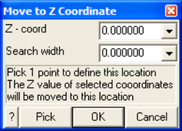

Z – coordinate 指定点的 Z 坐标。所有选定顶点（即列表中的顶点）的 Z 坐标都将移动到该值。

Search width 与指定的 z 坐标值相距在搜索宽度以内的所有坐标都将被移动，即使它们不在列表中。

Pick 激活光标十字线，以便从模型中交互式选取该点。为便于在模型上直观地选取点，所有捕捉功能均可使用

为便于在模型上直观地选取点，所有捕捉功能均可使用。

#### CAD > Snap

选取后，偏移矢量的各分量会显示在对话框中。

OK - 完成偏移矢量的编辑并拉伸选定的顶点。

Cancel - 中止顶点的拉伸。

完成任何编辑操作后，您有一次机会通过选择以下功能撤销所做的修改

#### Undo

您也可以通过选择以下功能恢复相同的选择集，并再次修改同一组实体

#### Redo

可以使用以下功能调整双击时间

#### Tools > Double Click Time

## 5.5.4.16 将顶点移动到平面

将选定的顶点移动到某个平面。顶点沿垂直于该平面的方向（或用户指定的方向）移动。

可以点击按钮，或直接在任意顶点上单击右键来启动此功能。启动此功能后，系统会首先提示您建立要移动的顶点列表。

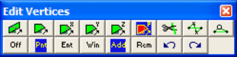

- 如果勾选了 Tools > Shift-key Selection，则必须按住 Shift 键才能进行多项选择。

- 默认情况下，选中的实体会被添加到列表中；但如果按住 Ctrl 键，选中的实体将从列表中移除。

- 按住 Shift 键或 Ctrl 键时，可以拖出交叉窗口。

- 此工具栏的使用方法详见 Build A List of Vertices for Editing

- 按空格键会自动激活上一次使用的编辑功能。

- 单击右键时按住 Alt 键，会自动重复上一次使用的编辑功能。

选择所需实体后，可以点击任意编辑按钮：

CAD > Edit > Stretch Vertices CAD > Edit > Move Vertices to Point CAD > Edit > Move Vertices to X CAD > Edit > Move Vertices to Y CAD > Edit > Move Vertices to Z CAD > Edit > Move Vertices to Plane CAD > Edit > Subdivide Construction Lines CAD > Edit > Smooth Construction Lines CAD > Edit > Remove Construction Vertex

- 双击任意顶点以执行高亮显示的功能，

- 单击右键查看选项列表。

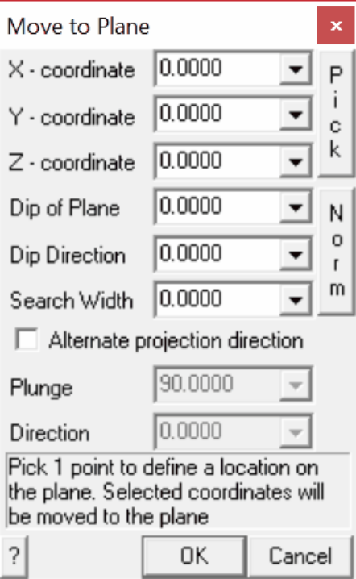

X Y Z – coordinate 指定平面上任意一点的坐标。

Pick 激活光标十字线，以便从模型中交互式选取平面上该点的 x y z 坐标。为便于在模型上直观地选取点，所有捕捉功能均可使用

Dip of Plane 指定平面的倾角（向下为正，单位为度）。

Dip Direction 指定倾斜矢量的方位角（度）。

Norm - 激活光标，以便交互式选择一个表面，使平面与之平行。平面的倾角和倾向将被设置为垂直于所选表面。

Search width 与指定平面相距在搜索宽度以内的所有坐标都将被移动，即使它们不在列表中。

Alternate projection direction - 如果未选中，则所有点都将沿垂直于平面的方向投影到所选平面上。如果选中，用户可以指定自己所需的投影方向。

Plunge - 用户指定的投影方向。

Direction - 用户指定的投影方向。

为便于在模型上直观地选取点，所有捕捉功能均可使用。

#### CAD > Snap

选取后，偏移矢量的各分量会显示在对话框中。

OK - 完成偏移矢量的编辑并拉伸选定的顶点。

Cancel - 中止顶点的拉伸。

完成任何编辑操作后，您有一次机会通过选择以下功能撤销所做的修改

#### Undo

您也可以通过选择以下功能恢复相同的选择集，并再次修改同一组实体

Redo

可以使用以下功能调整双击时间

Tools > Double Click Time

## 5.5.4.17 细分边

#### CAD > Edit > Remove

在块体边或构造线边上插入顶点（另请参阅 Construction Vertex）。

可以点击按钮，或直接在任意边上单击右键来启动此功能。启动此功能后，系统会首先提示您建立要插入顶点的位置列表。

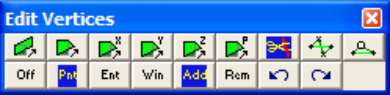

- 如果勾选了 Tools > Shift-key Selection，则必须按住 Shift 键才能进行多项选择。

- 默认情况下，选中的实体会被添加到列表中；但如果按住 Ctrl 键，选中的实体将从列表中移除。

- 按住 Shift 键或 Ctrl 键时，可以拖出交叉窗口。

- 此工具栏的使用方法详见 Build A List of Vertices for Editing

- 按空格键会自动激活上一次使用的编辑功能。

- 单击右键时按住 Alt 键，会自动重复上一次使用的编辑功能。

选择所需实体后，可以点击任意编辑按钮：

CAD > Edit > Stretch Vertices CAD > Edit > Move Vertices to Point CAD > Edit > Move Vertices to X CAD > Edit > Move Vertices to Y

#### CAD > Edit > Move Vertices to Z

CAD > Edit > Move Vertices to Plane

CAD > Edit > Subdivide Construction Lines

CAD > Edit > Smooth Construction Lines

CAD > Edit > Remove Construction Vertex

- 双击任意顶点以执行高亮显示的功能，

- 单击右键查看选项列表。

完成任何编辑操作后，您有一次机会通过选择以下功能撤销所做的修改

#### Undo

您也可以通过选择以下功能恢复相同的选择集，并再次修改同一组实体

#### Redo

可以使用以下功能调整双击时间

#### Tools > Double Click Time

注意：

- 通过设置 View > Render > Cline dot radius 参数，可以查看构造线上所有点的位置。

- 使用此轨迹平滑功能之前，应使用 CAD > Pack and Renumber Clines 功能整理构造线。

- 可以使用 Tools > Double Click Time 调整双击时间。

## 5.5.4.18 平滑构造线

通过消除角点来平滑构造线（另请参阅 Construction Vertex）。

#### CAD > Edit > Remove

可以点击按钮，或直接在任意顶点上单击右键来启动此功能。启动此功能后，系统会首先提示您建立要平滑的顶点列表。

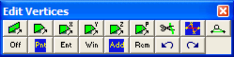

- 如果勾选了 Tools > Shift-key Selection，则必须按住 Shift 键才能进行多项选择。

- 默认情况下，选中的实体会被添加到列表中；但如果按住 Ctrl 键，选中的实体将从列表中移除。

- 按住 Shift 键或 Ctrl 键时，可以拖出交叉窗口。

- 此工具栏的使用方法详见 Build A List of Vertices for Editing

- 按空格键会自动激活上一次使用的编辑功能。

- 单击右键时按住 Alt 键，会自动重复上一次使用的编辑功能。

选择所需实体后，可以点击任意编辑按钮：

CAD > Edit > Stretch Vertices

CAD > Edit > Move Vertices to Point CAD > Edit > Move Vertices to X CAD > Edit > Move Vertices to Y CAD > Edit > Move Vertices to Z CAD > Edit > Move Vertices to Plane CAD > Edit > Subdivide Construction Lines CAD > Edit > Smooth Construction Lines CAD > Edit > Remove Construction Vertex

- 双击任意顶点以执行高亮显示的功能，

- 单击右键查看选项列表。

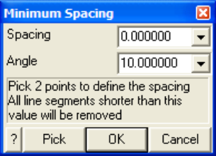

Spacing 值限制点与点之间的最小间距。例如，如果 Spacing 指定为 2m，而下图中点 4 和点 5 之间的轨迹长度为 1.5m，则点 4 将被删除，并由点 3 和点 5 之间的直线取代。

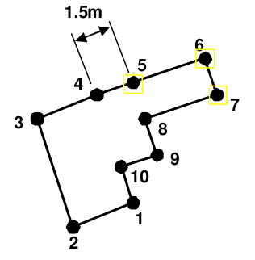

此参数为零表示不使用该参数。

Angle 值限制相邻线段之间的最小夹角。例如，如果 Angle 指定为 10°，而线段 3-4 的方向与

下图中线段 4-5 的方向相差 7°，则点 4 将被删除，并由点 3 和点 5 之间的直线取代。

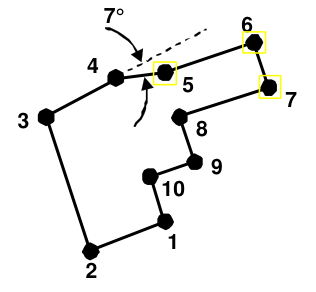

此参数为零表示不使用该参数。

OK - 完成偏移矢量的编辑并拉伸选定的顶点。

Cancel - 中止顶点的拉伸。

完成任何编辑操作后，您有一次机会通过选择以下功能撤销所做的修改

#### Undo

您也可以通过选择以下功能恢复相同的选择集，并再次修改同一组实体

#### Redo

可以使用以下功能调整双击时间

#### Tools > Double Click Time

注意：

- 通过设置 View > Render > Cline dot radius 参数，可以查看构造线上所有点的位置。

- 使用此轨迹平滑功能之前，应使用 CAD > Pack and Renumber Clines 功能整理构造线。

- 可以使用 Tools > Double Click Time 调整双击时间。

## 5.5.4.19 删除构造线顶点

通过消除单个角点来平滑构造线（另请参阅 Construction Lines）。

#### CAD > Edit > Smooth

可以点击按钮，或直接在任意顶点上单击右键来启动此功能。启动此功能后，系统会首先提示您建立要删除的顶点列表。

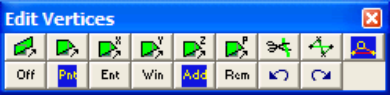

- 如果勾选了 Tools > Shift-key Selection，则必须按住 Shift 键才能进行多项选择。

- 默认情况下，选中的实体会被添加到列表中；但如果按住 Ctrl 键，选中的实体将从列表中移除。

- 按住 Shift 键或 Ctrl 键时，可以拖出交叉窗口。

- 此工具栏的使用方法详见 Build A List of Vertices for Editing

- 按空格键会自动激活上一次使用的编辑功能。

- 单击右键时按住 Alt 键，会自动重复上一次使用的编辑功能。

选择所需实体后，可以点击任意编辑按钮：

CAD > Edit > Stretch Vertices CAD > Edit > Move Vertices to Point CAD > Edit > Move Vertices to X CAD > Edit > Move Vertices to Y CAD > Edit > Move Vertices to Z CAD > Edit > Move Vertices to Plane CAD > Edit > Subdivide Construction Lines CAD > Edit > Smooth Construction Lines CAD > Edit > Remove Construction Vertex

- 双击任意顶点以执行高亮显示的功能，

- 单击右键查看选项列表。

完成任何编辑操作后，您有一次机会通过选择以下功能撤销所做的修改

#### Undo

您也可以通过选择以下功能恢复相同的选择集，并再次修改同一组实体

#### Redo

可以使用以下功能调整双击时间

#### Tools > Double Click Time

注意：

- 通过设置 View > Render > Cline dot radius 参数，可以查看构造线上所有点的位置。

- 使用此轨迹平滑功能之前，应使用 CAD > Pack and Renumber Clines 功能整理构造线。

- 可以使用 Tools > Double Click Time 调整双击时间。
