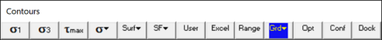
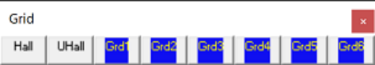
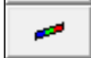

选择一个场点网格进行查看。

可通过单击等值线工具栏上的按钮启动此程序

将此工具栏拖到主窗口的左边缘或右边缘，即可将其改为竖直方向。

将其拖到主窗口的上边缘或下边缘，即可改回水平方向。

分析结果（应力、应变和位移）可以在单元表面和场点网格上绘制等值线。

启用 OpenGL (Tools > OpenGL) 后，可以同时显示所有网格；未启用 OpenGL 时，只能同时显示两个网格。

Hide All —— 隐藏所有网格。

Unhide All —— 显示所有网格。

用户可以使用以下命令构建多个场点网格平面

CAD > Build > Grid Plane

CAD > Build > Grid Line

如有需要，可使用以下命令将各个网格选择按钮放置在视图工具栏上

Tools > View Toolbar Configure
