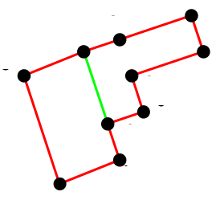

压缩所有构造线并重新编号。

彼此非常接近的坐标点会被合并。位置相同的构造线角点将使用同一个坐标点编号，因此在任何坐标编辑操作（Cad > Edit）中都会一起移动。此功能可用于消除相邻构造线之间的微小间隙和重叠。

所有同色的构造线段将尽可能连接起来，在交点之间形成连续的线。

**6**

在此示例中，将形成 3 条线段，由以下点组构成

- 线段 1： 10, 1, 2, 3, 4。

- 线段 2： 4, 5, 6, 7, 8, 9, 10。

- 线段 3： 4, 10。

启动此功能时，系统会提示您指定压缩的搜索半径

Radius：该值用于合并彼此接近的点。此参数为零表示不使用该参数，此时 Map3D 将合并与线的距离在边长 1/1000 搜索半径内的点。指定非零值时务必格外小心，因为过大的值会合并过多的点，造成的问题可能比解决的还多。

所有未使用的坐标编号都会从坐标列表中删除。

应在使用 CAD > Edit > Smooth Construction lines 功能之前使用此功能。

应在使用 CAD > Snap > Trace Cline Snap 功能之前使用此功能。

可以使用 CAD > Unpack Clines 功能解压构造线。
