## 5.5.2.1 无

禁用捕捉。光标十字线交点处不显示拾取框。

点将在十字线指示的位置被选取。此模式适用于徒手草图绘制或数字化。数字化时，所有三个坐标值均从图纸上按比例读取。但徒手绘制草图时，只能确定其中两个坐标，第三个坐标必须由捕捉基准提供

CAD > Snap > Cursor/Grid Base

这是数字化时的推荐设置。

## 5.5.2.2 最近边

捕捉到最近的边。

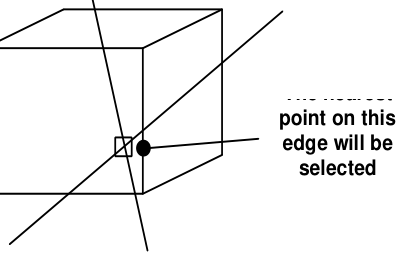

如果拾取框位于某个实体的角点上，将选取该角点。

否则将选取最近边上的最近点。

拾取框必须位于实体或构造线上。

## 5.5.2.3 最近角点

捕捉到最近的角点。

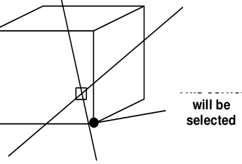

将选取最靠近拾取框的角点。

拾取框必须位于实体或构造线上。

## 5.5.2.4 最近表面

捕捉到表面上。

如果拾取框位于某个实体的角点上，将选取该角点。

如果拾取框位于某条边上，将选取该边上的最近点。

否则将选取表面上的最近点。

拾取框必须位于实体或构造线上。

## 5.5.2.5 线的中点

捕捉到所选边的中点。

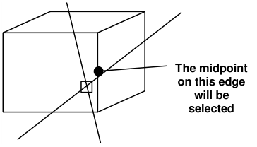

如果拾取框位于某个实体的角点上，将选取该角点。

否则将选取最近边的中点。

拾取框必须位于实体或构造线上。

## 5.5.2.6 切线捕捉

强制光标与所选边相切。

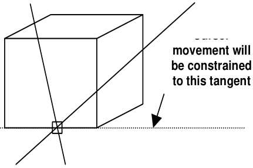

将选取最靠近拾取框的边。拾取框必须位于实体或构造线上。

选取后，光标的所有移动都将被约束在所选边定义的切线上。现在可以在这条切线上的任意位置选取点。

选取一个点后，切线捕捉会自动取消。也可以随时按 Esc 键或单击鼠标右键取消切线捕捉。

若要沿切线等间距选取点，可将切线捕捉与以下任一功能结合使用：

CAD > Snap > Grid Snap 捕捉到矩形网格。

CAD > Snap > X-Gird Snap 以等间距的 X 网格间隔捕捉到所选边。

CAD > Snap > Y-Grid Snap 以等间距的 Y 网格间隔捕捉到所选边。

CAD > Snap > Z-Grid Snap 以等间距的 Z 网格间隔捕捉到所选边。

## 5.5.2.7 交点捕捉

捕捉到所选边与某条切线的交点。

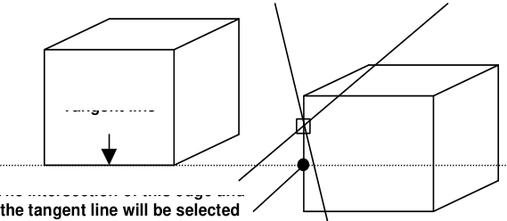

由于此功能在完整的 3D 空间中运行，切线可能从所选边的上方或下方经过而并不真正相交。在这种情况下，将选取所选边上距离切线最近的点。

必须强调这一约定：交点不会选在切线上，而是选在相交线上。

使用此功能分两个步骤。单击 Intersect Snap 按钮时，系统会提示您：

1. 首先选择一条切线。

2. 然后选择要与切线相交的边。点将选在这条线上。

将选取最靠近拾取框的边。

拾取框必须位于实体或构造线上。

此功能可用于定位切线与所选边的延长线的交点。

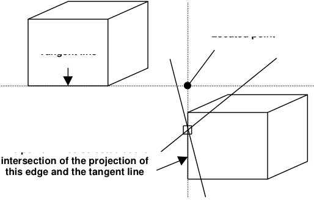

选取一个点后，交点捕捉会自动取消。也可以随时按 Esc 键或单击鼠标右键取消交点捕捉。

有关在模型构建中使用交点捕捉的示例，请参阅

Tabular Mining

## 5.5.2.8 构造线追踪捕捉

捕捉到沿构造线段的选定角点。此捕捉模式可作为快速构建 DDLoop（CAD > Build > DDLoop）、FFLoop（CAD > Build >

FFLoop）、巷道（CAD > Build > Tunnel 和 CAD > Build > GPlanes）的方法。

使用此捕捉模式时，只需选取所需构造线段上的起点和终点，两者之间的所有点将被自动选取。例如，如果选取点 4 和点 9，点 5、6、7 和 8 将被自动选取。请注意，如果两次选取同一个点，将选取整个回路。

**6**

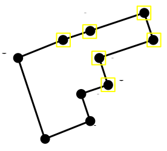

注意：

通过设置 View > Render > Cline dot radius 参数，可以查看构造线上所有点的位置。

使用此追踪捕捉模式之前，应使用 CAD > Pack and Renumber Clines 功能整理构造线。

CAD > Edit > Smooth Construction Lines 功能也可用于帮助整理构造线。

## 5.5.2.9 构造线回路追踪捕捉

捕捉到沿构造线段的所有角点。此捕捉模式可作为快速构建 DDLoop（CAD > Build > DDLoop）、FFLoop（CAD > Build > FFLoop）、巷道（CAD > Build > Tunnel 和 CAD > Build > GPlanes）的方法。

使用此捕捉模式时，只需选取所需构造线段上的一个点，该线上的所有点将被自动选取。例如，如果选取点 4，点 5、6、7、8、1、2 和 3 将被自动选取。

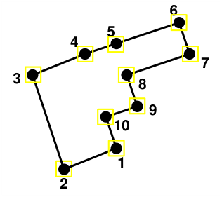

注意：

通过设置 View > Render > Cline dot radius 参数，可以查看构造线上所有点的位置。

使用此追踪捕捉模式之前，应使用 CAD > Pack and Renumber Clines 功能整理构造线。

CAD > Edit > Smooth Construction Lines 功能也可用于帮助整理构造线。

## 5.5.2.10 点窗口

使用窗口选取角点。

此捕捉模式可作为快速构建 DDLoop（CAD > Build > DDLoop）、FFLoop（CAD > Build > FFLoop）、巷道（CAD > Build > Tunnel）、CLines（CAD >

Build > CLines）和 GLines（CAD > Build > GLines）的方法。

虽然此捕捉模式最常用于沿 CLines 选取多个点，但角点可以位于所有单元类型上，包括：FF 单元、DD 单元、GPlanes、GLines 和 CLines。

- Video Demo of FFLoop Model Building

- Video Demo of DDLoop model buiding

- Video Demo of Model_Simplification_Using_Slicing

在上图中，如果在选取窗口之前先选取了一个或多个点，则窗口中的点将添加到这些已有点之后，从距离最近的先前选取的点开始。例如，如果在选取窗口之前先选取点 3，然后使用包含点 4、5 和 6 的窗口，则会按此顺序添加这些点。

或者，如果在选取窗口之前先选取点 3，然后使用包含点 1、2 和 10 的窗口，则会按 2、1、10 的顺序添加这些点。

在上图中，如果在选取窗口之前没有选取任何点，则窗口中的点将从尽可能相距最远的位置开始选取。

例如，如果在所有点上选取一个窗口，由于点 2 和点 6 相距最远，各点将按 2、3、4、5、6、7、8、9、10、1、2 的顺序选取。

由于此示例构成闭合回路，各点即按此方式选取。

CAD > Build > DDLoop）。

这样就形成了适合构建 DDLoop 的回路（

在上图中，如果在选取窗口之前先选取点 1，然后使用包含所有点的窗口，则所有点将按如下所示选取：1、2、3、4、5、6、7、8、9、10、11、1、12、13、14、15、16、17、18、19、20、21、22、12。

这样就形成了适合构建 FFLoop 的两个回路（CAD > Build > FFLoop）。或者，如果在选取窗口之前先选取点 3，然后使用包含点 1、2 和 10 的窗口，则会按 2、1、10 的顺序添加这些点。

注意：

通过设置 View > Render > Cline dot radius 参数，可以查看构造线上所有点的位置。

使用此追踪捕捉模式之前，应使用 CAD > Pack and Renumber Clines 功能整理构造线。

CAD > Edit > Smooth Construction Lines 功能也可用于帮助整理构造线。

## 5.5.2.11 矩形网格捕捉

捕捉到矩形网格。光标十字线交点处不显示拾取框。

光标的所有移动都将被约束在网格点上。

网格可以按任意所需的间距和位置，定向在 X-Y、Y-Z 或 X-Z 平面内。要设置这些参数，请使用

CAD > Snap > Cursor/Grid Setup 设置光标/网格的间距和方向。

有关在模型构建中使用网格捕捉模式的示例，请参阅

Freehand Sketching - Room and Pillar。

## 5.5.2.12 圆形网格捕捉

捕捉到圆柱网格。光标十字线交点处不显示拾取框。

光标的所有移动都将被约束在网格点上。

网格可以按任意所需的间距和位置，定向在 X-Y、Y-Z 或 X-Z 平面内。要设置这些参数，请使用

CAD > Snap > Cursor/Grid Setup 设置光标/网格的间距和方向。

## 5.5.2.13 X 网格捕捉

捕捉到 x 网格间距。

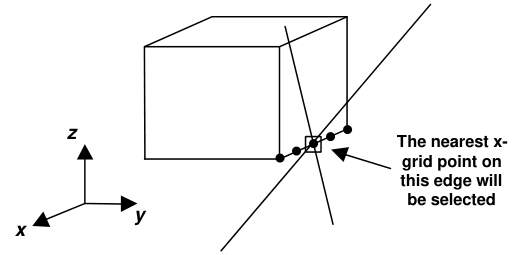

如果拾取框位于某个实体的角点上，将选取该角点。

否则将选取最近边上符合 x 网格间距的最近点。

拾取框必须位于实体或构造线上。

由于 x 坐标值被约束在规定的 X 网格间距上，y 和 z 坐标值由所选线的方程计算得出。

网格间距和位置可以通过再次单击 X-Grid Snap 按钮来定义，或使用

CAD > Snap > Cursor/Grid Setup 设置光标/网格的间距和方向。

X 网格捕捉可与以下任一功能结合使用：

CAD > Snap > None 禁用捕捉。

CAD > Snap > Edge 捕捉到最近的边。

CAD > Snap > Tangent Snap 强制光标与所选边相切。

## 5.5.2.14 Y 网格捕捉

捕捉到 y 网格间距。

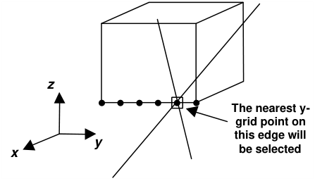

如果拾取框位于某个实体的角点上，将选取该角点。

否则将选取最近边上符合 y 网格间距的最近点。

拾取框必须位于实体或构造线上。

由于 y 坐标值被约束在规定的 y 网格间距上，x 和 z 坐标值由所选线的方程计算得出。

网格间距和位置可以通过再次单击 Y-Grid Snap 按钮来定义，或使用

CAD > Snap > Cursor/Grid Setup 设置光标/网格的间距和方向。

Y 网格捕捉可与以下任一功能结合使用：

CAD > Snap > None 禁用捕捉。

CAD > Snap > Edge 捕捉到最近的边。

CAD > Snap > Tangent Snap 强制光标与所选边相切。

## 5.5.2.15 Z 网格捕捉

捕捉到 z 网格间距。

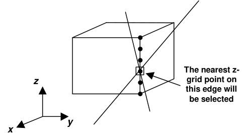

如果拾取框位于某个实体的角点上，将选取该角点。

否则将选取最近边上符合 y 网格间距的最近点。

拾取框必须位于实体或构造线上。

由于 z 坐标值被约束在规定的 Z 网格间距上，x 和 y 坐标值由所选线的方程计算得出。

网格间距和位置可以通过再次单击 Z-Grid Snap 按钮来定义，或使用

CAD > Snap > Cursor/Grid Setup 设置光标/网格的间距和方向。

Z 网格捕捉可与以下任一功能结合使用：

CAD > Snap > None 禁用捕捉。

CAD > Snap > Edge 捕捉到最近的边。

CAD > Snap > Tangent Snap 强制光标与所选边相切。

## 5.5.2.16 光标/网格设置

设置光标/网格的位置、间距和方向。

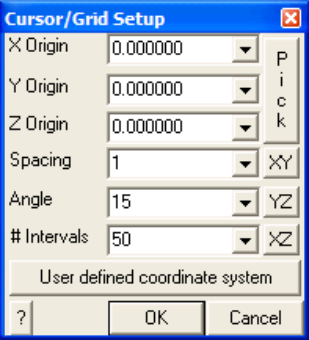

X, Y and Z Origin - 指定网格中心的坐标。

Pick - 激活光标十字线，以便从

模型中交互式选择光标/网格基准。

Spacing - 指定网格点之间的距离。

Angle - 指定圆柱网格各半径之间的夹角（度）。

#### Intervals - 指定将显示的网格点数。

CAD > Snap > XY Cursor - 将光标十字线和捕捉网格约束在 X-Y 平面内。

CAD > Snap > YZ Cursor - 将光标十字线和捕捉网格约束在 Y-Z 平面内。

CAD > Snap > XZ Cursor - 将光标十字线和捕捉网格约束在 X-Z 平面内。

CAD > Snap > User defined Cursor - 将光标十字线和捕捉网格约束在用户定义的平面内。

用户定义的坐标系仅在矩形和圆形网格捕捉时有效（CAD > Snap > Grid Snap 和 CAD > Snap > Cylinder Snap）。

用户定义的平面由其倾角（j）、倾向（J）和侧伏角（a）指定，其中：

- Pnt on X - 局部 x 轴（ _x'_ ）沿平面走向定义。可以使用此功能在该轴上选取一个点。

- Pnt on Y - 局部 y 轴（ _y'_ ）沿倾向定义。可以使用此功能在该轴上选取一个点。

- 局部 z 轴垂直于该平面。

- Norm - 激活光标，以便交互式选择一个表面，使局部 UCS 平面与之平行。平面的倾角和倾向将被设置为垂直于所选表面。

- Rake - 允许 X' 绕局部 z 轴旋转。

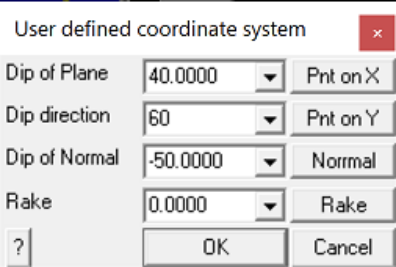

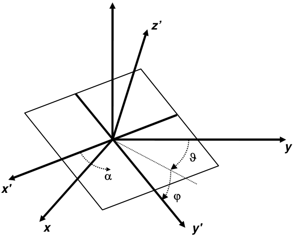

有关在模型构建中使用网格捕捉模式的示例，请参阅 Freehand Sketching - Room and Pillar。
