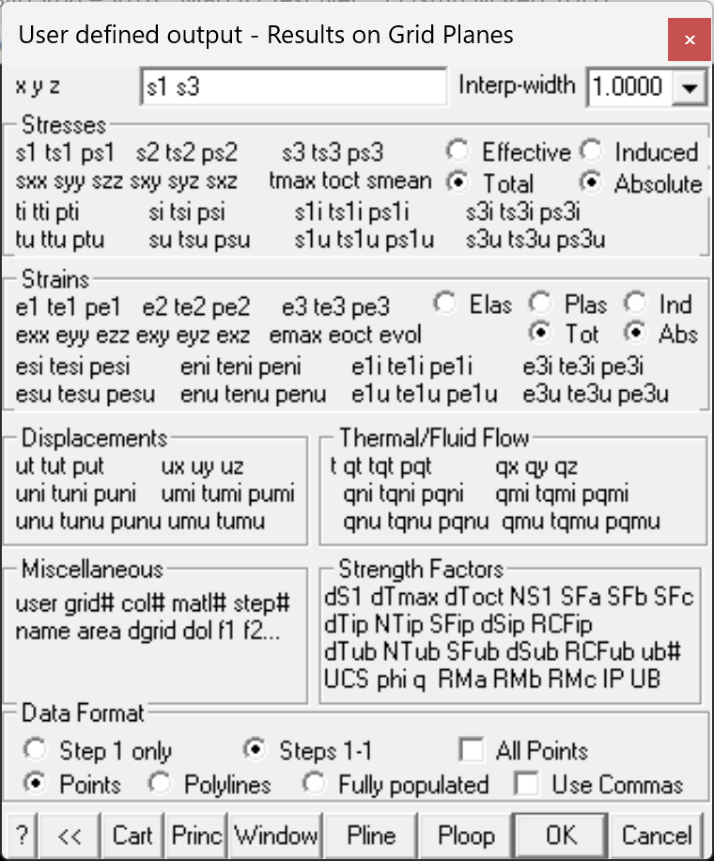
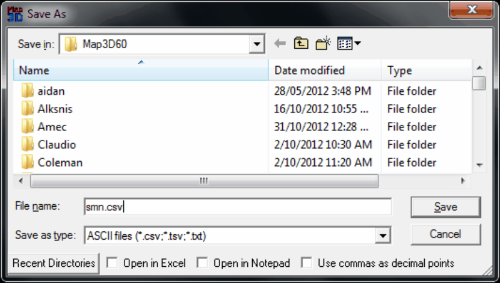
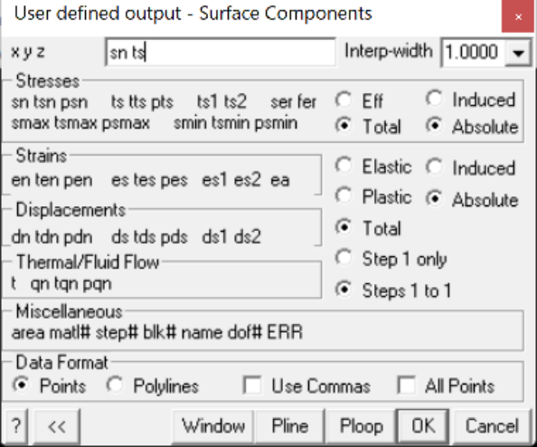
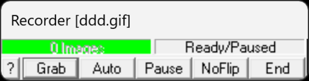

## 5.1.23.1 复制屏幕到剪贴板

将屏幕的位图转储到 Windows 剪贴板。该图像可粘贴到其他应用程序中。

由于屏幕背景通常为黑色、单元轮廓为白色，您可能需要选择

File > Output > Copy Screen (B&W flipped)

以交换这两种颜色。

## 5.1.23.2 复制屏幕（黑白反转）

将屏幕的位图转储到 PNG（Portable Network Graphics - *.PNG）、GIF（Compuserve Graphics Interchange Format）或 BMP（Windows 设备无关位图 *.BMP）文件，并交换屏幕背景色与单元轮廓色。该文件可加载到其他软件中，用于报告展示和打印。

更多详情请参阅

File > Output > PNG, GIF or BMP image

## 5.1.23.3 PNG、GIF、JPEG、BMP 或 TIFF 屏幕图像

将屏幕的位图转储到 PNG（Portable Network Graphics - *.PNG）、GIF（CompuServe Graphics Interchange Format）、BMP（Windows 设备无关位图 *.BMP）或 TIFF（tagged image file format）文件。该文件可加载到其他软件中，用于报告展示和打印。

由于屏幕背景通常为黑色、单元轮廓为白色，您可能需要选择

File > Output > PNG, GIF, JPEG, BMP or TIFF (B&W flipped)

以交换这两种颜色。

这些文件可以使用 File > Image Viewer 显示

BMP 格式是一种受到广泛支持的图形文件格式（大多数网页浏览器、文字处理器和绘图程序均支持）。BMP 格式的主要优点是支持显示的所有颜色。遗憾的是，由于没有压缩，这些文件可能非常大（每个 1MB 或更大）。

PNG 格式是一种受到广泛支持的图形文件格式（大多数网页浏览器、文字处理器和绘图程序均支持）。PNG 格式的主要优点是出色的无损压缩（通常为 BMP 文件大小的 1%）并支持显示的所有颜色。有关动画的详情，请参阅 File > Output > Image Recorder。

GIF 格式是支持最为广泛的图形文件格式。GIF 格式的主要优点是出色的无损压缩（通常为 BMP 文件大小的 1%）和动画功能。遗憾的是，GIF 仅支持 256 种显示颜色。根据所显示的内容，Map3D 最多可使用 512 种颜色，因此 GIF 可能无法以全部颜色再现屏幕图像

GIF 格式依据 Version 89a ©1987,1988,1989,1990 Copyright CompuServe Incorporated, Columbus, Ohio 规范实现。

本软件使用 FreeImage 开源图像库。详情请参阅 [http://freeimage.sourceforge.net](http://freeimage.sourceforge.net)。FreeImage 依据（GNU GPL 或 FIPL）第（许可证版本）版使用。

## 5.1.23.4 PNG、GIF、JPEG、BMP 或 TIFF（黑白反转）

将屏幕的位图转储到 PNG（Portable Network Graphics - *.PNG）、GIF（Compuserve Graphics Interchange Format）或 BMP（Windows 设备无关位图 *.BMP）文件，并交换屏幕背景色与单元轮廓色。该文件可加载到其他软件中，用于报告展示和打印。

更多详情请参阅

File > Output > PNG, JPEG, GIF, BMP or TIFF image

## 5.1.23.5 DXF 屏幕图像

将屏幕图像转储到 AutoCAD 图形交换格式的文件（*.DXF）。这是一种矢量格式，可导入许多软件包中进行进一步渲染。

## 5.1.23.6 PNT 屏幕图像

将屏幕图像转储到文件（*.PNT），即扩展名为 ".PNT" 的通用 ASCII 数据文件。PNT 格式便于与其他 CAD 软件交换原始模型数据。这是一种矢量格式，可导入许多软件包中进行进一步渲染。

## 5.1.23.7 OBJ 屏幕图像

将屏幕图像转储到 Wavefront 格式的文件（*.OBJ）。这便于与其他 CAD 和虚拟现实建模软件交换模型数据。这是一种矢量格式，可导入许多软件包中进行进一步渲染。

## 5.1.23.8 WRL 屏幕图像

将屏幕图像转储到 VRML 格式的文件（*.WRL）。VRML 便于与其他 CAD 和虚拟现实建模软件交换模型数据。这是一种矢量格式，可导入许多软件包中进行进一步渲染。

## 5.1.23.9 3D-PDF 屏幕图像

将屏幕图像转储到 PDF（3D）格式的文件。3D PDF 可在 Adobe Reader 中以完整 3D 方式查看。

## 5.1.23.10 选定的网格分量

将选定的网格分量以用户控制的格式转储到文本文件（*.txt）。

默认情况下，所有网格上的所有点都会被转储。如果只想转储选定的一组点，请使用下文介绍的窗口功能。

选择所需数据并点击 OK 后，系统会提示您输入用于保存数据的文件名。您可以选择 CSV（逗号分隔/定界数据）、TSV（制表符分隔/定界数据）或 TXT（空格分隔/定界数据）。您还可以指定自动在 Excel 或记事本（Notepad）中打开该文件。请注意，不应使用以逗号作为小数点的 CSV 文件。

#### Stresses:

s1 ts1 ps1 最大主应力 s1、其走向和倾伏角。

s2 ts2 ps2 中间主应力 s2、其走向和倾伏角。

s3 ts3 ps3 最小主应力 s3、其走向和倾伏角。sxx syy szz sxy syz sxz 笛卡尔应力分量。tmax 最大剪应力 tmax = ½ ( s1 - s3 ) toct 八面体剪应力 toct = ¹/3 [( s1 - s2 )² + ( s2 - s3 )² +( s3 - s1 )²]½ smean 平均应力 smean = ¹/3 ( s1 + s2 + s3 )

ti tti pti 网格平面内的最大剪应力、其走向和倾伏角。si tsi psi 网格平面内的法向应力、其走向和倾伏角。s1i ts1i ps1i 与网格平面相切的最大应力、其走向和倾伏角。s3i ts3i ps3i 与网格平面相切的最小应力、其走向和倾伏角。tu ttu ptu 遍布平面内的最大剪应力、其走向和倾伏角。su tsu psu 垂直于遍布平面的应力、其走向和倾伏角。s1u ts1u ps1u 与遍布平面相切的最大应力、其走向和倾伏角。s3u ts3u ps3u 与遍布平面相切的最小应力、其走向和倾伏角。遍布平面的方向在以下位置指定

Plot > Strength Factors > Ubiquitous Parameters

Effective/Total 有效应力或总应力分量。这些选项仅用于 Map3D Thermal-Fluid Flow，因为该程序可以计算稳态孔隙压力分布。Induced/Absolute 诱发应力是不含开采前应力贡献的应力，表示相对于开采前状态的应力变化。绝对应力是包含开采前应力贡献的应力。

#### Strains:

e1 te1 pe1 最大主应变 e1、其走向和倾伏角。e2 te2 pe2 中间主应变 e2、其走向和倾伏角。

e3 te3 pe3 最小主应变 e3、其走向和倾伏角。exx eyy ezz exy eyz exz 笛卡尔应变分量。emax 最大剪应变 emax = ½ ( e1 - e3 ) eoct 八面体剪应变 eoct = ¹/3 [( e1 - e2 )² + ( e2 - e3 )² +( e3 - e1 )²]½ evol 体积应变 evol = ( e1 + e2 + e3 ) esi tesi pesi 网格平面内的最大剪应变、其走向和倾伏角。eni teni peni 网格平面内的法向应变、其走向和倾伏角。e1i te1i pe1i 与网格平面相切的最大应变、其走向和倾伏角。e3i te3i pe3i 与网格平面相切的最小应变、其走向和倾伏角。esu tesu pesu 遍布平面内的最大剪应变、其走向和倾伏角。enu tenu penu 垂直于遍布平面的应变、其走向和倾伏角。e1u te1u pe1u 与遍布平面相切的最大应变、其走向和倾伏角。e3u te3u pe3u 与遍布平面相切的最小应变、其走向和倾伏角。Elastic/Plastic/Total 弹性、塑性或总应变分量。这些选项仅用于 Map3D Non-Linear，因为该程序可以计算非线性应变。Induced/Absolute 诱发应变是不含开采前贡献的应变，表示相对于开采前状态的应变变化。绝对应变是包含开采前应变贡献的应变。

#### Displacements:

ut tut put 总位移、其走向和倾伏角。ux uy uz 笛卡尔位移分量。uni tuni puni 垂直于网格平面的位移、其走向和倾伏角。umi tumi pumi 与网格平面相切的最大位移、其走向和倾伏角。unu tunu punu 垂直于遍布平面的位移、其走向和倾伏角。umu tumu pumu 与遍布平面相切的最大位移、其走向和倾伏角。

#### Flow:

t 温度/水头。

qt tqt pqt 总流量、其走向和倾伏角。qx qy qz 笛卡尔流量分量。qni tqni pqni 垂直于网格平面的位移、其走向和倾伏角。qmi tqmi pqmi 与网格平面相切的最大位移、其走向和倾伏角。qnu tqnu pqnu 垂直于遍布平面的位移、其走向和倾伏角。qmu tqmu pqmu 与遍布平面相切的最大位移、其走向和倾伏角。

#### Strength:

- ds1 剩余最大主应力 Ds1 = s1 - ( _UCS_ + _q_ s3 )

- dtmax 剩余最大剪应力 Dtmax = ½(s1 - s3) - [ _UCS_ + ½(s1+s3) ( _q_ -1) ]/( _q_ +1) = [s1 - ( _UCS_ + _q_ s3) ]/( _q_ +1)

- dtoct 剩余八面体剪应力 Dtoct = toct - [ _UCS_ + ( _q_ –1) smean ] Ö(2) /( _q_ +2)

- NS1 使用正态分布 N(Ds1 /std) 的概率

- SFA 强度/应力可确定为 ( _UCS_ + _q_ s3 )/ s1

- SFB 强度/应力可确定为 ( _UCS_ + _q_ s3 - s3 )/(s1 - s3)

- SFC 强度/应力可确定为 [ _UCS_ + ½(s1+s3) ( _q_ -1) ]/[ ½(s1 - s3)( _q_ +1) ]

- dTip 剩余面内剪应力 Dtip = tip - [ Cohesion + sip tan(j) ]

- NTip 使用正态分布 N(Dtip /std) 的概率

- SFip 强度/应力可确定为 [ Cohesion + sip tan(j) ] / tip

- dSip 剩余面内壁面应力 Dsip = [ 3 s1i - s3i ] - UCS

- RCFip 面内壁面应力的岩石状态系数（Rock Condition Factor）RCFip = [ 3 s1i - s3i ]/UCS

- dTub 剩余遍布平面剪应力 Dtub

- NTub 使用正态分布 N(Dtub /std) 的概率

- SFub 强度/应力可确定为 [ Cohesion + sub tan(j) ] / tub

- dSub 剩余 ub 平面壁面应力 Dsub = [ 3 s1ub - s3ub ] - UCS

- RCFub ub 平面壁面应力的岩石状态系数 RCFip = [ 3 s1ub - s3ub ]/UCS

- UB# 绘制 Dtub 值最大的 UB 组编号（1、2 或 3）

- _UCS phi q_ 使用 Plot > Strength Factors > Rockmass Strength Parameters 定义的 Mohr-Coulomb 强度参数；请注意，只有在指定了 Mohr-Coulomb 或 Druker-Prager 强度准则时，这些参数才有定义

- _sc_ 使用 Plot > Strength Factors > Rockmass Strength Parameters 定义的 Hoek-Brown 强度参数；请注意，只有在指定了 Hoek-Brown 强度准则时，该参数才有定义

#### Miscellaneous:

user 用户自定义值。

grid# 点所在网格的编号。matl# 点所处材料的编号。围岩（host）材料的编号为 1。在使用多种材料的问题中，结果可能在替代材料区域内计算。

step# 开采步骤编号。name 网格名称。area 所选点相邻的网格单元面积。dgrid 每个网格点到最近表面的距离。dol 到最近网格的距离 _Dgrid_ 除以网格间距 _Lgrid_ 。f1 f2... 用户自定义的材料参数。可以通过 Plot > Properties > Material Properties > User defined Parameters 定义。

#### Data Format:

点数据将按每行一个点的方式写出：

- x1 y1 z1 values1 x2 y2 z2 values2 x3 y3 z3 values3 x4 y4 z4 values4

其中 xi yi zi 表示每个点的坐标，

valuesi 表示每个点处用户所选分量列表的值。用户自定义值将作为注释行（即以星号 "*" 开头的行）列在文件开头。

多段线数据将按 PNT 文件格式写出为一系列多段线

- x1 y1 z1 3 values1 x2 y2 z2 2 values2 x3 y3 z3 2 values3 x4 y4 z4 2 values4

其中 xi yi zi 表示每个点的坐标，

- 3 表示该点是新线的起点，

- 2 表示该点是同一条线的延续，

valuesi 表示多段线每个角点处用户所选分量列表的值。用户自定义值将作为注释行（即以星号 "*" 开头的行）列在文件开头。

Fully Populated：数据将按所有数据均位于规则尺寸网格上的方式写出。

Use Commas：数据将以逗号代替小数点写出。

#### Other:

&lt;&lt;    将对话框缩小为小尺寸

>>    将对话框放大为大尺寸 Cartesian   配置笛卡尔应力分量的输出。Principal   配置主应力分量的输出。Window   激活图形拾取窗口。

- 系统会提示您分别单击选择窗口的两个角点。

- 只有窗口内包含的网格点才会包含在转储中。

- 如果不使用此功能，则转储所有网格上的所有点。

- 要查看实际等值线点的位置，请启用轨迹显示（Plot > Options > Trajectories）。等值线点位于绘制轨迹的位置。

Polyline   激活图形拾取多边形。系统会提示您依次单击选择一系列角点来定义多边形：

- 选择这些点时必须按住 Shift 键。

- 如果定义了闭合多边形，将包含多边形内的等值线点。

- 如果定义的是开放多边形，将包含沿多段线长度方向的一系列点。

- 要查看实际等值线点的位置，请启用轨迹显示（Plot > Options > Trajectories）。等值线点位于绘制轨迹的位置。

- 按住 Shift 键并拖出窗口，可以定义简单的矩形窗口（与 Window 按钮相同）。

## 5.1.23.11 选定的表面分量

将选定的表面分量以用户控制的格式转储到文本文件（*.txt）。

默认情况下，所有表面上的所有点都会被转储。如果只想转储选定的一组点，请使用下文介绍的窗口功能。

选择所需数据并点击 OK 后，系统会提示您输入用于保存数据的文件名。您可以选择 CSV（逗号分隔/定界数据）、TSV（制表符分隔/定界数据）或 TXT（空格分隔/定界数据）。

您还可以指定自动在 Excel 或记事本（Notepad）中打开该文件。请注意，不应使用以逗号作为小数点的 CSV 文件。

#### Stresses:

sn tsn psn 垂直于表面的应力、其走向和倾伏角。

ts tts pts 表面平面内的最大剪应力、其走向和倾伏角。ts1 ts2   表面平面内的剪应力分量。ts1 平行于第一条边（即由 x1 y1 z1 – x2 y2 z2 定义的边）。ts2 垂直于 ts1，指向第二条边（即由 x2 y2 z2 – x3 y3 z3 定义的边）的方向。

ser 表面应力误差。迭代求解器的工作方式是确定每个联立方程当前解的误差，然后通过逐次逼近的过程减小这些误差。该参数表示每个方程的误差。

fer 破坏准则误差。该参数仅用于非线性蠕变分析（包括断层滑动和 3D 材料非线性）。除非指定了某种黏性且问题变为非线性，否则该参数应始终接近零。在后一种情况下，黏性蠕变可能使应力状态超出破坏准则，表明缺乏静力平衡。该参数表示每个方程的黏性应力。

smax tsmax psmax 最大切向应力、其走向和倾伏角。smin tsmin psmin 最小切向应力、其走向和倾伏角。Effective/Total – 有效应力或总应力分量。这些选项仅用于 Map3D Thermal-Fluid Flow，因为该程序可以计算稳态孔隙压力分布。

#### Strains:

en ten pen 垂直于表面方向的应变、其走向和倾伏角。该参数仅用于 DD 平面，计算方法为法向位移（闭合量）除以厚度。es tes pes 表面平面内的最大剪应变、其走向和倾伏角。该参数仅用于 DD 平面，计算方法为剪切位移（ride）除以厚度。es1 es2   表面平面内的剪应变分量。es1 平行于第一条边（即由 x1 y1 z1 – x2 y2 z2 定义的边）。es2 垂直于 es1，指向第二条边（即由 x2 y2 z2 – x3 y3 z3 定义的边）的方向。

#### Displacements:

dn tdn pdn 垂直于表面方向的法向位移（闭合量）、其走向和倾伏角。该参数仅用于 DD 平面。请注意，可以指定弹性值、塑性值或总值。

ds tds pds 表面平面内的最大剪切位移（ride）、其走向和倾伏角。该参数仅用于 DD 平面。请注意，可以指定弹性值、塑性值或总值。

ds1 ds2   表面平面内的剪切位移（ride）分量。ds1 平行于第一条边（即由 x1 y1 z1 – x2 y2 z2 定义的边）。ds2 垂直于 ds1，指向第二条边（即由 x2 y2 z2 – x3 y3 z3 定义的边）的方向。Elastic/Plastic/Total 弹性、塑性或总应变/位移分量。这些选项仅用于 DD 平面。

#### Miscellaneous:

area   表面面积。matl# 指定给表面的材料编号。step# 开采步骤编号。blk#   块体编号。name   块体表面名称。dof#   自由度编号。

#### Data Format

点数据将按每行一个点的方式写出。

x1 y1 z1 values1 x2 y2 z2 values2 x3 y3 z3 values3 x4 y4 z4 values4

其中 xi yi zi 表示每个点的坐标，

valuesi 表示每个点处用户所选分量列表的值。用户自定义值将作为注释行（即以星号 "*" 开头的行）列在文件开头。

多段线数据将按 PNT 文件格式写出为一系列多段线 x1 y1 z1 3 values1 x2 y2 z2 2 values2 x3 y3 z3 2 values3 x4 y4 z4 2 values4

其中 xi yi zi 表示每个点的坐标，

3 表示该点是新线的起点，

2 表示该点是同一条线的延续，

valuesi 表示多段线每个角点处用户所选分量列表的值。用户自定义值将作为注释行（即以星号 "*" 开头的行）列在文件开头。

如果未选择线性 BEM 分析（Analysis > Options > Linear），valuesi 仅在单元中心可用，因此只会为第一个点提供。如果选择了线性 BEM 分析，则各角点处的值均可用，因此会为所有点提供。

#### Other

&lt;&lt;    将对话框缩小为小尺寸 >>    将对话框放大为大尺寸 Window   激活图形拾取窗口。

- 系统会提示您分别单击选择窗口的两个角点。

- 只有窗口内包含的网格点才会包含在转储中。

- 如果不使用此功能，则转储所有网格上的所有点。

- 要查看实际等值线点的位置，请启用轨迹显示（Plot > Options > Trajectories）。等值线点位于绘制轨迹的位置。

Polyline   激活图形拾取多边形。系统会提示您依次单击选择一系列角点来定义多边形：

- 选择这些点时必须按住 Shift 键。

- 如果定义了闭合多边形，将包含多边形内的等值线点。

- 如果定义的是开放多边形，将包含沿多段线长度方向的一系列点。

- 要查看实际等值线点的位置，请启用轨迹显示（Plot > Options > Trajectories）。等值线点位于绘制轨迹的位置。

- 按住 Shift 键并拖出窗口，可以定义简单的矩形窗口（与 Window 按钮相同）。

Use Commas：数据将以逗号代替小数点写出。

## 5.1.23.12 动画 TIFF/GIF 录制器

将多幅连续图像录制到各自独立的 PNG、GIF、BMP 或 TIFF 文件中。

许多演示程序允许通过显示一系列图像来制作简单的动画。Map3D 图像录制器允许将多个屏幕转储录制到各自独立的 PNG、GIF、BMP 或 TIFF 文件中。

动画 TIFF/GIF 录制器会将多幅图像保存到同一个 TIFF 或 GIF 文件中。这些图像可以用能够显示动画 TIFF 或 GIF 的图像查看器回放（例如 Map3D Image Viewer、大多数互联网浏览器、Windows 照片查看器等）。

Image Recorder 会将多幅图像创建为单独的文件。选择 File > Output > Image Recorder 后，系统会提示您指定用于保存动画的文件名。图像文件名将通过在您指定的文件名后附加图像序号生成（例如 name0001.png、name0002.png、name0003.png ……）。

录制器对话框提供当前动画的信息，并允许您控制录制和指定动画选项。

对话框会显示动画中当前的图像数量以及录制器的状态。各种状态包括：

Ready/Paused – 动画文件已打开，可以录制。按 Grab 或 Auto 可添加图像。

Capturing Image – 正在向动画中添加图像。

Ready/Auto Capture - 随着您更新屏幕，所显示的图像将自动添加到动画中。

Recorder Off – 动画文件已关闭，未准备好录制。

Grab – 将当前显示的图像添加到动画中。

Auto – 随着您更新屏幕，自动将显示的图像添加到动画中。这包括您执行的所有旋转、平移和绘图操作。

Pause – 禁用自动模式。

Flipped/NoFlip – 切换背景与前景（通常为黑色和白色）是否反转。

End – 停止录制器并关闭动画文件。

#### Notes:

在选择动画序列的文件名时，勾选 File > Output > Image Recorder > Append Images，可以将更多图像追加到现有的图像序列中。

在选择操作之前输入 n#，可以自动重复旋转和平移操作。例如，要制作应力图的动画显示，请指定以下内容

Plot > Options > Persist

Plot > Stress > Sigma:1

View > Rotation Increment > 10

选择 Auto 按钮

输入 35#

选择向右旋转（可从旋转工具栏中选择，也可按 Page Down 键）。

将创建一系列编号从 name001 到 name036 的文件。这些文件可以导入演示软件中进行动画制作和显示。

随着开采推进而变化的应力等值线，可以在推进开采步骤的同时抓取一系列绘图来显示。
