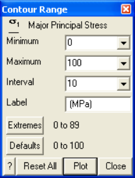

指定当前绘制等值线的范围（最小值、最大值、间隔……）。可以点击按钮，或直接在任意等值线上单击右键来启动此功能。

**abe u te a**

上图中等值线范围以水平方向显示。勾选 Plot Options > Vertical Legend 可改为垂直方向。

Minimum：指定等值线范围的下限值。

Maximum：指定等值线范围的上限值。

Interval：指定等值线间隔。间隔可以大于（最大值减最小值）的 1/10，但不能小于该值。

Label：指定等值线标签。

Extremes：显示该参数检测到的下限和上限极值。选择此按钮会将等值线范围设为这些值。

Defaults：显示该参数默认的等值线下限和上限范围。选择此按钮会将等值线范围设为这些值。

Reset All：将所有绘图参数的范围恢复为默认值。

Plot：重新生成等值线图。

等值线范围的最小值不一定要小于最大值。例如，在绘制强度系数等值线时，可以将最小值设为 2、最大值设为 1，使接近 1 的强度系数以红色显示。
