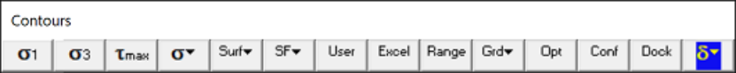
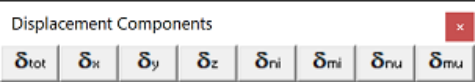
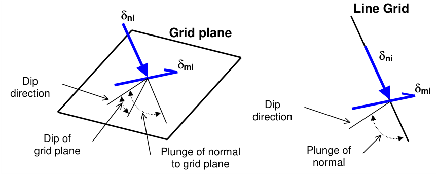
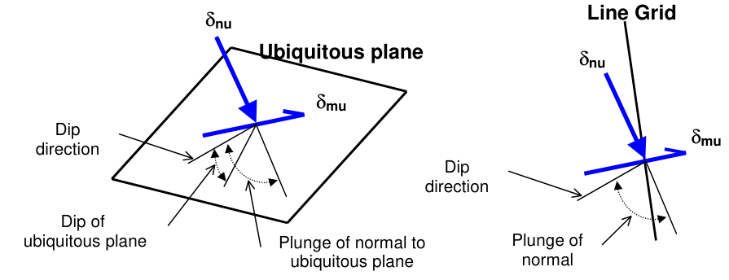

## 5.3.3.1 总位移

绘制位移的等值线。

这些分量可通过 Displacement Components 工具栏访问，方式如下：

将该工具栏拖到主窗口的左边缘或右边缘，可将其改为垂直方向。

将其拖到主窗口的上边缘或下边缘，可恢复为水平方向。

选择 Contours 工具栏上的按钮可激活 Displacement Components 工具栏。您可以使用配置按钮将此按钮添加到 Contours 工具栏。

该工具栏用于快速访问位移分量。

Plot > Displacement > dtotal = ( dx² + dy² + dz² )½ 总位移   绘制总位移的等值线 Plot > Displacement > dx X 向位移   绘制 x 向位移分量的等值线 Plot > Displacement > dy Y 向位移   绘制 y 向位移分量的等值线 Plot > Displacement > dz Z 向位移   绘制 z 向位移分量的等值线

为计算面内位移，网格平面上每个点的位移状态都会被重新定向，以确定平行于网格平面的最大位移和垂直于该平面的位移。请注意，dni 垂直于网格平面，并平行于线网格的方向。

Plot > Displacement > dni 面内法向   绘制垂直于网格平面的位移分量的等值线。

Plot > Displacement > dmi 面内最大值   绘制与网格平面相切的最大位移的等值线。

为计算遍布平面 #1 的位移，网格平面上每个点的位移状态都会被重新定向，以确定平行于遍布平面 #1 的最大位移和垂直于该平面的位移。请注意，dmi 并不垂直于网格平面。

Plot > Displacement > dnu 遍布平面法向   绘制垂直于遍布平面的位移分量的等值线。

Plot > Displacement > dmu 遍布平面最大值   绘制与遍布平面相切的最大位移的等值线。

- 倾向自 y 轴起顺时针方向为正。

- 平面的倾角自水平面起向下为正（即沿倾向方向）。

- 法线的俯角自水平面起向下为正（即向上为负）。

注意：

只有在模型构建（CAD）阶段之后才能激活位移工具栏

Map3D 分析阶段。

遍布剪切面的方向通过以下功能设置

Plot > Strength Factors > Ubiquitous Parameters

等值线范围通过以下功能设置

#### Plot > Range

如有需要，可以将该分量添加到等值线工具栏

Tools > Configure Contouring Toolbar > Displacement

您可以将

More Displacement Components

按钮添加到等值线工具栏，以便快速访问所有位移分量。
