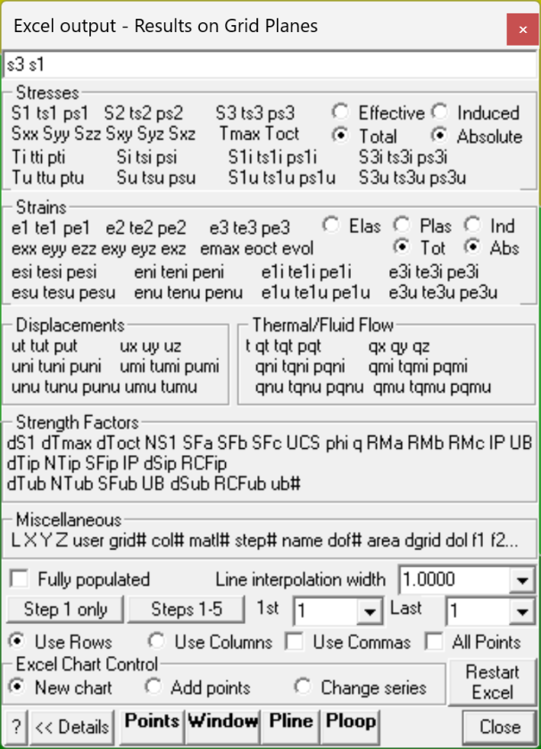

在 Excel 中绘制指定的网格分量。

必须先对网格结果绘制等值线，才能选择它们进行 Excel 绘图（例如 Plot > Stress > s1 Major Principal Stress）。

第一个参数将用作绘图的 x 轴（即横坐标）。其他参数将定义绘图的 y 轴（即数据系列或纵坐标）。可以指定多个 y 轴参数。

可以创建两种类型的 Excel 绘图：

- 选定的等值线点。

- 沿多段线长度方向的一系列点。

如果绘制 "s3 s1"、"si ti" 或 "su tu"，Map3D 将提供最佳拟合直线（采用线性回归）的信息，包括：

- 截距

- 斜率

- 摩擦角

- 标准差

- 变异系数

Fully populated   指定通过插值生成所有缺失的等值线点。

- 此选项仅适用于选定等值线点的绘图（Points、Window 和闭合多段线）。

- 此选项不适用于在开放多段线上绘图。

- 为节省分析时间，Map3D 在稀疏网格上计算结果。

- 要查看实际等值线点的位置，请启用轨迹显示（Plot > Options > Trajectories）。

- 取消选中此选项时，绘图中只包含实际的等值线点。

- 选中此选项时，绘图中包含所有缺失的等值线点。

Line interpolation width   指定通过插值生成等值线点的所需间距。

- 此选项仅适用于在开放多段线上绘图。

- 此选项不适用于选定等值线点的绘图。

- 如果 Line interpolation width 设为零，则只绘制开放多段线的端点。

- 否则，将按指定的 Line interpolation width 通过插值沿多段线生成点。

Step # only   指定仅导出第 # 步的结果（# 为当前显示的已加载开采步骤）。

Steps 1-5   指定导出所有步骤的结果。

   - 请注意，对于大型数据集这可能需要相当长的时间，因此必须耐心等待 Map3D 循环完所有步骤。

- 1st/Last   指定导出从第一步（1st）到最后一步（Last）之间（含首尾）所有步骤的结果。

   - 请注意，对于大型数据集这可能需要相当长的时间，因此必须耐心等待 Map3D 循环完所有步骤。

Use Commas   指定导出到 Excel 的结果在数字格式中使用逗号代替小数点。

Use Rows   导出多个开采步骤时（参见上文 Steps 1-5），结果将按行累加显示。

Use Columns   导出多个开采步骤时（参见上文 Steps 1-5），结果将按列累加显示。

- 请注意，您可能需要指定 All Points，以确保相应行之间没有缺失的点。

All Points   指定将所有点导出到 Excel，包括采空区内部的点。

Restart Excel   如果 Map3D 与 Excel 失去通信，必须重新启动 Excel（Restart Excel）以重新建立通信。

Points   激活图形化拾取单个点。

- 将绘制离拾取点最近的点。

- 要查看实际等值线点的位置，请启用轨迹显示（Plot > Options > Trajectories）。等值线点位于绘制轨迹的位置。

Window   激活矩形拾取窗口。

- 系统会提示您分别单击选择窗口的两个角点。

- 只有窗口内包含的网格点才会纳入绘图。

- 要查看实际等值线点的位置，请启用轨迹显示（Plot > Options > Trajectories）。等值线点位于绘制轨迹的位置。

Pline (open)   激活图形化拾取多边形。

- 可以选择两个点来定义单条线段。

- 如果按住 Shift 键，可以选择多条线段。

- 可以使用 Line interpolation width 参数指定通过插值生成等值线点的所需间距。

- 在等值线上叠加规则网格（Plot > Options > Grid Lines）可能有助于选择多段线的位置。

- 如果 Line interpolation width 设为零，则只绘制开放多段线的端点。

- 如果定义的是开放多段线，将绘制沿多段线长度方向的一系列点。

- 如果定义了闭合多边形，将绘制多边形内的等值线点。

Pline (closed)   激活图形化拾取多边形。

- 必须按住 Shift 键才能选择多条线段。

- 选择起始点以闭合多段线，即可定义闭合多边形。

- 如果定义了闭合多边形，将绘制多边形内的等值线点。

- 如果定义的是开放多段线，将绘制沿多段线长度方向的一系列点。

- 要查看实际等值线点的位置，请启用轨迹显示（Plot > Options > Trajectories）。等值线点位于绘制轨迹的位置。

Ploop (closed)   与 Pline (closed) 相同，只是多段线会自动闭合形成闭合回路。

- 必须按住 Shift 键才能选择多条线段。

#### Excel Chart Control:

New chart - 创建新的 Excel 图表。

Extend existing chart - 向现有 Excel 图表添加数据。所有绘图参数必须与之前使用的相同。

Change series - 更改现有 Excel 图表的数据系列或添加新系列。只有第一个绘图参数必须相同。可以根据需要指定其他绘图参数。

#### Stresses:

s1 ts1 ps1 最大主应力 s1、其走向和倾伏角。

s2 ts2 ps2 中间主应力 s2、其走向和倾伏角。s3 ts3 ps3 最小主应力 s3、其走向和倾伏角。sxx syy szz sxy syz sxz 笛卡尔应力分量。tmax 最大剪应力 tmax = ½ ( s1 - s3 ) toct 八面体剪应力 toct = ¹/3 [( s1 - s2 )² + ( s2 - s3 )² +( s3 - s1 )²]½ smean 平均应力 smean = ¹/3 ( s1 + s2 + s3 ) ti tti pti 网格平面内的最大剪应力、其走向和倾伏角。si tsi psi 网格平面内的法向应力、其走向和倾伏角。s1i ts1i ps1i 与网格平面相切的最大应力、其走向和倾伏角。s3i ts3i ps3i 与网格平面相切的最小应力、其走向和倾伏角。tu ttu ptu 遍布平面内的最大剪应力、其走向和倾伏角。su tsu psu 垂直于遍布平面的应力、其走向和倾伏角。s1u ts1u ps1u 与遍布平面相切的最大应力、其走向和倾伏角。s3u ts3u ps3u 与遍布平面相切的最小应力、其走向和倾伏角。遍布平面的方向在以下位置指定

Plot > Strength Factors > Ubiquitous Parameters

Effective/Total 有效应力或总应力分量。这些选项仅用于 Map3D Thermal-Fluid Flow，因为该程序可以计算稳态孔隙压力分布。Induced/Absolute 诱发应力或绝对应力分量（即不含开采前应力贡献的应力）。

#### Strains:

e1 te1 pe1 最大主应变 e1、其走向和倾伏角。e2 te2 pe2 中间主应变 e2、其走向和倾伏角。e3 te3 pe3 最小主应变 e3、其走向和倾伏角。exx eyy ezz exy eyz exz 笛卡尔应变分量。emax 最大剪应变 emax = ½ ( e1 - e3 ) eoct 八面体剪应变 eoct = ¹/3 [( e1 - e2 )² + ( e2 - e3 )² +( e3 - e1 )²]½ evol 体积应变 evol = ( e1 + e2 + e3 ) esi tesi pesi 网格平面内的最大剪应变、其走向和倾伏角。eni teni peni 网格平面内的法向应变、其走向和倾伏角。e1i te1i pe1i 与网格平面相切的最大应变、其走向和倾伏角。e3i te3i pe3i 与网格平面相切的最小应变、其走向和倾伏角。esu tesu pesu 遍布平面内的最大剪应变、其走向和倾伏角。enu tenu penu 垂直于遍布平面的应变、其走向和倾伏角。e1u te1u pe1u 与遍布平面相切的最大应变、其走向和倾伏角。e3u te3u pe3u 与遍布平面相切的最小应变、其走向和倾伏角。Elastic/Plastic/Total 弹性、塑性或总应变分量。这些选项仅用于 Map3D Non-Linear，因为该程序可以计算非线性应变。Induced/Absolute 诱发应变或绝对应变分量（即不含开采前应力贡献的应变）。

#### Displacements:

ut tut put 总位移、其走向和倾伏角。ux uy uz 笛卡尔位移分量。uni tuni puni 垂直于网格平面的位移、其走向和倾伏角。umi tumi pumi 与网格平面相切的最大位移、其走向和倾伏角。unu tunu punu 垂直于遍布平面的位移、其走向和倾伏角。umu tumu pumu 与遍布平面相切的最大位移、其走向和倾伏角。

#### Flow:

t 温度/水头。

qt tqt pqt 总流量、其走向和倾伏角。qx qy qz 笛卡尔流量分量。qni tqni pqni 垂直于网格平面的位移、其走向和倾伏角。qmi tqmi pqmi 与网格平面相切的最大位移、其走向和倾伏角。qnu tqnu pqnu 垂直于遍布平面的位移、其走向和倾伏角。qmu tqmu pqmu 与遍布平面相切的最大位移、其走向和倾伏角。

#### Strength:

· ds1 剩余最大主应力 Ds1 = s1 - ( _UCS_ + _q_ s3 )

- dtmax 剩余最大剪应力 Dtmax = ½(s1 - s3) - [ _UCS_ + ½(s1+s3) ( _q_ -1) ]/( _q_ +1) = [s1 - ( _UCS_ + _q_ s3) ]/( _q_ +1)

- dtoct 剩余八面体剪应力 Dtoct = toct - [ _UCS_ + ( _q_ –1) smean ] Ö(2) /( _q_ +2)

- NS1 使用正态分布 N(Ds1 /std) 的概率

- SF-A 强度/应力可确定为 ( _UCS_ + _q_ s3 )/ s1

- SF-B 强度/应力可确定为 ( _UCS_ + _q_ s3 - s3 )/(s1 - s3)

- SF-C 强度/应力可确定为 [ _UCS_ + ½(s1+s3) ( _q_ -1) ]/[ ½(s1 - s3)( _q_ +1) ]

- dTip 剩余面内剪应力 Dtip = tip - [ Cohesion + sip tan(j) ]

- NTip 使用正态分布 N(Dtip /std) 的概率

- SFip 强度/应力可确定为 [ Cohesion + sip tan(j) ] / tip

- dSip 剩余面内壁面应力 Dsip = [ 3 s1i - s3i ] - UCS

- RCFip 面内壁面应力的岩石状态系数（Rock Condition Factor）RCFip = [ 3 s1i - s3i ]/UCS

- dTub 剩余遍布平面剪应力 Dtub

- NTub 使用正态分布 N(Dtub /std) 的概率

- SFub 强度/应力可确定为 [ Cohesion + sub tan(j) ] / tub

- dSub 剩余 ub 平面壁面应力 Dsub = [ 3 s1ub - s3ub ] - UCS

- RCFub ub 平面壁面应力的岩石状态系数 RCFip = [ 3 s1ub - s3ub ]/UCS

- UB# 绘制 Dtub 值最大的 UB 组编号（1、2 或 3）

#### Miscellaneous:

L  沿线的长度。使用 Polyline 命令选择所需的线。

X  坐标值。Y  坐标值。Z  坐标值。user 用户自定义值。

grid# 点所在网格的编号。col# 指定给点所在网格的颜色编号。

matl# 点所处材料的编号。围岩（host）材料的编号为 1。在使用多种材料的问题中，结果可能在替代材料区域内计算。

step# 开采步骤编号。name 指定给点所在网格的名称。

dof#   指定该点在 Map3D 数据库中存储位置的唯一编号。area 与 GPlane 上选定点关联的线段面积。dgrid 每个网格点到最近表面的距离。dol 到最近网格的距离 _Dgrid_ 除以网格间距 _Lgrid_ 。

f1 f2... 用户自定义的材料参数。可以通过 Plot > Properties > Material Properties > User defined Parameters 定义。
