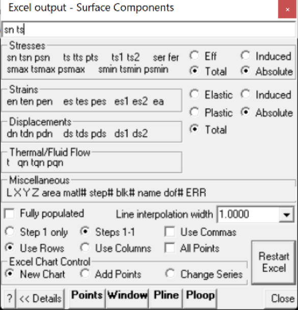

在 Excel 中绘制指定的表面分量。

必须先对表面结果绘制等值线，才能选择它们进行 Excel 绘图（例如 Plot > Surface Components > Ts Shear Stress）。

第一个参数将用作绘图的 x 轴（即横坐标）。其他参数将定义绘图的 y 轴（即数据系列或纵坐标）。可以指定多个 y 轴参数。

可以创建两种类型的 Excel 绘图：

- 选定的等值线点。

- 沿多段线长度方向的一系列点。

通过 Map3D 进行 Excel 绘图由加载项 Map3D.xla 实现

- 当 Map3D 启动 Excel 时，该程序会自动加载。

- 必须允许运行此宏，Map3D 的绘图功能才能正常工作。

Fully populated   指定通过插值生成所有缺失的等值线点。

- 此选项仅适用于选定等值线点的绘图（Points、Window 和闭合多段线）。

- 此选项不适用于在开放多段线上绘图。

- 为节省分析时间，Map3D 在稀疏网格上计算结果。

- 要查看实际等值线点的位置，请启用轨迹显示（Plot > Options > Trajectories）。

- 取消选中此选项时，绘图中只包含实际的等值线点。

- 选中此选项时，绘图中包含所有缺失的等值线点。

Line interpolation width   指定通过插值生成等值线点的所需间距。

- 此选项仅适用于在开放多段线上绘图。

- 此选项不适用于选定等值线点的绘图。

- 如果 Line interpolation width 设为零，则只绘制开放多段线的端点。

- 否则，将按指定的 Line interpolation width 通过插值沿多段线生成点。

Step # only   指定仅导出第 # 步的结果（# 为当前显示的已加载开采步骤）。

Steps 1-5   指定导出所有步骤的结果。

- 请注意，对于大型数据集这可能需要相当长的时间，因此必须耐心等待 Map3D 循环完所有步骤。

Use Commas   指定导出到 Excel 的结果在数字格式中使用逗号代替小数点。

Restart Excel   如果 Map3D 与 Excel 失去通信，必须重新启动 Excel（Restart Excel）以重新建立通信。

Points   激活图形化拾取单个点。

- 将绘制离拾取点最近的点。

- 要查看实际等值线点的位置，请启用轨迹显示（Plot > Options > Trajectories）。等值线点位于绘制轨迹的位置。

Window   激活矩形拾取窗口。

- 系统会提示您分别单击选择窗口的两个角点。

- 只有窗口内包含的网格点才会纳入绘图。

- 要查看实际等值线点的位置，请启用轨迹显示（Plot > Options > Trajectories）。等值线点位于绘制轨迹的位置。

Polyline (closed)   激活图形化拾取多边形。

- 必须按住 Shift 键才能选择多条线段。

- 选择起始点以闭合多段线，即可定义闭合多边形。

- 如果定义了闭合多边形，将绘制多边形内的等值线点。

- 如果定义的是开放多段线，将绘制沿多段线长度方向的一系列点。

- 要查看实际等值线点的位置，请启用轨迹显示（Plot > Options > Trajectories）。等值线点位于绘制轨迹的位置。

Polyline (open)   激活图形化拾取多边形。

- 可以选择两个点来定义单条线段。

- 如果按住 Shift 键，可以选择多条线段。

- 可以使用 Line interpolation width 参数指定通过插值生成等值线点的所需间距。

- 在等值线上叠加规则网格（View > Render > Grid Lines）可能有助于选择多段线的位置。

- 如果 Line interpolation width 设为零，则只绘制开放多段线的端点。

- 如果定义的是开放多段线，将绘制沿多段线长度方向的一系列点。

- 如果定义了闭合多边形，将绘制多边形内的等值线点。

#### Excel Chart Control:

New chart - 创建新的 Excel 图表。

Extend existing chart - 向现有 Excel 图表添加数据。所有绘图参数必须与之前使用的相同。

Change series - 更改现有 Excel 图表的数据系列或添加新系列。只有第一个绘图参数必须相同。可以根据需要指定其他绘图参数。

#### Stresses:

sn tsn psn 垂直于表面的应力、其走向和倾伏角。

ts tts pts 表面平面内的最大剪应力、其走向和倾伏角。ts1 ts2   表面平面内的剪应力分量。ts1 平行于第一条边（即由 x1 y1 z1 – x2 y2 z2 定义的边）。ts2 垂直于 ts1，指向第二条边（即由 x2 y2 z2 – x3 y3 z3 定义的边）的方向。

ser 表面应力误差。迭代求解器的工作方式是确定每个联立方程当前解的误差，然后通过逐次逼近的过程减小这些误差。该参数表示每个方程的误差。

fer 破坏准则误差。该参数仅用于非线性蠕变分析（包括断层滑动和 3D 材料非线性）。除非指定了某种黏性且问题变为非线性，否则该参数应始终接近零。在后一种情况下，黏性蠕变可能使应力状态超出破坏准则，表明缺乏静力平衡。该参数表示每个方程的黏性应力。

smax tsmax psmax 最大切向应力、其走向和倾伏角。smin tsmin psmin 最小切向应力、其走向和倾伏角。Effective/Total – 有效应力或总应力分量。这些选项仅用于 Map3D Thermal-Fluid Flow，因为该程序可以计算稳态孔隙压力分布。Induced/Absolute 诱发应力或绝对应力分量（即不含开采前应力贡献的应力）。

#### Strains:

en ten pen 垂直于表面方向的应变、其走向和倾伏角。该参数仅用于 DD 平面，计算方法为法向位移（闭合量）除以厚度。es tes pes 表面平面内的最大剪应变、其走向和倾伏角。该参数仅用于 DD 平面，计算方法为剪切位移（ride）除以厚度。

es1 es2   表面平面内的剪应变分量。es1 平行于第一条边（即由 x1 y1 z1 – x2 y2 z2 定义的边）。es2 垂直于 es1，指向第二条边（即由 x2 y2 z2 – x3 y3 z3 定义的边）的方向。

Elastic/Plastic/Total 弹性、塑性或总应变分量。这些选项用于 Map3D Fault-Slip 中的 DD 平面，也用于 Map3D Non-Linear，因为该程序可以计算非线性应变。

Induced/Absolute 诱发应变或绝对应变分量（即不含开采前应力贡献的应变）。

#### Displacements:

dn tdn pdn 垂直于表面方向的法向位移（闭合量）、其走向和倾伏角。该参数仅用于 DD 平面。请注意，可以指定弹性值、塑性值或总值。

ds tds pds 表面平面内的最大剪切位移（ride）、其走向和倾伏角。该参数仅用于 DD 平面。请注意，可以指定弹性值、塑性值或总值。

ds1 ds2   表面平面内的剪切位移（ride）分量。ds1 平行于第一条边（即由 x1 y1 z1 – x2 y2 z2 定义的边）。ds2 垂直于 ds1，指向第二条边（即由 x2 y2 z2 – x3 y3 z3 定义的边）的方向。

#### Miscellaneous:

L  沿线的长度。使用 Polyline 命令选择所需的线。X  坐标值。Y  坐标值。Z  坐标值。area   表面面积。matl# 指定给表面的材料编号。step# 开采步骤编号。blk#   块体编号。name 块体名称。dof#   自由度编号。ERR   能量释放率绘图。
