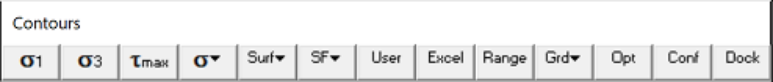
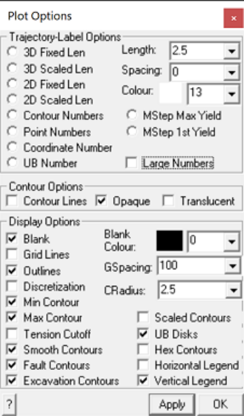

设置等值线绘图选项。

可以点击按钮，或直接在任意等值线上单击右键来启动此功能。

将该工具栏拖到主窗口的左边缘或右边缘，可将其改为垂直方向。

将其拖到主窗口的上边缘或下边缘，可恢复为水平方向。

#### Trajectory-Label Options:

- 3D Fixed Length – 显示固定长度的 3D 方向指示符。

该指示符构造为一个 3D 矢量，末端的箭头指向远离您的方向（即指向显示屏内部）。这样可以判断矢量是倾向远离您还是朝向您。显示为点的矢量则直接指向显示屏内部或外部。

如果将视图调整为沿网格边缘观察，您会看到矢量从等值线平面穿入穿出。

矢量的长度通过 TLength: 参数设置。

矢量的密度通过 TSpacing: 参数设置。

- 3D Scaled Length – 显示按比例缩放长度的 3D 方向指示符。

指示符的构造方式同上。

矢量长度按应力大小缩放：如果大小等于等值线范围的最小值，则矢量以零长度绘制；如果大小等于等值线范围的最大值，则矢量以 TLength: 参数指定的长度绘制。

- 2D Fixed Length – 显示固定长度的 2D 方向指示符。

该指示符构造为真实 3D 矢量在网格平面内的 2D 投影。

矢量的长度通过 TLength: 参数设置。

矢量的密度通过 TSpacing: 参数设置。

- 2D Scaled Length – 显示按比例缩放长度的 2D 方向指示符。

指示符的构造方式同上。

该指示符构造为真实 3D 矢量在网格平面内的 2D 投影。

矢量长度按应力大小缩放：如果大小等于等值线范围的最小值，则矢量以零长度绘制；如果大小等于等值线范围的最大值，则矢量以 TLength: 参数指定的长度绘制。

- Contour Numbers – 在等值线上显示等值线数值。该数字对应各点处等值线的大小。

- Point Numbers – 在等值线上显示点编号。该编号对应各点的记录号。

- Coordinate Numbers – 在等值线上显示坐标数值。该数字对应各点的 x,y,z 坐标。

- UB Number – 在等值线上显示具有最大剩余剪应力的遍布节理组编号（1、2 或 3）。参见 Ubiquitous Parameters

- MStep Max Yield – 显示出现最大剩余应力的步骤。参见 Accumulated Damage

- MStep 1st Yield – 显示首次发生屈服的步骤。参见 Accumulated Damage

- Large Numbers – 以大号或小号显示数字。

- Length – 设置方向指示符的绘制长度。如果此参数设置得太小，轨迹矢量会小到看不见；如果设置得太大，轨迹矢量会相互重叠，使显示变得混乱。

- Spacing – 设置相邻方向指示符或数字之间的间距。如果将此参数设为零，则会在所有网格点处绘制轨迹。对于离散得很细的网格，轨迹矢量可能过于密集而难以分辨。此参数取值越大，绘制的轨迹符号越少。

- Colour – 设置绘制轨迹所用的颜色。

#### Contour Options:

- Contour Lines – 在等值线颜色之间绘制线条。这些线条有助于突出不同等值线间隔之间的边界，对黑白展示尤其有用。

- Opaque – 以不透明颜色绘制等值线。如果此选项与半透明选项均未选中，则只绘制等值线（即不绘制彩色等值线图）。

- Translucent - 以半透明颜色绘制等值线。如果此选项与不透明选项均未选中，则只绘制等值线（即不绘制彩色等值线图）。

#### Display Options:

- Blank – 选中后，在网格平面穿过采空区块体的位置会遮蔽等值线。当模型的部分内容被隐藏时，这有助于识别采空区的范围；它也有助于生成 2D 剖面，因为采空区的位置清晰可见。

Blank Colour: - 设置遮蔽所用的颜色。

Grid Lines – 等值线以规则的网格间隔绘制线条。所需间隔通过 Spacing: 参数设置。

Outlines – 在网格边缘周围绘制轮廓。使用多个网格时，您可能不希望看到这些轮廓。

Discretization – 将网格离散化叠加显示在等值线上。

Min Contour – 取消选中时，不绘制低于等值线范围最小值的等值线。当仅关注等值线范围的上部时，这对显示等值线很有用。

例如，在显示非线性应变分量或剩余应力时，通常只让等值线的非零部分可见会很有用。

如果所需参数为负值，只需交换等值线范围的最大值和最小值，或绘制该参数的绝对值即可。

Max Contour – 取消选中时，不绘制高于等值线范围最大值的等值线。

- Tension Cutoff Symbol – 选中后，在应力状态低于指定拉伸截断值的任何位置都会绘制特殊的拉伸符号。此选项仅用于强度系数绘图。

- Smooth Contours – 如果未选中线性分析选项，结果仅在每个边界单元的中心计算，表面值的等值线图会显得非常呈方格状。此选项可平滑这些等值线，便于解读。

如果已选中线性分析选项，结果将在单元角点计算。由于无需平滑，此选项会被忽略。

此选项对网格绘图没有影响。

Fault contours – 在断层面上绘制等值线。这些是材料类型为断层泥（fault-gouge）的 DD 表面。

Excavation contours – 在采空区表面上绘制等值线。这些是材料类型为 0 的 FF 或 DD 表面。

Scalled Contours – 将等值线显示为地形曲面。

垂直于平面的高度按应力大小缩放：如果大小等于等值线范围的最小值，则高度以零长度绘制；如果大小等于等值线范围的最大值，则矢量以 CRadius: 参数指定的长度绘制。

对于线网格，将缩放管的半径。

UB disks – 切换平面等值线图与表示 UB 平面方向的圆盘的显示。更多信息请参见 UB-Plane Parameters。

Hex contours – 在 Map3D 的黏塑性（Visco-Plastic）版本中，启用此选项可显示在内部节点处计算的数值。

Horizontal Legend - 将等值线间隔图例水平放置。

Vertical Banner - 将等值线间隔图例垂直放置。

GSpacing: - 设置网格间隔。

CRadius - 设置线网格等值线绘制的半径。

#### Miscellaneous:

Apply – 重新生成等值线图。
