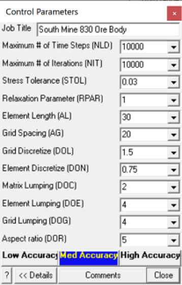
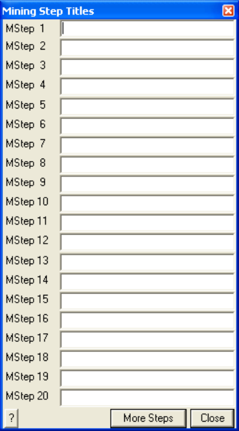

## 5.3.12.1 控制参数

指定分析控制参数。

**Job Title** - 指定描述性的项目标题。

**Maximum # of Time Steps (** **_NLD_ )** - 指定分析期间使用的最大步数。仅当进行非线性蠕变分析时，此参数才有意义

#### Analysis > Options > Creep

此时它限制实际的时间步数。

如果超过此参数，程序将停止，并提示用户说明如何继续。此参数可以在求解期间修改。

除非用户有特殊理由限制时间步数，否则应将此参数设为任意大的数值。

**Maximum # of Iterations (** **_NIT_ )** - 指定矩阵求解期间使用的最大迭代次数。

如果超过此参数，程序将停止，并提示用户说明如何继续。此参数可以在求解期间修改。

除非用户有特殊理由限制时间步数，否则应将此参数设为任意大的数值。

**Stress Tolerance (** **_STOL_ )** - 指定矩阵解所需的精度。

在矩阵求解期间，精度会随每次迭代逐步提高。当最大应力误差低于此值时，即可认为矩阵已求解。

该参数的建议值为目标深度处远场应力状态的 0.1%。_STOL_ 应使用与远场应力状态相同的单位指定（例如 MPa 或 psi）。

**Relaxation Parameter (** **_RPAR_ )** - 指定矩阵求解期间使用的最大松弛值。

在矩阵求解期间，程序会不断调整松弛参数，力求以尽可能少的迭代次数达到收敛。此参数限制所用的最大值。

对于条件良好的问题，建议使用 1.2。对于条件不佳的问题，应使用 0.8。

**Element Length (** **_AL_ )** - 指定最小单元长度。

在离散化过程中，所有模型表面（FF 块体的表面和 DD 平面）都被细分为边长为

_Lelem = Delem/DON_

的边界单元，其中 _Delem_ 由 Map3D 确定，为相邻模型表面之间的最小距离。由于在某些位置距离 _Delem_ 可能为零，因此必须指定最小单元边长 _AL_。

_AL_ 应设为最小矿柱或采场宽度的两倍。应使用与指定坐标相同的单位（例如米或英尺）。

离散化完成后，可使用以下功能绘制距离 _Delem_

Plot > Miscellaneous > Delem distance to nearest element on surfaces。

请注意，如有需要，可以通过为每个单元指定最大宽度，逐个单元地覆盖此行为

#### CAD > Edit > Entity Properties > Maximum Width

这使用户能够在没有网格平面的区域，对表面强制采用精细而均匀的离散化。

**Grid Spacing (** **_AG_ )** - 指定最小网格间距。

在离散化过程中，所有场点网格和模型表面都被细分为边长为

_Lgrid = Dgrid/DOL_

的单元，其中 _Dgrid_ 由 Map3D 确定，为模型表面与网格平面之间的最小距离。由于在某些位置距离 _Dgrid_ 可能为零，因此必须指定最小网格间距 _AG_。同样的过程也用于离散化靠近场点网格的模型表面（FF 块体的表面和 DD 平面）。

_AG_ 应设为所关注的最小尺寸。例如，如果用户需要查看穿过 2m 宽矿柱的应力分布，则 _AG_ 取 0.5 即可提供足够数量的场点以精确绘制等值线。应使用与指定坐标相同的单位（例如米或英尺）。

离散化完成后，可使用以下功能在模型表面上绘制距离 _Dgrid_

Plot > Surface Components > Dgird distance to nearest grid

或在网格上绘制

Plot > Miscellaneous > Delem distance to nearest element on grids。

请注意，如有需要，可以通过为每个网格指定最大间距，逐个网格地覆盖此行为

#### CAD > Edit > Entity Properties > Maximum Width

这使用户能够对网格强制采用精细而均匀的离散化。

**Grid Discretize (** **_DOL_ ) -** 指定所需的距离与单元长度之比，用于按下式确定网格间距

_Lgrid = Dgrid/DOL_

其中 _Dgrid_ 由 Map3D 确定，为模型表面与网格平面之间的最小距离。

_DOL_ 取 1.0 通常已足够，预期可得到误差为 10-20% 的解。如需更高精度，_DOL_ 取 2.0 应可得到 5-10% 的误差。取 4.0 则误差小于 5%。虽然较大的 _DOL_ 值会生成更多边界单元，从而延长运行时间，但这对于获得更高精度是必要的。

离散化完成后，可使用以下功能在模型表面上绘制比值 _Dgrid/Lelem_

Plot > Miscellaneous > Dgrid/Lelem _DOL_ ratio on surfaces

或在网格上绘制比值 _Dgrid/Lgrid_

Plot > Miscellaneous > Dgrid/Lgrid _DOL_ ratio on grids。

**Element Discretize (** **_DON_ ) -** 指定所需的距离与单元长度之比，用于确定单元边长

_Lelem = Delem/DON_

其中 _Delem_ 表示到最近模型表面的距离。

_DON_ 取 0.5 通常适用于所有问题，但具有非常狭窄的采空区或矿柱的问题除外。在后一种情况下，建议 _DON_ 取 1.0。虽然较大的 _DON_ 值会生成更多边界单元，从而延长运行时间，但这对于在存在非常狭窄的采空区或矿柱时获得条件良好、可求解的问题是必要的。

离散化完成后，可使用以下功能绘制比值 _Delem/Lelem_

Plot > Miscellaneous > Delem/Lelem _DON_ ratio on surfaces。

**Matrix Lumping (** **_DOC_ ) -** 指定所需的距离与单元长度之比。在矩阵组装期间，所有落在尺寸

#### _Delem/DOC_

范围内的单元将被合并（lumping）。_Delem_ 表示到最近模型表面的距离。

与 _DOL_ 一样，_DOC_ 取 1.0 通常已足够，预期可得到误差为 10-20% 的解。如需更高精度，_DOC_ 取 2.0 应可得到 5-10% 的误差。取 4.0 则误差小于 5%。虽然较大的 _DOC_ 值会产生更大的系数矩阵，从而延长运行时间，但这对于获得更高精度是必要的。

离散化完成后，可使用以下功能绘制距离 _Delem_

Plot > Miscellaneous > Delem distance to nearest element on surfaces。

**Element Lumping (** **_DOE_ ) -** 指定所需的距离与单元长度之比。在网格组装期间，所有落在尺寸

#### _Dgrid/DOE_

范围内的单元将被合并（lumping）。_Dgrid_ 表示到最近场点网格表面的距离。

_DOE_ 取 2.0 通常已足够，预期可得到误差为 10-20% 的解。如需更高精度，_DOE_ 取 4.0 应可得到 5-10% 的误差。取 8.0 则误差小于 5%。虽然较大的 _DOE_ 值会延长运行时间，但这对于获得更高精度是必要的。

离散化完成后，可使用以下功能在网格上绘制距离 _Dgrid_

Plot > Miscellaneous > Delem distance to nearest element on grids。

**Grid Lumping (** **_DOG_ ) -** 指定所需的距离与单元长度之比。在网格组装期间，所有落在尺寸

#### _Dgrid/DOG_

范围内的网格点将被合并（lumping）。_Dgrid_ 表示到最近场点网格表面的距离。

_DOG_ 取 2.0 通常已足够，预期可得到误差为 10-20% 的解。如需更高精度，_DOG_ 取 4.0 应可得到 5-10% 的误差。取 8.0 则误差小于 5%。虽然较大的 _DOG_ 值会延长运行时间，但这对于获得更高精度是必要的。

离散化完成后，可使用以下功能在网格上绘制距离 _Dgrid_

Plot > Miscellaneous > Delem distance to nearest element on grids。

**Aspect Ratio (** **_DOR_ ) -** 指定所需的单元长宽比。除非用户希望将狭窄的单元细分为更均匀的形状，否则所有问题均建议 _DOR_ 取 5.0。

设置 _DON_ =0.5、_DOL=DOC_ =1、_DOE=DOG_ =2，误差为 10-20%。设置 _DON_ =0.5、_DOL=DOC_ =2、_DOE=DOG_ =4，误差为 5-10%。设置 _DON_ =1、_DOL=DOC_ =4、_DOE=DOG_ =8，误差 &lt; 5%。

**Comments -** 允许您指定与本次运行一起保存的注释。

#### Summary:

- _STOL_ 应设为目标深度处远场应力状态的 0.1%。使用与远场应力状态相同的单位（例如 MPa 或 psi）。

- _AL_ 应设为最小矿柱或采场宽度的两倍。使用与指定坐标相同的单位（例如米或英尺）。

- _AG_ 应设为所关注的最小尺寸。使用与指定坐标相同的单位（例如米或英尺）。

- 单元按边长离散化，边长取 _Delem/DON_ 和 _Dgrid/DOL_ 中较小者，且不能小于 _AL_，也不能大于最大宽度。

- 网格按由 _Dgrid/DOL_ 确定的间距离散化，该间距不能小于 _AG_，也不能大于最大间距。

- 在矩阵组装期间，所有落在尺寸 _Delem/DOC_ 范围内的单元将被合并（lumping）。

- 在网格组装期间，所有落在尺寸 _Dgrid/DOE_ 范围内的单元将被合并（lumping）。

- 在网格组装期间，所有落在尺寸 _Dgrid/DOG_ 范围内的网格点将被合并（lumping）。

#### Notes:

有关离散化与合并（lumping）的更详细讨论，请参阅

- Discretization and Lumping。

## 5.3.12.2 开采步骤标题

为每个开采步骤指定描述性标题。

## 5.3.12.3 材料属性

指定材料属性。

根据所选的材料类型，会出现几种不同的对话框：Mohr-Coulomb、Hoek-Brown、Drucker-Prager、Backfill Hyperbolic 和 None。

3D FF 块体中的 Mohr-Coulomb 可在 Map3D Non-Linear 和 Map3D Visco-Plastic 中用作非线性材料行为的流动法则。也可在 Map3D Fault-Slip 中用作 3D FF 块体或围岩（host）材料的破坏准则。

3D FF 块体中的 Hoek-Brown 可在 Map3D Fault-Slip 中用作 3D FF 块体或围岩材料的破坏准则。

3D FF 块体中的 Drucker-Prager 可在 Map3D Fault-Slip 中用作 3D FF 块体或围岩材料的破坏准则。

DD 平面中的 Fault-Gouge 可在 Map3D Fault-Slip、Map3D Non-Linear 或 Map3D Visco-Plastic 中用作 DD 平面的流动法则。

DD 平面中的 Equilibrated-Gouge 可在 Map3D Fault-Slip、Map3D Non-Linear 或 Map3D Visco-Plastic 中用作 DD 平面的流动法则。

DD 平面中的 Yielding-Pillar 可在 Map3D Fault-Slip、Map3D Non-Linear 或 Map3D Visco-Plastic 中用作 DD 平面的流动法则。

DD 平面中的 Hyperbolic-Backfill 可在 Map3D Fault-Slip、Map3D Non-Linear 或 Map3D Visco-Plastic 中用作 DD 平面的流动法则。

DD 平面中的 Quadratic-Backfill 可在 Map3D Fault-Slip、Map3D Non-Linear 或 Map3D Visco-Plastic 中用作 DD 平面的流动法则。

3D FF 块体或 DD 平面中的 Softened Material 可用于软化弹性材料，以模拟地层屈服及由此产生的应力重分布效应。

Stress State 指定开采前的应力状态。

在弹性分析中，破坏准则仅用于强度系数计算和等值线绘图，不影响分析结果。

在非线性分析中（Map3D Non-Linear 中的 3D FF 块体、Map3D Visco-Plastic 中的 3D FF 块体以及 Map3D Fault-Slip 中的 DD 平面），破坏准则用作流动法则，以控制屈服和非线性变形。

## 5.3.12.4 Map3Di 设置

设置 Map3Di 分析。

Map3Di 允许将外部场荷载效应叠加到 Map3D 模型中。有关此功能的详情，请参阅 Map3Di。

检查要使用的 Map3Di 荷载文件时，系统会提示您查找文件名和位置。如果查找成功，该文件将被检查。

Map3Di 荷载文件采用多段线文件格式指定。有关生成 Map3Di 荷载文件的详情，请参阅 Contour Plane Options。

注释行必须以第 1 列的星号 "*" 开头。

2D 平面按如下方式存储为一系列三角形或四边形多段线：

x1 y1 z1 3 values1 x2 y2 z2 2 values2 x3 y3 z3 2 values3 x4 y4 z4 2 values4 ...

3D 块体按如下方式存储为一系列四面体或六面体多段线：

x1 y1 z1 3 values1 x2 y2 z2 2 values2 x3 y3 z3 2 values3 x4 y4 z4 2 values4 x5 y5 z5 1 values5 x6 y6 z6 1 values6

x7 y7 z7 1 values7

x8 y8 z8 1 values8

其中 **xi yi zi** 表示每个点的坐标。

- 3 表示该点是新多段线的起点。

- 2 表示该点属于块体底面的一部分。

- 1 表示该点属于块体顶面的一部分。此项仅用于定义 3D 块体形状。

通过重复该序列（即以数字 **3** 开始一条新的多段线）来指定更多的多段线。

任何点都可以重复或省略，以指定三角形的侧面或四面体。

- valuesi 指定中心或每个角点处的场荷载大小。如果只指定 values1（即 values2 … 留空），则该值均匀施加于整个实体。

- 如果为所有角点指定了 valuesi，则场荷载按更高阶的多项式分布施加。

对于 2D 表面三角形，使用线性分布

_a_ + _b x_ + _c y_

对于 2D 四边形，使用下列分布

_a_ + _b x_ + _c y_ + _d x y_

对于 3D 块体形状，尽可能多地使用分布的各项

_a_ + _b x_ + _c y_ + _d z_ + _e x y_ + _f y z_ + _g z x_ + _h x y z_

实际的场荷载效应可以通过几种方式指定。

#### 2D Planes

2D 平面定义一个位移不连续体，其法向位移（闭合量）dn 和剪切位移（ride）ds 已指定，因此 valuesi 可以指定为

dn ds 或 dn ds1 ds2

如果只指定 dn ds，则剪切位移（ride）平行于该 2D 平面的最大面内剪应力施加。

如果指定了 dn ds1 ds2 的全部，则剪切位移（ride）分量 ds1 平行于第一条边施加（即由 x1 y1 z1 – x2 y2 z2 定义的边）。ds2 垂直于 ds1，沿第二条边的方向施加（即由 x2 y2 z2 - x3 y3 z3 定义的边）。

剪切位移（ride）和法向位移（闭合量）以位移单位指定（即与几何尺寸相同的单位（米））。

剪切位移（ride）和法向位移（闭合量）可通过现场或实验室对剪切、闭合和/或裂缝张开的测量确定，也可通过其他数值模拟程序（如储层或水力压裂模拟器）确定。它们也可以根据微震监测数据估算。

#### 3D Blocks

3D 块体定义一个具有指定应变 e 的区域，可以指定为

e1 e2 e3 或 exx eyy ezz exy eyz ezx

如果只指定 e1 e2 e3，则这些主应变平行于主应力施加。这些应变用于按下式确定初始应力 s°

s1° = [ ( _1-_ n) e1 + n ( e2 + e3 ) ] _E_ / [ ( _1+_ n) ( _1-2_ n) ] s2° = [ ( _1-_ n) e2 + n ( e3 + e1 ) ] _E_ / [ ( _1+_ n) ( _1-2_ n) ] s3° = [ ( _1-_ n) e3 + n ( e1 + e2 ) ] _E_ / [ ( _1+_ n) ( _1-2_ n) ]

如果指定了 exx eyy ezz exy eyz ezx 的全部，则这些应变作为笛卡尔分量施加。这些应变用于按下式确定初始应力 s°

sxx°  = [ ( _1-_ n) exx + n ( eyy + ezz ) ] _E_ / [ ( _1+_ n) ( _1-2_ n) ] syy° = [ ( _1-_ n) eyy + n ( ezz + exx ) ] _E_ / [ ( _1+_ n) ( _1-2_ n) ] szz°  = [ ( _1-_ n) ezz + n ( exx + eyy ) ] _E_ / [ ( _1+_ n) ( _1-2_ n) ] txy° = exy _E_ / ( _1+_ n) tyz° = eyz _E_ / ( _1+_ n) tzx° = ezx _E_ / ( _1+_ n)

应变以无量纲应变单位指定（即 0.001 表示 1000 微应变）。

_E_ 和 n 分别表示杨氏模量（岩体尺度——变形模量）和泊松比。Map3D 会自动确定 3D 块体角点所处的材料，并使用相应的材料属性。

这些应变可通过现场或实验室对温度或流体压力的测量确定，也可通过其他数值模拟程序（如热分析程序）确定。它们也可以根据微震监测数据估算。

应施加的应变可通过膨胀系数 _A_ 由温度确定，其中温度变化或流体压力变化（相对于背景值）会引起初始应力

s1° **=** s2° **=** s3° = _A_ D _T_

对于流体流动问题，饱和介质的膨胀系数 _A_ 应设为 1（正一）。对于热问题，膨胀系数应指定为负值，由下式给出

_A_ = a _E /(1-2_ n _)_

其中 a 表示热膨胀系数（即线膨胀系数）。

#### Notes

必须在进行 Map3D BEM 分析之前设置此功能

Analysis > BEM Analysis。

CAD > Properties > Map3Di Setup > View 可用于查看 Map3Di 数据。

## 5.3.12.5 模型信息

显示以下模型参数的当前统计：

- 用于定义几何体的表面数，

- 用于定义表面的坐标数，

- 开采步骤数。

以下参数仅在离散化分析（Analysis > Discretization）完成后才显示：

- 边界单元数，

- 边界节点数（仅用于高阶单元（Analysis > Options > Linear），

- 用户定义网格上的场点数。
