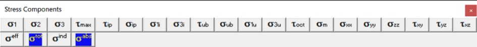
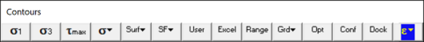
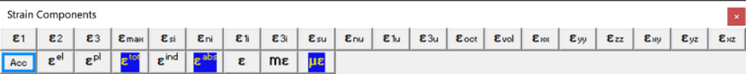
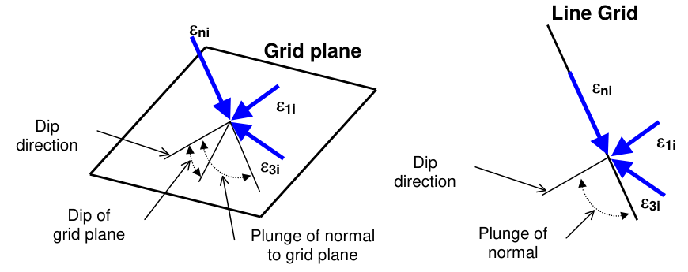
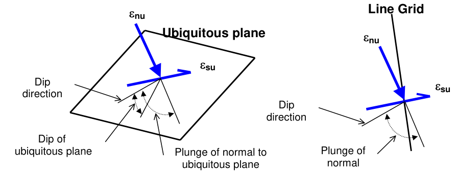
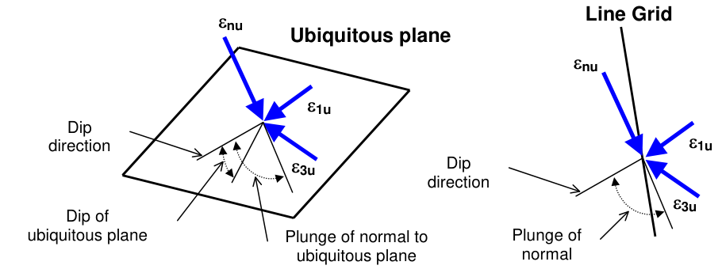

## 5.3.2.1 最大主应变

绘制最大、中间和最小主应变的等值线。可通过 Strain Components 工具栏访问这些分量，方法如下：

将该工具栏拖到主窗口的左边缘或右边缘，可将其改为垂直方向。

将其拖到主窗口的上边缘或下边缘，可恢复为水平方向。

选择 Contours 工具栏上的按钮可激活 Stress Components 工具栏。

将该工具栏拖到主窗口的左边缘或右边缘，可将其改为垂直方向。

将其拖到主窗口的上边缘或下边缘，可恢复为水平方向。

选择 Contours 工具栏上的按钮可激活 Strain Components 工具栏。

您可以使用配置按钮将此按钮添加到 Contours 工具栏。

在弹性分析中，最大主应力通常与最小主应力以及 Mohr-Coulomb 或 Hoek-Brown 强度准则一起使用，以估算因应力过大造成的损伤程度。 相比之下，在非线性分析中，除非使用了某种蠕变，否则应力永远不会超过强度。在后一种情况下，黏性蠕变可能使应力状态超出破坏准则，表明缺乏静力平衡。因此，对于非线性分析，通常直接考察模型预测的非线性应变量或应变率

Mohr-Coulomb in 3D FF blocks

#### Accumulated Damage:

对于塑性分析，可以启用累积损伤功能。未启用 Acc 时，使用塑性应变的当前值。启用 Acc 时，将在整个模型加载历史中跟踪从第 1 步到当前步骤的损伤，因此绘制的是最不利情况（最大值）的塑性应变。

请注意，首次屈服发生的步骤（MStep 1st Yield）和最大塑性应变发生的步骤（MStep Max Yield）都会被跟踪，并可显示为轨迹标签。

#### Strain Components:

请注意，有三种应变分量可以绘制等值线：

Plot > Strain > Value > Elastic Plot > Strain > Value > Plastic Plot > Strain > Value > Total

应变也有两种不同的表示方式：

Plot > Strain > Value > Induced Strain Plot > Strain > Value > Absolute Strain

等值线范围通过以下功能设置

#### Plot > Range

如有需要，这些分量中的任何一个都可以添加到等值线工具栏

Tools > Configure Contouring Toolbar > Strain

您可以将

#### More Strain Components

按钮添加到等值线工具栏，以便快速访问所有应变分量。

## 5.3.2.4 最大剪应变

绘制最大剪应变 ½( e1 - e3 ) 的等值线

可通过 Strain Components 工具栏访问该分量，方法如下：

将该工具栏拖到主窗口的左边缘或右边缘，可将其改为垂直方向。

将其拖到主窗口的上边缘或下边缘，可恢复为水平方向。

选择 Contours 工具栏上的按钮可激活 Stress Components 工具栏。

您可以使用配置按钮将此按钮添加到 Contours 工具栏。

在弹性分析中，最大主应力通常与最小主应力以及 Mohr-Coulomb 或 Hoek-Brown 强度准则一起使用，以估算因应力过大造成的损伤程度。 相比之下，在非线性分析中，除非使用了某种蠕变，否则应力永远不会超过强度。在后一种情况下，黏性蠕变可能使应力状态超出破坏准则，表明缺乏静力平衡。因此，对于非线性分析，通常直接考察模型预测的非线性应变量或应变率

Mohr-Coulomb in 3D FF blocks

请注意，有三种应变分量可以绘制等值线：

Plot > Strain > Value > Elastic Plot > Strain > Value > Plastic Plot > Strain > Value > Total

应变也有两种不同的表示方式：

Plot > Strain > Value > Induced Strain Plot > Strain > Value > Absolute Strain

等值线范围通过以下功能设置

#### Plot > Range

如有需要，这些分量中的任何一个都可以添加到等值线工具栏

Tools > Configure Contouring Toolbar > Strain

您可以将

#### More Strain Components

按钮添加到等值线工具栏，以便快速访问所有应变分量。

## 5.3.2.5 面内剪应变

绘制作用在网格平面上的最大剪应变以及垂直于网格平面或平行于线网格的应变分量的等值线。

可通过 Strain Components 工具栏访问这些分量，方法如下：

将该工具栏拖到主窗口的左边缘或右边缘，可将其改为垂直方向。

将其拖到主窗口的上边缘或下边缘，可恢复为水平方向。

选择 Contours 工具栏上的按钮可激活 Stress Components 工具栏。

您可以使用配置按钮将此按钮添加到 Contours 工具栏。

#### Plot > Grid Selection

为计算面内应变，网格平面上每个点的应变状态都会被重新定向，以确定平行于网格平面的最大剪应变和垂直于该平面的应变。请注意，eip 垂直于网格平面，并平行于线网格的方向。

- 倾向自 y 轴起顺时针方向为正。

- 平面的倾角自水平面起向下为正（即沿倾向方向）。

- 法线的俯角自水平面起向下为正（即向上为负）。

在弹性分析中，最大面内剪应力通常与面内法向应力以及 Mohr-Coulomb 强度准则一起使用

Mohr-Coulomb in 3D FF blocks

以估算因应力过大造成的损伤程度。 相比之下，在非线性分析中，除非使用了某种蠕变，否则应力永远不会超过强度。在后一种情况下，黏性蠕变可能使应力状态超出破坏准则，表明缺乏静力平衡。因此，对于非线性分析，通常直接考察模型预测的非线性应变量或应变率

Mohr-Coulomb in DD planes

以估算在与网格平面方向相同的断层、节理组或层理面上因应力过大而产生的滑动量。由于这些参数依赖于方向，该准则适用于各向异性岩体的稳定性评价。

请注意，有三种应变分量可以绘制等值线：

Plot > Strain > Value > Elastic Plot > Strain > Value > Plastic Plot > Strain > Value > Total

应变也有两种不同的表示方式：

Plot > Strain > Value > Induced Strain Plot > Strain > Value > Absolute Strain

等值线范围通过以下功能设置

#### Plot > Range

如有需要，这些分量中的任何一个都可以添加到等值线工具栏

Tools > Configure Contouring Toolbar > Strain

您可以将

#### More Strain Components

按钮添加到等值线工具栏，以便快速访问所有应变分量。

相关主题：

Plot > Strain > e1i In-plane Maximum Plot > Strain > e3i In-plane Minimum Plot > Strain > esu Ubiquitous-plane Shear Plot > Strain > enu Ubiquitous-plane Normal

## 5.3.2.7 面内最大应变

绘制与当前选定网格平面相切或垂直于线网格的最大和最小应变的等值线。

可通过 Strain Components 工具栏访问这些分量，方法如下：

将该工具栏拖到主窗口的左边缘或右边缘，可将其改为垂直方向。

将其拖到主窗口的上边缘或下边缘，可恢复为水平方向。

选择 Contours 工具栏上的按钮可激活 Stress Components 工具栏。

您可以使用配置按钮将此按钮添加到 Contours 工具栏。

#### Plot > Grid Selection

为计算面内最大和最小应变，首先确定与网格平面相切的应变，再将其分解以得出最大值和最小值。请注意，eni 垂直于网格平面，并平行于线网格的方向。还请注意，eni、e1i 和 e3i 彼此垂直。

- 倾向自 y 轴起顺时针方向为正。

- 平面的倾角自水平面起向下为正（即沿倾向方向）。

- 法线的俯角自水平面起向下为正（即向上为负）。

请注意，有三种应变分量可以绘制等值线：

#### Plot > Strain > Value > Elastic

Plot > Strain > Value > Plastic Plot > Strain > Value > Total

应变也有两种不同的表示方式：

Plot > Strain > Value > Induced Strain Plot > Strain > Value > Absolute Strain

等值线范围通过以下功能设置

Plot > Range

如有需要，可以将该分量添加到等值线工具栏

Tools > Configure Contouring Toolbar > Strain

您可以将

More Strain Components

按钮添加到等值线工具栏，以便快速访问所有应变分量。

相关主题：

Plot > Strain > esi In-plane Shear Plot > Strain > eni In-plane Normal Plot > Strain > e1u Ubiquitous-plane Maximum. Plot > Strain > e3u Ubiquitous-plane Minimum.

## 5.3.2.9 遍布平面剪应变

绘制作用在遍布平面 #1 上的最大剪应变以及垂直于该平面的应变分量的等值线。

可通过 Strain Components 工具栏访问这些分量，方法如下：

将该工具栏拖到主窗口的左边缘或右边缘，可将其改为垂直方向。

将其拖到主窗口的上边缘或下边缘，可恢复为水平方向。

选择 Contours 工具栏上的按钮可激活 Stress Components 工具栏。

您可以使用配置按钮将此按钮添加到 Contours 工具栏。

为计算遍布应变，网格平面上每个点的应变状态都会被重新定向，以确定平行于遍布平面的最大剪应变和垂直于遍布平面的应变。请注意，enu 垂直于遍布平面，并不平行于线网格的方向。

- 倾向自 y 轴起顺时针方向为正。

- 平面的倾角自水平面起向下为正（即沿倾向方向）。

- 法线的俯角自水平面起向下为正（即向上为负）。

遍布剪切面的方向通过以下功能设置

#### Plot > Strength Factors > Ubiquitous Parameters

请注意，有三种应变分量可以绘制等值线：

Plot > Strain > Value > Elastic Plot > Strain > Value > Plastic Plot > Strain > Value > Total

应变也有两种不同的表示方式：

Plot > Strain > Value > Induced Strain Plot > Strain > Value > Absolute Strain

等值线范围通过以下功能设置

#### Plot > Range

如有需要，可以将该分量添加到等值线工具栏

Tools > Configure Contouring Toolbar > Strain

您可以将

#### More Strain Components

按钮添加到等值线工具栏，以便快速访问所有应变分量。

相关主题：

Plot > Strain > e1u Ubiquitous-plane Maximum. Plot > Strain > e3u Ubiquitous-plane Minimum. Plot > Strain > esi In-plane Shear Plot > Strain > eni In-plane Normal

## 5.3.2.11 遍布平面最大应变

绘制与遍布平面 #1 相切的最大和最小应变的等值线。可通过 Strain Components 工具栏访问这些分量，方法如下：

将该工具栏拖到主窗口的左边缘或右边缘，可将其改为垂直方向。

将其拖到主窗口的上边缘或下边缘，可恢复为水平方向。

选择 Contours 工具栏上的按钮可激活 Stress Components 工具栏。

您可以使用配置按钮将此按钮添加到 Contours 工具栏。

为计算遍布应变，网格平面上每个点的应变状态都会被重新定向，以确定平行于遍布平面的最大和最小应变。请注意，enu 并不垂直于遍布平面，也不平行于线网格的方向。

- 倾向自 y 轴起顺时针方向为正。

- 平面的倾角自水平面起向下为正（即沿倾向方向）。

- 法线的俯角自水平面起向下为正（即向上为负）。

遍布剪切面的方向通过以下功能设置

#### Plot > Strength Factors > Ubiquitous Parameters

请注意，有三种应变分量可以绘制等值线：

Plot > Strain > Value > Elastic Plot > Strain > Value > Plastic Plot > Strain > Value > Total

应变也有两种不同的表示方式：

Plot > Strain > Value > Induced Strain Plot > Strain > Value > Absolute Strain

等值线范围通过以下功能设置

#### Plot > Range

如有需要，可以将该分量添加到等值线工具栏

Tools > Configure Contouring Toolbar > Strain

您可以将

#### More Strain Components

按钮添加到等值线工具栏，以便快速访问所有应变分量。

相关主题：

Plot > Strain > esi Ubiquitous-plane Shear

Plot > Strain > eni Ubiquitous-plane Normal

Plot > Strain > e1u In-plane Maximum.

Plot > Strain > e3u In-plane Minimum.

## 5.3.2.13 八面体剪应变

绘制八面体剪应变的等值线

eoct = ¹/3 [ (e1 - e2)² + (e2 - e3)² +(e3 - e1)² ]½

和体积应变

evvol = (e1 + e2 + e3)

可通过 Strain Components 工具栏访问这些分量，方法如下：

将该工具栏拖到主窗口的左边缘或右边缘，可将其改为垂直方向。

将其拖到主窗口的上边缘或下边缘，可恢复为水平方向。

选择 Contours 工具栏上的按钮可激活 Stress Components 工具栏。

您可以使用配置按钮将此按钮添加到 Contours 工具栏。

在弹性分析中，最大主应力通常与最小主应力以及 Mohr-Coulomb 或 Hoek-Brown 强度准则一起使用，以估算因应力过大造成的损伤程度。

相比之下，在非线性分析中，除非使用了某种蠕变，否则应力永远不会超过强度。在后一种情况下，黏性蠕变可能使应力状态超出破坏准则，表明缺乏静力平衡。因此，对于非线性分析，通常直接考察模型预测的非线性应变量或应变率

Mohr-Coulomb in 3D FF blocks

请注意，有三种应变分量可以绘制等值线：

Plot > Strain > Value > Elastic Plot > Strain > Value > Plastic Plot > Strain > Value > Total

应变也有两种不同的表示方式：

Plot > Strain > Value > Induced Strain Plot > Strain > Value > Absolute Strain

等值线范围通过以下功能设置

#### Plot > Range

如有需要，可以将该分量添加到等值线工具栏

Tools > Configure Contouring Toolbar > Strain

您可以将

#### More Strain Components

按钮添加到等值线工具栏，以便快速访问所有应变分量。

## 5.3.2.15 Exx 应变分量

绘制笛卡尔应变分量的等值线。可通过 Strain Components 工具栏访问这些分量，方法如下：

将该工具栏拖到主窗口的左边缘或右边缘，可将其改为垂直方向。

将其拖到主窗口的上边缘或下边缘，可恢复为水平方向。

选择 Contours 工具栏上的按钮可激活 Stress Components 工具栏。

您可以使用配置按钮将此按钮添加到 Contours 工具栏。

Plot > Strain >  exx Cartesian Strain Component   沿 x 轴方向的正应变 Plot > Strain >  eyy Cartesian Strain Component   沿 y 轴方向的正应变 Plot > Strain >  ezz Cartesian Strain Component   沿 z 轴方向的正应变 Plot > Strain >  exy Cartesian Strain Component   沿 x-y 平面方向的正应变 Plot > Strain >  eyz Cartesian Strain Component   沿 y-z 平面方向的正应变 Plot > Strain >  exz Cartesian Strain Component   沿 x-z 平面方向的正应变

请注意，有三种应变分量可以绘制等值线：

Plot > Strain > Value > Elastic Plot > Strain > Value > Plastic Plot > Strain > Value > Total

应变也有两种不同的表示方式：

Plot > Strain > Value > Induced Strain Plot > Strain > Value > Absolute Strain

等值线范围通过以下功能设置

#### Plot > Range

如有需要，可以将该分量添加到等值线工具栏

Tools > Configure Contouring Toolbar > Strain

您可以将

More Strain Components

按钮添加到等值线工具栏，以便快速访问所有应变分量。

## 5.3.2.21 数值

5.3.2.21.1  弹性应变

选择弹性、塑性或总应变分量。可通过 Strain Components 工具栏访问这些分量，方法如下：

将该工具栏拖到主窗口的左边缘或右边缘，可将其改为垂直方向。

将其拖到主窗口的上边缘或下边缘，可恢复为水平方向。

选择 Contours 工具栏上的按钮可激活 Stress Components 工具栏。

您可以使用配置按钮将此按钮添加到 Contours 工具栏。

详情请参阅

Mohr-Coulomb in 3D FF blocks.

### 5.3.2.21.4 诱发应变

绘制诱发应变或绝对应变分量。

可通过 Strain Components 工具栏访问该分量，方法如下：

将该工具栏拖到主窗口的左边缘或右边缘，可将其改为垂直方向。

将其拖到主窗口的上边缘或下边缘，可恢复为水平方向。

选择 Contours 工具栏上的按钮可激活 Stress Components 工具栏。

您可以使用配置按钮将此按钮添加到 Contours 工具栏。

诱发应变是不含开采前应变贡献的应变，表示相对于开采前状态的应变变化。

绝对应变是包含开采前应变贡献的应变。

另请参阅：

Plot > Stress > Value > Induced Strain Plot > Stress > Value > Absolute Strain

### 5.3.2.21.6 应变

绘制应变：

- 以未缩放单位表示（应变/1），

- 以毫应变表示（应变/1000），

- 以微应变表示（应变/1000000）。

可通过 Strain Components 工具栏访问该分量，方法如下：

将该工具栏拖到主窗口的左边缘或右边缘，可将其改为垂直方向。

将其拖到主窗口的上边缘或下边缘，可恢复为水平方向。

选择 Contours 工具栏上的按钮可激活 Stress Components 工具栏。

您可以使用配置按钮将此按钮添加到 Contours 工具栏。

