## 5.3.6.1 岩体参数

### 5.3.6.1.1 岩体强度参数

设置用于按主应力分量生成强度系数等值线图的强度参数。

可通过 Strength Factor Components 工具栏访问这些分量，方法如下：

将该工具栏拖到主窗口的左边缘或右边缘，可将其改为垂直方向。

将其拖到主窗口的上边缘或下边缘，可恢复为水平方向。

选择 Contours 工具栏上的按钮可激活 Strength Factor Components 工具栏。

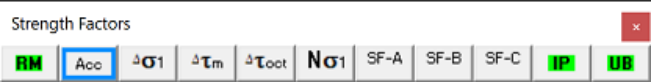

在弹性分析中，最大和最小主应力可与 Mohr-Coulomb、Hoek-Brown 或 Drucker-Prager 强度准则一起使用，以估算因应力过大造成的岩体损伤程度。由于这些参数均不具有方向敏感性，该准则适用于均质岩体的稳定性评价。

相比之下，在非线性分析中，除非使用了某种蠕变，否则应力永远不会超过强度。在后一种情况下，黏性蠕变可能使应力状态超出破坏准则，表明缺乏静力平衡。因此，对于非线性分析，通常直接考察模型预测的非线性应变量或应变率

Mohr-Coulomb in 3D FF blocks.

#### Mohr-Coulomb

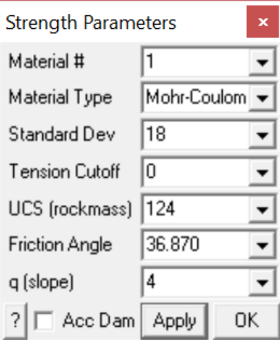

Material # 指定材料编号。材料 #1 代表围岩（host）材料。其他材料编号用于定义替代材料区域，如矿石、断层泥（gouge）、充填体等。

Standard Deviation 指定在 s1 方向上测得的破坏准则的不确定度。

Material Type 指定材料类型：Mohr-Coulomb、Hoek-Brown、Drucker-Prager 或 None。

Tension Cutoff, UCS, Friction Angle Mohr-Coulomb 准则按主应力定义强度，如下所示：

#### Mohr-Coulomb

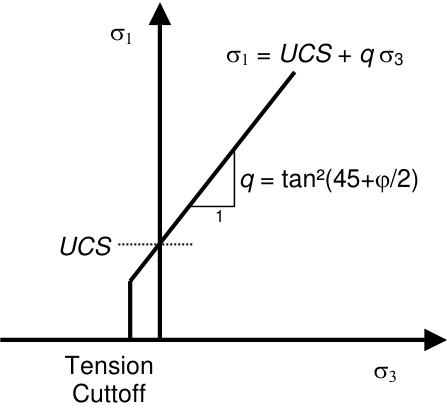

拉伸截断（tension cutoff）和 UCS 以应力单位（MPa 或 psi）指定。摩擦角以度为单位指定。

Apply – 重新生成等值线图。

Acc Dam – 绘制累积损伤。参见 Accumulated Damage

#### Hoek-Brown

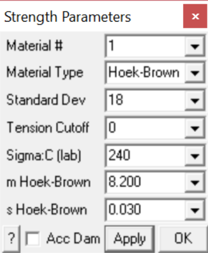

Material # 指定材料编号。材料 #1 代表围岩（host）材料。其他材料编号用于定义替代材料区域，如矿石、断层泥（gouge）、充填体等。

Material Type 指定材料类型：Mohr-Coulomb、Hoek-Brown、Drucker-Prager 或 None。

Standard Deviation 指定在 s1 方向上测得的破坏准则的不确定度（以应力单位 MPa 或 psi 指定）。

Tension Cutoff, Sigma:C, m and s Hoek-Brown 准则按主应力定义强度，如下所示：

#### Hoek-Brown

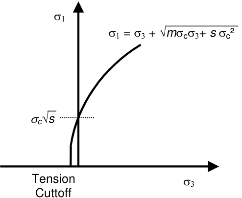

拉伸截断（tension cutoff）和 Sigma:C 以应力单位（MPa 或 psi）指定。

Apply – 重新生成等值线图。

Acc Dam – 绘制累积损伤。参见 Accumulated Damage

#### Drucker-Prager

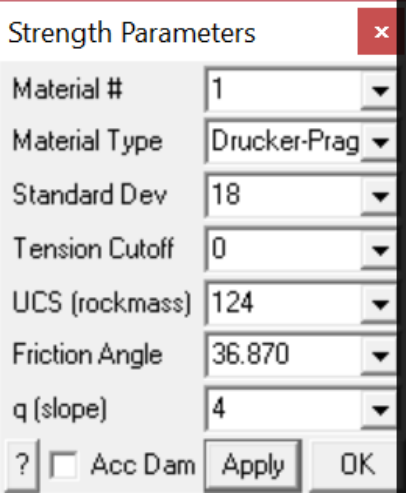

Material # 指定材料编号。材料 #1 代表围岩（host）材料。其他材料编号用于定义替代材料区域，如矿石、断层泥（gouge）、充填体等。Material Type 指定材料类型：Mohr-Coulomb、Hoek-Brown、Drucker-Prager 或 None。

Standard Deviation 指定在 toct 方向上测得的破坏准则的不确定度。

Tension Cutoff, UCS, Friction Angle Drucker-Prager 准则按主应力定义强度，如下所示：

#### Drucker-Prager

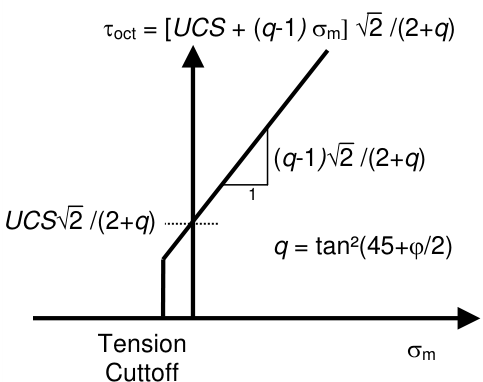

其中

toct = ¹/3 [(s1 - s2)² + (s2 - s3)² +(s3 - s1)²]½

smean = ¹/3 (s1 + s2 + s3)

拉伸截断（tension cutoff）和 UCS 以应力单位（MPa 或 psi）指定。摩擦角以度为单位指定。

请注意，强度参数已被选取，使得当 s2 等于 s3 时，该准则简化为 Mohr-Coulomb 准则。

Apply – 重新生成等值线图。

Acc Dam – 绘制累积损伤。参见 Accumulated Damage

#### 相关主题：

Plot > Strength Factor > Probability N-distribution

Plot > Strength Factor > SF-A - Strength/Stress Plot > Strength Factor > SF-B - Strength/Stress Plot > Strength Factors > SF-C - Strength/Stress Plot > Strength Factors > dS1 - Excess Stress Plot > Strength Factors > dTmax - Excess Stress

Plot > Strength Factors > dToct - Excess Stress

Plot > Strength Factors > In-plane Parameters

Plot > Strength Factors > Ubiquitous Parameters

### 5.3.6.1.2 累积损伤

绘制累积损伤。

可通过 Strength Factor Components 工具栏访问该分量，方法如下：

将该工具栏拖到主窗口的左边缘或右边缘，可将其改为垂直方向。

将其拖到主窗口的上边缘或下边缘，可恢复为水平方向。

选择 Contours 工具栏上的按钮可激活 Strength Factor Components 工具栏。

未启用 Acc 时，按当前应力值绘制剩余应力、破坏概率、强度系数和 RCF。

启用 Acc 时，将在整个模型加载历史中跟踪从第 1 步到当前步骤的损伤，因此绘制的是剩余应力、破坏概率、强度系数或 RCF 的最不利情况。

这使得弹性应力分析结果的使用方式类似于塑性模型中的累积应变。

损伤跟踪分别针对以下 5 种情况进行：

1. 岩体破坏（剩余 S1 应力、概率、强度系数）2. 面内剪切破坏（剩余剪应力、概率、强度系数）3. ub 平面剪切破坏（剩余剪应力、概率、强度系数）

4. 面内剩余壁面应力（剩余应力、RCF）

5. ub 平面剩余壁面应力（剩余应力、RCF）

请注意，首次屈服发生的步骤（MStep 1st Yield）和最大剩余应力发生的步骤（MStep Max Yield）都会被跟踪，并可显示为轨迹标签。

### 5.3.6.1.3 S1 剩余应力

使用方法 "A" 绘制剩余最大主应力和强度系数的等值线。可通过 Strength Factor Components 工具栏访问这些分量，方法如下：

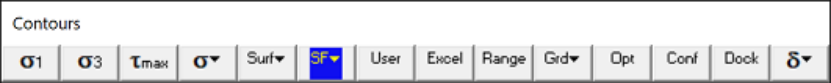

将该工具栏拖到主窗口的左边缘或右边缘，可将其改为垂直方向。

将其拖到主窗口的上边缘或下边缘，可恢复为水平方向。

选择

Contours 工具栏上的按钮可激活 Strength Factor Components 工具栏。

在弹性分析中，最大和最小主应力可与 Mohr-Coulomb 或 Hoek-Brown 强度准则一起使用

#### Plot > Strength Factors > Strength Parameters

以估算因应力过大造成的损伤程度。由于这些参数均不具有方向敏感性，该准则适用于均质岩体的稳定性评价。

相比之下，在非线性分析中，除非使用了某种蠕变，否则应力永远不会超过强度。在后一种情况下，黏性蠕变可能使应力状态超出破坏准则，表明缺乏静力平衡。因此，对于非线性分析，通常直接考察模型预测的非线性应变量或应变率

Mohr-Coulomb in 3D FF blocks.

方法 "A" 假定达到破坏的应力路径是在不丧失围压的情况下通过增大 s1 实现的。这代表矿柱破坏，其中 s1 被视为驱动力。

#### Mohr-Coulomb

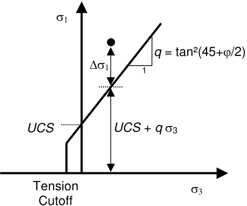

Plot > Strength Factors > SF-A   Strength/Stress 可确定为 ( _UCS_ + _q_ s3 )/ s1 Plot > Strength Factors > SF/A   Stress/Strength 可确定为 s1 / ( _UCS_ + _q_ s3 ) Plot > Strength Factors > Ds1   剩余应力可确定为 Ds1 = s1 - ( _UCS_ + _q_ s3 )

Plot > Strength Factors > N(Ds1 /std)   使用正态分布的概率。

与方法 "B" 相同。

#### Hoek-Brown

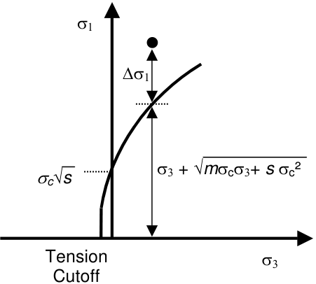

Plot > Strength Factors > SF-A   Strength/Stress 可确定为 [ s3 + Ö( _m_ scs3 + _s_ sc²) ] / s1

Plot > Strength Factors > SF/A   Stress/Strength 可确定为 s1 / [ s3 + Ö( _m_ scs3 + _s_ sc²) ]

Plot > Strength Factors > Ds1   剩余应力可确定为 Ds1 = s1 - [ s3 + Ö( _m_ scs3 + _s_ sc²) ]

Plot > Strength Factors > N(Ds1 /std)   使用正态分布的概率。

与方法 "B" 相同。

Drucker-Prager 仅通过方法 "C" 定义。

强度参数通过以下功能设置

Plot > Strength Factors > Strength Parameters

相关主题：

Plot > Strength Factor > SF-B - Strength/Stress Plot > Strength Factors > SF-C - Strength/Stress Plot > Strength Factors > dTmax - Excess Stress Plot > Strength Factors > dToct - Excess Stress Plot > Strength Factors > In-plane Parameters Plot > Strength Factors > Ubiquitous Parameters

### 5.3.6.1.4 Tmax 剩余应力

使用方法 "C" 绘制剩余剪应力或强度系数的等值线。可通过 Strength Factor Components 工具栏访问这些分量，方法如下：

将该工具栏拖到主窗口的左边缘或右边缘，可将其改为垂直方向。

将其拖到主窗口的上边缘或下边缘，可恢复为水平方向。

选择 Contours 工具栏上的按钮可激活 Strength Factor Components 工具栏。

在弹性分析中，最大和最小主应力可与 Mohr-Coulomb 或 Hoek-Brown 强度准则一起使用

Plot > Strength Factors > Strength Parameters

以估算因应力过大造成的损伤程度。由于这些参数均不具有方向敏感性，该准则适用于均质岩体的稳定性评价。

相比之下，在非线性分析中，除非使用了某种蠕变，否则应力永远不会超过强度。在后一种情况下，黏性蠕变可能使应力状态超出破坏准则，表明缺乏静力平衡。因此，对于非线性分析，通常直接考察模型预测的非线性应变量或应变率

Mohr-Coulomb in 3D FF blocks.

方法 "C" 假定达到破坏的应力路径是在丧失围压的情况下通过增大 s1 实现的。这代表拱座（abutment）破坏，其中 s1 - s3 被视为驱动力。

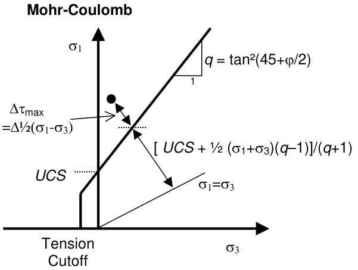

Plot > Strength Factors > SF-C   Strength/Stress 可确定为 [ _UCS_ + ½(s1+s3) ( _q_ - 1) ]/[ ½(s1 - s3)( _q_ +1) ]

Plot > Strength Factors > SF/C   Stress/Strength 可确定为 [ ½(s1 - s3)( _q_ +1) ]/ [ _UCS_ + ½(s1+s3) ( _q_ -1) ]

Plot > Strength Factors > Dtmax   剩余应力可确定为

Dtmax = ½(s1 - s3) - [ _UCS_ + ½(s1+s3) ( _q_ -1) ]/( _q_ +1)

= [s1 - ( _UCS_ + _q_ s3) ]/( _q_ +1)

#### Hoek-Brown

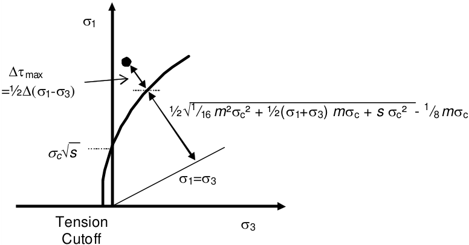

Plot > Strength Factors > SF-C   Strength/Stress 可确定为 &#123; Ö[1 /16 _m_ ²sc² + ½(s1 + s3) _m_ sc + _s_ sc²] - ¼ _m_ sc&#125;/(s1 - s3)

Plot > Strength Factors > SF/C   Stress/Strength 可确定为 (s1 - s3)/&#123; Ö[1 /16 _m_ ²sc² + ½(s1 + s3) _m_ sc + _s_ sc²] - ¼ _m_ sc &#125;

Plot > Strength Factors > Dtmax   剩余应力可确定为

Dtmax = ½(s1 - s3) - ½&#123; Ö[1 /16 _m_ ²sc² + ½(s1 + s3) _m_ sc + _s_ sc²] - ¼ _m_ sc &#125;

#### Drucker-Prager

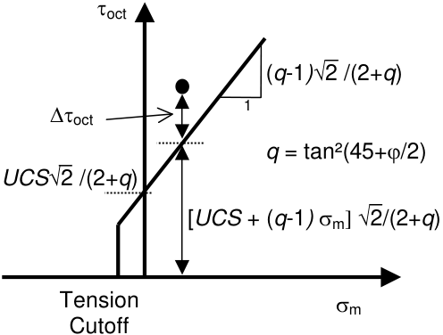

SF-C Strength/Stress   可确定为 [ _UCS_ + ( _q_ –1) smean ] Ö(2) /[ toct ( _q_ +2) ]

SF-C Stress/Strength   可确定为 toct /[ _UCS_ + ( _q_ –1) smean ] Ö(2) /( _q_ +2) Dtoct Excess   可确定为 toct - [ _UCS_ + ( _q_ –1) smean ] Ö(2) /( _q_ +2)

其中

_q_ = tan²(45+j/2) toct = ¹/3 Ö[( s1 - s2 )² + ( s2 - s3 )² +( s3 - s1 )²] smean = ¹/3 ( s1 + s2 + s3 )

请注意，强度参数已被选取，使得当 s2 等于 s3 时，该准则简化为 Mohr-Coulomb 准则。

强度参数通过以下功能设置

Plot > Strength Factors > Strength Parameters

相关主题：

Plot > Strength Factor > SF-A - Stress/Strength Plot > Strength Factors > SF-B - Stress/Strength Plot > Strength Factors > dS1 - Excess Stress Plot > Strength Factors > In-plane Parameters Plot > Strength Factors > Ubiquitous Parameters

5.3.6.1.6  NS1 正态概率

使用方法 "A" 绘制剩余最大主应力和强度系数的等值线。可通过 Strength Factor Components 工具栏访问这些分量，方法如下：

将该工具栏拖到主窗口的左边缘或右边缘，可将其改为垂直方向。

将其拖到主窗口的上边缘或下边缘，可恢复为水平方向。

选择 Contours 工具栏上的按钮可激活 Strength Factor Components 工具栏。

在弹性分析中，最大和最小主应力可与 Mohr-Coulomb 或 Hoek-Brown 强度准则一起使用

Plot > Strength Factors > Strength Parameters

以估算因应力过大造成的损伤程度。由于这些参数均不具有方向敏感性，该准则适用于均质岩体的稳定性评价。

相比之下，在非线性分析中，除非使用了某种蠕变，否则应力永远不会超过强度。在后一种情况下，黏性蠕变可能使应力状态超出破坏准则，表明缺乏静力平衡。因此，对于非线性分析，通常直接考察模型预测的非线性应变量或应变率

Mohr-Coulomb in 3D FF blocks.

方法 "A" 假定达到破坏的应力路径是在不丧失围压的情况下通过增大 s1 实现的。这代表矿柱破坏，其中 s1 被视为驱动力。

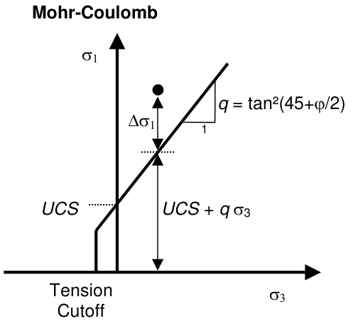

Plot > Strength Factors > SF-A   Strength/Stress 可确定为 ( _UCS_ + _q_ s3 )/ s1 Plot > Strength Factors > SF/A   Stress/Strength 可确定为 s1 / ( _UCS_ + _q_ s3 ) Plot > Strength Factors > Ds1   剩余应力可确定为 Ds1 = s1 - ( _UCS_ + _q_ s3 )

Plot > Strength Factors > N(Ds1 /std)   使用正态分布的概率。

与方法 "B" 相同。

#### Hoek-Brown

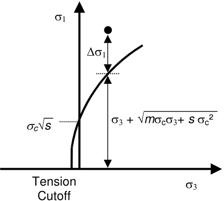

Plot > Strength Factors > SF-A   Strength/Stress 可确定为 [ s3 + Ö( _m_ scs3 + _s_ sc²) ] / s1

Plot > Strength Factors > SF/A   Stress/Strength 可确定为 s1 / [ s3 + Ö( _m_ scs3 + _s_ sc²) ]

Plot > Strength Factors > Ds1   剩余应力可确定为 Ds1 = s1 - [ s3 + Ö( _m_ scs3 + _s_ sc²) ]

Plot > Strength Factors > N(Ds1 /std)   使用正态分布的概率。

与方法 "B" 相同。

Drucker-Prager 仅通过方法 "C" 定义。

强度参数通过以下功能设置

Plot > Strength Factors > Strength Parameters

相关主题：

Plot > Strength Factor > SF-B - Strength/Stress Plot > Strength Factors > SF-C - Strength/Stress Plot > Strength Factors > dTmax - Excess Stress Plot > Strength Factors > dToct - Excess Stress Plot > Strength Factors > In-plane Parameters Plot > Strength Factors > Ubiquitous Parameters

### 5.3.6.1.8 SF-B 强度/应力

使用方法 "B" 绘制剩余最大主应力和强度系数的等值线。可通过 Strength Factor Components 工具栏访问这些分量，方法如下：

将该工具栏拖到主窗口的左边缘或右边缘，可将其改为垂直方向。

将其拖到主窗口的上边缘或下边缘，可恢复为水平方向。

选择

Contours 工具栏上的按钮可激活 Strength Factor Components 工具栏。

在弹性分析中，最大和最小主应力可与 Mohr-Coulomb 或 Hoek-Brown 强度准则一起使用

#### Plot > Strength Factors > Strength Parameters

以估算因应力过大造成的损伤程度。由于这些参数均不具有方向敏感性，该准则适用于均质岩体的稳定性评价。

相比之下，在非线性分析中，除非使用了某种蠕变，否则应力永远不会超过强度。在后一种情况下，黏性蠕变可能使应力状态超出破坏准则，表明缺乏静力平衡。因此，对于非线性分析，通常直接考察模型预测的非线性应变量或应变率

Mohr-Coulomb in 3D FF blocks.

方法 "B" 假定达到破坏的应力路径是在不丧失围压的情况下通过增大 s1 实现的。这代表矿柱破坏，其中 s1 - s3 被视为驱动力。

#### Mohr-Coulomb

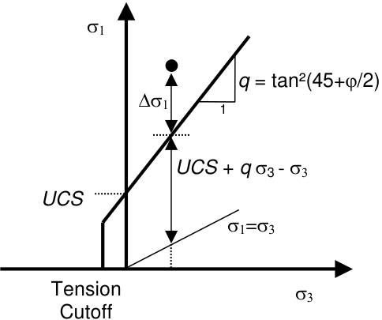

Plot > Strength Factors > SF-B   Strength/Stress 可确定为 ( _UCS_ + _q_ s3 - s3 )/(s1 - s3)

Plot > Strength Factors > SF/B   Stress/Strength 可确定为 (s1 - s3)/( _UCS_ + _q_ s3 - s3 )

Plot > Strength Factors > Ds1   剩余应力可确定为 Ds1 = s1 - ( _UCS_ + _q_ s3 )

Plot > Strength Factors > N(Ds1 /std)   使用正态分布的概率。

与方法 "A" 相同。

#### Hoek-Brown

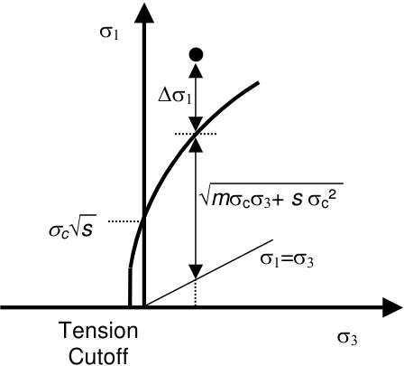

Plot > Strength Factors > SF-B   Strength/Stress 可确定为 Ö( _m_ scs3 + _s_ sc²)/(s1 - s3) Plot > Strength Factors > SF/B   Stress/Strength 可确定为 (s1 - s3)/Ö( _m_ scs3 + _s_ sc²) Plot > Strength Factors > Ds1   剩余应力可确定为 Ds1 = s1 - [ s3 + Ö( _m_ scs3 + _s_ sc²) ]

Plot > Strength Factors > N(Ds1 /std)   使用正态分布的概率。

与方法 "A" 相同。

Drucker-Prager 仅通过方法 "C" 定义。

强度参数通过以下功能设置

Plot > Strength Factors > Strength Parameters

相关主题：

Plot > Strength Factor > SF-A - Strength/Stress Plot > Strength Factors > SF-C - Strength/Stress Plot > Strength Factors > dTmax - Excess Stress Plot > Strength Factors > dToct - Excess Stress Plot > Strength Factors > In-plane Parameters Plot > Strength Factors > Ubiquitous Parameters

### 5.3.6.1.9 SF-C 强度/应力

使用方法 "C" 绘制剩余剪应力或强度系数的等值线。可通过 Strength Factor Components 工具栏访问这些分量，方法如下：

将该工具栏拖到主窗口的左边缘或右边缘，可将其改为垂直方向。

将其拖到主窗口的上边缘或下边缘，可恢复为水平方向。

选择 Contours 工具栏上的按钮可激活 Strength Factor Components 工具栏。

在弹性分析中，最大和最小主应力可与 Mohr-Coulomb 或 Hoek-Brown 强度准则一起使用

#### Plot > Strength Factors > Strength Parameters

以估算因应力过大造成的损伤程度。由于这些参数均不具有方向敏感性，该准则适用于均质岩体的稳定性评价。

相比之下，在非线性分析中，除非使用了某种蠕变，否则应力永远不会超过强度。在后一种情况下，黏性蠕变可能使应力状态超出破坏准则，表明缺乏静力平衡。因此，对于非线性分析，通常直接考察模型预测的非线性应变量或应变率

Mohr-Coulomb in 3D FF blocks.

方法 "C" 假定达到破坏的应力路径是在丧失围压的情况下通过增大 s1 实现的。这代表拱座（abutment）破坏，其中 s1 - s3 被视为驱动力。

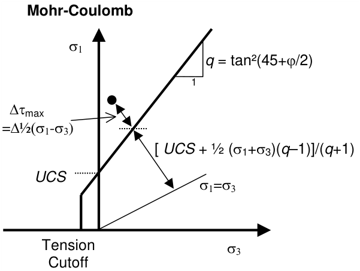

Plot > Strength Factors > SF-C   Strength/Stress 可确定为 [ _UCS_ + ½(s1+s3) ( _q_ - 1) ]/[ ½(s1 - s3)( _q_ +1) ]

Plot > Strength Factors > SF/C   Stress/Strength 可确定为 [ ½(s1 - s3)( _q_ +1) ]/ [ _UCS_ + ½(s1+s3) ( _q_ -1) ]

Plot > Strength Factors > Dtmax   剩余应力可确定为

Dtmax = ½(s1 - s3) - [ _UCS_ + ½(s1+s3) ( _q_ -1) ]/( _q_ +1)

= [s1 - ( _UCS_ + _q_ s3) ]/( _q_ +1)

#### Hoek-Brown

Plot > Strength Factors > SF-C   Strength/Stress 可确定为 &#123; Ö[1 /16 _m_ ²sc² + ½(s1 + s3) _m_ sc + _s_ sc²] - ¼ _m_ sc&#125;/(s1 - s3)

Plot > Strength Factors > SF/C   Stress/Strength 可确定为 (s1 - s3)/&#123; Ö[1 /16 _m_ ²sc² + ½(s1 + s3) _m_ sc + _s_ sc²] - ¼ _m_ sc &#125;

Plot > Strength Factors > Dtmax   剩余应力可确定为

Dtmax = ½(s1 - s3) - ½&#123; Ö[1 /16 _m_ ²sc² + ½(s1 + s3) _m_ sc + _s_ sc²] - ¼ _m_ sc &#125;

#### Drucker-Prager

SF-C Strength/Stress   可确定为 [ _UCS_ + ( _q_ –1) smean ] Ö(2) /[ toct ( _q_ +2) ]

SF-C Stress/Strength   可确定为 toct /[ _UCS_ + ( _q_ –1) smean ] Ö(2) /( _q_ +2) Dtoct Excess   可确定为 toct - [ _UCS_ + ( _q_ –1) smean ] Ö(2) /( _q_ +2)

其中

_q_ = tan²(45+j/2) toct = ¹/3 Ö[( s1 - s2 )² + ( s2 - s3 )² +( s3 - s1 )²] smean = ¹/3 ( s1 + s2 + s3 )

请注意，强度参数已被选取，使得当 s2 等于 s3 时，该准则简化为 Mohr-Coulomb 准则。

强度参数通过以下功能设置

Plot > Strength Factors > Strength Parameters

相关主题：

Plot > Strength Factor > SF-A - Stress/Strength Plot > Strength Factors > SF-B - Stress/Strength Plot > Strength Factors > dS1 - Excess Stress Plot > Strength Factors > In-plane Parameters Plot > Strength Factors > Ubiquitous Parameters

### 5.3.6.1.10 SF/A 应力/强度

使用方法 "A" 绘制剩余最大主应力和强度系数的等值线。可通过 Strength Factor Components 工具栏访问这些分量，方法如下：

将该工具栏拖到主窗口的左边缘或右边缘，可将其改为垂直方向。

将其拖到主窗口的上边缘或下边缘，可恢复为水平方向。

选择 Contours 工具栏上的按钮可激活 Strength Factor Components 工具栏。

在弹性分析中，最大和最小主应力可与 Mohr-Coulomb 或 Hoek-Brown 强度准则一起使用

Plot > Strength Factors > Strength Parameters

以估算因应力过大造成的损伤程度。由于这些参数均不具有方向敏感性，该准则适用于均质岩体的稳定性评价。

相比之下，在非线性分析中，除非使用了某种蠕变，否则应力永远不会超过强度。在后一种情况下，黏性蠕变可能使应力状态超出破坏准则，表明缺乏静力平衡。因此，对于非线性分析，通常直接考察模型预测的非线性应变量或应变率

Mohr-Coulomb in 3D FF blocks.

方法 "A" 假定达到破坏的应力路径是在不丧失围压的情况下通过增大 s1 实现的。这代表矿柱破坏，其中 s1 被视为驱动力。

Plot > Strength Factors > SF-A   Strength/Stress 可确定为 ( _UCS_ + _q_ s3 )/ s1 Plot > Strength Factors > SF/A   Stress/Strength 可确定为 s1 / ( _UCS_ + _q_ s3 ) Plot > Strength Factors > Ds1   剩余应力可确定为 Ds1 = s1 - ( _UCS_ + _q_ s3 )

Plot > Strength Factors > N(Ds1 /std)   使用正态分布的概率。

与方法 "B" 相同。

#### Hoek-Brown

Plot > Strength Factors > SF-A   Strength/Stress 可确定为 [ s3 + Ö( _m_ scs3 + _s_ sc²) ] / s1

Plot > Strength Factors > SF/A   Stress/Strength 可确定为 s1 / [ s3 + Ö( _m_ scs3 + _s_ sc²) ]

Plot > Strength Factors > Ds1   剩余应力可确定为 Ds1 = s1 - [ s3 + Ö( _m_ scs3 + _s_ sc²) ]

Plot > Strength Factors > N(Ds1 /std)   使用正态分布的概率。

与方法 "B" 相同。

Drucker-Prager 仅通过方法 "C" 定义。

强度参数通过以下功能设置

Plot > Strength Factors > Strength Parameters

相关主题：

Plot > Strength Factor > SF-B - Strength/Stress Plot > Strength Factors > SF-C - Strength/Stress Plot > Strength Factors > dTmax - Excess Stress Plot > Strength Factors > dToct - Excess Stress Plot > Strength Factors > In-plane Parameters Plot > Strength Factors > Ubiquitous Parameters

### 5.3.6.1.11 SF/B 应力/强度

使用方法 "B" 绘制剩余最大主应力和强度系数的等值线。可通过 Strength Factor Components 工具栏访问这些分量，方法如下：

将该工具栏拖到主窗口的左边缘或右边缘，可将其改为垂直方向。

将其拖到主窗口的上边缘或下边缘，可恢复为水平方向。

选择

Contours 工具栏上的按钮可激活 Strength Factor Components 工具栏。

在弹性分析中，最大和最小主应力可与 Mohr-Coulomb 或 Hoek-Brown 强度准则一起使用

#### Plot > Strength Factors > Strength Parameters

以估算因应力过大造成的损伤程度。由于这些参数均不具有方向敏感性，该准则适用于均质岩体的稳定性评价。

相比之下，在非线性分析中，除非使用了某种蠕变，否则应力永远不会超过强度。在后一种情况下，黏性蠕变可能使应力状态超出破坏准则，表明缺乏静力平衡。因此，对于非线性分析，通常直接考察模型预测的非线性应变量或应变率

Mohr-Coulomb in 3D FF blocks.

方法 "B" 假定达到破坏的应力路径是在不丧失围压的情况下通过增大 s1 实现的。这代表矿柱破坏，其中 s1 - s3 被视为驱动力。

#### Mohr-Coulomb

Plot > Strength Factors > SF-B   Strength/Stress 可确定为 ( _UCS_ + _q_ s3 - s3 )/(s1 - s3)

Plot > Strength Factors > SF/B   Stress/Strength 可确定为 (s1 - s3)/( _UCS_ + _q_ s3 - s3 )

Plot > Strength Factors > Ds1   剩余应力可确定为 Ds1 = s1 - ( _UCS_ + _q_ s3 )

Plot > Strength Factors > N(Ds1 /std)   使用正态分布的概率。

与方法 "A" 相同。

#### Hoek-Brown

Plot > Strength Factors > SF-B   Strength/Stress 可确定为 Ö( _m_ scs3 + _s_ sc²)/(s1 - s3) Plot > Strength Factors > SF/B   Stress/Strength 可确定为 (s1 - s3)/Ö( _m_ scs3 + _s_ sc²) Plot > Strength Factors > Ds1   剩余应力可确定为 Ds1 = s1 - [ s3 + Ö( _m_ scs3 + _s_ sc²) ]

Plot > Strength Factors > N(Ds1 /std)   使用正态分布的概率。

与方法 "A" 相同。

Drucker-Prager 仅通过方法 "C" 定义。

强度参数通过以下功能设置

Plot > Strength Factors > Strength Parameters

相关主题：

Plot > Strength Factor > SF-A - Strength/Stress Plot > Strength Factors > SF-C - Strength/Stress Plot > Strength Factors > dTmax - Excess Stress Plot > Strength Factors > dToct - Excess Stress Plot > Strength Factors > In-plane Parameters Plot > Strength Factors > Ubiquitous Parameters

### 5.3.6.1.12 SF/C 应力/强度

使用方法 "C" 绘制剩余剪应力或强度系数的等值线。可通过 Strength Factor Components 工具栏访问这些分量，方法如下：

将该工具栏拖到主窗口的左边缘或右边缘，可将其改为垂直方向。

将其拖到主窗口的上边缘或下边缘，可恢复为水平方向。

选择 Contours 工具栏上的按钮可激活 Strength Factor Components 工具栏。

在弹性分析中，最大和最小主应力可与 Mohr-Coulomb 或 Hoek-Brown 强度准则一起使用

#### Plot > Strength Factors > Strength Parameters

以估算因应力过大造成的损伤程度。由于这些参数均不具有方向敏感性，该准则适用于均质岩体的稳定性评价。

相比之下，在非线性分析中，除非使用了某种蠕变，否则应力永远不会超过强度。在后一种情况下，黏性蠕变可能使应力状态超出破坏准则，表明缺乏静力平衡。因此，对于非线性分析，通常直接考察模型预测的非线性应变量或应变率

Mohr-Coulomb in 3D FF blocks.

方法 "C" 假定达到破坏的应力路径是在丧失围压的情况下通过增大 s1 实现的。这代表拱座（abutment）破坏，其中 s1 - s3 被视为驱动力。

Plot > Strength Factors > SF-C   Strength/Stress 可确定为 [ _UCS_ + ½(s1+s3) ( _q_ - 1) ]/[ ½(s1 - s3)( _q_ +1) ]

Plot > Strength Factors > SF/C   Stress/Strength 可确定为 [ ½(s1 - s3)( _q_ +1) ]/ [ _UCS_ + ½(s1+s3) ( _q_ -1) ]

Plot > Strength Factors > Dtmax   剩余应力可确定为

Dtmax = ½(s1 - s3) - [ _UCS_ + ½(s1+s3) ( _q_ -1) ]/( _q_ +1)

= [s1 - ( _UCS_ + _q_ s3) ]/( _q_ +1)

#### Hoek-Brown

Plot > Strength Factors > SF-C   Strength/Stress 可确定为 &#123; Ö[1 /16 _m_ ²sc² + ½(s1 + s3) _m_ sc + _s_ sc²] - ¼ _m_ sc&#125;/(s1 - s3)

Plot > Strength Factors > SF/C   Stress/Strength 可确定为 (s1 - s3)/&#123; Ö[1 /16 _m_ ²sc² + ½(s1 + s3) _m_ sc + _s_ sc²] - ¼ _m_ sc &#125;

Plot > Strength Factors > Dtmax   剩余应力可确定为

Dtmax = ½(s1 - s3) - ½&#123; Ö[1 /16 _m_ ²sc² + ½(s1 + s3) _m_ sc + _s_ sc²] - ¼ _m_ sc &#125;

#### Drucker-Prager

SF-C Strength/Stress   可确定为 [ _UCS_ + ( _q_ –1) smean ] Ö(2) /[ toct ( _q_ +2) ]

SF-C Stress/Strength   可确定为 toct /[ _UCS_ + ( _q_ –1) smean ] Ö(2) /( _q_ +2) Dtoct Excess   可确定为 toct - [ _UCS_ + ( _q_ –1) smean ] Ö(2) /( _q_ +2)

其中

_q_ = tan²(45+j/2) toct = ¹/3 Ö[( s1 - s2 )² + ( s2 - s3 )² +( s3 - s1 )²] smean = ¹/3 ( s1 + s2 + s3 )

请注意，强度参数已被选取，使得当 s2 等于 s3 时，该准则简化为 Mohr-Coulomb 准则。

强度参数通过以下功能设置

Plot > Strength Factors > Strength Parameters

相关主题：

Plot > Strength Factor > SF-A - Stress/Strength Plot > Strength Factors > SF-B - Stress/Strength Plot > Strength Factors > dS1 - Excess Stress Plot > Strength Factors > In-plane Parameters Plot > Strength Factors > Ubiquitous Parameters

## 5.3.6.2 面内参数

5.3.6.2.1  面内参数

设置用于按面内应力分量生成强度系数等值线图的强度参数。

可通过 Strength Factor Components 工具栏访问这些分量，方法如下：

将该工具栏拖到主窗口的左边缘或右边缘，可将其改为垂直方向。

将其拖到主窗口的上边缘或下边缘，可恢复为水平方向。

选择 Contours 工具栏上的按钮可激活 Strength Factor Components 工具栏。

为计算面内剪应力和法向应力，网格平面上每个点的应力状态都会被重新定向，以确定平行于网格平面的最大剪应力和垂直于网格平面的应力。

在弹性分析中，最大面内剪应力和法向应力可与 Mohr-Coulomb 强度准则一起使用，以估算在与网格平面方向相同的断层、节理组或层理面上因应力过大而产生的滑动量。由于这些参数依赖于方向，该准则适用于各向异性岩体的稳定性评价。

相比之下，在非线性分析中，除非使用了某种蠕变，否则应力永远不会超过强度。在后一种情况下，黏性蠕变可能使应力状态超出破坏准则，表明缺乏静力平衡。因此，对于非线性分析，通常直接考察模型预测的非线性应变量或应变率

Mohr-Coulomb in DD planes Fault-Gouge in DD planes Backfill-Hyperbolic in DD planes

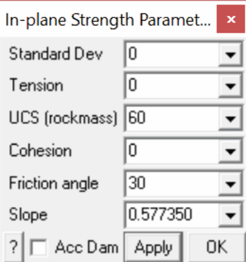

Mohr-Coulomb 准则按剪应力和法向应力定义抗剪强度，如下所示：

#### Mohr-Coulomb

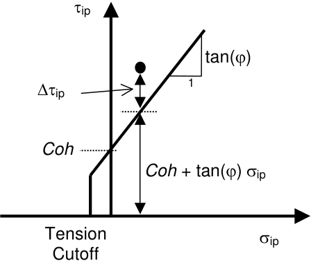

拉伸截断（tension cutoff）、UCS 和黏聚力以应力单位（MPa 或 psi）指定。

摩擦角以度为单位指定。

Standard Deviation 指定在 tip 方向上测得的破坏准则的不确定度（以应力单位 MPa 或 psi 指定）。

Acc Dam – 绘制累积损伤。参见 Accumulated Damage

Apply – 重新生成等值线图。

相关主题：

Plot > Strength Factor > Probability N-distribution Plot > Strength Factor > SF-ip - Stress/Strength Plot > Strength Factors > SF-ub - Stress/Strength Plot > Strength Factors > dTip - Excess Stress Plot > Strength Factors > dTub - Excess Stress Plot > Strength Factors > Rockmass Strength Parameters Plot > Strength Factors > Ubiquitous Parameters

### 5.3.6.2.2 累积损伤

绘制累积损伤。

可通过 Strength Factor Components 工具栏访问该分量，方法如下：

将该工具栏拖到主窗口的左边缘或右边缘，可将其改为垂直方向。

将其拖到主窗口的上边缘或下边缘，可恢复为水平方向。

选择 Contours 工具栏上的按钮可激活 Strength Factor Components 工具栏。

未启用 Acc 时，按当前应力值绘制剩余应力、破坏概率、强度系数和 RCF。

启用 Acc 时，将在整个模型加载历史中跟踪从第 1 步到当前步骤的损伤，因此绘制的是剩余应力、破坏概率、强度系数或 RCF 的最不利情况。

这使得弹性应力分析结果的使用方式类似于塑性模型中的累积应变。

损伤跟踪分别针对以下 5 种情况进行：

1. 岩体破坏（剩余 S1 应力、概率、强度系数）2. 面内剪切破坏（剩余剪应力、概率、强度系数）3. ub 平面剪切破坏（剩余剪应力、概率、强度系数）

4. 面内剩余壁面应力（剩余应力、RCF）

5. ub 平面剩余壁面应力（剩余应力、RCF）

请注意，首次屈服发生的步骤（MStep 1st Yield）和最大剩余应力发生的步骤（MStep Max Yield）都会被跟踪，并可显示为轨迹标签。

### 5.3.6.2.3 面内剩余剪应力

绘制面内抗剪强度的等值线。

可通过 Strength Factor Components 工具栏访问这些分量，方法如下：

将该工具栏拖到主窗口的左边缘或右边缘，可将其改为垂直方向。

将其拖到主窗口的上边缘或下边缘，可恢复为水平方向。

选择

Contours 工具栏上的按钮可激活 Strength Factor Components 工具栏。

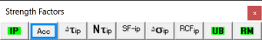

为计算面内剪应力和法向应力，网格平面上每个点的应力状态都会被重新定向，以确定平行于网格平面的最大剪应力和垂直于网格平面的应力。

在弹性分析中，最大面内剪应力和法向应力可与 Mohr-Coulomb 强度准则一起使用

#### Plot > Strength Factors > In-plane Parameters

以估算在与网格平面方向相同的断层、节理组或层理面上因应力过大而产生的滑动量。由于这些参数依赖于方向，该准则适用于各向异性岩体的稳定性评价。

相比之下，在非线性分析中，除非使用了某种蠕变，否则应力永远不会超过强度。在后一种情况下，黏性蠕变可能使应力状态超出破坏准则，表明缺乏静力平衡。因此，对于非线性分析，通常直接考察模型预测的非线性应变量或应变率

Mohr-Coulomb in DD planes

Fault-Gouge in DD planes

Backfill-Hyperbolic in DD planes

这里假定达到破坏的应力路径是在不丧失围压的情况下通过增大 tip 实现的。

#### Mohr-Coulomb

SF-ip Strength/Stress   可确定为 [ Cohesion + sip tan(j) ] / tip SF-ip Stress/Strength   可确定为 tip / [ Cohesion + sip tan(j) ] dTip Excess   可确定为 Dtip = tip - [ Cohesion + sip tan(j) ]

NTip Probability   可确定为 N(Dtip /std)

强度参数通过以下功能设置

Plot > Strength Factors > In-plane Parameters

相关主题：

Plot > Stress > Tip - In-plane Shear Plot > Stress > Sip - In-plane Normal Plot > Strength Factors > SF-ub Strength/Stress Plot > Strength Factors > dTub Excess

Plot > Strength Factors > NSub Probability

### 5.3.6.2.4 面内剩余壁面应力

绘制面内壁面应力强度的等值线。可通过 Strength Factor Components 工具栏访问这些分量，方法如下：

将该工具栏拖到主窗口的左边缘或右边缘，可将其改为垂直方向。

将其拖到主窗口的上边缘或下边缘，可恢复为水平方向。

选择

Contours 工具栏上的按钮可激活 Strength Factor Components 工具栏。

为计算面内壁面应力，网格平面上每个点的应力状态都会被重新定向，以确定平行于网格平面的最大和最小切向应力。

然后即可确定垂直于网格平面的虚拟圆形采空区的最大壁面应力为 [ 3 s1i - s3i ]。

请注意，sip 垂直于网格平面，并平行于线网格的方向。还请注意，sip、s1i 和 s3i 彼此垂直。

- 倾向自 y 轴起顺时针方向为正。

- 平面的倾角自水平面起向下为正（即沿倾向方向）。

- 法线的俯角自水平面起向下为正（即向上为负）。

dSip Excess   可确定为 Dsip = [ 3 s1i - s3i ] - UCS

RCFip   可确定为 RCFip = [ 3 s1i - s3i ]/UCS

强度参数通过以下功能设置

Plot > Strength Factors > In-plane Parameters

相关主题：

Plot > Stress > Tip - In-plane Shear Plot > Stress > Sip - In-plane Normal Plot > Stress > S1i - In-plane Maximum Plot > Stress > S3i - In-plane Minimum Plot > Strength Factors > SF-ub Strength/Stress Plot > Strength Factors > dTub Excess Plot > Strength Factors > dSub Excess Plot > Strength Factors > NSub Probability

### 5.3.6.2.6 NTip 正态概率

绘制面内抗剪强度的等值线。可通过 Strength Factor Components 工具栏访问这些分量，方法如下：

将该工具栏拖到主窗口的左边缘或右边缘，可将其改为垂直方向。

将其拖到主窗口的上边缘或下边缘，可恢复为水平方向。

选择 Contours 工具栏上的按钮可激活 Strength Factor Components 工具栏。

为计算面内剪应力和法向应力，网格平面上每个点的应力状态都会被重新定向，以确定平行于网格平面的最大剪应力和垂直于网格平面的应力。

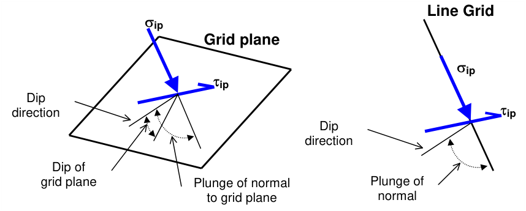

在弹性分析中，最大面内剪应力和法向应力可与 Mohr-Coulomb 强度准则一起使用

#### Plot > Strength Factors > In-plane Parameters

以估算在与网格平面方向相同的断层、节理组或层理面上因应力过大而产生的滑动量。由于这些参数依赖于方向，该准则适用于各向异性岩体的稳定性评价。

相比之下，在非线性分析中，除非使用了某种蠕变，否则应力永远不会超过强度。在后一种情况下，黏性蠕变可能使应力状态超出破坏准则，表明缺乏静力平衡。因此，对于非线性分析，通常直接考察模型预测的非线性应变量或应变率

Mohr-Coulomb in DD planes

Fault-Gouge in DD planes

Backfill-Hyperbolic in DD planes

这里假定达到破坏的应力路径是在不丧失围压的情况下通过增大 tip 实现的。

#### Mohr-Coulomb

SF-ip Strength/Stress   可确定为 [ Cohesion + sip tan(j) ] / tip SF-ip Stress/Strength   可确定为 tip / [ Cohesion + sip tan(j) ] dTip Excess   可确定为 Dtip = tip - [ Cohesion + sip tan(j) ]

NTip Probability   可确定为 N(Dtip /std)

强度参数通过以下功能设置

Plot > Strength Factors > In-plane Parameters

相关主题：

Plot > Stress > Tip - In-plane Shear Plot > Stress > Sip - In-plane Normal Plot > Strength Factors > SF-ub Strength/Stress Plot > Strength Factors > dTub Excess

Plot > Strength Factors > NSub Probability

## 5.3.6.3 UB 平面参数

5.3.6.3.1  遍布参数

设置用于按遍布平面应力分量生成强度系数等值线图的强度参数。

可通过 Strength Factor Components 工具栏访问这些分量，方法如下：

将该工具栏拖到主窗口的左边缘或右边缘，可将其改为垂直方向。

将其拖到主窗口的上边缘或下边缘，可恢复为水平方向。

选择

Contours 工具栏上的按钮可激活 Strength Factor Components 工具栏。

为计算遍布剪应力和法向应力，网格平面上每个点的应力状态都会被重新定向，以确定平行于遍布剪切面的最大剪应力和垂直于遍布剪切面的应力。

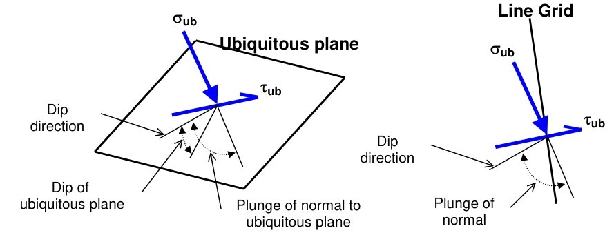

在弹性分析中，最大遍布平面剪应力和法向应力可与 Mohr-Coulomb 强度准则一起使用，以估算在指定方向的断层、节理组或层理面上因应力过大而产生的滑动量。由于这些参数依赖于方向，该准则适用于各向异性岩体的稳定性评价。

相比之下，在非线性分析中，除非使用了某种蠕变，否则应力永远不会超过强度。在后一种情况下，黏性蠕变可能使应力状态超出破坏准则，表明缺乏静力平衡。因此，对于非线性分析，通常直接考察模型预测的非线性应变量或应变率

Mohr-Coulomb in DD planes

Fault-Gouge in DD planes

Backfill-Hyperbolic in DD planes

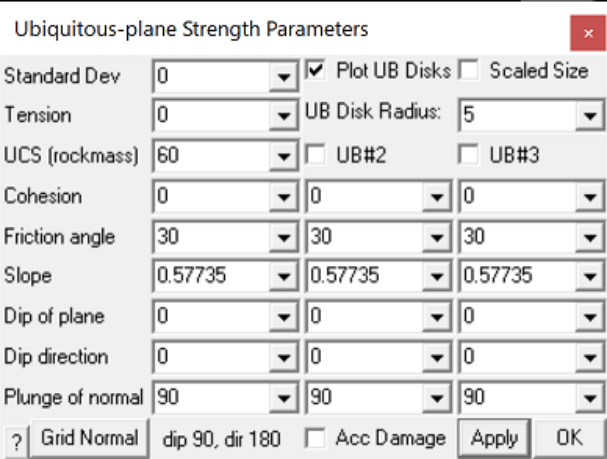

Cohesion 和 Friction Angle Mohr-Coulomb 准则按主应力定义强度，如下所示：

#### Mohr-Coulomb

拉伸截断（tension cutoff）、UCS 和黏聚力以应力单位（MPa 或 psi）指定。摩擦角以度为单位指定。

Standard Deviation 指定在 tip 方向上测得的破坏准则的不确定度（以应力单位 MPa 或 psi 指定）。

Dip of plane – 指定遍布平面的倾角（度）。法线的倾角会自动调整以反映该值的变化。

Dip Direction – 指定遍布平面的倾向（度）。

Dip of Normal – 指定遍布平面法线的倾角（度）。平面的倾角会自动调整以反映该值的变化。

Grid Normal – 将遍布平面设为与当前选定的网格平面平行。在这种情况下，所有面内结果将与遍布平面结果相同。

Acc Dam – 绘制累积损伤。参见 Accumulated Damage

Plot UB DIsks – 切换平面等值线图与表示 UB 平面方向的圆盘的显示。

Scaled Size – 按量值缩放 UB 圆盘的大小。

UB DIsk Radius – 指定 UB 圆盘的半径。

Apply – 重新生成等值线图。

UB#2 & UB#3 – 激活遍布平面 #2 和/或 #3 的强度参数。选中后，

将为所有强度参数给出所有活动遍布平面中的最小值（ Plot > Strength Factor > Probability N-distribution、Plot > Strength Factors > SF-ub - Stress/Strength 以及 Plot > Strength Factors > dTub - Excess Stress）。要确定哪个遍布平面的强度最小，可以绘制 Plot > Strength Factors > UB# with minimum strength），或在强度参数图上单击左键。

相关主题：

Plot > Strength Factor > Probability N-distribution Plot > Strength Factors > SF-ub - Stress/Strength Plot > Strength Factor > SF-ip - Stress/Strength Plot > Strength Factors > dTub - Excess Stress Plot > Strength Factors > dTip - Excess Stress Plot > Strength Factors > UB# with minimum strength Plot > Strength Factors > Rockmass Strength Parameters

Plot > Strength Factors > In-plane Parameters

### 5.3.6.3.2 累积损伤

绘制累积损伤。可通过 Strength Factor Components 工具栏访问该分量，方法如下：

将该工具栏拖到主窗口的左边缘或右边缘，可将其改为垂直方向。

将其拖到主窗口的上边缘或下边缘，可恢复为水平方向。

选择 Contours 工具栏上的按钮可激活 Strength Factor Components 工具栏。

未启用 Acc 时，按当前应力值绘制剩余应力、破坏概率、强度系数和 RCF。

启用 Acc 时，将在整个模型加载历史中跟踪从第 1 步到当前步骤的损伤，因此绘制的是剩余应力、破坏概率、强度系数或 RCF 的最不利情况。

这使得弹性应力分析结果的使用方式类似于塑性模型中的累积应变。

损伤跟踪分别针对以下 5 种情况进行：

1. 岩体破坏（剩余 S1 应力、概率、强度系数）2. 面内剪切破坏（剩余剪应力、概率、强度系数）3. ub 平面剪切破坏（剩余剪应力、概率、强度系数）

4. 面内剩余壁面应力（剩余应力、RCF）

5. ub 平面剩余壁面应力（剩余应力、RCF）

请注意，首次屈服发生的步骤（MStep 1st Yield）和最大剩余应力发生的步骤（MStep Max Yield）都会被跟踪，并可显示为轨迹标签。

- 5.3.6.3.3  遍布剩余剪应力

绘制遍布平面抗剪强度的等值线。可通过 Strength Factor Components 工具栏访问这些分量，方法如下：

将该工具栏拖到主窗口的左边缘或右边缘，可将其改为垂直方向。

将其拖到主窗口的上边缘或下边缘，可恢复为水平方向。

选择 Contours 工具栏上的按钮可激活 Strength Factor Components 工具栏。

为计算遍布剪应力和法向应力，网格平面上每个点的应力状态都会被重新定向，以确定平行于遍布剪切面的最大剪应力和垂直于遍布剪切面的应力。

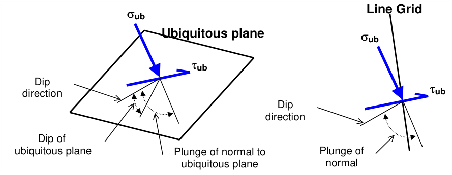

遍布剪切面的方向通过以下功能设置

#### Plot > Strength Factors > Ubiquitous Parameters

在弹性分析中，最大遍布平面剪应力和法向应力可与 Mohr-Coulomb 强度准则一起使用，以估算在指定方向的断层、节理组或层理面上因应力过大而产生的滑动量。由于这些参数依赖于方向，该准则适用于各向异性岩体的稳定性评价。

相比之下，在非线性分析中，除非使用了某种蠕变，否则应力永远不会超过强度。在后一种情况下，黏性蠕变可能使应力状态超出破坏准则，表明缺乏静力平衡。因此，对于非线性分析，通常直接考察模型预测的非线性应变量或应变率

Mohr-Coulomb in DD planes

Fault-Gouge in DD planes

Backfill-Hyperbolic in DD planes

这里假定达到破坏的应力路径是在不丧失围压的情况下通过增大 tub 实现的。

#### Mohr-Coulomb

SF-ub Strength/Stress   可确定为 [ Cohesion + sub tan(j) ] / tub SF-ub Stress/Strength   可确定为 tub / [ Cohesion + sub tan(j) ] dTub Excess   可确定为 Dtub = tub - [ Cohesion + sub tan(j) ] NTub Probability   可确定为 N(Dtub /std)

强度参数通过以下功能设置

Plot > Strength Factors > Ubiquitous Parameters

相关主题：

Plot > Stress > Tub - Ubiquitous-plane Shear Plot > Stress > Sub - Ubiquitous-plane Normal Plot > Stress > S1u - Ubiquitous-plane Maximum Plot > Stress > S3u - Ubiquitous-plane Minimum Plot > Strength Factors > SF-ub Strength/Stress Plot > Strength Factors > dTip Excess Plot > Strength Factors > dSip Excess Plot > Strength Factors > NTip Probability

UB#2 & UB#3 – 激活遍布平面 #2 和/或 #3 的强度参数。选中后，将为所有强度参数给出所有活动遍布平面中的最小值（ Plot > Strength Factor > Probability N-distribution、Plot > Strength Factors > SF-ub - Stress/Strength 以及

Plot > Strength Factors > dTub - Excess Stress). To determine which ubiquitous plane has the minimum strength you can plot Plot > Strength Factors > UB# with minimum strength) or left click on and strength parameter plot.

### 5.3.6.3.4 遍布平面剩余壁面应力

绘制 ub 平面壁面应力强度的等值线。

可通过 Strength Factor Components 工具栏访问这些分量，方法如下：

将该工具栏拖到主窗口的左边缘或右边缘，可将其改为垂直方向。

将其拖到主窗口的上边缘或下边缘，可恢复为水平方向。

选择 Contours 工具栏上的按钮可激活 Strength Factor Components 工具栏。

为计算 ub 平面壁面应力，网格平面上每个点的应力状态都会被重新定向，以确定平行于 ub 平面的最大和最小切向应力。

然后即可确定垂直于 ub 平面的虚拟圆形采空区的最大壁面应力为 [ 3 s1u - s3u ]。

请注意，sub 垂直于 ub 平面。还请注意，sub、s1 和 s3u 彼此垂直。

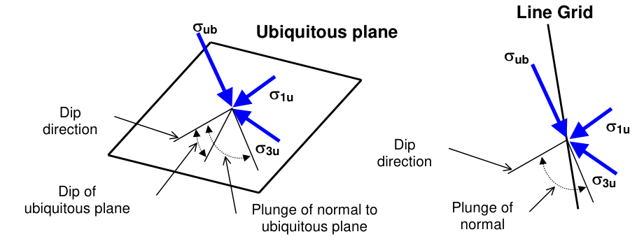

- 倾向自 y 轴起顺时针方向为正。

- 平面的倾角自水平面起向下为正（即沿倾向方向）。

- 法线的俯角自水平面起向下为正（即向上为负）。

dSub Excess   可确定为 Dsub = [ 3 s1u - s3u ] - UCS

RCFub   可确定为 RCFub = [ 3 s1u - s3u ]/UCS

遍布剪切面的方向通过以下功能设置

Plot > Strength Factors > Ubiquitous Parameters

相关主题：

Plot > Stress > Tub - Ubiquitous-plane Shear Plot > Stress > Sub - Ubiquitous-plane Normal Plot > Stress > S1u - Ubiquitous-plane Maximum Plot > Stress > S3u - Ubiquitous-plane Minimum Plot > Strength Factors > SF-ub Strength/Stress Plot > Strength Factors > dTip Excess Plot > Strength Factors > dSip Excess Plot > Strength Factors > NTip Probability

### 5.3.6.3.6 NTub 正态概率

绘制遍布平面抗剪强度的等值线。可通过 Strength Factor Components 工具栏访问这些分量，方法如下：

将该工具栏拖到主窗口的左边缘或右边缘，可将其改为垂直方向。

将其拖到主窗口的上边缘或下边缘，可恢复为水平方向。

选择 Contours 工具栏上的按钮可激活 Strength Factor Components 工具栏。

为计算遍布剪应力和法向应力，网格平面上每个点的应力状态都会被重新定向，以确定平行于遍布剪切面的最大剪应力和垂直于遍布剪切面的应力。

遍布剪切面的方向通过以下功能设置

#### Plot > Strength Factors > Ubiquitous Parameters

在弹性分析中，最大遍布平面剪应力和法向应力可与 Mohr-Coulomb 强度准则一起使用，以估算在指定方向的断层、节理组或层理面上因应力过大而产生的滑动量。由于这些参数依赖于方向，该准则适用于各向异性岩体的稳定性评价。

相比之下，在非线性分析中，除非使用了某种蠕变，否则应力永远不会超过强度。在后一种情况下，黏性蠕变可能使应力状态超出破坏准则，表明缺乏静力平衡。因此，对于非线性分析，通常直接考察模型预测的非线性应变量或应变率

Mohr-Coulomb in DD planes

Fault-Gouge in DD planes

Backfill-Hyperbolic in DD planes

这里假定达到破坏的应力路径是在不丧失围压的情况下通过增大 tub 实现的。

#### Mohr-Coulomb

SF-ub Strength/Stress   可确定为 [ Cohesion + sub tan(j) ] / tub SF-ub Stress/Strength   可确定为 tub / [ Cohesion + sub tan(j) ] dTub Excess   可确定为 Dtub = tub - [ Cohesion + sub tan(j) ] NTub Probability   可确定为 N(Dtub /std)

强度参数通过以下功能设置

Plot > Strength Factors > Ubiquitous Parameters

相关主题：

Plot > Stress > Tub - Ubiquitous-plane Shear Plot > Stress > Sub - Ubiquitous-plane Normal Plot > Stress > S1u - Ubiquitous-plane Maximum Plot > Stress > S3u - Ubiquitous-plane Minimum Plot > Strength Factors > SF-ub Strength/Stress Plot > Strength Factors > dTip Excess Plot > Strength Factors > dSip Excess Plot > Strength Factors > NTip Probability

UB#2 & UB#3 – 激活遍布平面 #2 和/或 #3 的强度参数。选中后，将为所有强度参数给出所有活动遍布平面中的最小值（ Plot > Strength Factor > Probability N-distribution、Plot > Strength Factors > SF-ub - Stress/Strength 以及

Plot > Strength Factors > dTub - Excess Stress). To determine which ubiquitous plane has the minimum strength you can plot Plot > Strength Factors > UB# with minimum strength) or left click on and strength parameter plot.
