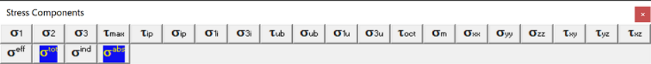
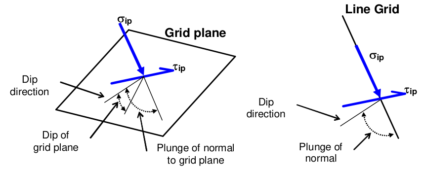
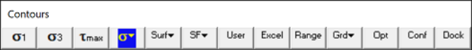
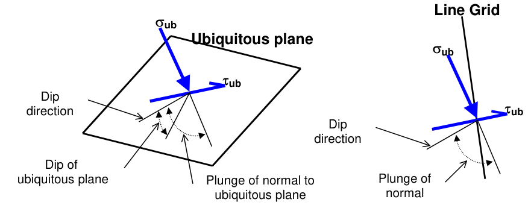
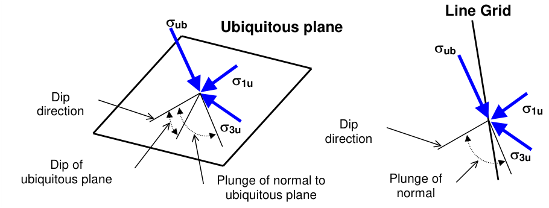

## 5.3.1.1 最大主应力

可用于显示主应力分量 s1 s2 s3。可通过 Stress Components 工具栏访问这些分量，方法如下：

将该工具栏拖到主窗口的左边缘或右边缘，可将其改为垂直方向。

将其拖到主窗口的上边缘或下边缘，可恢复为水平方向。

选择 Contours 工具栏上的按钮可激活 Stress Components 工具栏。

在弹性分析中，最大主应力通常与最小主应力以及 Mohr-Coulomb 或 Hoek-Brown 强度准则一起使用

#### Plot > Strength Factors > Strength Parameters

以估算岩体因应力过大而受到的损伤程度。由于这些参数均不具有方向敏感性，该准则适用于均质岩体的稳定性评价。

相比之下，在非线性分析中，除非使用了某种蠕变，否则应力永远不会超过强度。在后一种情况下，黏性蠕变可能使应力状态超出破坏准则，表明缺乏静力平衡。因此，对于非线性分析，通常直接考察模型预测的非线性应变量或应变率

Mohr-Coulomb in 3D FF blocks.

应力过大可以用多种形式表示，包括：

Plot > Strength Factor > SF-A Strength/Stress Plot > Strength Factor > SF-B Strength/Stress Plot > Strength Factors > SF-C Strength/Stress Plot > Strength Factors > dS1 Excess Stress Plot > Strength Factors > dTmax Excess Stress

等值线范围通过以下功能设置

#### Plot > Range

如有需要，这些分量中的任何一个都可以添加到等值线工具栏

Tools > Configure Contouring Toolbar > Stress

您可以将

#### More Stress Components

按钮添加到等值线工具栏，以便快速访问所有应力分量。

中间主应力通常用于计算八面体剪应力

Plot > Stress > Toct Octahedral shear Stress

或平均应力

Plot > Stress > Smean Mean Stress.

## 5.3.1.4 最大剪应力

可用于显示应力分量 tmax=½(s1 - s3)。可通过 Stress Components 工具栏访问该分量，方法如下：

将该工具栏拖到主窗口的左边缘或右边缘，可将其改为垂直方向。

将其拖到主窗口的上边缘或下边缘，可恢复为水平方向。

选择 Contours 工具栏上的按钮可激活 Stress Components 工具栏。

在弹性分析中，最大剪应力通常与最小主应力以及 Mohr-Coulomb 或 Hoek-Brown 强度准则一起使用

#### Plot > Strength Factors > Strength Parameters

以估算因应力过大造成的损伤程度。由于这些参数均不具有方向敏感性，该准则适用于均质岩体的稳定性评价。

相比之下，在非线性分析中，除非使用了某种蠕变，否则应力永远不会超过强度。在后一种情况下，黏性蠕变可能使应力状态超出破坏准则，表明缺乏静力平衡。因此，对于非线性分析，通常直接考察模型预测的非线性应变量或应变率

Mohr-Coulomb in 3D FF blocks.

应力过大可以用多种形式表示，包括：

Plot > Strength Factor > SF-A Strength/Stress Plot > Strength Factor > SF-B Strength/Stress Plot > Strength Factors > SF-C Strength/Stress Plot > Strength Factors > dS1 Excess Stress Plot > Strength Factors > dTmax Excess Stress

等值线范围通过以下功能设置

#### Plot > Range

如有需要，这些分量中的任何一个都可以添加到等值线工具栏

Tools > Configure Contouring Toolbar > Stress

您可以将

#### More Stress Components

按钮添加到等值线工具栏，以便快速访问所有应力分量。

## 5.3.1.5 面内剪应力

可用于绘制作用在网格平面上的最大剪应力以及垂直于网格平面或平行于线网格的应力分量的等值线。可通过 Stress Components 工具栏访问这些分量，方法如下：

将该工具栏拖到主窗口的左边缘或右边缘，可将其改为垂直方向。

将其拖到主窗口的上边缘或下边缘，可恢复为水平方向。

选择 Contours 工具栏上的按钮可激活 Stress Components 工具栏。

为计算面内应力，网格平面上每个点的应力状态都会被重新定向，以确定平行于网格平面的最大剪应力和垂直于该平面的应力。请注意，sip 垂直于网格平面，并平行于线网格的方向。

- 倾向自 y 轴起顺时针方向为正。

- 平面的倾角自水平面起向下为正（即沿倾向方向）。

- 法线的俯角自水平面起向下为正（即向上为负）。

在弹性分析中，最大面内剪应力通常与面内法向应力以及 Mohr-Coulomb 强度准则一起使用

Plot > Strength Factors > In-plane Parameters

以估算在与网格平面方向相同的断层、节理组或层理面上因应力过大而产生的滑动量。由于这些参数依赖于方向，该准则适用于各向异性岩体的稳定性评价。

相比之下，在非线性分析中，除非使用了某种蠕变，否则应力永远不会超过强度。在后一种情况下，黏性蠕变可能使应力状态超出破坏准则，表明缺乏静力平衡。因此，对于非线性分析，通常直接考察模型预测的非线性应变量或应变率

Mohr-Coulomb in DD planes Fault-Gouge in DD planes Backfill-Hyperbolic in DD planes.

应力过大可以用多种形式表示，包括：

Plot > Strength Factors > SF-ip Strength/Stress Plot > Strength Factors > dTip Excess Shear Stress

等值线范围通过以下功能设置

#### Plot > Range

如有需要，这些分量中的任何一个都可以添加到等值线工具栏

Tools > Configure Contouring Toolbar > Stress

您可以将

#### More Stress Components

按钮添加到等值线工具栏，以便快速访问所有应力分量。

相关主题：

Plot > Stress > S1i In-plane Maximum Plot > Stress > S3i In-plane Minimum Plot > Stress > Tub Ubiquitous-plane Shear Plot > Stress > Sub Ubiquitous-plane Normal

## 5.3.1.7 面内最大应力

可用于绘制与当前选定网格平面相切或垂直于线网格的最大和最小应力的等值线。可通过 Stress Components 工具栏访问这些分量，方法如下：

将该工具栏拖到主窗口的左边缘或右边缘，可将其改为垂直方向。

将其拖到主窗口的上边缘或下边缘，可恢复为水平方向。

选择 Contours 工具栏上的按钮可激活 Stress Components 工具栏。

为计算面内最大和最小应力，首先确定与网格平面相切的应力，再将其分解以得出最大值和最小值。请注意，sip 垂直于网格平面，并平行于线网格的方向。还请注意，sip、s1i 和 s3i 彼此垂直。

- 倾向自 y 轴起顺时针方向为正。

- 平面的倾角自水平面起向下为正（即沿倾向方向）。

- 法线的俯角自水平面起向下为正（即向上为负）。

等值线范围通过以下功能设置

#### Plot > Range

如有需要，可以将该分量添加到等值线工具栏

#### Tools > Configure Contouring Toolbar > Stress

您可以将

#### More Stress Components

按钮添加到等值线工具栏，以便快速访问所有应力分量。

相关主题：

Plot > Stress > Tip In-plane Shear Plot > Stress > Sip In-plane Normal Plot > Stress > S1u Ubiquitous-plane Maximum. Plot > Stress > S3u Ubiquitous-plane Minimum.

## 5.3.1.9 遍布平面剪应力

可用于绘制作用在遍布平面 #1 上的最大剪应力以及垂直于该平面的应力分量的等值线。可通过 Stress Components 工具栏访问这些分量，方法如下：

将该工具栏拖到主窗口的左边缘或右边缘，可将其改为垂直方向。

将其拖到主窗口的上边缘或下边缘，可恢复为水平方向。

选择 Contours 工具栏上的按钮可激活 Stress Components 工具栏。

为计算遍布应力，网格平面上每个点的应力状态都会被重新定向，以确定平行于遍布平面的最大剪应力和垂直于遍布平面的应力。请注意，sub 垂直于遍布平面，并不平行于线网格的方向。

- 倾向自 y 轴起顺时针方向为正。

- 平面的倾角自水平面起向下为正（即沿倾向方向）。

- 法线的俯角自水平面起向下为正（即向上为负）。

遍布剪切面的方向通过以下功能设置

#### Plot > Strength Factors > Ubiquitous Parameters

在弹性分析中，最大遍布平面剪应力通常与遍布平面法向应力以及 Mohr-Coulomb 强度准则一起使用

#### Plot > Strength Factors > Ubiquitous Parameters

以估算在指定方向的断层、节理组或层理面上因应力过大而产生的滑动量。由于这些参数依赖于方向，该准则适用于各向异性岩体的稳定性评价。

相比之下，在非线性分析中，除非使用了某种蠕变，否则应力永远不会超过强度。在后一种情况下，黏性蠕变可能使应力状态超出破坏准则，表明缺乏静力平衡。因此，对于非线性分析，通常直接考察模型预测的非线性应变量或应变率

Mohr-Coulomb in DD planes Fault-Gouge in DD planes Backfill-Hyperbolic in DD planes.

应力过大可以用多种形式表示，包括：

Plot > Strength Factors > SF-ub Strength/Stress. Plot > Strength Factors > dTub Excess Shear Stress.

等值线范围通过以下功能设置

#### Plot > Range

如有需要，可以将该分量添加到等值线工具栏

Tools > Configure Contouring Toolbar > Stress

您可以将

#### More Stress Components

按钮添加到等值线工具栏，以便快速访问所有应力分量。

相关主题：

Plot > Stress > S1u Ubiquitous-plane Maximum Plot > Stress > S3u Ubiquitous-plane Minimum Plot > Stress > Tip In-plane Shear Plot > Stress > Sip In-plane Normal

遍布平面的方向在以下位置指定

Plot > Strength Factors > Ubiquitous Parameters

## 5.3.1.11 遍布平面最大应力

可用于绘制与遍布平面 #1 相切的最大和最小应力的等值线。可通过 Stress Components 工具栏访问这些分量，方法如下：

将该工具栏拖到主窗口的左边缘或右边缘，可将其改为垂直方向。

将其拖到主窗口的上边缘或下边缘，可恢复为水平方向。

选择 Contours 工具栏上的按钮可激活 Stress Components 工具栏。

为计算遍布平面最大和最小应力，首先确定与该平面相切的应力，再将其分解以得出最大值和最小值。请注意，sub 垂直于遍布平面，并不平行于线网格的方向。还请注意，sub、s1u 和 s3u 彼此垂直。

- 倾向自 y 轴起顺时针方向为正。

- 平面的倾角自水平面起向下为正（即沿倾向方向）。

- 法线的俯角自水平面起向下为正（即向上为负）。

遍布剪切面的方向通过以下功能设置

Plot > Strength Factors > Ubiquitous Parameters

等值线范围通过以下功能设置

#### Plot > Range

如有需要，可以将该分量添加到等值线工具栏

#### Tools > Configure Contouring Toolbar > Stress

您可以将

#### More Stress Components

按钮添加到等值线工具栏，以便快速访问所有应力分量。

相关主题：

Plot > Stress > Tub In-plane Shear Plot > Stress > Sub In-plane Normal Plot > Stress > S1i In-plane Maximum. Plot > Stress > S3i In-plane Minimum.

## 5.3.1.13 八面体剪应力

绘制八面体剪应力的等值线

toct = ¹/3 [ (s1 - s2)² + (s2 - s3)² +(s3 - s1)² ]½

和平均应力

smean = ¹/3 (s1 + s2 + s3)

可通过 Stress Components 工具栏访问这些分量，方法如下：

将该工具栏拖到主窗口的左边缘或右边缘，可将其改为垂直方向。

将其拖到主窗口的上边缘或下边缘，可恢复为水平方向。

选择 Contours 工具栏上的按钮可激活 Stress Components 工具栏。

在弹性分析中，八面体剪应力通常与平均应力以及 Drucker-Prager 强度准则一起使用

#### Plot > Strength Factors > Strength Parameters

以估算因应力过大造成的损伤程度。由于这些参数均不具有方向敏感性，该准则适用于均质岩体的稳定性评价。

相比之下，在非线性分析中，除非使用了某种蠕变，否则应力永远不会超过强度。在后一种情况下，黏性蠕变可能使应力状态超出破坏准则，表明缺乏静力平衡。因此，对于非线性分析，通常直接考察模型预测的非线性应变量或应变率

Mohr-Coulomb in 3D FF blocks.

应力过大可以用多种形式表示，包括：

Plot > Strength Factors > SF-C Strength/Stress Plot > Strength Factors > dToct Excess Stress Plot > Strength Factors > dS1 Excess Stress Plot > Strength Factors > dTmax Excess Stress

等值线范围通过以下功能设置

#### Plot > Range

如有需要，这些分量中的任何一个都可以添加到等值线工具栏

Tools > Configure Contouring Toolbar > Stress

您可以将

#### More Stress Components

按钮添加到等值线工具栏，以便快速访问所有应力分量。

## 5.3.1.15 Sxx 笛卡尔应力

绘制笛卡尔应力分量的等值线。可通过 Stress Components 工具栏访问这些分量，方法如下：

将该工具栏拖到主窗口的左边缘或右边缘，可将其改为垂直方向。

将其拖到主窗口的上边缘或下边缘，可恢复为水平方向。

选择 Contours 工具栏上的按钮可激活 Stress Components 工具栏。

Plot > Stress > sxx Cartesian Stress Component   沿 x 轴方向的正应力。 Plot > Stress > syy Cartesian Stress Component   沿 y 轴方向的正应力。 Plot > Stress > szz Cartesian Stress Component   沿 z 轴方向的正应力。 Plot > Stress > txy Cartesian Stress Component   x-y 平面内的剪应力。 Plot > Stress > tyz Cartesian Stress Component   y-z 平面内的剪应力。 Plot > Stress > tzx Cartesian Stress Component   x-z 平面内的剪应力。

等值线范围通过以下功能设置

#### Plot > Range

如有需要，这些分量中的任何一个都可以添加到等值线工具栏

Tools > Configure Contouring Toolbar > Stress

您可以将

#### More Stress Components

按钮添加到等值线工具栏，以便快速访问所有应力分量。

## 5.3.1.21 数值

### 5.3.1.21.1 有效应力

选择有效应力或总应力分量。可通过 Stress Components 工具栏访问这些分量，方法如下：

将该工具栏拖到主窗口的左边缘或右边缘，可将其改为垂直方向。

将其拖到主窗口的上边缘或下边缘，可恢复为水平方向。

选择 Contours 工具栏上的按钮可激活 Stress Components 工具栏。

有效应力是骨架应力（即不含孔隙压力分量）。总应力是骨架应力加上孔隙压力（或热分量）。

此选项仅用于 Map3D Thermal-Fluid Flow，即 Map3D 的热应力/流体流动分析版本。

详情请参阅 Expansion Coefficient 和 Conductivity。

### 5.3.1.21.3 诱发应力

绘制诱发应力或绝对应力分量。可通过 Stress Components 工具栏访问这些分量，方法如下：

将该工具栏拖到主窗口的左边缘或右边缘，可将其改为垂直方向。

将其拖到主窗口的上边缘或下边缘，可恢复为水平方向。

选择 Contours 工具栏上的按钮可激活 Stress Components 工具栏。

诱发应力是不含开采前应力贡献的应力，表示相对于开采前状态的应力变化。

绝对应力是包含开采前应力贡献的应力。

另请参阅：

Plot > Strain > Value > Induced Strain

Plot > Strain > Value > Absolute Strain
