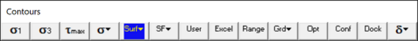
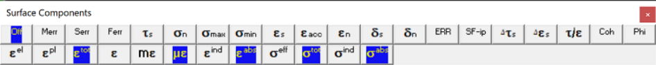
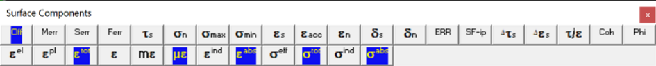
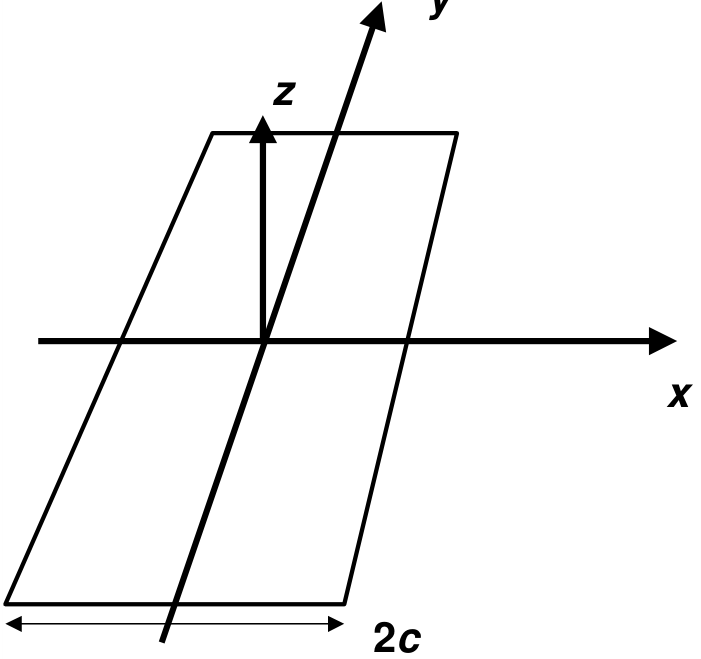
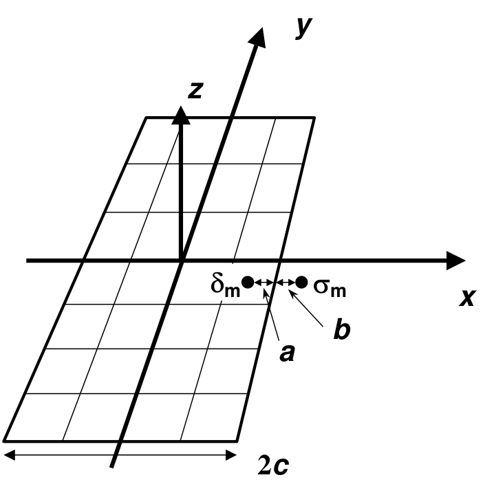
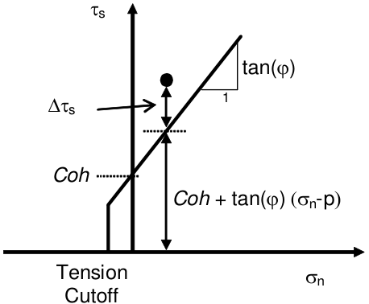

## 5.3.7.1 关闭表面等值线

关闭等值线。

可通过 Strength Factor Components 工具栏访问该分量，方法如下：

将该工具栏拖到主窗口的左边缘或右边缘，可将其改为垂直方向。

将其拖到主窗口的上边缘或下边缘，可恢复为水平方向。

选择 Contours 工具栏上的按钮可激活 Surface Components 工具栏。

## 5.3.7.2 Serr 应力误差

绘制表面应力误差的等值线。

可通过 Strength Factor Components 工具栏访问这些分量，方法如下：

将该工具栏拖到主窗口的左边缘或右边缘，可将其改为垂直方向。

将其拖到主窗口的上边缘或下边缘，可恢复为水平方向。

选择 Contours 工具栏上的按钮可激活 Surface Components 工具栏。

在矩阵求解期间，Map3D 会尝试逐步求解系数矩阵中保存的联立方程，以及描述替代材料区域、断层滑动、蠕变等的任何其他方程。迭代求解器的工作方式是确定每个联立方程当前解的误差（表面应力误差），然后通过逐次逼近的过程减小这些误差。

Stress Error 绘制所有表面上当前应力误差的等值线。

Maximum Stress Error 绘制出现最大应力误差的位置的等值线。

当最大表面应力误差和最大破坏准则误差降至用户指定的应力容差 STOL 以下时，即认为已获得收敛解

Analysis > CParams

#### Related Topics:

Plot > Surface Components > Ferr - Failure Error

Analysis Dialog

## 5.3.7.3 Ferr 破坏误差

绘制表面破坏准则误差的等值线。

可通过 Strength Factor Components 工具栏访问该分量，方法如下：

将该工具栏拖到主窗口的左边缘或右边缘，可将其改为垂直方向。

将其拖到主窗口的上边缘或下边缘，可恢复为水平方向。

选择 Contours 工具栏上的按钮可激活 Surface Components 工具栏。

在矩阵求解期间，Map3D 会尝试逐步求解系数矩阵中保存的联立方程，以及描述替代材料区域、断层滑动、蠕变等的任何其他方程。迭代求解器的工作方式是确定每个联立方程当前解的误差（表面应力误差），然后通过逐次逼近的过程减小这些误差。

当最大表面应力误差和最大破坏准则误差降至用户指定的应力容差 STOL 以下时，即认为已获得收敛解

Analysis > CParams

破坏准则误差仅用于非线性蠕变分析（包括断层滑动和 3D 材料非线性）。除非指定了某种黏性且问题变为非线性，否则该参数应始终接近零。在后一种情况下，黏性蠕变可能使应力状态超出破坏准则，表明缺乏静力平衡。

#### Related Topics:

Plot > Surface Components > Serr - Stress Error

Analysis > Options > Creep Analysis Dialog

## 5.3.7.4 剪应力

绘制表面平面内最大剪应力的等值线。可通过 Strength Factor Components 工具栏访问该分量，方法如下：

将该工具栏拖到主窗口的左边缘或右边缘，可将其改为垂直方向。

将其拖到主窗口的上边缘或下边缘，可恢复为水平方向。

选择 Contours 工具栏上的按钮可激活 Surface Components 工具栏。

在弹性分析中，最大面内剪应力通常与面内法向应力以及 Mohr-Coulomb 强度准则一起使用，以估算断层、节理组或层理面上因应力过大而产生的滑动量。

相比之下，在非线性分析中，除非使用了某种蠕变，否则最大面内剪应力永远不会超过强度。在后一种情况下，黏性蠕变可能使应力状态超出破坏准则，表明缺乏静力平衡。因此，对于非线性分析，通常直接考察模型预测的滑动量

Mohr-Coulomb in DD planes

Fault-Gouge in DD planes

Backfill-Hyperbolic in DD planes

等值线范围通过以下功能设置

Plot > Range

如有需要，可以将该分量添加到等值线工具栏

Tools > Configure Contouring Toolbar

#### Related Topics:

Plot > Surface Components > Sn Normal Stress Plot > Surface Components > dTs - Excess Shear Stress Plot > Surface Components > dEs - Incremental Shear Strain Plot > Surface Components > Es - Shear Strain Plot > Surface Components > ds - Shear Displacement (Ride)

## 5.3.7.5 法向应力

绘制垂直于表面的应力的等值线。

可通过 Strength Factor Components 工具栏访问该分量，方法如下：

将该工具栏拖到主窗口的左边缘或右边缘，可将其改为垂直方向。

将其拖到主窗口的上边缘或下边缘，可恢复为水平方向。

选择 Contours 工具栏上的按钮可激活 Surface Components 工具栏。

在弹性分析中，最大面内剪应力通常与面内法向应力以及 Mohr-Coulomb 强度准则一起使用，以估算断层、节理组或层理面上因应力过大而产生的滑动量。

相比之下，在非线性分析中，除非使用了某种蠕变，否则最大面内剪应力永远不会超过强度。在后一种情况下，黏性蠕变可能使应力状态超出破坏准则，表明缺乏静力平衡。因此，对于非线性分析，通常直接考察模型预测的滑动量

Mohr-Coulomb in DD planes

Fault-Gouge in DD planes

Backfill-Hyperbolic in DD planes

等值线范围通过以下功能设置

Plot > Range

如有需要，可以将该分量添加到等值线工具栏

Tools > Configure Contouring Toolbar

#### Related Topics:

Plot > Surface Components > Ts Shear Stress

Plot > Surface Components > dTs - Excess Shear Stress

Plot > Surface Components > dEs - Incremental Shear Strain

Plot > Surface Components > Es - Shear Strain

Plot > Surface Components > ds - Shear Displacement (Ride)

## 5.3.7.6 最大切向应力

绘制与表面相切的应力的等值线。可通过 Strength Factor Components 工具栏访问这些分量，方法如下：

将该工具栏拖到主窗口的左边缘或右边缘，可将其改为垂直方向。

将其拖到主窗口的上边缘或下边缘，可恢复为水平方向。

选择 Contours 工具栏上的按钮可激活 Surface Components 工具栏。

在弹性分析中，除非有要求，否则不计算切向应力。这是因为求解过程不需要它们，且会增加分析时间。勾选 Analysis > Options > Calculate Tangential Stress Components 即可请求此计算。

在塑性分析中，默认会计算这些值。

在弹性分析中，最大切向应力通常称为极限纤维应力。这有助于确定应力超过岩体无侧限抗压强度或抗拉强度的位置。

等值线范围通过以下功能设置

Plot > Range

如有需要，可以将该分量添加到等值线工具栏

Tools > Configure Contouring Toolbar

## 5.3.7.8 剪应变

绘制 DD 单元充填材料中产生的剪应变的等值线。可通过 Strength Factor Components 工具栏访问该分量，方法如下：

将该工具栏拖到主窗口的左边缘或右边缘，可将其改为垂直方向。

将其拖到主窗口的上边缘或下边缘，可恢复为水平方向。

选择 Contours 工具栏上的按钮可激活 Surface Components 工具栏。

剪应变由剪切位移（ride）除以 DD 平面厚度确定。

CAD > Edit > Entity Properties > DDplane Thickess

请注意，有三种应变分量可以绘制等值线：

Plot > Surface Components > Value > Elastic Plot > Surface Components > Value > Plastic Plot > Surface Components > Value > Total

应变也有两种不同的表示方式：

Plot > Strain > Value > Induced Strain Plot > Strain > Value > Absolute Strain

请注意，这是作用在 DD 表面上的剪应变的当前水平。

由于位移在滑动过程中可能改变方向甚至反向，累积的总剪应变可能给出不同的值。

等值线范围通过以下功能设置

Plot > Range

如有需要，可以将该分量添加到等值线工具栏

Tools > Configure Contouring Toolbar

#### Related Topics:

Plot > Surface Components > dEs - Incremental Shear Strain

Plot > Surface Components > ds - Shear Displacement (Ride)

## 5.3.7.10 法向应变

绘制 DD 单元充填材料中产生的法向应变的等值线。可通过 Strength Factor Components 工具栏访问该分量，方法如下：

将该工具栏拖到主窗口的左边缘或右边缘，可将其改为垂直方向。

将其拖到主窗口的上边缘或下边缘，可恢复为水平方向。

选择 Contours 工具栏上的按钮可激活 Surface Components 工具栏。

法向应变由法向位移（闭合量）除以 DD 平面厚度确定

#### CAD > Edit > Entity Properties > DDplane Thickess

请注意，有三种应变分量可以绘制等值线：

Plot > Surface Components > Value > Elastic Plot > Surface Components > Value > Plastic Plot > Surface Components > Value > Total

等值线范围通过以下功能设置

Plot > Range

如有需要，可以将该分量添加到等值线工具栏

Tools > Configure Contouring Toolbar

#### Related Topics:

Plot > Surface Components > dn - Normal Displacement (Closure)

## 5.3.7.11 剪切位移（Ride）

绘制 DD 单元上产生的 ride 即剪切位移的等值线。可通过 Strength Factor Components 工具栏访问该分量，方法如下：

将该工具栏拖到主窗口的左边缘或右边缘，可将其改为垂直方向。

将其拖到主窗口的上边缘或下边缘，可恢复为水平方向。

选择 Contours 工具栏上的按钮可激活 Surface Components 工具栏。

请注意，有三种剪切位移分量可以绘制等值线：

Plot > Surface Components > Value > Elastic Plot > Surface Components > Value > Plastic Plot > Surface Components > Value > Total

位移也有两种不同的表示方式：

Plot > Strain > Value > Induced Strain Plot > Strain > Value > Absolute Strain

等值线范围通过以下功能设置

Plot > Range

如有需要，可以将该分量添加到等值线工具栏

Tools > Configure Contouring Toolbar

#### Related Topics:

Plot > Surface Components > dEs - Incremental Shear Strain Plot > Surface Components > Es - Shear Strain

## 5.3.7.12 法向位移（闭合量）

绘制 DD 单元上产生的闭合量即法向位移的等值线。可通过 Strength Factor Components 工具栏访问该分量，方法如下：

将该工具栏拖到主窗口的左边缘或右边缘，可将其改为垂直方向。

将其拖到主窗口的上边缘或下边缘，可恢复为水平方向。

选择 Contours 工具栏上的按钮可激活 Surface Components 工具栏。

请注意，有三种闭合量分量可以绘制等值线：

Plot > Surface Components > Value > Elastic Plot > Surface Components > Value > Plastic Plot > Surface Components > Value > Total

等值线范围通过以下功能设置

Plot > Range

如有需要，可以将该分量添加到等值线工具栏

Tools > Configure Contouring Toolbar

#### Related Topics:

Plot > Surface Components > ds - Shear Displacement (Ride)

## 5.3.7.13 ERR

计算能量释放率。

可通过 Strength Factor Components 工具栏访问该分量，方法如下：

将该工具栏拖到主窗口的左边缘或右边缘，可将其改为垂直方向。

将其拖到主窗口的上边缘或下边缘，可恢复为水平方向。

选择 Contours 工具栏上的按钮可激活 Surface Components 工具栏。

此功能使用户能够计算采掘工作面前方的能量释放率（ _ERR_ ）。另一种方法可在任意所需位置计算 _ERR_ ：Analysis > Options > LERD/LSS

#### Crack-tip Formulation

考虑无限均质弹性介质中的一条平面裂纹。众所周知，在裂纹尖端附近，开度 d 在靠近端面处呈现 Ö _r_ 响应

而应力 s 呈现 1/Ö _r_ 响应

其中 _r_ 表示到裂纹尖端的距离。

对于端面的微小推进增量 a，通过将法向位移（闭合量）与应力在区域 a 上叠加，可以确定释放的总能量。这需要将 d 的坐标系偏移距离 a，从而得到

然后可由下式计算释放的总能量（积分范围为 0 到 a）

- _W_ = ½ ò s d _dr_

[4] = ½ _p_ d _p_ s ò Ö(a- _r_ )/Ö _r dr_ = ¼ p a _p_ d _p_ s

现在可以对 a 求导来确定能量释放率，得到

该表达式仅假设 d 在端面附近呈现 Ö _r_ 响应，且 s 在端面附近呈现 1/Ö _r_ 响应。没有对几何形状作任何假设。不要求 _p_ d 与 _p_ s 以任何方式相关。请注意，这些假设仅在无限均质弹性介质中成立。在双材料界面或其他采空区表面附近，这些假设不再成立。

#### Analytical Solution for a Planar Crack

考虑一条宽度为 2 _c_、长度为宽度八倍的平面裂纹。

对于这种形状，开度（法向位移或闭合量）可以解析地确定为（在中间截面处）

#### d = 4(1-n²)/ _E p_ Ö( _c_ ²- _x_ ²) [6]

其中 _E_ 和 n 分别表示杨氏模量（岩体尺度——变形模量）和泊松比，_p_ 表示开采前的均匀应力状态。裂纹尖端前方的应力也可以解析地确定为

使裂纹表面变形所做的功等于释放的总能量，可按如下方式确定（积分范围为 - _c_ 到 + _c_ ）

- _W_ = ½ ò _p_ d _dx_

[8] = 2p (1-n²) _p_ ²/ _E_ ò Ö( _c_ ²- _x_ ²) _dx_

- = p (1-n²) _p_ ² _c_ ²/ _E_

随着裂纹长度增加，单位裂纹扩展长度释放的能量可通过求导确定为

对于仅裂纹一端的扩展，能量释放率为该值的一半

_ERR_ = p (1-n²) _p_ ² _c_ / _E_ [10]

#### Comparison with Planar Crack Solution

现在比较平面裂纹几何与裂纹尖端公式，可以看到，对于平面裂纹（将公式 [1] 和 [2] 与 [6] 和 [7] 比较）

_p_ d = 4(1-n²)/ _E p_ Ö(2 _c_ ) [11] _p_ s = _p_ Ö(c/2) [12]

观察这些方程可知，在平面裂纹几何下，这两个参数可通过下式关联

_p_ d = 8(1-n²)/ _E p_ s [13]

将其代入 _ERR_ 的公式 [5]，得到

_ERR_ = p (1-n²) _p_ ² _c_ / _E_ [14]

与平面裂纹得到的结果（公式 [10]）相同。

对 _p_ d 和 _p_ s 作各种代换，可以得出

_ERR_ = 2p (1-n²) p _p_ s²/ _E_ [15] 和 _ERR_ = 1/32 p _p_ d² _E_ /(1-n²) [16]

后一个方程与 Ryder 和 Jager 推导的表达式相同（他们的公式 [11]，第 236 页，Rock Mechanics for Tabular Hard Rock Mines, 2002）。他们指出该方程用于 MINSIM 中计算 _ERR_。显然还实施了某种形式的 a 边修正（Ryder 和 Napier, Numerical Methods in Geomechanics, Nagoya, 1985），但具体如何实现的细节并不清楚。

#### _ERR_ Calculation in Map3D

_p_ d 和 _p_ s 都可以通过数值模拟确定。

例如，已知在推进工作面后方距离 _a_ 处确定的法向位移（闭合量）dm，可使用公式 [1] 确定 _p_ d 为

同样，已知在推进工作面前方距离 _b_ 处的应力 sm，可使用公式 [2] 确定 _p_ s 为

请注意，没有理由要求 _a_ 等于 _b_，因此不要求边界单元尺寸均匀。

一旦确定了 _p_ d 和 _p_ s 之一或二者，即可根据公式 [5]、[15] 或 [16] 方便地计算 _ERR_。

对裂纹尖端附近应力和位移分布的详细研究表明，对于常数 DD 单元，开度和应力都会被一致地高估。幸运的是，高估的程度与单元尺寸密切相关，发现如果将 _a_ 乘以 3/2、将 _b_ 乘以 2/3，可以获得精确得多的结果。利用这些代换，并使用公式 [17] 和 [18]，可由下式确定 _ERR_

- _ERR_ = 1/6 p dm sm Ö(2/3 _b)_ / Ö(3/2 _a)_

- = 1/6 p dm sm Ö( _b_ / _a)_ [19]

Map3D 中使用此公式计算 _ERR_。

#### An Example

当 _E_ 为 60000 MPa、n 为 0.25、_p_ 为 100 MPa、_c_ 为 100 m 时，我们计算得到 _p_ s 的理论值为 707.11，_p_ d 为 0.088388，_ERR_ 为 49.1 MN/m

可以在 Map3D 中使用宽度为 _w_ 的均匀单元对其建模，得到以下结果：

|_w_(m)|_b_=_a_(m)|sm (MPa)|dm (m)|_ERR _(MN/m)|error|
|---|---|---|---|---|---|
|50|25|197.567|0.5209|53.9|+9.8%|
|25|12.5|262.669|0.3754|51.6|+5.2%|
|12.5|6.25|358.943|0.2679|50.3|+2.5%|
|10|5|398.56|0.2402|50.1|+2.1%|
|6.25|3.125|498.323|0.1903|49.6|+1.0%|
|5|2.5|554.58|0.1705|49.5|+0.9%|
|3.125|1.5625|697.764|0.1349|49.3|+0.4%|

请注意，应力 sm 和法向位移（闭合量）dm 是在单元中心处确定的。由于使用了均匀的单元宽度，_a_ 等于 _b_，也等于 ½ _w_

## 5.3.7.14 SF-D 强度/应力

绘制 DD 单元上强度/应力比的等值线。可通过 Strength Factor Components 工具栏访问该分量，方法如下：

将该工具栏拖到主窗口的左边缘或右边缘，可将其改为垂直方向。

将其拖到主窗口的上边缘或下边缘，可恢复为水平方向。

选择 Contours 工具栏上的按钮可激活 Surface Components 工具栏。

在弹性分析中，最大面内剪应力通常与面内法向应力以及 Mohr-Coulomb 强度准则一起使用，以估算断层、节理组或层理面上因应力过大而产生的滑动量。

相比之下，在非线性分析中，除非使用了某种蠕变，否则最大面内剪应力永远不会超过强度。在后一种情况下，黏性蠕变可能使应力状态超出破坏准则，表明缺乏静力平衡。因此，对于非线性分析，通常直接考察模型预测的滑动量

Mohr-Coulomb in DD planes

Fault-Gouge in DD planes

Backfill-Hyperbolic in DD planes

#### Mohr-Coulomb

Strength/Stress   可确定为  [ Cohesion + (sn-p) tan(j) ] / ts

dTs   Excess Shear Stress  可确定为 Dts = ts - [ Cohesion + (sn-p) tan(j) ]

如果流体压力已指定为 Stress State 的一部分，则使用有效法向应力（sn-p）（这里 p 为流体压力）。

等值线范围通过以下功能设置

Plot > Range

如有需要，可以将该分量添加到等值线工具栏

Tools > Configure Contouring Toolbar

#### Related Topics:

Plot > Surface Components > dTs - Excess Shear Stress

## 5.3.7.15 剩余剪应力

绘制 DD 单元上剩余应力 Dts 的等值线。

可通过 Strength Factor Components 工具栏访问该分量，方法如下：

将该工具栏拖到主窗口的左边缘或右边缘，可将其改为垂直方向。

将其拖到主窗口的上边缘或下边缘，可恢复为水平方向。

选择 Contours 工具栏上的按钮可激活 Surface Components 工具栏。

此功能仅用于非线性分析（Map3D Non-Linear 中的 3D FF 块体和 Map3D Fault-Slip 中的 DD 平面）。详情请参阅

CAD > Properties > Material Properties

在每个蠕变步中，所有屈服单元（应力超过强度的单元）的应力状态按强度加蠕变阻力计算。这限制了每个屈服单元上塑性蠕变增量 Deplastic 的大小

- ts = Strength + _C_ Deplastic /D _t_

- _C_ = _G_ D _t_

其中蠕变阻力由蠕变系数 _C_ 乘以塑性应变率确定。请注意，用户必须同时选择蠕变系数 _C_ 和时间步长 D _t_，然后将二者之商指定为黏性模量 _G_ 。蠕变增量对应力 ts 的贡献即为剩余应力，由下式给出

Dts   = _C_ Deplastic /D _t_

累积塑性应变 eplastic 由所有蠕变步的塑性蠕变增量 Deplastic 之和确定。

#### Related Topics:

Plot > Surface Components > dEs - Incremental Shear Strain Plot > Surface Components > Ts - Shear Stress Plot > Surface Components > Es - Shear Strain

Analysis > Options > Creep

## 5.3.7.16 增量剪应变

绘制 DD 单元上塑性蠕变增量 Deplastic 的等值线。

可通过 Strength Factor Components 工具栏访问该分量，方法如下：

将该工具栏拖到主窗口的左边缘或右边缘，可将其改为垂直方向。

将其拖到主窗口的上边缘或下边缘，可恢复为水平方向。

选择 Contours 工具栏上的按钮可激活 Surface Components 工具栏。

此功能仅用于非线性分析（Map3D Non-Linear 中的 3D FF 块体和 Map3D Fault-Slip 中的 DD 平面）。详情请参阅

CAD > Properties > Material Properties

在每个蠕变步中，所有屈服单元（应力超过强度的单元）的应力状态按强度加蠕变阻力计算。这限制了每个屈服单元上塑性蠕变增量 Deplastic 的大小

- ts = Strength + _C_ Deplastic /D _t_

- _C_ = _G_ D _t_

其中蠕变阻力由蠕变系数 _C_ 乘以塑性应变率确定。请注意，用户必须同时选择蠕变系数 _C_ 和时间步长 D _t_，然后将二者之商指定为黏性模量 _G_ 。蠕变增量对应力 ts 的贡献即为剩余应力，由下式给出

Dts   = _C_ Deplastic /D _t_

累积塑性应变 eplastic 由所有蠕变步的塑性蠕变增量 Deplastic 之和确定。

请注意，由于用户必须选择时间步长 D _t_ 来定义黏性模量 _G_ ，剪应变率只需将增量剪应变 Deplastic 除以时间步长即可方便地得到。

#### Related Topics:

Plot > Surface Components > dTs - Excess Shear Stress

Plot > Surface Components > Ts - Shear Stress

Plot > Surface Components > Es - Shear Strain

Analysis > Options > Creep

## 5.3.7.17 应力/应变率

绘制 DD 单元上剩余应力除以塑性蠕变增量 Dts / Deplastic 的等值线。可通过 Strength Factor Components 工具栏访问该分量，方法如下：

将该工具栏拖到主窗口的左边缘或右边缘，可将其改为垂直方向。

将其拖到主窗口的上边缘或下边缘，可恢复为水平方向。

选择 Contours 工具栏上的按钮可激活 Surface Components 工具栏。

此功能仅用于非线性分析（Map3D Non-Linear 中的 3D FF 块体和 Map3D Fault-Slip 中的 DD 平面）。详情请参阅

CAD > Properties > Material Properties

在每个蠕变步中，所有屈服单元（应力超过强度的单元）的应力状态按强度加蠕变阻力计算。这限制了每个屈服单元上塑性蠕变增量 Deplastic 的大小

- ts = Strength + _C_ Deplastic /D _t_

- _C_ = _G_ D _t_

其中蠕变阻力由蠕变系数 _C_ 乘以塑性应变率确定。请注意，用户必须同时选择蠕变系数 _C_ 和时间步长 D _t_，然后将二者之商指定为黏性模量 _G_ 。蠕变增量对应力 ts 的贡献即为剩余应力，由下式给出

Dts   = _C_ Deplastic /D _t_

累积塑性应变 eplastic 由所有蠕变步的塑性蠕变增量 Deplastic 之和确定。

#### Related Topics:

Plot > Surface Components > dTs - Excess Shear Stress Plot > Surface Components > dEs - Incremental Shear Strain Plot > Surface Components > Ts - Shear Stress Plot > Surface Components > Es - Shear Strain

#### Analysis > Options > Creep

## 5.3.7.18 黏聚力

绘制断层泥（gouge）材料的黏聚力和摩擦角的等值线。可通过 Strength Factor Components 工具栏访问这些分量，方法如下：

将该工具栏拖到主窗口的左边缘或右边缘，可将其改为垂直方向。

将其拖到主窗口的上边缘或下边缘，可恢复为水平方向。

选择 Contours 工具栏上的按钮可激活 Surface Components 工具栏。

使用 Equilibrated-Gouge 材料类型时，这一点尤其值得关注，因为黏聚力和摩擦角可能因位置而异。

## 5.3.7.20 温度/水头

绘制温度或水头的等值线。

Map3D Thermal-Fluid Flow 可用于同时求解与应力分析耦合的稳态热/流体流动。该程序的设置使得用户只需指定温度/水头边界条件，耦合的热/流体流动应力问题即可同时求解。此功能适用于模拟加热或冷却效应以及土体的排水或不排水响应。

详情请参阅

#### Expansion Coefficient and Conductivity

等值线范围通过以下功能设置

Plot > Range

如有需要，可以将该分量添加到等值线工具栏

Tools > Configure Contouring Toolbar

## 5.3.7.21 法向通量

绘制垂直于表面的流量的等值线。

Map3D Thermal-Fluid Flow 可用于同时求解与应力分析耦合的稳态热/流体流动。该程序的设置使得用户只需指定温度/水头边界条件，耦合的热/流体流动应力问题即可同时求解。此功能适用于模拟加热或冷却效应以及土体的排水或不排水响应。

详情请参阅

Expansion Coefficient and Conductivity

等值线范围通过以下功能设置

Plot > Range

如有需要，可以将该分量添加到等值线工具栏

Tools > Configure Contouring Toolbar

## 5.3.7.22 数值

5.3.7.22.1  弹性应变

选择弹性、塑性或总应变分量。可通过 Strain Components 工具栏访问这些分量，方法如下：

将该工具栏拖到主窗口的左边缘或右边缘，可将其改为垂直方向。

将其拖到主窗口的上边缘或下边缘，可恢复为水平方向。

选择 Contours 工具栏上的按钮可激活 Stress Components 工具栏。

您可以使用配置按钮将此按钮添加到 Contours 工具栏。

详情请参阅

Mohr-Coulomb in 3D FF blocks.

### 5.3.7.22.4 绝对应变

绘制诱发应变或绝对应变分量。

可通过 Strain Components 工具栏访问该分量，方法如下：

将该工具栏拖到主窗口的左边缘或右边缘，可将其改为垂直方向。

将其拖到主窗口的上边缘或下边缘，可恢复为水平方向。

选择 Contours 工具栏上的按钮可激活 Stress Components 工具栏。

您可以使用配置按钮将此按钮添加到 Contours 工具栏。

诱发应变是不含开采前应变贡献的应变，表示相对于开采前状态的应变变化。

绝对应变是包含开采前应变贡献的应变。

另请参阅：

Plot > Stress > Value > Induced Strain Plot > Stress > Value > Absolute Strain

### 5.3.7.22.6 诱发应力

绘制诱发应力或绝对应力分量。可通过 Stress Components 工具栏访问这些分量，方法如下：

将该工具栏拖到主窗口的左边缘或右边缘，可将其改为垂直方向。

将其拖到主窗口的上边缘或下边缘，可恢复为水平方向。

选择 Contours 工具栏上的按钮可激活 Stress Components 工具栏。

诱发应力是不含开采前应力贡献的应力，表示相对于开采前状态的应力变化。

绝对应力是包含开采前应力贡献的应力。

另请参阅：

Plot > Strain > Value > Induced Strain

Plot > Strain > Value > Absolute Strain
