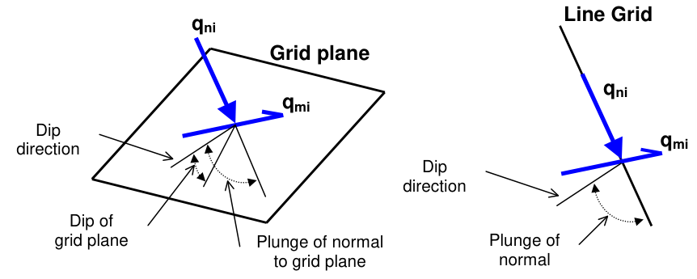
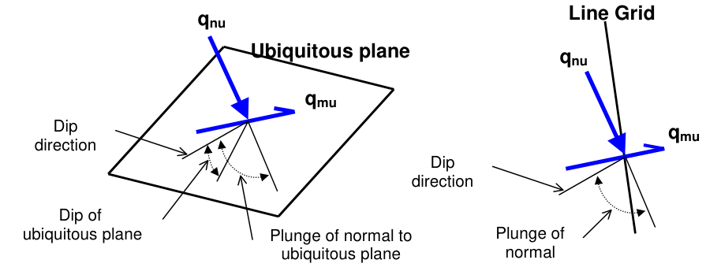

## 5.3.5.1 Plot > Thermal/Flux

激活 Thermal/Flux 工具栏——在完成 Map3D 热-流体流动 BEM 分析之后使用。

热/流量分析的参数在 Expansion Coefficient 和 Conductivity 中说明。

该工具栏用于快速访问热/流量分量。

Plot > Flux > t/h   温度/水头

Plot > Flux > qtotal = ( qx² + qy² + qz² )½ 总流量   绘制总流量的等值线

Plot > Flux > qx X 向流量   绘制 x 向流量分量的等值线

Plot > Flux > qy Y 向流量   绘制 y 向流量分量的等值线

Plot > Flux > qz Z 向流量   绘制 z 向流量分量的等值线

为计算面内流量，网格平面上每个点的流量状态都会被重新定向，以确定平行于网格平面的最大流量和垂直于该平面的流量。请注意，qni 垂直于网格平面，并平行于线网格的方向。

Plot > Flux > qni 面内法向   绘制垂直于网格平面的流量分量的等值线。

Plot > Flux > qmi 面内最大值   绘制与网格平面相切的最大流量的等值线。

为计算遍布平面 #1 的流量，网格平面上每个点的流量状态都会被重新定向，以确定平行于遍布平面 #1 的最大流量和垂直于该平面的流量。请注意，dmi 并不垂直于网格平面。

Plot > Flux > qnu 遍布平面法向   绘制垂直于遍布平面的流量分量的等值线。

Plot > Flux > qmu 遍布平面最大值   绘制与遍布平面相切的最大流量的等值线。

- 倾向自 y 轴起顺时针方向为正。

- 平面的倾角自水平面起向下为正（即沿倾向方向）。

- 法线的俯角自水平面起向下为正（即向上为负）。

#### 注意：

只有在模型构建（CAD）阶段之后才能激活流量工具栏

#### Map3D 分析阶段。

遍布剪切面的方向通过以下功能设置

Plot > Strength Factors > Ubiquitous Parameters

等值线范围通过以下功能设置

#### Plot > Range

如有需要，可以将该分量添加到等值线工具栏

Tools > Configure Contouring Toolbar > Displacement

您可以将

#### More Flow Components

按钮添加到等值线工具栏，以便快速访问所有流动分量。
