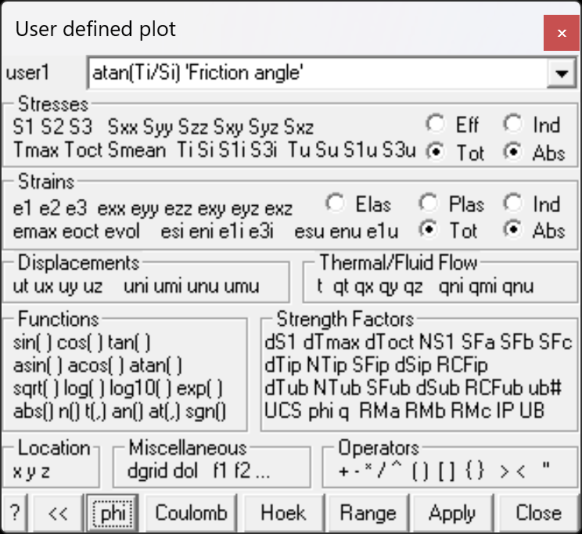

绘制用户自定义应力分量的等值线。

#### Stresses:

- S1 S2 S3 主应力分量 s1 s2 s3

- Sxx Syy Szz Sxy Syz Sxz 笛卡尔应力分量 sxx syy szz txy tyz tzx

- Tmax 最大剪应力 ½(s1 - s3)

- Toct 八面体剪应力 toct = ¹/3 [(s1 - s2)² + (s2 - s3)² +(s3 - s1)²]½

- Smean 平均应力 smean = ¹/3 (s1 + s2 + s3)

- Ti Si 网格平面内的最大剪应力和法向应力 tip sip

- S1i S3i 与网格平面相切的最大和最小应力 s1i s3i

- Tu Su 遍布平面内的最大剪应力和法向应力 tub sub。遍布剪切面的方向通过以下功能设置

- S1u S3u 与遍布平面相切的最大和最小应力 s1u s3u \]

- Effective/Total 有效应力或总应力分量。这些选项仅用于 Map3D Thermal-Fluid Flow，因为该程序可以计算稳态孔隙压力分布。

- Induced/Absolute 诱发应力或绝对应力分量（即不含开采前应力贡献的应力）。

#### Strains:

- e1 e2 e3 最大主应变 e1 e2 e3

- exx eyy ezz exy eyz exz 笛卡尔应变分量 exx eyy ezz exy eyz ezx

- emax 最大剪应变 ½(e1 - e3)

- eoct 八面体剪应变 eoct = ¹/3 [(e1 - e2)² + (e2 - e3)² +(e3 - e1)²]½

- evol 体积应变 evol = (e1 + e2 + e3)

- esi eni 网格平面内的最大剪应变和法向应变 esi eni

- e1i e3i 与网格平面相切的最大和最小应变 e1i e3i

- esu enu 遍布平面内的最大剪应变和法向应变 esu enu

- e1u e3u 与遍布平面相切的最大和最小应变 e1u e3u

- Elastic/Plastic/Total 弹性、塑性或总应变分量。这些选项仅用于 Map3D Non-Linear，因为该程序可以计算非线性应变。

- Induced/Absolute 诱发应变或绝对应变分量（即不含开采前应力贡献的应变）。

#### Displacements:

- ut 总位移、其走向和倾伏角 dt

- · ux uy uz 笛卡尔位移分量 dx dy dz

- uni 垂直于网格平面的位移 dni

- umi 与网格平面相切的最大位移 dmi

- unu 垂直于遍布平面的位移 dnu

- umu 与遍布平面相切的最大位移 dmu

#### Thermal/Fluid Flow:

- t 温度/水头

- qt 总流量、其走向和倾伏角。

- qx qy qz 笛卡尔流量分量。

- qni 垂直于网格平面的位移。

- qmi 与网格平面相切的最大位移。

- qnu 垂直于遍布平面的位移。

- qmu 与遍布平面相切的最大位移。

#### Functions:

- sin() cos() tan()   正弦、余弦和正切三角函数。

- asin() acos() atan()   反三角函数。

- sqrt()   平方根函数。

- log()   自然对数函数。

- log10()   以 10 为底的对数函数。

- exp()   指数函数（反对数）。

- abs()   绝对值。

- n() an()   正态分布和反正态概率分布。正态分布使用的参数为 (Ds1/ _s_ )，表示剩余最大主应力除以标准差（参见 ）。

- t(,) at(,)   t 分布和反 t 概率分布。t 分布使用的参数为 (Ds1/ ( _sg),n_ -2)，其中 Ds1 表示剩余最大主应力，_s_ 表示标准差，_n_ 表示数据点个数，_g_ 表示系数 [1 + 1/ _n_ + (s3 - sm) ²/s3²/( _n_ -1)]½，其中 sm 表示 s3 的平均值，s3 表示 s3 的标准差。

- sgn()   符号函数：正值返回 +1，负值返回 -1，绝对值小于 10-12 的值返回 0。

#### Strength:

- ds1 剩余最大主应力 Ds1 = s1 - ( _UCS_ + _q_ s3 )

- dtmax 剩余最大剪应力 Dtmax = ½(s1 - s3) - [ _UCS_ + ½(s1+s3) ( _q_ -1) ]/( _q_ +1) = [s1 - ( _UCS_ + _q_ s3) ]/( _q_ +1)

- dtoct 剩余八面体剪应力 Dtoct = toct - [ _UCS_ + ( _q_ –1) smean ] Ö(2) /( _q_ +2)

- NS1 使用正态分布 N(Ds1 /std) 的概率

- SFA 强度/应力，对于 Mohr-Coulomb 可确定为 ( _UCS_ + _q_ s3 )/ s1

- 对于 Hoek-Brown 则为 [ s3 + Ö( _m_ scs3 + _s_ sc²) ] / s1

- SFB 强度/应力，对于 Mohr-Coulomb 可确定为 ( _UCS_ + _q_ s3 - s3 )/(s1 - s3)，对于 Hoek-Brown 则为 [ s3 + Ö( _m_ scs3 + _s_ sc²) ] / (s1 - s3)

- SFC 强度/应力，对于 Mohr-Coulomb 可确定为 [ _UCS_ + ½(s1+s3) ( _q_ -1) ]/[ ½(s1 - s3)( _q_ +1) ]

对于 Hoek-Brown 则为 &#123;Ö[1 /16 _m_ ²sc² + ½(s1 + s3) _m_ sc + _s_ sc²] - ¼ _m_ sc&#125;/(s1 - s3)

- dTip 剩余面内剪应力 Dtip = tip - [ Cohesion + sip tan(j) ]

- NTip 使用正态分布 N(Dtip /std) 的概率

- SFip 强度/应力可确定为 [ Cohesion + sip tan(j) ] / tip

- dSip 剩余面内壁面应力 Dsip = [ 3 s1i - s3i ] - UCS

- RCFip 面内壁面应力的岩石状态系数（Rock Condition Factor）RCFip = [ 3 s1i - s3i ]/UCS

- dTub 剩余遍布平面剪应力 Dtub

- NTub 使用正态分布 N(Dtub /std) 的概率

- SFub 强度/应力可确定为 [ Cohesion + sub tan(j) ] / tub

- dSub 剩余 ub 平面壁面应力 Dsub = [ 3 s1ub - s3ub ] - UCS

- RCFub ub 平面壁面应力的岩石状态系数 RCFip = [ 3 s1ub - s3ub ]/UCS

- UB# 绘制 Dtub 值最大的 UB 组编号（1、2 或 3）

- _UCS phi q_ 使用 Plot > Strength Factors > Rockmass Strength Parameters 定义的 Mohr-Coulomb 强度参数；请注意，只有在指定了 Mohr-Coulomb 或 Drucker-Prager 强度准则时，这些参数才有定义

- _RMa_ 岩体强度，对于 Mohr-Coulomb 定义为 ( _UCS_ + _q_ s3 )

对于 Hoek-Brown 则为 [ s3 + Ö( _m_ scs3 + _s_ sc²) ]

- _RMb_ 岩体强度，对于 Mohr-Coulomb 定义为 ( _UCS_ + _q_ s3 - s3 )

- 对于 Hoek-Brown 则为 [ Ö( _m_ scs3 + _s_ sc²) ]

- _RMc_ 岩体强度，对于 Mohr-Coulomb 定义为 [ _UCS_ + ½(s1+s3) ( _q_ -1) ]/( _q_ +1)，对于 Hoek-Brown 则为 &#123;Ö[1 /16 _m_ ²sc² + ½(s1 + s3) _m_ sc + _s_ sc²] - ¼ _m_ sc&#125;/2

- _IP_ 面内强度，使用 Mohr-Coulomb 定义为 [ Cohesion + sip tan(j) ]

- _UB_ 遍布强度，使用 Mohr-Coulomb 定义为 [ Cohesion + sub tan(j) ]

- _sc_ 使用 Plot > Strength Factors > Rockmass Strength Parameters 定义的 Hoek-Brown 强度参数；请注意，只有在指定了 Hoek-Brown 强度准则时，该参数才有定义

#### Location:

- x y z   网格点坐标。

#### Miscellaneous:

- Dgrid 每个网格点到最近表面的距离。

- Dol 到最近网格的距离 _Dgrid_ 除以网格间距 _Lgrid_ 。

- f1 f2... 用户自定义的材料参数。可以通过 Plot > Properties > Material Properties > User defined Parameters 定义。

#### Operators:

- + - * / ^   加、减、乘、除和乘方运算符。请注意，先计算乘方，然后计算乘法和除法，最后计算加法和减法。

- () [] &#123;&#125;   括号类型。括号必须成对匹配。

- >   最大值。例如，如果绘图方程指定为 s1 > 10，则将绘制 s1 和 10 中较大的值。

- &lt;   最小值。例如，如果绘图方程指定为 s1 &lt; 10，则将绘制 s1 和 10 中较小的值。

- " "   注释。

#### Other:

- phi:   atan(Ti/Si) 绘制抵抗断层、节理组或层理面（其方向与网格平面相同）上滑动所需的摩擦角。

- Mohr-Coulomb:   60 + S3*tan(45+30/2)^2   绘制 UCS 为 60、摩擦角为 30° 的 Mohr-Coulomb 准则的强度。如果之前已使用 Plot > Strength Factors > Rockmass Strength Parameters 定义了强度参数，这里也可以使用方程 _UCS_ + S3* _q_ 或 _UCS_ +S3*tan(45+ _phi_ /2)^2。

- Hoek:     S3 + sqrt( 0.1*60*S3 + 0.005*60^2 )   绘制 sc 为 60、m 为 0.1、s 为 0.005 的 Hoek-Brown 准则的强度。

- Range – 设置等值线范围。

- Plot – 重新生成等值线图。

下拉窗口最多可存储 20 个不同的方程。这些方程会在 Map3D 各次会话之间保存在 map3d.ini 文件中。
