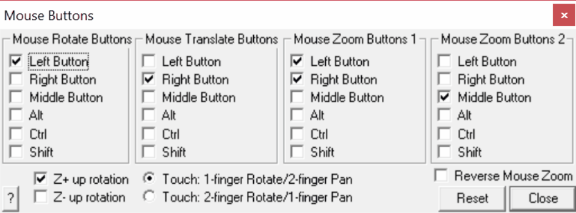

## 5.6.1.1 鼠标按键

用于自定义鼠标的旋转、平移和缩放功能。

请注意，每项功能最多可指定两个按键。这些按键设置会在各次会话之间保留。

Z+ up rotation：指定 Z+ 轴被约束为竖直方向，当 Z+ 轴朝上时，向左拖动鼠标会使模型向左旋转。

Z- up rotation：与上述假设相反。此时同样指定 Z+ 轴被约束为竖直方向，但当 Z+ 轴朝上时，向左拖动鼠标会使模型向右旋转。

Touch: 1-finger Rotate/2-finger Pan：触摸屏控制设为单指拖动旋转模型、双指拖动平移模型。

Touch: 2-finger Rotate/1-finger Pan：触摸屏控制设为双指拖动旋转模型、单指拖动平移模型。

Touch Zoom：双指捏合缩放模型。

Reverse Mouse Wheel：反转鼠标滚轮的作用，使向前滚动时放大模型而不是缩小。

## 5.6.1.2 双击时间

指定双击中两次单击之间的时间（毫秒）。

双击用于激活编辑功能

CAD > Edit

## 5.6.1.3 拖动等待时间

指定在拖动鼠标指针出现之前需要按住鼠标按键的时间（毫秒）。

拖动鼠标指针用于旋转、平移和缩放模型。
