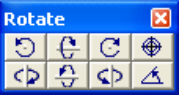
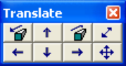
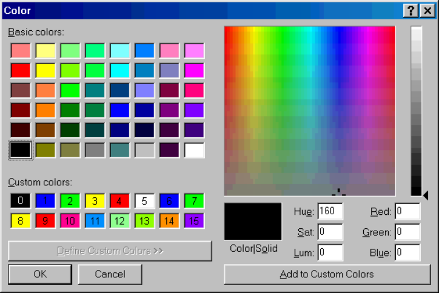

## 5.6.2.1 旋转工具栏

激活旋转工具栏。

可以使用这些按钮，或将方向图标拖到所需位置来旋转模型。

Rotate Counter clockwise（Insert 键）

Rotate Up（Home 键或 shift+向上箭头）

Rotate Clockwise（Page Up 键）

Rotate Left（Delete 键或 shift+向左箭头）

Rotate Down（End 键或 shift+向下箭头）

Rotate Right（Page Down 键或 shift+向右箭头）

View > Centre of Rotation

View > Rotation Increment

注意：

如果旋转工具栏不可见，可以通过以下方式激活

Tools > Rotation Toolbar

旋转模型之前，应设置所需的旋转中心

View > Centre of Rotation

## 5.6.2.2 平移工具栏

激活平移工具栏。

可以使用这些按钮，或将模型拖到所需位置来平移模型。

Zoom In（Enter 键或 "+" 键） Translate Up（向上箭头） Zoom Out（Ctrl+Enter 或 "-" 键） Translate Left（向左箭头） Translate Down（向下箭头） Translate Right（向右箭头） View > Zoom Factor

View > Translation Increment

注意：

如果平移工具栏不可见，可以通过以下方式激活

Tools > Translation Toolbar

放大之前

Zoom In

应设置所需的旋转中心

View > Centre of Rotation

## 5.6.2.3 等值线工具栏

激活等值线工具栏——在完成 Map3D BEM 分析之后使用。

该工具栏的默认配置如下：

该工具栏用于快速访问常用的应力参数。

Plot > Stress > S1 Major Principal Stress

Plot > Stress > S3 Minor Principal Stress

Plot > Stress > Tmax Maximum Shear Stress

Plot > Stress 激活应力工具栏。该工具栏包含所有应力分量。

Plot > Surface Components 激活表面工具栏。该工具栏包含所有表面分量。

Plot > Strength Factors 激活强度系数工具栏。该工具栏包含所有强度参数分量。

Plot > Stress > User 用户自定义应力绘图。

Plot > Range 指定当前绘制等值线的范围（最小值、最大值、间隔……）。

Plot > Grid Selection 激活网格选择工具栏。

Plot > Surface Components > Options 指定等值线绘图选项（轨迹、等值线……）。

Tools > Contouring Toolbar Configure 在等值线工具栏中添加或删除按钮。

注意：

只需按住鼠标左键并将按钮拖到所需位置，即可在工具栏上移动按钮。

只有在模型构建（CAD）阶段之后才能激活等值线工具栏

Map3D 分析阶段。

## 5.6.2.4 配置等值线工具栏

在等值线工具栏中添加或删除按钮。

只需选中或取消选中所需项目，即可将其添加到工具栏或从工具栏中删除。

注意：

只有在以下功能之后才能激活等值线工具栏

#### Tools > Contouring toolbar

模型构建（CAD）阶段之后

Map3D 分析阶段。

只需按住鼠标左键并将按钮拖到所需位置，即可在工具栏上移动按钮。

工具栏配置会在各次分析之间保存在 map3d.ini 文件中。

## 5.6.2.5 求解工具栏

激活求解工具栏——在 Map3D BEM 分析期间使用。

该工具栏的默认配置如下：

该工具栏用于快速访问 Map3D BEM 分析求解阶段中的重要参数

#### Analysis > BEM Analysis

Plot > Surface Components > Serr Stress Error Plot > Surface Components > Ferr Failure Error Plot > Surface Components > Shear Stress Plot > Surface Components > Normal Stress Plot > Surface Components > Shear Displacement (Ride)

Plot > Surface Components 激活包含所有表面分量的表面工具栏。Plot > Range 指定当前绘制等值线的范围（最小值、最大值、间隔……）。

Plot > Surface Components > Options 指定等值线绘图选项（轨迹、等值线……）。

Tools > Solve Toolbar Configure 在求解工具栏中添加或删除按钮。

注意：

分析期间，当您暂停分析时会显示求解工具栏

#### Analysis > Suspend。

如果未选中此选项，则在暂停 Map3D BEM 分析时不会激活求解工具栏。

只需按住鼠标左键并将按钮拖到所需位置，即可在工具栏上移动按钮。

只有在模型构建（CAD）阶段之后才能激活求解工具栏

#### Map3D 分析阶段。

相关主题：

Analysis > Auto Plot。

Analysis > Auto Range。

## 5.6.2.6 配置求解工具栏

在求解工具栏中添加或删除按钮。

只需选中或取消选中所需项目，即可将其添加到工具栏或从工具栏中删除。

注意：

只有在以下功能之后才能激活求解工具栏

#### Tools > Solve toolbar

模型构建（CAD）阶段之后

#### Map3D 分析阶段

分析期间，当您暂停分析时会显示求解工具栏

#### Analysis > Suspend

只需按住鼠标左键并将按钮拖到所需位置，即可在工具栏上移动按钮。

工具栏配置会在各次分析之间保存在 map3d.ini 文件中。

## 5.6.2.7 视图工具栏

激活视图工具栏。

该工具栏的默认配置如下

该工具栏提供对各种查看功能的快速访问。

View > Centre of Rotation   设置旋转中心。在旋转和缩放显示时该点保持不动。

View > Zoom   激活图形缩放窗口。系统会提示您分别单击选择窗口的两个角点。

View > Pan   激活图形平移。系统会提示您分别单击选择平移矢量的两个端点。

View > Length   激活图形长度测量工具。系统会提示您分别单击选择长度矢量的两个端点。这些点必须选在模型或等值线上。程序会报告所选矢量的长度、倾角和倾向。如果在选择点时按住 Shift 键，可以定义由多段组成的线并得到总长度。如果在等值线图上定义闭合多边形（选择点时按住 Shift 键），将报告多边形内的平均等值线值（参见 Plot > Polygon Box）。按住 Shift 键并拖出窗口，可以定义简单的矩形窗口。

View > Hide 激活隐藏工具栏。

View > Hide Block Colours 激活隐藏块体颜色工具栏。

View > Hide CLine Colours 激活隐藏构造线颜色工具栏。

File > Mining Step 激活开采步骤选择工具栏。

Tools > View Toolbar Configure 在视图工具栏中添加或删除按钮。

注意：

只需按住鼠标左键并将按钮拖到所需位置，即可在工具栏上移动按钮。

## 5.6.2.8 配置视图工具栏

在视图工具栏中添加或删除按钮。

只需选中或取消选中所需项目，即可将其添加到工具栏或从工具栏中删除。

注意：

只需按住鼠标左键并将按钮拖到所需位置，即可在工具栏上移动按钮。

工具栏配置会在各次分析之间保存在 map3d.ini 文件中。

## 5.6.2.9 CAD 工具栏

激活 CAD 工具栏。

该工具栏的默认配置如下：

该工具栏用于快速访问 Map3D BEM 分析中模型构建与编辑阶段所用的 CAD 功能

#### Analysis > Go to CAD

CAD > Build 激活用于构建新模型实体的构建工具栏。

CAD > Snap 激活用于设置捕捉模式的捕捉（snap）工具栏。CAD > Edit 激活用于修改模型实体的编辑工具栏。CAD > Grid Selection 激活用于显示网格的网格选择工具栏。Tools > CAD Toolbar > Configure 添加或删除按钮。

注意：

CAD 工具栏仅在分析的模型构建与编辑阶段显示

#### Analysis > Go to CAD

如果未选中此选项，则在模型构建与编辑阶段不会激活 CAD 工具栏。

只需按住鼠标左键并将按钮拖到所需位置，即可在工具栏上移动按钮。

相关主题：

Map3D Analysis Stages

## 5.6.2.10 配置 CAD 工具栏

在 CAD 工具栏中添加或删除按钮。

只需选中或取消选中所需项目，即可将其添加到工具栏或从工具栏中删除。

注意：

只有在以下功能期间才能激活 CAD 工具栏

#### Tools > CAD toolbar

模型构建（CAD）阶段

#### Map3D 分析阶段

只需按住鼠标左键并将按钮拖到所需位置，即可在工具栏上移动按钮。

工具栏配置会在各次分析之间保存在 map3d.ini 文件中。

## 5.6.2.11 块体颜色

为块体渲染指定自定义颜色。

Map3D 使用 16 种基本颜色进行渲染。

用户可以为基本颜色指定任意所需的颜色，Map3D 会自动生成这些颜色的明暗色调用于渲染。

这些颜色的用途如下：

- Colour 0 - 屏幕背景色。

- Colour 1-4 – 橡皮筋框和标记的颜色。

- Colour 5 – 前景色，用于文本、块体轮廓、轨迹符号和网格线。

- Colour 6 – 块体颜色编号 1、11、21、31 ……

- Colour 7 - 块体颜色编号 2、12、22、32 ……

- Colour 8 - 块体颜色编号 3、13、23、33 ……

- Colour 9 - 块体颜色编号 4、14、24、34 ……

- Colour 10 - 块体颜色编号 5、15、25、35 ……

- Colour 11 - 块体颜色编号 6、16、26、36 ……

- Colour 12 - 块体颜色编号 7、17、27、37 ……

- Colour 13 - 块体颜色编号 8、18、28、38 ……

- Colour 14 - 块体颜色编号 9、19、29、39 ……

- Colour 15 - 块体颜色编号 10、20、30、40 ……

重新指定颜色分三个步骤：

1. 从某个 "Custom Colors:" 中选取要重新定义的颜色。

2. 通过从 "Basic Colors:" 或 "Color Matrix" 中选取，或设置 "Hue: Sat: Lum: Red: Green: Blue:"，来设定所需的新颜色。

3. 按下 "Add to Custom Colors" 按钮。

选择以下功能可将所有颜色恢复为 Map3D 的原始默认值

#### Tools > Set Default Block Colours

自定义颜色会在各次分析之间保存在 map3d.ini 文件中。

## 5.6.2.12 等值线颜色

为等值线渲染指定自定义颜色。

Map3D 使用 16 种基本颜色绘制等值线。

这些颜色的用途如下：

- Colour 0 - 屏幕背景色。

- Colour 1 – 低于范围的等值线颜色。

- Colour 2 至 11 – 等值线颜色。

- Colour 12 高于范围的等值线颜色。

- Colour 13 – 拉伸截断颜色。

- Colour 15 – 前景色，用于文本、块体轮廓、轨迹符号和网格线。

重新指定颜色分三个步骤：

1. 从某个 "Custom Colors:" 中选取要重新定义的颜色。

2. 通过从 "Basic Colors:" 或 "Color Matrix" 中选取，或设置 "Hue: Sat: Lum: Red: Green: Blue:"，来设定所需的新颜色。

3. 按下 "Add to Custom Colors" 按钮。

自定义颜色会在各次分析之间保存在 map3d.ini 文件中。

选择以下功能可将等值线颜色设为 Map3D 默认值

Tools > Set Contour Colours

## 5.6.2.13 设置默认块体颜色

将所有颜色恢复为 Map3D 的原始默认值。

可以使用以下功能设置自定义颜色

Tools > Custom Colours

## 5.6.2.14 设置等值线颜色 1

将所有颜色恢复为 Map3D 的原始默认值。

可以使用以下功能设置自定义颜色

#### Tools > Contour Colours

## 5.6.2.18 配置按钮字体

为按钮指定自定义字体、大小、颜色等。

Map3D 使用 "Windows System Font" 绘制所有按钮。

用户可以重新定义该字体及其显示特性。

选择以下功能可将字体恢复为 Map3D 的原始默认值

#### Tools > Reset Default Font

自定义字体会在各次分析之间保存在 map3d.ini 文件中。

## 5.6.2.19 重置默认字体

将按钮字体恢复为 Map3D 的原始默认值。

可以使用以下功能设置自定义字体

Tools > Configure Button Font

## 5.6.2.20 小尺寸按钮

允许您设置工具栏按钮的大小。
