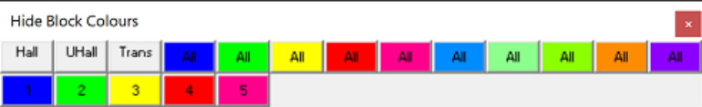

## 5.2.2.1 全部隐藏

用于隐藏所选颜色编号的所有块体。

将视图工具栏拖到主窗口的左边缘或右边缘，即可将其改为竖直方向。

将其拖到主窗口的上边缘或下边缘，即可改回水平方向。

选择视图工具栏上的按钮即可激活 Hide Block Colours 工具栏。

View > Hide Block Colours > Hide All   隐藏所有块体表面。

View > Hide Block Colours > Unhide All   显示所有当前隐藏的表面。

第一行用于隐藏和显示相应颜色的所有块体。

其余按钮标有相应的块体颜色编号，用于隐藏这些块体。与每个颜色编号相关联的块体名称会显示在工具提示和菜单列表中。

请注意，该工具栏可以滚动并调整大小。

要调整大小，只需抓住任意边缘或角并拖动到所需的大小和形状。只有当按钮过多、当前大小和形状无法全部显示时，才会出现滚动条。
