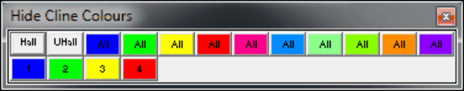

## 5.2.4.1 全部隐藏

用于隐藏所选颜色的所有构造线。

将此工具栏拖到主窗口的左边缘或右边缘，即可将其改为竖直方向。

将其拖到主窗口的上边缘或下边缘，即可改回水平方向。

选择视图工具栏上的按钮即可激活 Hide Cline Colours 工具栏。

View > Hide Cline Colours > Hide All   隐藏所有构造线。

View > Hide Cline Colours > Unhide All   显示所有当前隐藏的构造线。

第一行用于隐藏和显示相应颜色的所有构造线。

其余按钮标有相应的构造线颜色编号，用于隐藏这些构造线。

请注意，该工具栏可以滚动并调整大小。

要调整大小，只需抓住任意边缘或角并拖动到所需的大小和形状。只有当按钮过多、当前大小和形状无法全部显示时，才会出现滚动条。
