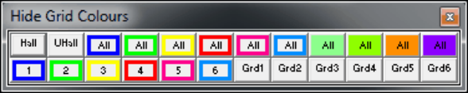

## 5.2.5.1 全部隐藏

用于隐藏所选颜色的所有网格。

将此工具栏拖到主窗口的左边缘或右边缘，即可将其改为竖直方向。

将其拖到主窗口的上边缘或下边缘，即可改回水平方向。

选择该按钮即可激活 Hide Grid Colours 工具栏。

View > Hide Grid Colours > Hide All   隐藏所有网格。

View > Hide Grid Colours > Unhide All   显示所有当前隐藏的网格。

第一行用于隐藏和显示相应颜色的所有网格。

标有相应网格颜色编号的按钮用于隐藏这些网格。与每个颜色编号相关联的网格名称会显示在工具提示和菜单列表中。

其余按钮的作用与 Grid Selection 中相同，用于隐藏单个网格。

请注意，该工具栏可以滚动并调整大小。

要调整大小，只需抓住任意边缘或角并拖动到所需的大小和形状。只有当按钮过多、当前大小和形状无法全部显示时，才会出现滚动条。
