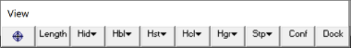
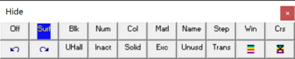

- **5.2.1.1** **Off**

这些工具可方便地隐藏几何体的各个部分。

选择视图工具栏上的按钮可激活隐藏工具栏

请注意，如果视图工具栏上没有该按钮，可以通过使用该按钮并选择 Hide > Hide More 来添加。

View > Hide > Off   关闭隐藏功能。

View > Hide > Surfaces   逐个选取并隐藏表面。

View > Hide > Blocks   隐藏组成所选块体的所有表面。

View > Hide > Numbers   隐藏具有所选块体颜色编号的所有表面。

View > Hide > Colour   隐藏具有所选颜色的所有表面。

View > Hide > Materials   隐藏具有所选材料编号的所有表面。同一块体在不同的当前开采步骤下可能包含不同的材料。

使用后一功能时，请确保选择合适的开采步骤

File > Mining Step

View > Hide > Names   隐藏具有所选块体名称的所有表面。

View > Hide > Steps   隐藏在所选步骤中开采的所有表面。

View > Hide > Window   隐藏所选窗口内的所有表面。只有整个实体都包含在窗口内时才会被选中。

View > Hide > Crossing   隐藏交叉窗口内的所有表面。只要实体的一部分位于窗口内就会被选中。

View > Hide > Undo last Hide   撤销上一次隐藏操作（目前最多保存 10 次）。

View > Hide > Redo last Hide   重做上一次隐藏操作（目前最多保存 10 次）。

View > Hide > Unhide All   取消隐藏当前所有已隐藏的表面。

View > Hide > Inactive   激活后，将显示非活动单元。非活动表面用于显示仅供可视化而包含、不用于实际应力分析的要素

#### CAD > Edit > Entity Properties

View > Hide > Solids   激活后，将隐藏实体块。实体块是未被开挖的 3D 块体或 DD 平面。

随着开采顺序的推进

#### File > Mining Step

不同的块体会被开挖。要仅显示采空区，请打开此选项。

View > Hide > Excavations   激活后，将隐藏采空区。

View > Hide > Unused   激活后，将隐藏未使用的单元。未使用的单元是分析中不使用的 3D 块体表面或 DD 平面。此类单元出现在断层穿过采空区的位置，或者材料编号较小的材料位于材料编号较大的区域内的位置（例如，岩脉穿过矿体）。

随着开采顺序的推进

#### File > Mining Step

这种情况可能会改变。要隐藏未使用的表面，请打开此选项。更多讨论请参阅

Analysis > Options > Closure

#### Constructing Alternate Material Zones

View > Hide > Translucent   激活后，隐藏的表面将以半透明方式显示。

View > Hide > Show Errors   隐藏/显示错误（激活后仅显示单元错误）。请注意，此选项可与 View > Hide > Translucent 选项一起使用。

View > Hide > Hide Errors   隐藏/显示错误（激活后不显示

#### 单元错误）。

在 CAD 阶段，各种颜色表示以下问题：

- 紫色 - 发现间隙并已填补，问题因此得到修复。此消息并不表示错误，仅作为用户信息提供。

- 绿色 - 发现重复块体并已删除，问题因此得到修复。此消息并不表示错误，仅作为用户信息提供。

- 蓝色 - 检测到狭窄间隙。这些间隙并不表示错误，也不一定是问题；但如果在相交分析或 BEM 分析过程中出现问题，这些位置是最可能的原因。此消息并不表示错误，仅作为用户警告提供。

- 白色 - 检测到连接方向错误的边。封闭块体的所有边必须以一致的方式连接，以便能够一致地确定块体的内部和外部。白色边不满足此要求。此消息表示存在错误，应在继续分析之前予以修复。

- 橙色 - 检测到未与其他边连接的边。封闭块体的每条边都必须与另一条边连接才能形成封闭块体。橙色边不满足此要求。此消息表示存在错误，应在继续分析之前予以修复。

- 黄色 - 检测到与多条其他边连接的边。封闭块体的每条边只能与另一条边连接才能形成封闭块体。黄色边不满足此要求。此消息表示存在错误，应在继续分析之前予以修复。

- 红色 - 突出显示具有无效六面体形状的黏塑性区域。在 Map3D Visco-Plastic 中，塑性区域只允许为六面体形状（顶部 4 个角点、底部 4 个角点）或该形状的某种退化形式（如四面体）。

在 INTERSECTION 阶段，各种颜色表示以下问题：

- 紫色 - 由于无法解决的接触，某个表面已被禁用。在分析各块体表面之间的接触时，无法解决该表面与另一表面的接合方式，因此该表面被禁用，不会用于 BEM 应力分析。此问题最可能的原因是形状非常怪异，例如极其狭窄的三角形。虽然这是一个错误，但通常可以忽略，因为极其狭窄的形状对分析结果的贡献很小。

- 绿色 - 由于无法解决的闭合，某个表面已被禁用。在分析块体的闭合性时，无法解决该表面与块体的接合方式，因此该表面被禁用，不会用于 BEM 应力分析。此问题最可能的原因是形状非常怪异，例如极其狭窄的三角形。虽然这是一个错误，但通常可以忽略，因为极其狭窄的形状对分析结果的贡献很小。

- 蓝色 - 检测到狭窄间隙。这些间隙并不表示错误，也不一定是问题；但如果在相交分析或 BEM 分析过程中出现问题，这些位置是最可能的原因。此消息并不表示错误，仅作为用户警告提供。

- 白色 - 检测到未闭合的表面。在分析块体的闭合性时，发现无法一致地确定块体的内部和外部。此消息表示存在错误，应在继续分析之前予以修复。

- 橙色 - 检测到未与其他边连接的边。封闭块体的每条边都必须与另一条边连接才能形成封闭块体。橙色边不满足此要求。此消息表示存在错误，应在继续分析之前予以修复。

- 黄色 - 由于无法解决的形状，某个表面已被禁用。此问题最可能的原因是形状非常怪异，例如极其狭窄的三角形。虽然这是一个错误，但通常可以忽略，因为极其狭窄的形状对分析结果的贡献很小。
