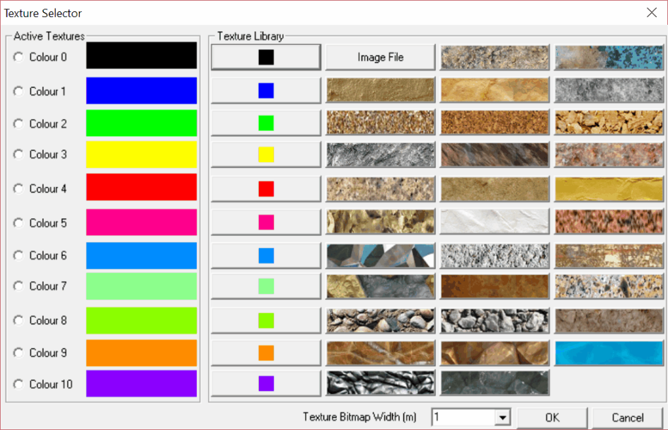

## 5.2.6.1 Block Outlines

设置模型的渲染选项。

View > Render > Block Outlines - 块体以显示其边缘的轮廓绘制。

View > Render > Grid Lines - 块体以规则网格间隔的线条绘制。激活此功能时会提示您输入网格间隔。

View > Render > Block Colours - 块体以颜色着色绘制。关闭此功能可获得线框视图。

View > Render > Material Numbers - 块体根据块体中所含的材料属性着色。同一块体在不同的当前开采步骤下可能包含不同的材料。

使用此功能时，请确保选择合适的开采步骤

#### File > Mining Step

View > Render > Mining Step Numbers - 块体根据其被开挖的开采步骤着色。

View > Render > Dark Shading - 块体使用暗色光源着色模型绘制。激活此功能时会提示您输入边缘半径。边缘半径用于对边和角着色，使其呈现圆润外观。边缘半径应指定为块体厚度的一个分数。着色可能会显著降低刷新速度。

View > Render > Bright Shading - 块体使用亮色光源着色模型绘制。激活此功能时会提示您输入边缘半径。边缘半径用于对边和角着色，使其呈现圆润外观。边缘半径应指定为块体厚度的一个分数。着色可能会显著降低刷新速度。

View > Render > Texture Rendering - 开启/关闭纹理渲染。纹理渲染允许您用位图图像代替纯色来为表面着色。参见 Assign Bock Textures

View > Render > Block Numbers - 块体表面上绘制编号。这些编号对应当前选定的渲染模式：Block Colours、Material Numbers 或 Mining Step Numbers。

View > Render > Block Names - 块体表面上绘制块体名称。

View > Render > Coordinate Numbers - 块体表面上绘制块体名称。

View > Render > Backfacing Surfaces - 激活后，将绘制 3D FF 块体的背面表面。一般情况下，用户不需要也不希望看到这些表面。

View > Render > Fixed With Spacing - 激活后，具有指定固定宽度离散化的表面将在渲染时显示其离散化。

View > Render > Discretize - 切换模型的离散化与非离散化视图的显示。View > Render > Perspective - 切换透视或正交视图的显示。在正交模式下，所有尺寸均按真实比例绘制。在透视视图中，离观察者较远的实体绘制得较小。

View > Render > Clines Dot Radius - 指定在构造线所有角点处绘制的圆点半径。这会显著降低绘图速度，仅在需要时使用。值为零表示不绘制圆点。

View > Render > Point Size - 指定在选择期间在所有角点处绘制的圆点半径。

View > Render > Line Width - 指定块体轮廓和等值线的宽度。

## 5.2.6.9 Assign Block Textures

纹理渲染允许您用位图图像代替纯色来为表面着色。为此，请执行以下操作：

1. 选择要为其指定纹理的颜色编号（例如 Colour 0、Colour 1 ...）

2. 选择预定义的位图之一，或使用 "Image File" 选择您自己的位图。

3. 为了将位图图像映射到每个表面上，必须指定 "Texture Bitmap With"。"Texture Bitmap With" 会缩放指定的位图，使图案按指定的几何宽度重复。

例如，如果指定宽度为 1m，则位图将被缩放，使其在块体表面上以 1m 的宽度绘制。

## 5.2.6.10 Small Block Numbers

设置模型的渲染选项。

View > Render > Block Outlines - 块体以显示其边缘的轮廓绘制。

View > Render > Grid Lines - 块体以规则网格间隔的线条绘制。激活此功能时会提示您输入网格间隔。

View > Render > Block Colours - 块体以颜色着色绘制。关闭此功能可获得线框视图。

View > Render > Material Numbers - 块体根据块体中所含的材料属性着色。同一块体在不同的当前开采步骤下可能包含不同的材料。

使用此功能时，请确保选择合适的开采步骤

#### File > Mining Step

View > Render > Mining Step Numbers - 块体根据其被开挖的开采步骤着色。

View > Render > Dark Shading - 块体使用暗色光源着色模型绘制。激活此功能时会提示您输入边缘半径。边缘半径用于对边和角着色，使其呈现圆润外观。边缘半径应指定为块体厚度的一个分数。着色可能会显著降低刷新速度。

View > Render > Bright Shading - 块体使用亮色光源着色模型绘制。激活此功能时会提示您输入边缘半径。边缘半径用于对边和角着色，使其呈现圆润外观。边缘半径应指定为块体厚度的一个分数。着色可能会显著降低刷新速度。

View > Render > Texture Rendering - 开启/关闭纹理渲染。纹理渲染允许您用位图图像代替纯色来为表面着色。参见 Assign Bock Textures

View > Render > Block Numbers - 块体表面上绘制编号。这些编号对应当前选定的渲染模式：Block Colours、Material Numbers 或 Mining Step Numbers。

View > Render > Block Names - 块体表面上绘制块体名称。

View > Render > Coordinate Numbers - 块体表面上绘制块体名称。

View > Render > Backfacing Surfaces - 激活后，将绘制 3D FF 块体的背面表面。一般情况下，用户不需要也不希望看到这些表面。

View > Render > Fixed With Spacing - 激活后，具有指定固定宽度离散化的表面将在渲染时显示其离散化。

View > Render > Discretize - 切换模型的离散化与非离散化视图的显示。View > Render > Perspective - 切换透视或正交视图的显示。在正交模式下，所有尺寸均按真实比例绘制。在透视视图中，离观察者较远的实体绘制得较小。

View > Render > Clines Dot Radius - 指定在构造线所有角点处绘制的圆点半径。这会显著降低绘图速度，仅在需要时使用。值为零表示不绘制圆点。

View > Render > Point Size - 指定在选择期间在所有角点处绘制的圆点半径。

View > Render > Line Width - 指定块体轮廓和等值线的宽度。
