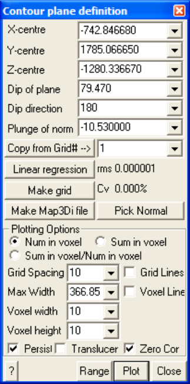
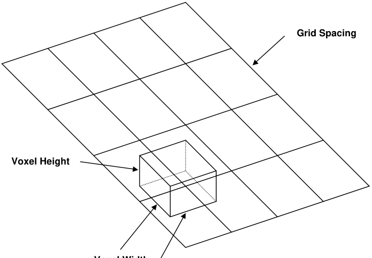
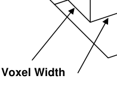

用于设置对可视化点数据绘制等值线时所用的平面（参见 Visualization）。

**X-centre** – 等值线平面中心的 x 坐标值。

**Y-centre** – 等值线平面中心的 y 坐标值。**Z-centre** – 等值线平面中心的 z 坐标值。**Dip of plane** – 等值线平面的倾角。

**Dip direction** – 等值线平面的倾向。

**Dip of normal** – 等值线平面法线的倾角（该值与平面倾角相差 90°）。

**Pick Normal** - 激活光标，以便交互式选择一个表面。等值线平面的中心、倾角和倾向将被设置为与所选表面平行。

**Copy from Grid#** – 从模型网格平面复制位置和方向参数。**Linear regression** – 通过使所有点到平面的法向距离最小，求出穿过地震数据的最佳拟合平面。

**Make Grid** – 根据等值线平面创建模型网格平面。

**Make Map3Di file** – 根据等值线数据生成数据文件，用于 **Map3Di** 分析中的地震加载（详见下文）。

#### Contour Plane Options:

**Num in voxel** – 对每个体素内的点数绘制等值线。**Sum in voxel** – 对体素内所有点的绘图方程值之和绘制等值线。

**Sum/Num in voxel** – 对两个值的商绘制等值线。

- **Grid spacing** – 用于对地震数据绘制等值线的网格间距。由于体素以每个网格角点为中心，该参数控制体素的密度。请注意，如果网格间距小于体素宽度，相邻体素将会重叠。

**Voxel width** – 体素宽度沿平行于网格平面边缘的方向测量。

**Voxel height** – 体素高度沿垂直于网格平面的方向测量。这使用户可以

限制与网格平面的距离，只有在该距离内的数据才会纳入等值线绘制。

**Outlines** – 绘制实际的体素轮廓。

- **Persist** – 选中后，每次对模型进行重新定向、平移或缩放时都会重新绘制这些点。由于这对大型模型可能很耗时，因此并非总是需要此选项。

**Translucent** - 将点绘制为半透明球体。

**Zero Contour** - 取消选中时，不绘制低于等值线范围最小值的等值线。当仅关注等值线范围的上部时，

这对显示等值线很有用。**Range** – 指定半径缩放和等值线的最小值、最大值和间隔。

- Plot 重新生成绘图。此按钮可以放置在视图工具栏（Tools >

- View Toolbar Configure）或等值线工具栏（Tools > Contour Toolbar Configure）上。

#### Linear Regression:

线性回归通过寻找 **_rms_** 值（均方根值，即所有点到拟合平面的平均距离）最小的平面来进行。

对于这种情况，标准的相关系数理论不适合作为拟合优度的度量。这是因为我们关心的不是"变量之间关联程度的度量"，而是拟合平面对数据的代表程度。请注意，如果所有数据都位于同一个水平面上，则平面拟合是完美的。但根据定义，其相关性为零

（因此相关系数等于零），因为 z 值不依赖于 x 或 y 值。这并不是我们想要的。

这里定义了一个类似于变异系数（变异性除以量值的度量）的参数。**_Cv_** 简单定义为 **_rms_** 值（所有点到拟合平面的平均距离）除以所有点到质心的平均距离。它衡量平面对数据的代表程度。该比值通常以百分比表示。按此定义，随机数据得到 **Cv** =100%（100% 的变异性）。完美拟合得到 **_Cv_** =0（0% 的变异性）。请注意，**_Cv_** 有可能超过 100%。可以把该参数看作平面周围的变异性与数据集物理宽度之比。

这与变异系数的正式定义（标准差除以平均值）非常相似。大多数地质材料的性质 **_Cv_** 在 20% 到 30% 左右。可以使用

**_r_ = (1-** **_Cv_ ²)****½**

将 **_Cv_** 转换为等效的相关系数，但这并不是真正正确的参数，并且当 **_Cv_** 超过 1 时存在定义上的问题。

每当绘制数据时，都会显示当前平面的 **rms** 和 **_Cv_**。

#### Make Map3Di file:

为了生成 Map3Di 加载文件，必须确定地震活动所指示的剪切位移（ride）分布。这需要若干假设（参见 A. McGarr, "Some Applications of Seismic Source Mechanism Studies to Assessing Underground Hazard", Proc. 1st International Symposium on Rockbursts and Seismicity in Mines, SAIMM, Johannesburg, 1984, pp. 199-208，以及 Hoffman, G, R. Sewjee and G. van Aswegan, "First steps in the integration of numerical modelling and seismic monitoring", 5th International Symposium on Rockburst and Seismicity in Mines, SAIMM, Johannesburg, 2000, pp. 397-404.），概述如下：

1) 假设一个滑动模型。这里可以考虑椭圆裂纹模型（Brune）或因蠕变而具有软边缘的凹凸体模型（Walsh, J.J. and J. Waterson, "Distribution of cumulative displacements and seismic slip on a single normal fault surface", J. Struct. Geol., V. 9, 1987, pp. 1039-1046）。除非用户有办法定义其他形状，否则通常采用圆形（硬币形）。

2) 平均滑动量可由地震矩 **_Mo_ =** m **_AD_** 确定，其中 m 为刚度模量，**_A_** 为震源面积（由震源半径确定），**_D_** 为断层上的平均滑动量。它也可以由"地震应变降"（Seismic Strain Drop）确定。

3) 滑动面半径可根据 Brune 半径估算，其中 b 为剪切波速度，**_fo_** 为拐角频率。对于凹凸体模型，半径 **_a_ = 2.34** b **/(2** p **_fo_ )**，其中 b 由"视体积"（Apparent Volume）的半径确定，可能更合适。

4) 滑动方向可由地震矩张量（如有）确定，或由建模得到的应力状态确定。

根据这 4 项即可确定地震事件所指示的滑动剖面。

对于椭圆剖面，剪切位移（ride）分布为

**1.50** **_D_ (1-** **_r_ ²/** **_a_ ²)****½**

对于凹凸体剖面，剪切位移（ride）分布为

#### 2.89 _D_ (1- _r_ / _a_ )(1+2 _r_ / _a_ -3 _r_ ²/ _a_ ²)½

可按如下方式生成 Map3Di 的地震加载文件：

- 1) 将地震数据文件构造为一系列点：

**x1 y1 z1 f1 f2 … x2 y2 z2 f1 f2 … x3 y3 z3 f1 f2 … ...**

其中 **xi yi zi** 表示每个点的坐标，

**f1** 表示平均滑动量 **_D_**，**f2** 表示震源半径 **_a_** 。

- 2) 在 Visualization 功能中，对于椭圆剖面，将绘图方程指定为

   - **1.50*f1*sqrt(1-rip^2/f2^2)**

对于凹凸体剖面，使用

#### 2.89*f1*(1-rip/f2)*sqrt(1+2*rip/f2-3*rip^2/f2^2)

3) 选择所需的平面和网格间距，设置所需的体素高度和宽度。体素高度可用于剔除平面外的事件。务必将体素宽度选为等于所需的最大事件半径，以便将剪切位移（ride）分布到所有受影响的体素上。

- 4) 将绘图选项设为 "Sum in Voxel" 并执行 Plot。

- 5) Make Map3Di file。

- 6) 使用 CAD > Properties > Map3Di Setup 查看 Map3Di 文件，并查看 f2 参数。

有关数据格式的详细信息，请参阅 **CAD > Properties > Map3Di**。
