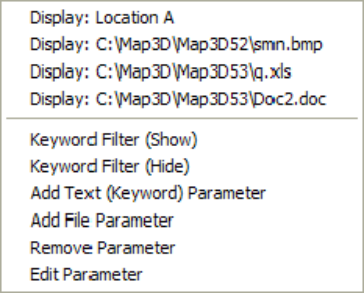

此功能可用于显示包含品位、岩体质量等有用地质信息的数据库。

每个点都可以标记一系列：

- 数值（例如颜色、大小、方向等）

- 关键字

- 文本消息

- 文件名（例如图形文件、文档、电子表格等）

要激活此功能，请在可视化数据点上单击右键（参见 Visualization）。

如果没有可视化点，可以使用 Make Point 创建一个新点。

单击右键后会弹出一个包含以下选项的菜单：

此菜单上部的 "Display" 项是附加到数据点的数据（分别为文本字符串、位图、电子表格和文档）。选择其中任一项即可显示该项内容。

菜单下部的项是访问数据库的功能：

- **Keyword Filter (Show)** – 用于指定一系列显示关键字过滤器。只有关联了其中某个关键字的点数据才可见，其余均被隐藏。这样可以过滤显示所需的数据库条目。

- **Keyword Filter (Hide)** – 用于指定一系列隐藏关键字过滤器。关联了其中某个关键字的点数据将被隐藏，其余均可见。这样可以过滤掉不需要的数据库条目。

- **Add Text (Keyword) Parameter** - 用于向数据点添加文本字符串。该文本用于关键字过滤，并将添加到显示列表中。

- **Add File Parameter** - 用于向数据点添加文件参数。文件名用于关键字过滤，该文件将添加到显示列表中。此处可以指定任何文件名（例如图形文件、电子表格文件、文档文件等）。如果该文件类型已关联应用程序，则会自动启动该应用程序来显示指定文件。

**Remove Parameter** - 用于从数据点中删除参数。

**Edit Parameter** - 用于编辑或修改参数。
