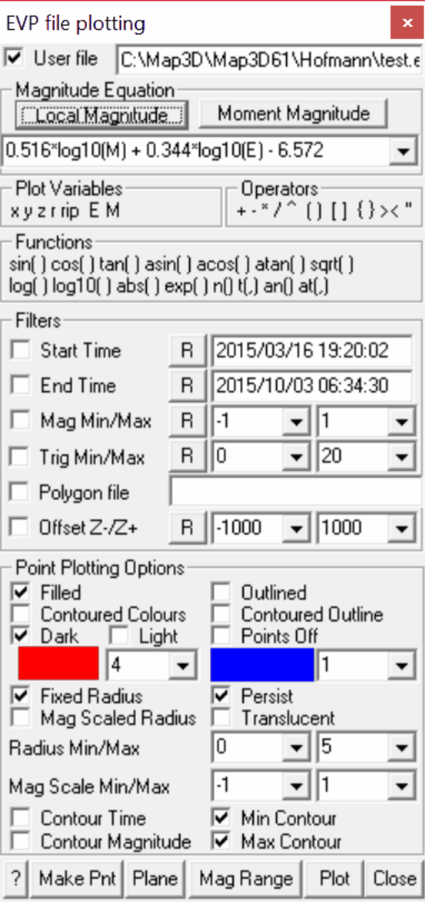

此选项可对 EVP 文件格式（来自 IMS 微震系统）的点数据进行可视化。点可以显示为带光源阴影的球体，其直径和/或颜色随震级（量值）变化，也可以在平面上绘制等值线以显示密度等。

Map3D 还支持文本格式文件的可视化。

每个点都可以标记一系列：

- 数值（例如颜色、大小、方向等）

- 文本消息

- 文件名（例如图形文件、文档、电子表格等）

左键单击某个点时，其位置、量值和文本消息会显示在状态栏上。

右键单击某个点会激活可视化数据库（Visual Database）。此功能可用于显示包含品位、岩体质量等有用地质信息的数据库。每个点都可以标记一系列：

- 数值（例如颜色、大小、方向等）

- 文本消息

- 文件名（例如图形文件、文档、电子表格等）

#### Event File:

事件文件为 *.EVP 文件格式。

EVP 事件文件由 IMS 微震系统生成。

地震数据按以下方式存储为一系列点：

**date time le x1 y1 z1 M  E Mp Ep Ms Es trigs... "text message" "file name"... date time le x2 y2 z2 M  E Mp Ep Ms Es trigs... "text message" "file name"... date time le x3 y3 z3 M  E Mp Ep Ms Es trigs... "text message" "file name"...**

其中 **xi yi zi** 表示每个点的坐标，

**M** 表示地震矩，**E** 表示辐射能量，**trigs** 表示触发数，

**text message** 表示可选的一系列文本字符串，必须用双引号括起来。**file name** 表示可选的一系列文件名，必须用双引号括起来。

- 用鼠标左键选取事件时，文本消息和文件名会显示在屏幕底部的状态栏中。

- 用鼠标右键选取事件也可以对其进行编辑。

- 如果文件名已与某个应用程序关联，用鼠标右键选取还可以显示该文件（请参阅 Windows 文档中关于如何"将文件与程序关联"的说明）。

#### 将多个文件合并到一个数据库

您可以按住 Windows 标准的 "shift" 或 "ctrl" 键同时选择多个文件。

这些文件将合并到一个数据库中。

这样，您可以将可视化数据的不同部分保存在不同文件中，然后轻松地将它们合并到一个数据库中。

#### Magnitude Equation:

定义要绘制的参数，例如 **(0.516*log10(M) + 0.344*log10(E) - 6.572**

下拉窗口最多可存储 20 个不同的方程。这些方程会在 Map3D 各次会话之间保存在 map3d.ini 文件中。

#### Plot Variables:

**E M** 事件文件中的数据字段。

#### Functions:

**sin() cos() tan()** 正弦、余弦和正切三角函数 **asin() acos() atan()** 反三角函数 **sqrt()** 平方根函数

**log()** 自然对数函数 **log10()** 以 10 为底的对数函数 **abs()** 绝对值 **exp()** 指数函数（反对数） **n() t(,)** 正态分布和 t 分布 **an() at(,)** 反正态分布和反 t 分布

#### Location:

**x y z** 网格点坐标。

#### Operators:

- **+ - * /** ^   加、减、乘、除和乘方运算符。请注意，先计算乘方，然后计算乘法和除法，最后计算加法和减法。

- **() [] &#123;&#125;** 括号类型。括号必须成对匹配。

- 最大值。例如，如果绘图方程指定为 f1 > 10，则将绘制 f1 和 10 中较大的值。

- **&lt;** 最小值。例如，如果绘图方程指定为 f1 &lt; 10，则将绘制 f1 和 10 中较小的值。

#### Filters:

**Start/End Time** – 日期/时间过滤器的下限和上限。**Mag Min/Max** – 震级过滤器的下限和上限。**Trig Min/Max** – 触发数过滤器的下限和上限。

**Polygon File** – 包含多边形过滤器的文件名。该文件必须为 *.pnt 文件格式。为便于创建此文件，**Plane** 功能允许您将 UDCS（用户定义坐标系）设置为最佳拟合平面。

**Offset Z-/Z+** – 与多边形过滤器相比 Z 向偏移量的下限和上限。

#### Point Plotting Options:

**Filled** – 点以指定颜色、等值线颜色和/或阴影填充。**Contoured Colours** – 填充颜色根据由 **Plot Equation** 确定的量值进行调整。

- **Dark** – 填充颜色加阴影，呈现为带光源阴影的球体，使用深沉浓郁的配色方案。

- **Light** – 填充颜色加阴影，呈现为带光源阴影的球体，使用明亮光泽的配色方案。

**Outlined** – 点以指定颜色或等值线颜色描边。

**Contoured Outline** – 点以等值线颜色绘制，颜色根据由 **Plot Equation** 确定的量值进行调整。

**Contour Plane** – 启用或禁用等值线平面的显示（参见 **Plane** ）。

**Fixed Radius** – 点将绘制为球体，其半径为指定的 **Radius:** 参数。

**Magnitude Scaled Radius** – 点将绘制为球体，其半径按量值（由 **Magnitude Equation** 确定）缩放：如果量值小于等值线范围的最小值，则球体按 **Radius:** 参数指定的最小半径绘制；如果量值超过等值线范围的最大值，则按 **Radius:** 参数指定的最大半径绘制。

#### Other:

- **Persist** – 选中后，每次对模型进行重新定向、平移或缩放时都会重新绘制这些点。由于这对大型模型可能很耗时，因此并非总是需要此选项。

**Translucent** - 将点绘制为半透明球体。

**Min Contour** - 取消选中时，不绘制低于等值线范围最小值的等值线。当仅关注等值线范围的上部时，这对显示等值线很有用。

**Max Contour** - 取消选中时，不绘制高于等值线范围最大值的等值线。当仅关注等值线范围的下部时，

这对显示等值线很有用。**Make Point** - 添加新点。

**Plane** – 用于设置等值线平面。

**Range** – 指定半径缩放和等值线的最小值、最大值和间隔。

Plot 重新生成绘图。此按钮可以放置在视图工具栏（Tools > View Toolbar Configure）或等值线工具栏（Tools > Contour Toolbar Configure）上。
