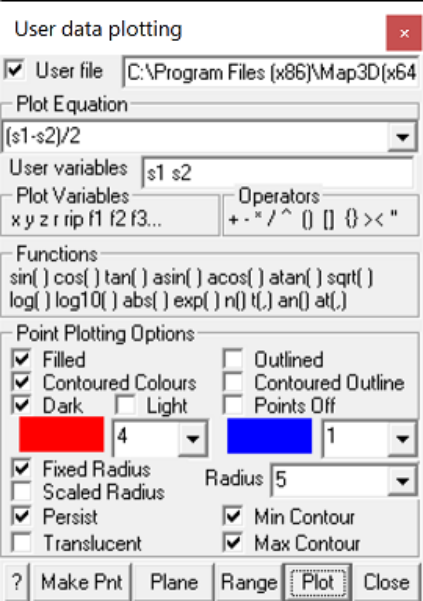

此选项可对文本文件格式的点数据进行可视化。点可以显示为带光源阴影的球体，其直径和/或颜色随震级（量值）变化，也可以在平面上绘制等值线以显示密度等。

Map3D 还支持 EVP 格式文件的可视化。

每个点都可以标记一系列：

- 数值（例如颜色、大小、方向等）

- 文本消息

- 文件名（例如图形文件、文档、电子表格等）

左键单击某个点时，其位置、量值和文本消息会显示在状态栏上。

右键单击某个点会激活可视化数据库（Visual Database）。此功能可用于显示包含品位、岩体质量等有用地质信息的数据库。每个点都可以标记一系列：

- 数值（例如颜色、大小、方向等）

- 文本消息

- 文件名（例如图形文件、文档、电子表格等）

#### Event File:

事件文件就是一个文本文件（*.txt）。

该格式便于与其他 CAD 软件交换原始模型数据。

注释行必须以星号 "*" 或井号 "#" 开头。

地震数据按以下方式存储为一系列点：

**x1 y1 z1 f1 f2 f3 … "text message" "file name"... x2 y2 z2 f1 f2 f3 … "text message" "file name"... x3 y3 z3 f1 f2 f3 … "text message" "file name"...**

其中 **xi yi zi** 表示每个点的坐标，

**f1 f2 f3…** 表示可选的一系列数值（例如颜色、大小、方向等），**text message** 表示可选的一系列文本字符串，必须用双引号括起来。**file name** 表示可选的一系列文件名，必须用双引号括起来。

- 用鼠标左键选取事件时，文本消息和文件名会显示在屏幕底部的状态栏中。

- 用鼠标右键选取事件也可以对其进行编辑。

- 如果文件名已与某个应用程序关联，用鼠标右键选取还可以显示该文件（请参阅 Windows 文档中关于如何"将文件与程序关联"的说明）。

#### 将多个文件合并到一个数据库

您可以按住 Windows 标准的 "shift" 或 "ctrl" 键同时选择多个文件。

这些文件将合并到一个数据库中。

这样，您可以将可视化数据的不同部分保存在不同文件中，然后轻松地将它们合并到一个数据库中。

#### Plot Equation:

定义要绘制的参数，例如 **(f1-f2)/2** 或等价的 **(sig1-sig3)/2**

- 下拉窗口最多可存储 20 个不同的方程。这些方程会在 Map3D 各次会话之间保存在 map3d.ini 文件中。

#### Plot Variables:

**f1 f2 f3…** 事件文件中的数据字段。

可以定义用户自定义变量（例如 **sig1 sig3 …** ），用于表示与 **f1 f2 f3…** 对应的列标题。

这些变量可以在注释行中定义，即任何以 "*" 或 "#" 开头的行 **。** 只需按如下方式提供用户自定义的绘图变量，例如：

*** x y z sig1 sig2 ...**

#### Functions:

**sin() cos() tan()** 正弦、余弦和正切三角函数 **asin() acos() atan()** 反三角函数 **sqrt()** 平方根函数 **log()** 自然对数函数 **log10()** 以 10 为底的对数函数 **abs()** 绝对值 **exp()** 指数函数（反对数） **n() t(,)** 正态分布和 t 分布 **an() at(,)** 反正态分布和反 t 分布

#### Location:

**x y z** 网格点坐标。

#### Operators:

- **+ - * /** ^   加、减、乘、除和乘方运算符。请注意，先计算乘方，然后计算乘法和除法，最后计算加法和减法。

- **() [] &#123;&#125;** 括号类型。括号必须成对匹配。

- 最大值。例如，如果绘图方程指定为 f1 > 10，则将绘制 f1 和 10 中较大的值。

- **&lt;** 最小值。例如，如果绘图方程指定为 f1 &lt; 10，则将绘制 f1 和 10 中较小的值。

#### Point Plotting Options:

**Filled** – 点以指定颜色、等值线颜色和/或阴影填充。

**Contoured Colours** – 填充颜色根据由 **Plot Equation** 确定的量值进行调整。

**Dark** – 填充颜色加阴影，呈现为带光源阴影的球体，使用深沉浓郁的配色方案。

**Light** – 填充颜色加阴影，呈现为带光源阴影的球体，使用明亮光泽的配色方案。

**Outlined** – 点以指定颜色或等值线颜色描边。

**Contoured Outline** – 点以等值线颜色绘制，颜色根据由 **Plot Equation** 确定的量值进行调整。

**Contour Plane** – 启用或禁用等值线平面的显示（参见 **Plane** ）。

**Fixed Radius** – 点将绘制为球体，其半径为指定的 **Radius:** 参数。

**Scaled Radius** – 点将绘制为球体，其半径按量值（由

**Plot Equation** 确定）缩放：如果量值小于等值线范围的最小值，则球体半径为零；如果量值等于等值线范围的最大值，则按 **Radius:** 参数指定的半径绘制。

#### Other:

**Persist** – 选中后，每次对模型进行重新定向、平移或缩放时都会重新绘制这些点。由于这对大型模型可能很耗时，因此并非总是需要此选项。

**Translucent** - 将点绘制为半透明球体。

**Zero Contour** - 取消选中时，不绘制低于等值线范围最小值的等值线。当仅关注等值线范围的上部时，

这对显示等值线很有用。

**Make Point** - 添加新点。

**Plane** – 用于设置等值线平面。

**Range** – 指定半径缩放和等值线的最小值、最大值和间隔。

Plot 重新生成绘图。此按钮可以放置在视图工具栏（Tools > View Toolbar Configure）或等值线工具栏（Tools > Contour Toolbar Configure）上。
