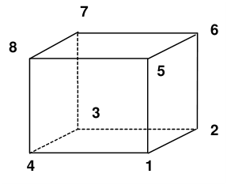
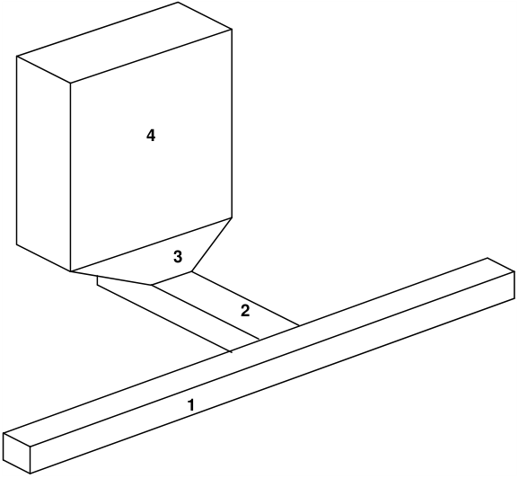

对于许多问题，开挖面的精确形状细节并不重要，因为人们关注的是更宏观的稳定性评估，例如矿柱、拱座或上盘的状况。由于描述每个表面的位置和连接关系非常繁琐，因此在 Map3D 中也可以用三维积木式块体来组装模型。

CAD > Build > Block

CAD > Build > DD Loop CAD > Build > FF Loop

#### CAD > Build > Tunnel

这些块体用于构建三维开挖体、替代材料区和充填区。每个块体由顶面和底面定义，各有 4 个角点。角点可以按顺时针或逆时针方向输入，只要顶面和底面彼此对齐即可（即角点 5 必须与角点 1 相对，角点 2 与角点 6 相对，依此类推）。各侧面既不必平行，也不必为平面，并且可以重复任一角点来定义三边形体和楔形体。

这些块体可以堆叠在一起，构成复杂的开挖形体或矿带边界。它们通过共享角点或相互相交而连接在一起。为多个块体所共有或穿入其他块体的侧面会被自动截断并删除。块体结构所包围的体积定义了开挖体、矿带、屈服区、充填区等。

为说明这一点，考虑一个由 4 个块体组装而成的简单放矿点布置。块体 1 代表出矿巷道，块体 2 代表横巷，块体 3 代表放矿点，块体 4 代表采场。Map3D 的前处理器会识别这些块体之间的连接关系，对其进行截断，并删除相邻块体的公共表面。
