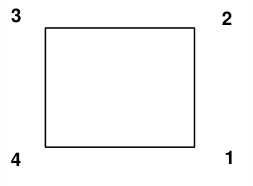
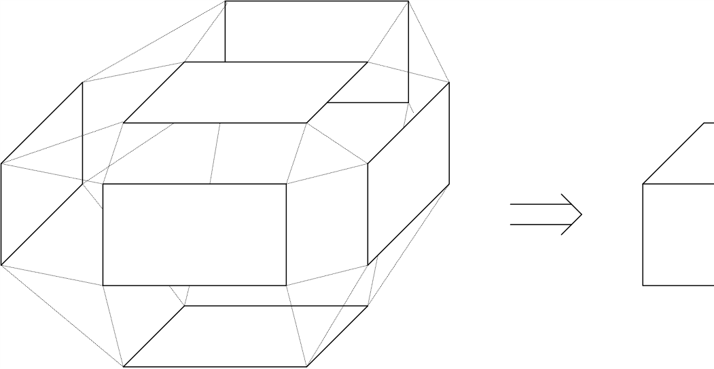
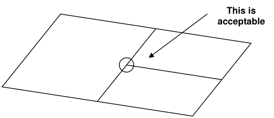

模型可以由单个表面片构建而成。

CAD > Build > Block

#### CAD > Build > DD Loop

表面片由三边形或四边形多边形定义，这些多边形不必是平面。角点可以按顺时针或逆时针方向输入，并且可以重复任一角点来定义三边形体和楔形体。

如有需要，表面片也可用于构建开挖面和复杂的矿体轮廓。

#### CAD > Build > FF Loop

程序可以帮助您轻松构建复杂的竣工布局。该程序的工作原理是沿多个中段平面图或剖面进行追踪，然后自动将它们连接起来。

这通常是最佳方法，尤其是在构建形状精确已知的结构的竣工模型时。对于许多以应力集中和局部失稳评估为主要关注点的土木类结构，这种方法适用于非常详细的分析。

这些形体可以使用 Map3D 内置的 CAD 功能构建，也可以从其他 CAD 软件中以下列格式之一导入：

- AutoCAD-DXF 格式。这是一种常用的图形交换文件，扩展名为".DXF"。

- 点文件格式是一种通用的 ASCII 数据文件，扩展名为".PNT"。

即使是简单的形体，这种构建过程也可能很快变得难以控制。由于必须创建一系列表面片，使其组合在一起形成无缝、无重叠的连续外壳，因此不能留下任何缝隙或孔洞。

以这种方式构建模型时，Map3D 会检查是否形成了封闭表面

#### Analysis > Options > Closure

此外，所有表面都将按一致的方式重新编号，以确保它们构成正体积

#### Analysis > Options > Renumber

如果表面未封闭，即开挖体因缺少部分而存在孔洞，则重新编号可能会失败。

与其他分析程序（等参边界元法以及有限元法或有限差分法）不同，这些板片不必共享公共角点。只要不存在缝隙，用户可以自由定义在边的中间位置有细分的单元。虽然可以使用这种表面建模技术构建模型，但更简单、更可靠的技术是使用实体建模

用块体构建模型
