本节介绍几种常见的构建错误，并就如何避免和纠正这些问题提出建议。

#### 将横巷连接到直巷道

在此示例中，只需将横巷的角点捕捉到通道巷道的边缘，即可轻松构建横巷。应使用"最近边"捕捉模式选择所示的点

#### CAD > Snap > Nearest Edge

Map3D 内置的布尔求交功能将在分析的第 2 阶段自动创建两个块体之间的交线。这种构建方式可以正常工作。

虽然对于简单的几何形状这种方式效果很好，但在许多情况下，连接并不这么简单。

我们来看一个更复杂的几何形状：下盘通道巷道的各段与所需的横巷位置并不对齐。

#### 将横巷连接到复杂巷道

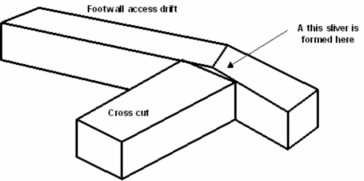

在此示例中，横巷没有正确连接到下盘通道巷道，在横巷末端形成了一个薄矿柱。Map3D 会检测到这个矿柱并尝试对其进行分析，但很可能不会成功。正如这一构造在现实中会在物理上失稳一样，它在数值上也是不稳定的。实际上，只有当矿柱的相邻面使用与矿柱厚度相近尺寸的边界单元进行离散时，Map3D 才能成功分析这一构造。然而，这并不是理想的做法，因为它需要大量单元，而且这个矿柱实际上并不存在。

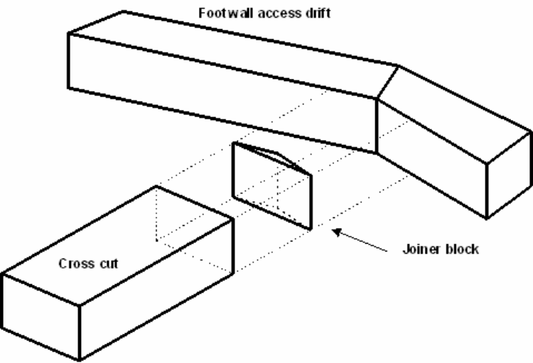

为避免这一问题，可以构建一个附加的连接块体，如旁边的分解视图所示。应使用"最近角点"捕捉模式，使这个新块体与巷道和横巷正确连接。这个连接块体实际上采出了不需要的矿柱，从而将横巷正确连接到下盘通道巷道。

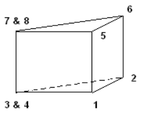

请注意，连接块体的顶面和底面都只有三个点。在同一位置两次选择其中一个角点即可轻松构建（例如点 3 和 4，以及点 7 和 8）。

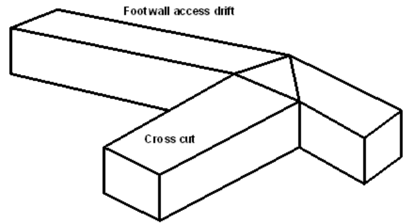

如果在构建下盘通道巷道时使其各段与所需的横巷位置对齐，就可以完全避免这一问题。只需按图所示细分下盘通道巷道即可轻松实现。事先稍加考虑，往往有助于降低构建难度。

#### 连接不匹配的采场块体

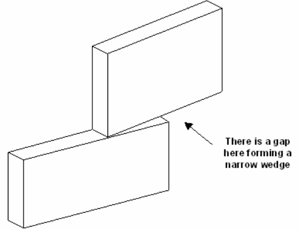

经常会遇到需要沿公共边连接多个采场块体的情况。

在此示例中，如果上部块体的底面与下部块体的顶面处于同一标高，Map3D 内置的布尔求交功能将在分析的第 2 阶段自动创建两个块体之间的交线。这种构建方式可以正常工作。

问题出现在构建过程中：当试图将一个块体的角点捕捉到另一个块体的侧面时。在此示例中，上部块体被捕捉到下部块体的上边缘，从而留下了缝隙。

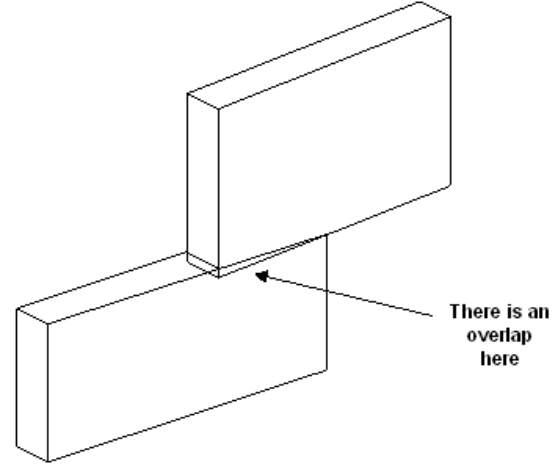

为了消除这一缝隙，可以使用拉伸功能将下部块体的角点捕捉到上部块体的下边缘。但这样会造成重叠，因此并不能解决问题。

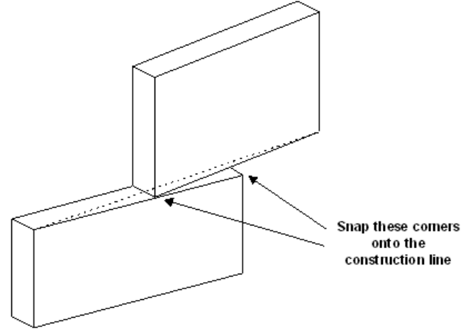

另一种方法是按上述方式创建连接块体。不过，更简单的方法是创建跨越问题区域的构造线，并将上部和下部块体的角点捕捉到这些线上。需要对采场块体的后表面和前表面都执行此操作。

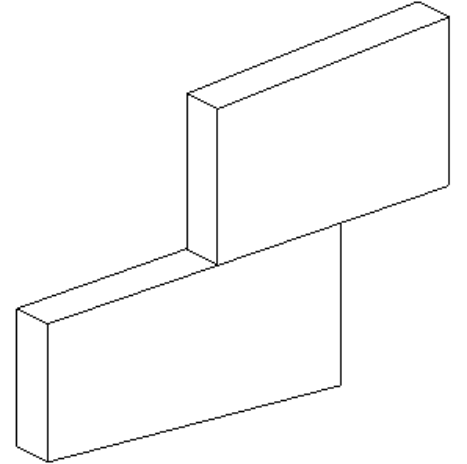

这种方法的缺点是会改变采场块体的形状，而且可能是以不理想的方式改变。

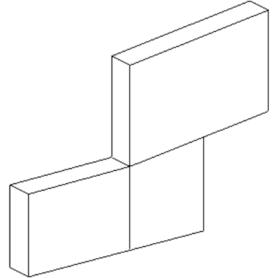

最好的方法可能是细分其中一个或两个采场块体。这是消除缝隙和连接不匹配块体最有效的技术。

#### 连接错位的采场块体

经常会遇到一个采场块体的形状与相邻采场块体不匹配的情况。

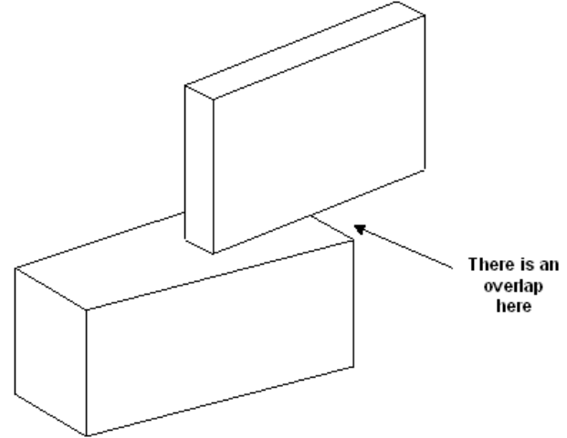

Map3D 内置的布尔求交功能可以轻松处理这种情况。程序将在分析的第 2 阶段自动创建两个块体之间的交线。

如果上部块体底面上的所有点与下部块体顶面上的所有点都处于同一标高，这些程序的效果最好。可以使用以下命令实现

#### CAD > Edit > Move Vertices to Z

即使上部块体的底面和下部块体的顶面不是平面且处于不同标高，只要它们确实相交，这些程序也能正常工作。但在后一种情况下，所得交线可能包含许多复杂单元。虽然这些形体可以正常工作，但由于数量多且往往需要密集离散，可能会减慢分析速度。

#### 将巷道连接到采场块体

经常会遇到需要将巷道与采场块体相交的情况。

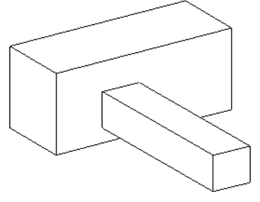

与上述情况一样，Map3D 内置的布尔求交功能可以轻松处理这种情况。程序将在分析的第 2 阶段自动创建巷道与采场块体之间的交线。

如果相交的面是平面且相互平行，这些程序的效果最好。即使相交的面不是平面也不平行，只要它们确实相交，这些程序也能正常工作。但在后一种情况下，所得交线可能包含许多复杂单元。虽然这些形体可以正常工作，但由于数量多且往往需要密集离散，可能会显著减慢分析速度。
