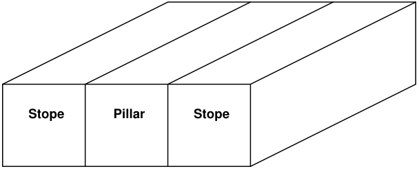
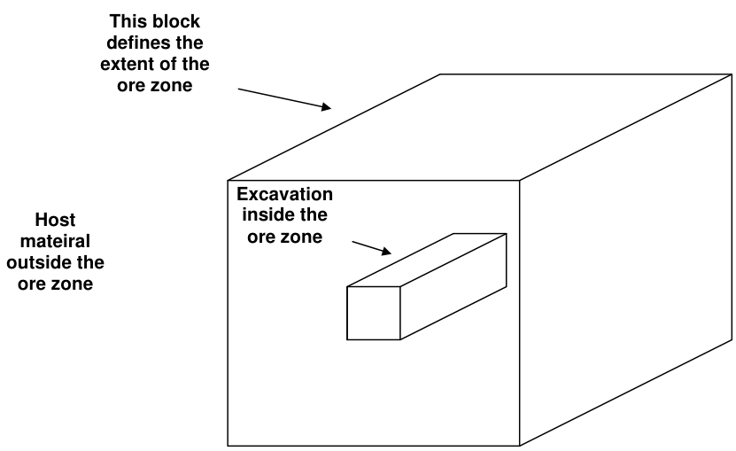
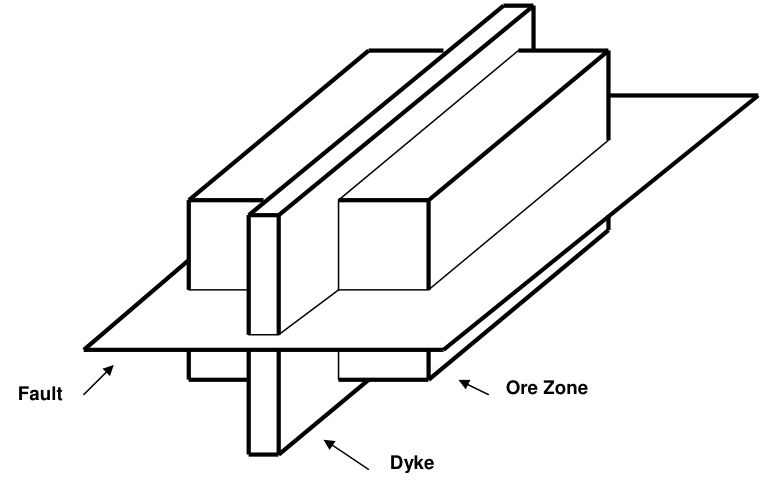

使用多种材料的模型，其构建原理与普通开挖模型类似。不必将块体内部定义为已开挖（即材料代码为零），只需指定块体内部材料的编号即可。

默认情况下，围岩为 1 号材料。任何具有不同性质（初始应力、弹性响应或强度）的区域，都必须像定义开挖体一样，使用虚拟力边界单元进行定义。不必为这些块体指定零材料代码（表示表面应力为零）或负材料代码（表示规定的应力状态），只需指定一个正的材料代码，以表示与各组块体相关联的性质。

如前所述，复杂的开挖形体是将多个具有相同块体编号的块体组合在一起而形成的。完全相同地，具有不同材料性质的各个独立区域，也是由许多具有相同块体编号的块体构成所需形体而形成的。

这里需要注意的一点是，应尽可能少地使用块体编号，因为块体编号不同的各组块体之间的所有表面都会保留在数据库中。

定义需要指定 2 号或更大材料编号（即与围岩不同的材料编号）的区域，有两种方法。

第一种方法是用块体构建具有不同材料编号的区域，这些块体的外观与开挖体完全相同。

这种方法适用于定义细节，例如开挖体周边的低模量区。它也是定义孤立构造（如刚性岩墙或爆破损伤矿柱）的最佳方法。

第二种方法是一种更宏观的方法，即用一组块体将整个开挖系统（或其一部分）包裹起来，这组块体可定义例如矿带。允许包络体之间相互嵌套（就像洋葱皮一样），也允许包络体相互重叠。例如，巷道可以穿过矿带延伸到围岩中。Map3D 会构建所需的交线。

这两种方法可以同时使用。可以使用按第二种方法定义全局区域的块体，这些块体可以完全或仅部分地包裹按第一种方法定义的其他开挖体。

定义多个材料区时，唯一必须严格遵守的是"材料编号越大，优先级越高"这一约定。采用这一约定是为了消除两个不同构造相交时的歧义，例如断层与岩墙相交。当断层与岩墙相交时，并不清楚应假定断层贯穿岩墙，还是岩墙贯穿断层。另一个例子是岩墙与矿带相交：应假定岩墙连续并切穿矿石，还是假定矿石连续并截断岩墙？

无论哪种情况，被赋予较大材料编号的构造都是连续的。如果断层为 4 号材料、岩墙为 3 号材料、矿石为 2 号材料，那么断层将贯穿全部区域。由于断层的材料编号最大，它将连续穿过矿石和岩墙，当然不会穿过开挖体。由于矿石的材料编号最小，它不会切穿岩墙，而是岩墙切穿矿石。

可以使用以下隐藏功能来帮助判断哪种材料切穿其他材料：

#### View > Hide > Solids

#### View > Hide > Unused

程序内置的逻辑支持最多五个构造同时相交（即五个不同块体编号的块体相交）。相交的块体数量不受限制，但在同一位置最多只能有五个块体相交。这样就可以定义例如多层矿带，在接触面两侧都有开挖体，并有一条断层沿接触面延伸。Map3D 会自动检测部分或完全包含在其他块体内的块体，以及与其他块体相邻的块体，从而可以在任何分析中考虑几乎无限数量的不同材料类型区域。

在图形模式下查看开挖几何体时，用户可以将鼠标光标移到关注的块体上。按下鼠标按钮后，将显示块体编号和块体名称，以及分配给该块体的材料代码和与该块体表面相邻或包裹该表面的区域的材料代码。例如，对于与围岩相邻的块体表面，"相邻材料代码"为 1（1 号材料代表围岩岩体）。如果块体表面与一个被指定为材料代码 2 的开挖体相邻，则"相邻材料代码"为 2。

分析过程中，结果在场点网格上生成。Map3D 会自动检测网格点是位于开挖体内部，还是位于具有不同材料性质的区域内。显示等值线结果时，用户可以将鼠标光标移到关注的场点上。按下鼠标按钮后，将显示该场点所在区域的材料代码，以及坐标、位移和应力状态信息。请注意，强度系数将使用为该区域指定的材料性质进行计算。此功能可用于评估各区域之间可能不同的强度。
