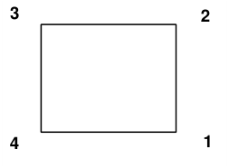
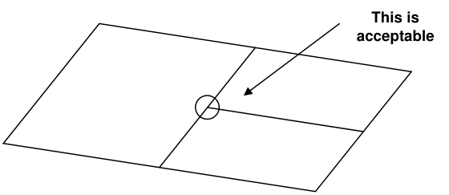
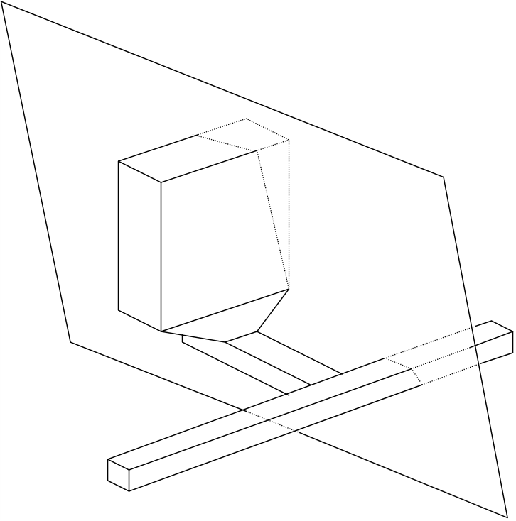
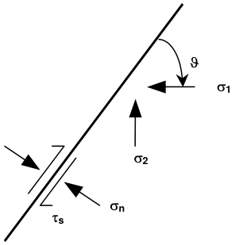

模型可以由单个表面片构建而成。表面片由三边形或四边形多边形定义，这些多边形不必是平面。角点可以按顺时针或逆时针方向输入，并且可以重复任一角点来定义三边形体和楔形体。

#### CAD > Build > DD Loop

这些形体可以使用 Map3D 内置的 CAD 功能构建，也可以从其他 CAD 软件中以下列格式之一导入：

- AutoCAD-DXF 格式。这是一种常用的图形交换文件，扩展名为".DXF"。

- 点文件格式是一种通用的 ASCII 数据文件，扩展名为".PNT"。

与其他分析程序（等参边界元法以及有限元法或有限差分法）不同，这些板片不必共享公共角点。只要不存在缝隙，用户可以自由定义在边的中间位置有细分的单元。

断层面和板状开采的构建原理与普通开挖模型相同。只需将这些构造与其他开挖体和多个材料区一起定义即可，并且可以与 Map3D 的所有其他功能同时使用。

断层面和板状开采区使用位移不连续单元定义，且只能以板片定义的形式指定。板片的四个角点定义了位移不连续的边界范围。由于 Map3D 会在内部构建边缘交线，位移不连续可以在任意位置与开挖体相交。

与上一节一样，定义断层面时唯一必须严格遵守的是"材料编号越大，优先级越高"这一约定。当两个不同构造相交时（例如断层与岩墙相交），被赋予较大材料编号的构造将贯穿另一个构造。

使用非线性模拟时（无论是断层滑移，还是 Map3D Non-Linear 中的广义屈服），必须注意远场应力不应超过强度。如果远场应力超过岩体强度，岩体本身就会失稳。虽然在某些蠕变问题中这可能是允许的，但通常是不可接受的，并且无法获得稳态（即无蠕变）解。

在模拟断层时，这一限制更为严格。任何断层在远场应力状态下都可能处于或非常接近静力平衡（即应力等于强度）。对于处于高应力比下的软弱断层，主应力方向必须几乎垂直或平行于断层面，否则断层将失稳，即使没有开采也会发生滑移。这种情况通常是不可接受的，因为无法获得稳态（即无蠕变）解。

当 s1 与断层面成 J 角时，作用在断层上的剪应力和法向应力为

ts = ( s1 - s2 ) sin(J) cos(J)

sn = s1 sin² (J) +  s2 cos² (J)

将其代入抗剪强度关系式

|ts| = Cohesion + sn tan(j)

可得应力状态必须满足

|( s1 - s2 ) sin(J) cos(J)| = Cohesion + [ s1 sin² (J) +  s2 cos² (J) ] tan(j)

例如，当

s1 = 32 MPa s2 = 16 MPa Cohesion = 0 j = 10°

时，J 必须小于 11° 或介于 69° 和 90° 之间。

当

s1 = 60 MPa s2 = 16 MPa Cohesion = 0 j = 30°

时，J 必须小于 15° 或介于 45° 和 90° 之间。
